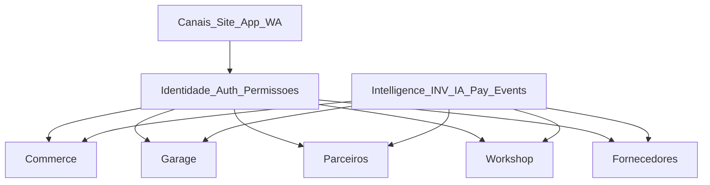

# FAL — Arquitetura 360°

**Versão:** 1.0  
**Data:** 2026-11-16  
**Status:** CANÔNICO  
**PRD:** [FAL_PRD_4.0.md](../entrada/FAL_PRD_4.0.md)  
**Dados:** [FAL_DADOS_FONTES_VERDADE.md](./FAL_DADOS_FONTES_VERDADE.md)  
**Visão:** [FAL_VISAO_ECOSSISTEMA_2040.md](../entrada/FAL_VISAO_ECOSSISTEMA_2040.md)

---

## 1. Princípio estrutural

**Modular monolith primeiro.** Módulos com fronteiras claras, contratos internos e eventos quando necessário. Microsserviços só com critério objetivo (escala, time, falha isolada) — não como meta antecipada.

Stack atual: React + Vite + Supabase (Postgres, Auth, RLS, Edge Functions) + Netlify.

---

## 2. Mapa do ecossistema

| Módulo | Responsabilidade | Estado no MVP |
|--------|------------------|---------------|
| Commerce | Catálogo, preço, estoque, cart, checkout, pedido, frete, pay | Endurecer até G8 |
| Garage | Veículos do cliente + contexto | Seed (`customer_vehicles`) |
| Parceiros | Marketplace serviços | Slot futuro |
| Workshop | Ops oficina | Slot futuro |
| Fornecedores | Portal B2B | Slot futuro |
| Intelligence | INV, notif, roteamento pay, integrações | Parcial (INV + notif + Edges) |

---

## 3. Identidade e organizações

### Hoje (MVP)

- Pessoa: `auth.users` + `profiles` + `customers`  
- Staff: roles (`administrador`, `gerente`, `operador`, `estoque`, `atendimento`)  
- Permissões: RLS + `StaffRoute` + `adminNavAccess`  

### Futuro (preparar conceitualmente)

- Organização (oficina, fornecedor) com membros e papéis  
- Uma pessoa pode ter múltiplos papéis sem cadastros duplicados  
- Compartilhamento autorizado de Garagem (familiar / oficina)  

**Regra:** não criar cinco cadastros da mesma pessoa em cinco módulos.

---

## 4. Veículo: três problemas distintos

| Problema | Dono | Contrato |
|----------|------|----------|
| Identidade canônica | manufacturers → models → vehicle_versions | upsert/leitura mestre |
| Identificação / normalização | INV (`resolveVehicleIdentity`, aliases, placa) | aditivo |
| Fitment peça × versão | PVC | única prova de compatibilidade |

Campos vazios ≠ coringa automático sem regra explícita. Motor: preferir 1.0 / 1.6; detalhar só quando necessário.

---

## 5. Commerce — contratos internos

| Capacidade | Contrato canônico | Proibido |
|------------|-------------------|----------|
| Busca listagem | `searchCatalog` → `search_products` | Segundo motor paralelo |
| Preço | `resolve_product_price(s)` | Confiar só em `products.price` na UI |
| Pedido | `place_order` | INSERT direto em orders |
| Pagamento | `create-fal-payment` + router híbrido | Cobrança fora do ledger |
| Frete cotado | Edges + `shipping_quotes` | Place order sem fingerprint válido |
| Transição status | RPCs `transition_*` / ship / deliver | Update status na UI |

---

## 6. Eventos de negócio (candidatos)

Usar eventos quando múltiplos módulos reagem ao mesmo fato:

- `order.placed` / `payment.approved` / `order.shipped` / `order.delivered`  
- `vehicle.resolved` / `vehicle.saved`  
- `notification.fanout` (já parcialmente modelado)  
- Futuro: `service.quote.created`, `work_order.completed`  

Não exigir barramento externo no MVP.

---

## 7. Integrações e degradação

| Integração | Falha esperada | Degradação |
|------------|----------------|------------|
| Placa | API down | Seletor manual |
| NL search | Edge down | Interpretação local / q textual |
| ME | Cotação/etiqueta | Mensagem clara; own se disponível |
| MP / Asaas | Timeout / webhook delay | Reconcile / sync; não duplicar cobrança |
| WhatsApp futuro | Canal off | Inbox app + atendimento humano |

---

## 8. Segurança e observabilidade

- Segredos só em env Edge/Netlify  
- RLS/RPC enforcement (UI não é perímetro)  
- Idempotência em place_order e payments  
- Logs/eventos de pagamento e pedido  
- Backup e papéis admin para operações destrutivas  

---

## 9. Critérios para extrair módulo

Só considerar serviço separado se:

1. domínio estável com contrato maduro;  
2. necessidade de escala/isolamento real;  
3. time/ownership separado;  
4. custo de acoplamento atual > custo de rede/ops.

Até lá: pastas/services claros dentro do monólito.

---

## 10. Anti-padrões

- Segundo canal para a mesma capacidade  
- Microsserviço “porque futuro”  
- Split Parceiros sem jurídico/financeiro  
- Substituir mestre veicular por INV  
- Feature futura no caminho crítico do G8  
