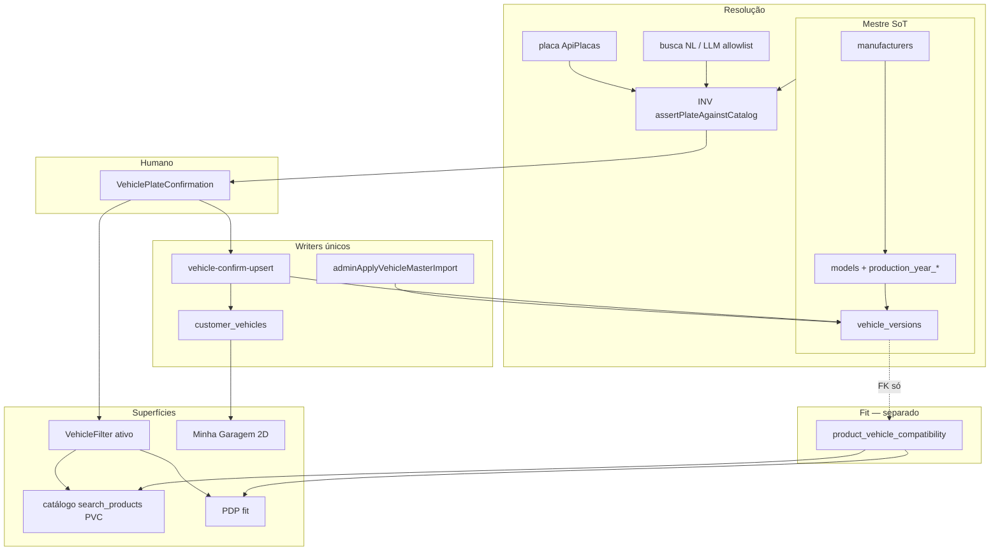

# FAL — Mapa canônico · Veículo (caminhos · relações · layout)

**Versão:** 1.0  
**Data:** 2026-11-21  
**Status:** CANÔNICO (mapa de autoridade do domínio veículo)  
**Branch:** `dev`  
**Regra:** cada regra tem **um** dono abaixo. Outros docs **linkam** — não recopiam.

Em conflito: este mapa + [Fontes de Verdade](./FAL_DADOS_FONTES_VERDADE.md) + [PRD 4.0](../entrada/FAL_PRD_4.0.md) vencem MARCHAs/VALs/planos datados.

---

## 1. Como usar

| Se você quer… | Abra (dono) |
|---------------|-------------|
| SoT de tabelas / o que não duplicar | [FAL_DADOS_FONTES_VERDADE.md](./FAL_DADOS_FONTES_VERDADE.md) §2.3 |
| Fundação placa / híbrido UI (histórico + contratos base) | [PLANO 0](../planejamento/FAL_PLANO0_FUNDACAO_CADASTRO_PLACA_2026-11-17.md) — **exceto** upsert no lookup (superseded §3) |
| Hub seed / fipeX / writer massa | [Mestre híbrido Integrações](../planejamento/FAL_PLANO_MESTRE_VEICULOS_HIBRIDO_INTEGRACOES_2026-11-21.md) |
| Assert placa A–D / família / assist | [Notes #6 REF](../planejamento/FAL_ANALISE_ERROS_NOTES_211136_REF_2026-11-21.md) — **DONE, não reabrir** |
| Identidade ownership / timeline (2A) | [PLANO 2A](../planejamento/FAL_PLANO2A_VEHICLE_IDENTITY_2026.md) |
| Garagem UX / 2D-first | [Garagem fundação](../planejamento/FAL_PLANO_GARAGEM_FUNDACAO_COERENTE_2026-11-21.md) · [UX Garagem](../planejamento/FAL_PADRAO_UX_MINHA_GARAGEM_2026-11-18.md) |
| Layout admin / Adaptive / tokens | [Padrão Telas Layout v1.5](../planejamento/FAL_PADRAO_TELAS_LAYOUT_DESIGN_v1_2026-11-21.md) |
| Visual 3D / CarImages | [Auditoria visual](../planejamento/FAL_AUDITORIA_COMPARATIVA_IDENTIDADE_VISUAL_VEICULAR.md) — CarImages **cancelada**; 3D consome filter |
| Intelligence futuro (2040) | [docs/futuro Intelligence](../futuro/FAL_INTELLIGENCE_VISAO_FUNCIONAL.md) — **não implementar** sem gate |

---

## 2. Relações (camadas — sem misturar)

| Camada | SoT | Nunca |
|--------|-----|-------|
| Mestre | `manufacturers` / `models` / `VV` | Gerar PVC |
| Vida de linha | `models.production_year_*` | Predicado de `search_products` |
| Fit | PVC `year_start`/`year_end` | Usar `VV.year` como prova de peça |
| Snapshot placa | `yearModel` + `yearFabrication` (sourceSnapshot) | Fab como ano do filtro |
| Seletor anos | VV.year + vida (`yearsByModel`) | PVC no seletor |
| Instância | `customer_vehicles` | Clonar mestre |
| Visual / 3D | consome `VehicleFilter` | Escrever identidade |

**INV ≠ 2A:** `resolveVehicleIdentity` / assert = catálogo. 2A = ownership/timeline na garagem.

---

## 3. Caminhos (runtime) — verdade atual

### 3.1 Placa → peças

1. UI `VehiclePlateSearch` → Edge `plate-lookup` (**read-only**: SELECT IDs / cache; **sem** `upsert_vehicle_canonical`).  
2. Client: `assertPlateAgainstCatalog` (+ assist LLM opcional, só modelos do mestre).  
3. `VehiclePlateConfirmation` (banda A–D; ambiguous exige pick; dual year informativo).  
4. Confirm → `vehicle-confirm-upsert` / `confirmVehicleCanonicalUpsert` (writer canônico).  
5. `VehicleFilter` → `search_products` (**só PVC** prova fit).  
6. Opcional: flush/save `customer_vehicles` (garagem ≠ PVC).

### 3.2 Seed / sync mestre

Hub `/admin/veiculos/integracoes` → `normalizeVehicleMasterInput` → CSV / fipeX intelligence → apply massa `adminApplyVehicleMasterImport` / sync (+ `merge_model_production_years`). Zero PVC.  
Writers reais também: CRUD admin (`adminUpsertModel`) e RPC `apply_catalog_applications_import` (modelo novo só `quality_status=review`).  
Loja: árvore/`listVehicleCatalogEntries` só `active` + `verified`. Runbook: `docs/dados/FAL_RUNBOOK_QUALIDADE_MESTRE_VEICULAR_2026-11-21.md`.

### 3.3 Admin layout (veículos)

| Superfície | Padrão layout | Nota |
|------------|---------------|------|
| CRUD `/admin/veiculos` | Página clássica | **Fora** AdaptiveWorkspace (decisão híbrido) |
| Hub Integrações | Chips + cards (família Pagamentos) | Não inventar segundo shell |
| Catálogo / Preços / Apps / Kits | [Padrão Layout v1.5](../planejamento/FAL_PADRAO_TELAS_LAYOUT_DESIGN_v1_2026-11-21.md) + Adaptive | PVC vive em Aplicações |
| Loja placa / seletor / garagem | Tokens `--fal-*`; UX Garagem | Sem Adaptive |

### 3.4 Deep-link `/catalogo` (Home · campanha · PDP · garagem)

| Papel | Dono |
|-------|------|
| Encoder YMM + `cat` + `vehicle=1` | `fal-pecas/src/lib/catalogHref.ts` |
| Kinds campanha / `ids` XOR filtro | `homeCampaignLink.ts` (usa `catalogHref`) |
| Lista filtrada | `search_products` (`p_category`/`p_model` CSV = união) |
| Lista curada | `?ids=` → `listPublishedProductsByIds` (não mistura cat/YMM) |

Não reimplementar `URLSearchParams` de veículo em Home/garagem — reutilizar o encoder.

---

## 4. Quatro (+1) camadas de ano

| # | Campo | Papel |
|---|-------|--------|
| 1 | PVC `year_start`/`end` | Fit peça |
| 2 | `VV.year` | Snapshot config (preferir **ano-modelo**) |
| 3 | `customer_vehicles.year` | Instância garagem |
| 4 | `models.production_year_*` | Vida de linha / assert |
| + | Snapshot `yearModel` / `yearFabrication` | Placa: filtro = modelo; fab informativo |

Detalhe histórico: [híbrido § Camadas de ano](../planejamento/FAL_PLANO_MESTRE_VEICULOS_HIBRIDO_INTEGRACOES_2026-11-21.md).

---

## 5. Writers (lista fechada)

| Writer | Quando | PVC? |
|--------|--------|------|
| `vehicle-confirm-upsert` / client confirm | Pós-humano (placa/manual confirmado) | Não |
| `adminApplyVehicleMasterImport` | Massa CSV / seed | Não |
| `merge_model_production_years` | Vida de linha | Não |
| Edge `plate-lookup` | — | **Proibido upsert** (2026-11-21) |

Qualquer segundo writer de mestre = rejeitar.

---

## 6. Docs supersedidos / só evidência (não recopiar)

| Doc | Trecho stale | Usar em vez |
|------|--------------|-------------|
| PLANO 0 | Lookup → `upsert_vehicle_canonical` | Este mapa §3.1 |
| PLANO 0 / MARCHAs antigas | “Edge sempre cria VV” | Confirm-writer |
| Notes “Próximo makers ocos” | Ocos zerados em dev (thin+vida) | Notes § Inteligência riqueza |
| `docs/README.md` PRD 3.0 | Índice 4.0 | [FAL_INDICE_CANONICO](../entrada/FAL_INDICE_CANONICO.md) |
| CarImages / G3 planos | POC cancelada | Auditoria visual |

VALs/MARCHAs datadas = evidência local. Não promovem regra nova sem dono neste mapa ou Fontes de Verdade.

---

## 7. Scorecard operacional (dev · 2026-11-21)

Referência de marcha — não substitui telemetria hub:

| Eixo | Nota interna | Travas |
|------|--------------|--------|
| Riqueza mestre | ~8,3 | Largura OK; motor VV ~21%; thin 1-VV dominante |
| Assertividade | ~9,0 | Falta VAL placa ApiPlacas ao vivo |
| Inteligência sistema | ~8,6 | Flags FIPE/motor off; path-10 carrinho/PDP |

---

## 8. Garantias automatizadas (antiregress)

| Garantia | Teste |
|----------|-------|
| Seletor anos sem PVC | `vehicleOptionsIdentityAntiregress.test.ts` |
| Lookup sem writer mestre · `allowCanonicalUpsert` sempre false · UI asserta | `assertivenessGuaranteesAntiregress.test.ts` |
| Família / exact win / dual year / mosca | `moscaBrancaJourney.test.ts` · `plateIdentityAssert.test.ts` |
| R2 ano obrigatório no upsert | `vehicleCanonicalUpsert.r2.test.ts` |

**INV Edge vs client:** Edge `resolveVehicleIdentity` não replica sibling-tree (sem árvore completa no Deno). SoT de ambiguidade na loja = `assertPlateAgainstCatalog` após lookup (obrigatório na UI).

## 9. Bloqueios permanentes

- Predicado FIPE / `codigo_fipe` no catálogo  
- PVC no seed/import/placa  
- Lookup escrevendo mestre  
- Visual/3D gerando identidade  
- Reabrir Notes #6 core  
- Merge/push `main` / prod sem autorização eFe  

**Assinatura:** Mapa veículo caminhos·relações·layout · 2026-11-21 · garantias antiregress §8.
