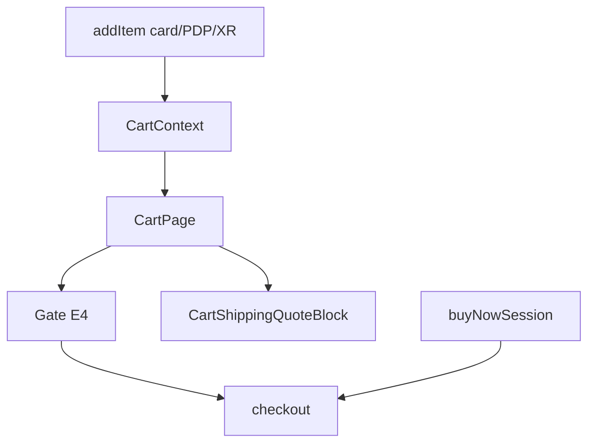

# Auditoria — Carrinho (layout · funções · visual)

**Data:** 2026-11-23  
**Branch:** `dev`  
**Natureza:** read-only (opção A) — **sem alteração de código**  
**VAL:** [FAL_MARCHA_AUDITORIA_CARRINHO_VAL_2026-11-23.md](./FAL_MARCHA_AUDITORIA_CARRINHO_VAL_2026-11-23.md)

---

## 1. Inventário as-is

### 1.1 Rota e shell

| Item | Valor |
|------|-------|
| Path | `/carrinho` (`router.tsx` → `CartPage`) |
| Provider | `CartProvider` em `App.tsx` |
| Shell | `MainLayout` + `MobileNav` fixo (`lg:hidden`) |

### 1.2 Camadas

| Camada | Arquivo | Papel |
|--------|---------|-------|
| UI | `fal-pecas/src/pages/Cart/CartPage.tsx` | Empty, lista, resumo, gate, CTAs |
| Estado | `contexts/CartContext.tsx` | add / updateQty / remove / restore / clear / flushRemote |
| Persistência guest | `services/cart/cartStorage.ts` | `fal_cart` localStorage |
| Persistência auth | `services/cart/supabaseCartService.ts` | `carts` / `cart_items` + merge login |
| Preço | `services/cart/cartPricing.ts` | FIND-006 reprice |
| Frete | `components/cart/CartShippingQuoteBlock.tsx` | Cotação **conjunto** + handoff checkout |
| Troca | `components/cart/ReplaceCartItemModal.tsx` | M32 |
| Nav | `CartButton.tsx`, `MobileNav.tsx` | Badge / tab |
| Buy now | `services/checkout/buyNowSession.ts` | **Paralelo** ao CartContext → checkout |

### 1.3 Layout UI

- `Container py-8`
- Com itens: `grid grid-cols-1 gap-6 lg:grid-cols-[1fr_350px]`
- Linha: `grid-cols-[86px_1fr_auto]` (thumb · corpo · total)
- Aside resumo: `h-max`, `position` estático — **não sticky**
- Sticky no mobile: só bottom `MobileNav` do shell
- Empty: `EmptyState` + CTA **Ver catálogo** → `/catalogo`

### 1.4 Funções user-facing (página)

1. Empty → Ver catálogo  
2. Lista + hint persistência (“conta” / “dispositivo” / Salvando…)  
3. Abrir PDP (thumb, nome, ref, **Ver produto**, total linha)  
4. Snapshot veículo associado (se houver)  
5. Compat por item (`CompatVerdictSummary` + **Trocar peça** se incompatível)  
6. Qty − / + (`aria-label`)  
7. Remover + toast **Desfazer** (7s)  
8. Cotar frete do conjunto (CEP, retirada, opções)  
9. Subtotal lista · à vista/Pix · crédito · frete · total estimado  
10. Logado: **Finalizar compra** → gate E4 → `/checkout`  
11. Guest: **Criar conta e continuar** / **Já tenho conta — entrar** (`from: /checkout`)

### 1.5 Fora da CartPage / inexistente na UI

| Item | Onde |
|------|------|
| Comprar agora / buy_now | PDP + ProductCard → sessionStorage (não passa pela página) |
| Clear-all explícito | Só `clear()` pós-pedido / API — sem botão na UI |
| Sticky Finalizar mobile | **Ausente** |
| Buy now na própria `/carrinho` | **Ausente** (correto vs O1-G) |

### 1.6 Antiregress já existentes

- `compatUiAntiregress`: Replace modal footer; CartButton dark tokens; gate não usa `/garagem` (usa `/conta/veiculos`)
- `cartPricing.test`, `cartQuoteFingerprint.test`, `cartGroupedQuoteSmoke.test`
- `productLabels` / O1-G labels

---

## 2. Padrão FAL alvo (cruzamento)

| Fonte | Contrato relevante |
|-------|-------------------|
| Plano mestre **O1-G** | Comprar agora → `/carrinho`; Finalizar **só** no carrinho; −/+ / Remover só no carrinho; card sem “Ver produto” |
| Plano mestre **O1-F** | Preço unitário; Remover + Desfazer; aria −/+; sem copy “sincronizado” |
| Compat **E.3** | Fit por item (estado/motivo/faltante); Finalizar → gate; mobile: **Finalizar sticky** |
| Compat **E.4** / M32 | Gate Completar / Trocar / Seguir; modal substituir |
| SPEC cotação 13/11 | Frete **em conjunto**; handoff checkout |
| Mapa telas | Revisar itens + cotar frete; totais claros |
| FASE6 e-commerce | Funil carrinho → checkout; frete a calcular até Entrega |
| UX.md | EmptyState; MobileNav com Carrinho |
| PADRAO telas | Tokens `fal-*`; loja **≠** Adaptive zin |
| Card VAL 10/10 | **STALE** vs O1-G |

---

## 3. Matriz gap (as-is × padrão)

Legenda: **OK** · **DRIFT** · **LACUNA** · **STALE DOC**

### 3.1 Funções

| # | Expectativa | As-is | Status | Pri |
|---|-------------|-------|--------|-----|
| F1 | Finalizar só no carrinho (O1-G) | Sim (logado) | OK | — |
| F2 | Guest não finaliza sem conta | CTAs cadastro/login | OK | — |
| F3 | Remover + Desfazer (O1-F) | Toast 7s | OK | — |
| F4 | Qty −/+ com aria | Sim | OK | — |
| F5 | Preço unitário na linha (O1-F) | “cada (lista)” + à vista | OK | — |
| F6 | Gate E4 no Finalizar | confirmDialog + log + Trocar/Completar | OK | — |
| F7 | Trocar peça M32 | ReplaceCartItemModal | OK | — |
| F8 | Frete conjunto | CartShippingQuoteBlock | OK | — |
| F9 | Comprar agora → carrinho (não checkout) | Em card/PDP (Notes #7 mobile: Adicionar primary) — superfície card ≠ O1-G desktop | DRIFT* | P1 |
| F10 | Clear-all na UI | Não há | OK† | — |
| F11 | Continuar comprando (wire E.3) | Só empty → catálogo; com itens sem atalho explícito | DRIFT | P2 |

\* O1-G define card desktop; Notes #7 inverte hierarquia no mobile — documentado na marcha home 23/11.  
† Ausência de clear-all não é requisito O1-G.

### 3.2 Layout

| # | Expectativa | As-is | Status | Pri |
|---|-------------|-------|--------|-----|
| L1 | Desktop: lista + resumo | `lg:grid-cols-[1fr_350px]` | OK | — |
| L2 | Mobile: empilhado | 1 coluna | OK | — |
| L3 | Finalizar sticky mobile (E.3) | Aside estático; CTAs guest no fim do scroll | **LACUNA** | **P0** |
| L4 | Linha legível no mobile estreito | Grid `86px_1fr_auto`: **preço sobrepõe título** (~320px) | **DRIFT** | **P0** |
| L5 | Aside sticky desktop (opcional UX) | `h-max` static | OK‡ | P2 |

‡ Não exigido por O1; E.3 só cita sticky no mobile.

### 3.3 Visual / tokens

| # | Expectativa | As-is | Status | Pri |
|---|-------------|-------|--------|-----|
| V1 | Tokens `fal-*` | Surface, line, danger, navy | OK | — |
| V2 | Dark CartButton | Antiregress dark:text-fal-fg | OK | — |
| V3 | Empty CTA Ver catálogo | Presente | OK | — |
| V4 | Thumb contain | object-contain | OK | — |
| V5 | Overlap preço/título mobile | Evidência smoke | **DRIFT** | **P0** (mesmo L4) |

### 3.4 Copy

| # | Expectativa | As-is | Status | Pri |
|---|-------------|-------|--------|-----|
| C1 | Persistência conta/dispositivo (O1-F) | Hint claro | OK | — |
| C2 | Sem “sincronizado” | Ausente | OK | — |
| C3 | “Ver produto” na **linha** do carrinho | Presente | OK§ | — |
| C4 | Microcopy checkout revalida frete | Presente | OK | — |

§ O1-G remove “Ver produto” do **card**, não do carrinho.

### 3.5 Compat / frete / persistência

| # | Expectativa | As-is | Status | Pri |
|---|-------------|-------|--------|-----|
| X1 | Fit por item + faltante | CompatVerdictSummary | OK | — |
| X2 | Gate + decision log no aceite gate | writeCompatDecisionLog no Finalizar | OK¶ | — |
| X3 | Handoff frete → checkout | Quote block | OK | — |
| X4 | Merge login / flushRemote | Context | OK | — |
| X5 | Packing 3D / POL seed | Residual auditoria cotação 13/11 | LACUNA domínio frete | P2 |
| X6 | Reavaliar todos ao trocar veículo (M11) | Fora desta página — validar na marcha impl | PENDENTE DE VALIDAÇÃO | P1 |

¶ Spec E.4 original dizia log no checkout; VALs posteriores gravam no gate — alinhar na marcha impl se divergir.

### 3.6 Docs stale

| Doc | Status |
|-----|--------|
| `FAL_CARD_UX_CARRINHO_VAL_2026-10-10.md` | **STALE DOC** (CTAs card pré–O1-G) |
| Wire E.3 “Continuar comprando” | Não materializado como botão com itens |

---

## 4. Smoke visual read-only (`localhost:5173/carrinho` · 2026-11-23)

| Cenário | Evidência |
|---------|-----------|
| Com 2 itens, guest, viewport ~323px | Título “Carrinho (2)”; hint dispositivo; Ver produto; qty; Remover; frete/retirada; CTAs guest; **sem** sticky Finalizar; **overlap** preço × título |
| Badge MobileNav | Carrinho ativo com badge 2 |
| Empty | Não exercitado nesta sessão (carrinho já populado); código empty = EmptyState + Ver catálogo |

---

## 5. Recomendações

| Pri | Gap | Ação sugerida | Status |
|-----|-----|----------------|--------|
| **P0** | L4/V5 overlap mobile | Empilhar total em `<sm`; coluna `auto` só `sm+` | **DONE** 2026-11-23 — [VAL](./FAL_MARCHA_CARRINHO_LAYOUT_LIMPO_VAL_2026-11-23.md) |
| **P0** | L3 sticky Finalizar | Sticky acima MobileNav; aside CTAs `lg+` | **DONE** 2026-11-23 — mesmo VAL |
| P1 | F9 card mobile vs O1-G | Decisão produto: manter Notes #7 ou unificar O1-G | Aberto |
| P1 | X6 M11 | Smoke: trocar veículo ativo → vereditos do carrinho atualizam | Aberto |
| P2 | F11 Continuar comprando | Link → `/catalogo` | **DONE** (mesmo VAL) |
| P2 | STALE Card VAL 10/10 | Arquivar ou nota “superseded by O1-G” | Aberto |
| P2 | Packing/POL | Fora do layout; seguir backlog cotação | Aberto |
| UI | Cotação aside vs PDP M5 | Compactar CEP/Consultar; paridade copy | **DONE** 2026-11-23 — [VAL cotação padrão](./FAL_MARCHA_CARRINHO_COTACAO_PADRAO_VAL_2026-11-23.md) |

---

## 6. Aceite desta marcha documental

- [x] Inventário funções/layout/arquivos  
- [x] Cruzamento O1-G/F, E.3/E.4, cotação, mapa, REF  
- [x] Matriz gap com prioridades  
- [x] Smoke read-only registrado  
- [x] Aprovação eFe → implementação P0 (layout limpo 2026-11-23)
