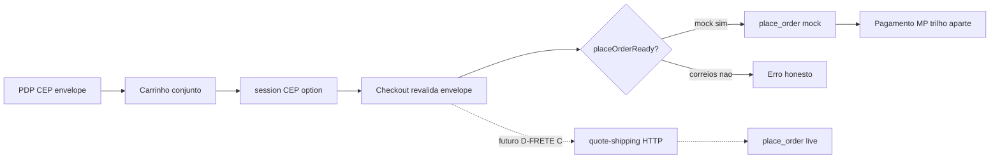

# FAL 3.0 — Auditoria técnica de frete, cotação e experiência de entrega

**Data:** 2026-10-10 (rev. verificação pós-estrutura)  
**Runtime:** `wtbpwuiayednvlhvuhbh`  
**Tipo:** Relatório canônico A–J (auditoria + estado após MARCHA estrutura)  
**Loja:** https://fal-pecas-automotivas.netlify.app  
**Plano:** [FAL_PLANO_FRETE_FINALIZACAO_2026-10-10.md](./FAL_PLANO_FRETE_FINALIZACAO_2026-10-10.md)  
**VAL estrutura:** [FAL_MARCHA_FRETE_ESTRUTURA_CARRIERS_VAL_2026-10-10.md](./FAL_MARCHA_FRETE_ESTRUTURA_CARRIERS_VAL_2026-10-10.md)

Classificação: **FATO** · **RELATO** · **HIPÓTESE** · **DECISÃO** · **PENDÊNCIA DE DECISÃO** · **BLOQUEIO**

---

## A. Resumo executivo

**Estado comercial (1ª venda):** frete de **produção** ainda **não** existe. `place_order` resolve só `mock:*` via `resolve_mock_shipping_option` (**FATO**). Correios/Frenet no client são sandbox local sem HTTP (**FATO**). Edge `quote-shipping` é esqueleto `501 not_configured` até secrets + MARCHA HTTP (**FATO**).

**Estado experiência (sandbox/mock):** PDP, carrinho e checkout consultam CEP via `quoteShippingEnvelope`, com disclaimer honesto e guard `placeOrderReady` no checkout (**FATO** — PRs #29–#31). Cotação do **conjunto** no carrinho (não soma unitária cega) (**FATO**). Handoff CEP/opção carrinho→checkout via `sessionStorage` (**FATO**). Logística (`weight_kg` / dims) no storefront + `loadCartLogistics` no checkout (**FATO**); cobertura de dados nos produtos = **HIPÓTESE** (depende do cadastro).

**Impacto:** primeira operação controlada pode usar mock/retirada (D-FRETE A/B) com avisos. Cotação Correios “real” na PDP = **PENDÊNCIA DE DECISÃO** D-FRETE **C** + **BLOQUEIO** secrets/HTTP/RPC.

---

## B. Inventário técnico

| Arquivo | Responsabilidade | Comportamento atual | Classe |
|---------|------------------|---------------------|--------|
| `ProductPage.tsx` + `ProductShippingQuoteBlock.tsx` | PDP Entrega e frete | CEP → envelope → opções / erro / disclaimer | FATO |
| `CartPage.tsx` + `CartShippingQuoteBlock.tsx` | Carrinho conjunto | CEP → opções; invalida se itens/qty; total + frete | FATO |
| `CheckoutPage.tsx` | Checkout entrega | `quoteShippingEnvelope` + `loadCartLogistics` + guard `placeOrderReady` | FATO |
| `shippingQuoteSession.ts` | Handoff | CEP + preferredOptionId (não é verdade de preço) | FATO |
| `freightService.ts` | Cache 90s | Ainda usado em caminhos legados; checkout migrou p/ envelope | FATO |
| `shippingService.ts` + `carrierRegistry.ts` | Adapter / catálogo | mock \| correios \| frenet \| carrier(disabled) | FATO |
| `shippingQuoteContract.ts` + `quoteShippingEnvelope.ts` | Camada B | status, expiresAt, fingerprint, logisticsGaps, disclaimer | FATO |
| `edgeQuoteClient.ts` + `supabase/functions/quote-shipping/` | Camada C live | Invoke + 501 até HTTP | FATO |
| `mockShippingProvider.ts` | Mock | economic / express / pickup | FATO |
| `correiosStubProvider.ts` | Correios sandbox | PAC/SEDEX determinístico, sem HTTP | FATO |
| `frenetStubProvider.ts` | Frenet sandbox | Agregador simulado | FATO |
| `carrierStubProvider.ts` | Slot futuro | Throw; `enabled=false` | FATO |
| `loadCartLogistics.ts` | Peso/dims quote | SELECT products weight/dims | FATO |
| `productService.ts` | Storefront | Expõe weight/dims no `PRODUCT_SELECT` | FATO |
| `AdminProductFormPage.tsx` | Admin logística | peso + altura + largura + comprimento | FATO |
| `AdminShippingOriginPage` + `store_shipping_origin` | CEP origem | Usado na cotação | FATO |
| `place_order` (F9-F) | Pedido | só `resolve_mock_shipping_option` | FATO |
| `.cursor/mcp.json` + setup MCP | Agente | `@codespar/mcp-correios@0.2.0-alpha.3`; env vazios | FATO |
| Edge MP | Pagamento | Sem relação com cotação frete | FATO |

---

## C. Matriz de provedores

| Provedor | Estado real | `placeOrderReady` | Limitações | Próximo |
|----------|-------------|-------------------|------------|---------|
| mock | Mock alinhado ao RPC | **true** | Não é frete real | D-FRETE A/B |
| correios | Sandbox client | false | Sem HTTP; IDs rejeitados no RPC | Edge HTTP + secrets + RPC + VAL |
| frenet | Sandbox client | false | Idem | MARCHA própria se escolhido |
| carrier | Stub desabilitado | false | Slot futuro | Contrato + provider |

**MCP Correios:** diagnóstico operador — **não** backend da loja (**FATO**).  
**Produção Netlify:** deve permanecer `VITE_SHIPPING_PROVIDER=mock` (ou default) até RPC live (**PENDÊNCIA** confirmar painel — **RELATO** de boas práticas).

---

## D. Matriz de dados

| Dado | Disponível? | Origem | Validação | Impacto |
|------|-------------|--------|-----------|---------|
| CEP destino | Sim | PDP/carrinho input; checkout address; ViaCEP | 8 dígitos | Cotação |
| CEP origem | Sim | `store_shipping_origin` | Admin | Cotação |
| Peso | Coluna + admin + storefront select | `products.weight_kg` | Checkout via `loadCartLogistics`; PDP usa `product.weightKg` | Live: `logisticsGaps` bloqueia se mode=live |
| Dimensões | Coluna + admin completo | height/width/length_cm | Passadas quando existem | Live incompleta se nulas |
| Qty / subtotal | Sim | Carrinho | Fingerprint + invalidação cart | Recotação |
| Opção no pedido | Só `mock:*` | RPC | Client não define amount; option inválida → erro | Segurança parcial |
| Validade cotação | Envelope 15 min | Contrato TS | UI não força expire ainda | HIPÓTESE / futuro |
| Handoff | sessionStorage | Carrinho | Só CEP/option id | Preferência UX |

---

## E. Matriz de riscos

| Risco | Evidência | Impacto | Prioridade | Mitigação |
|-------|-----------|---------|------------|-----------|
| Env≠mock quebra place_order | RPC só mock | Checkout bloqueado | Alta | Guard `placeOrderReady` + prod em mock |
| Sandbox como frete real | Disclaimer envelope | Confiança | Alta | D-FRETE + copy honesta |
| Produtos sem peso | Cadastro incompleto | Live falha / sandbox impreciso | Alta | Preencher logística; live recusa gaps |
| Secrets no Vite | Anti-padrão | Vazamento | Alta | Só Edge + MCP local |
| Cotação carrinho ≠ checkout | Dois momentos | Divergência | Média | Checkout revalida; handoff só preferência |
| Edge não deployada | Esqueleto local | Live 501 | Média | Deploy pós D-FRETE C |
| MCP alpha npm | `@0.2.0-alpha.3` | Instabilidade agente | Baixa | Pin versão; não usar na loja |

---

## F. Fluxo-alvo (atual + live)

Falhas: `invalid_cep` · `missing_logistics` · `not_configured` · `provider_error` · sem inventar preço.

---

## G. Plano de implementação (status)

| # | Etapa | Status |
|---|-------|--------|
| 1 | Auditoria A–J + registry + envelope + edge esqueleto + MCP | **FEITA** |
| 2 | UI PDP + carrinho conjunto + checkout envelope/guard/handoff/logística | **FEITA** |
| 3 | eFe: D-FRETE A/B/C + MCP credentials | **PENDÊNCIA DE DECISÃO** |
| 4 | Humano: MP H1–H6 | **BLOQUEIO** humano |
| 5 | MARCHA HTTP Correios na edge + testes | **BLOQUEIO** (após C + secrets) |
| 6 | MARCHA `place_order` opções live | **BLOQUEIO** (após 5) |
| 7 | VAL frete integrado + E2E (≠ VAL MP) | **BLOQUEIO** (após 4–6) |
| 8 | Gate α assinatura | **PENDÊNCIA** eFe |

---

## H. Decisões comerciais necessárias

| Decisão | Opções | Notas |
|---------|--------|-------|
| D-FRETE | A / B / C | Cotação real PDP ⇒ **C**; A/B = mensagem honesta (já suportada) |
| Correios vs Frenet | Direto 1º a avaliar | Não decidir só por stub |
| Retirada | `mock:pickup` / política A | Mensagem ao cliente |
| Mensagem loja | Copy sandbox/mock | Registry `commercialShippingDisclaimer` |
| Credenciais | CWS + Edge secrets | Nunca VITE_ |

---

## I. Plano de testes e VAL

| Tipo | Sem secrets | Com humano/secrets | Estado |
|------|-------------|-------------------|--------|
| Unit shipping | `carrierRegistry` + session (17) | — | **FEITO** FATO |
| tsc | OK na marcha | — | **FEITO** RELATO marcha |
| UI PDP/carrinho/checkout sandbox | Smoke visual loja | — | **PENDENTE** smoke staff |
| Edge 501/422 | Deploy + auth JWT | CORREIOS_* | Não deployado |
| MCP calculate_shipping | — | CORREIOS_* Cursor | Credenciais vazias |
| E2E frete+MP | — | D-FRETE + MP smoke | Bloqueado |

---

## J. Recomendação final (menor sequência segura)

1. Manter produção em **mock** até D-FRETE C + RPC live.  
2. eFe: preencher MCP Correios local (diagnóstico) + **assinar D-FRETE**.  
3. Paralelo: smoke MP H1–H6.  
4. Se **C**: MARCHA HTTP edge → `place_order` live → smoke UI → VAL frete → E2E → gate α.  
5. Se **A/B**: operação controlada com UI atual + avisos; sem HTTP.

---

## Verificação 10/10 (checklist)

| Check | Resultado |
|-------|-----------|
| Seções A–J presentes | OK |
| Paths citados existem no repo | OK (verificados) |
| Relatório alinhado ao código pós-#29–#31 | OK (esta rev.) |
| Plano canônico linkado | [PLANO](./FAL_PLANO_FRETE_FINALIZACAO_2026-10-10.md) |
| Molde / gate α / D-FRETE sync | Ver plano § sync |
| Secrets não expostos no relatório | OK |
| Live HTTP não declarado como pronto | OK |

---

## Encerramento

1. **Inspecionado:** PDP, cart, checkout, registry, envelope, edge, MCP, place_order, logistics admin/storefront, docs gate/molde/D-FRETE.  
2. **Evidências:** inventário B + PRs #29–#31.  
3. **Lacunas abertas:** D-FRETE, MP smoke, HTTP Correios, RPC live, VAL/E2E frete, smoke staff UI.  
4. **Próxima MARCHA técnica (auth):** HTTP Correios + place_order (após C).  
5. **Confirmação:** relatório corrigido na verificação; nenhuma alteração de secrets/produção nesta passagem documental.
