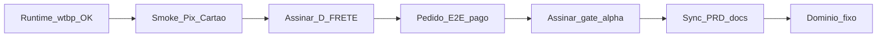

# Auditoria status × PRD × docs — FAL 3.0

**Data:** 2026-11-04  
**Tipo:** somente leitura (probe runtime + cruzamento documental)  
**Runtime canônico:** `wtbpwuiayednvlhvuhbh`  
**Loja:** https://fal-pecas-automotivas.netlify.app  
**Git (FATO remoto):** `origin/main` @ `9513dad` (PR #42) · `origin/dev` @ `b5925d1`  
**Protocolo:** auditar → evidências → próximos passos → STOP (sem código / secrets / deploy)

---

## 1. Resumo executivo

**Etapa atual:** Fase α — operação comercial controlada (plano soberano 2026-10-10).  
Código/docs α ~**80%** prontos; aceite comercial ~**20%** pendente (smoke Pix/cartão, D-FRETE assinado, 1 pedido E2E pago, assinatura do gate α).

**Bloqueadores P0 (humano):**
1. Smoke MP Pix + cartão (+ webhook approve) — H1–H5 já PASS (14/10); H6 parcial.
2. Assinatura D-FRETE A/B/C.
3. Assinatura gate α (“Operação controlada OK”).

**Runtime 04/11 (FATO):** loja viva. DNS `wtbp…` resolve; Netlify 200 com bundle `index-DYpbbWUS.js`; catálogo lista **100 produtos**; admin autenticado carrega formulário de produto. O diag de 30/10 (NXDOMAIN) está **superado** no canônico. Não apontar para HF `owllm…`.

**Próxima decisão:** eFe executar smoke MP sandbox (ou ACEITE DE RISCO explícito) + assinar D-FRETE; depois 1 pedido E2E e fechar gate α. Domínio fixo só após aceite α (Netlify = ponte).

---

## 2. Fontes

| Fonte | Papel |
|-------|--------|
| [docs/entrada/FAL_PRD_3.0.md](../entrada/FAL_PRD_3.0.md) §7, §31, §32, §36 | Escopo / lacunas / roadmap / decisões |
| [FAL_PLANO_FINALIZACAO_ALPHA_SOBERANO_2026-10-10.md](./FAL_PLANO_FINALIZACAO_ALPHA_SOBERANO_2026-10-10.md) | Plano mestre α |
| [FAL_ALPHA_GATE_2026-10-10.md](./FAL_ALPHA_GATE_2026-10-10.md) | Aceite operação controlada |
| [FAL_MP_SMOKE_H1H6_CHECK_2026-10-14.md](./FAL_MP_SMOKE_H1H6_CHECK_2026-10-14.md) | H1–H5 PASS |
| [FAL_D_FRETE_DECISAO_2026-10-10.md](./FAL_D_FRETE_DECISAO_2026-10-10.md) | Política frete |
| [FAL_E2E_PRODUCAO_STATUS_2026-10-10.md](./FAL_E2E_PRODUCAO_STATUS_2026-10-10.md) | E2E + Netlify |
| [FAL_AUDITORIA_GERAL_CONCLUSAO_2026-10-09.md](./FAL_AUDITORIA_GERAL_CONCLUSAO_2026-10-09.md) | Baseline pós-Onda1 |
| [FAL_DIAG_SUPABASE_WTBP_DOWN_2026-10-30.md](./FAL_DIAG_SUPABASE_WTBP_DOWN_2026-10-30.md) | Outage DNS (histórico) |
| Probe 2026-11-04 | DNS 8.8.8.8 + HTTP Netlify + browser |

---

## 3. Probe runtime (2026-11-04)

| Check | Resultado | Evidência |
|-------|-----------|-----------|
| DNS `wtbpwuiayednvlhvuhbh.supabase.co` | **OK** | Resolve via 8.8.8.8 → 172.64.149.246 / 104.18.38.10 |
| `GET …/auth/v1/health` | **UP** (401 sem key) | Servidor responde — esperado sem anon |
| Ref errado `wtbpqacxihqvwjivmqm` | **NXDOMAIN** | Não é o canônico; ignorar |
| Netlify home | **200** | `https://fal-pecas-automotivas.netlify.app/` |
| Bundle | **OK** | `assets/index-DYpbbWUS.js` (≠ stale `oy7VRadL`) |
| `/login` SPA | **200** | shell SPA |
| Catálogo browser | **OK** | “100 produtos · mostrando 24”; `hasCarregando=false` |
| Admin browser | **OK** | Sessão `efe.comercioltda@gmail.com`; produto COXIM 1308B carregado |
| HF `owllm…` | **fora** | Não é verdade comercial |

**Veredicto ops:** α-OPS-1 (Netlify ≠ stale) **PASS** nesta data. Loja + wtbp **vivos** — desbloqueia retomada de smoke MP.

---

## 4. Cruzamento PRD × realidade

| Afirmação PRD / doc antigo | Realidade 04/11 | Ação |
|----------------------------|-----------------|------|
| §32: **F10 = PRÓXIMO FOCO** | Onda 0–1 **ENCERRADA**; foco = **fechamento Fase α** (smoke/D-FRETE/gate) | Sync PRD §32 |
| §7 / lacunas: apps cobertura **parcial** | FIND-004 M1–M5 **ENCERRADO** (100/100 PVC) | Sync §7/§31 |
| §32 bloco C: F9-E DONE → STOP → **F9-F** | F9-F **IMPLEMENTADO** 10/10 (RPC + checkout); falta smoke humano | Sync status F9 |
| Smoke MP / webhook “bloqueado por secret” | H1–H5 **PASS** 14/10; webhook v4; falta **smoke Pix/cartão** | Atualizar §31 |
| §36: D-FRETE pendente | **Continua** PENDENTE assinatura A/B/C | Manter |
| Gate α / STATUS molde: H5 FAIL / UI simulado | H5 **PASS** prod (bundle default mercadopago); docs gate/molde **atrasados** | Sync gate + molde |
| Diag 30/10: wtbp NXDOMAIN | **Superado** 04/11 | Não reabrir como bloqueio atual |
| Domínio fixo | Decisão: Netlify ponte; domínio = pós-α / lançamento | Fora P0 α |

---

## 5. Matriz por frente

| Frente | Estado | Evidência | vs PRD | Prioridade |
|--------|--------|-----------|--------|------------|
| Fundação F1–F7 | ENCERRADO | ROADMAP + código | Alinhado | — |
| F8 / F8.1 ops admin | VALIDADO (base) | VALs preços/classif/apps | Base OK; polimento = F10 | P2 |
| F10 Onda 0–1 | ENCERRADO | STATUS_ONDA1 | PRD ainda diz “próximo” | Sync |
| Catálogo / FIND-004 | ENCERRADO | M5 VAL + browser 100 prod. | PRD “parcial” obsoleto | — |
| PDP A–D | VALIDADO | VALs A–D + `main` | Fora PRD detalhe | P2 evolutivo |
| Carrinho / Card UX | VALIDADO | VAL card | — | — |
| Checkout + F9-F | IMPLEMENTADO | VAL F9-F | PRD “STOP antes F9-F” obsoleto | P0 smoke |
| Pagamentos MP | Código pronto; smoke **PENDENTE** | H1H6 14/10 | Lacuna §31 ainda válida p/ smoke | **P0** |
| Frete sandbox | VALIDADO UI/estrutura | VALs frete | Live gated D-FRETE | **P1** |
| D-FRETE | PENDENTE assinatura | ficha | §36 alinhado | **P0/P1** |
| E2E pré-pagamento | VALIDADO | VAL E2E-pré | — | — |
| E2E pedido pago | NÃO EXECUTADO | E2E status | Lacuna real | **P1** |
| Gate α | PENDENTE eFe | gate doc | — | **P0** |
| Deploy Netlify | OK sync bundle | probe 04/11 | — | — |
| B3 repair | HOLD | B3 HOLD | Fora α | P2 |
| Bloco F permissões | HOLD | STOP F | Fora α | P2 |
| F11+ mestre | NÃO INICIADO | ROADMAP | Pós-α | P3 |
| Domínio fixo | ADIADO | decisão conversa | Pós aceite α | P3 |

---

## 6. Feito — não reabrir (sem finding novo)

Inventário plano soberano F01–F14 + probes:

- Onda 0–1 / schema-first  
- FIND-004 M1–M5  
- UI apps/anos + PDP A–D  
- Card UX + carrinho  
- Admin Cat→Grupo→Sub / Aplicações / Preços `%`  
- F9-F meios MP no `place_order`  
- E2E pré-pagamento (até login)  
- Frete auditoria A–J + registry/UI sandbox + MCP esqueleto  
- Checkout steps + seed Pix QR (código)  
- H1–H5 MP (secrets + redeploy webhook v4 + provider prod)  
- Netlify production bundle atual (`index-DYpbbWUS.js`)  
- Runtime wtbp **UP** (04/11)

---

## 7. Pendências (P0–P3)

### P0 — fechar α (humano / gate)

| ID | Item | Responsável | Nota |
|----|------|-------------|------|
| α-MP-2/3 | Smoke Pix + cartão sandbox | eFe (+ auth SMOKE MP) | Prep §3; H6 usuário teste se faltar |
| α-MP-4 | Webhook approve no smoke | eFe | URL wtbp + evento Pagamentos |
| α-FR-1/2 | D-FRETE A/B/C + mensagem/expedição | eFe | C se cotação real na PDP |
| α-GATE-1 | Assinatura operação controlada | eFe | [gate](./FAL_ALPHA_GATE_2026-10-10.md) |
| Docs sync leve | Gate/molde ainda citam H5 FAIL | Agente (auth docs) | Após smoke ou em MARCHA docs |

### P1 — evidência comercial + política

| ID | Item |
|----|------|
| α-E2E-1/2 | 1 pedido teste pago + frete coerente com D-FRETE |
| Sync PRD | §7/§31/§32/§36 + ROADMAP bloco C/D |
| α-FR-C* | Só se D-FRETE = **C** (secrets Correios + MARCHA HTTP + place_order live) |

### P2 — HOLD / fora do fechamento α

- B3 migration repair  
- Bloco F permissões granulares  
- Polimento F10 amplo (empty states, relatórios, etc.)  
- Volume fotos Storage  

### P3 — pós-α / lançamento

- F11+ catálogo mestre  
- Domínio fixo (sair da ponte Netlify)  
- Escala comercial F13  

---

## 8. Próximos passos ordenados

```text
[Humano] Smoke MP Pix/cartão (+ webhook) em fal-pecas-automotivas.netlify.app
    → evidências no MP status / prep
[Humano] Assinar D-FRETE (A ou B recomendados α; C se cotação real)
[Humano] 1 pedido E2E sandbox com prints / order id
[Humano] Assinar gate α
[Agente auth] Sync PRD + gate + molde (MARCHA docs nomeada)
[Depois] Domínio fixo / F11+ — só pós aceite α
```

**Não fazer agora:** inventar frete live, apontar para HF, repair B3, Bloco F, F11, trocar domínio sem aceite α.



---

## 9. STOP

Esta marcha **não** implementa código, não altera secrets, não redeploya e não executa smoke Pix.  
Entrega = este relatório. Próxima ação técnica do agente só com **MARCHA nomeada** (ex.: `SMOKE MP`, `MARCHA docs sync PRD`, ou pós D-FRETE = C).

**Assinatura agente:** auditoria status × PRD concluída 2026-11-04.
