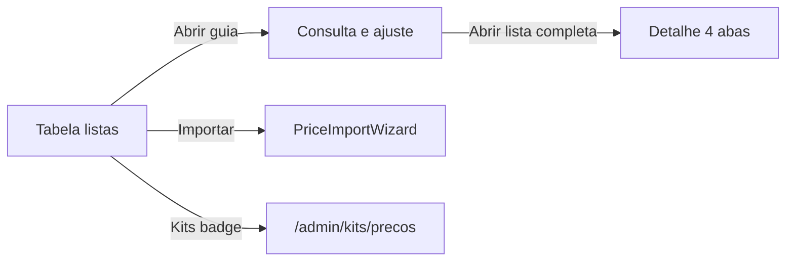

# Estudo — Listas de Preço: AS-IS + experiência TO-BE (workspace)

**Data:** 2026-11-21 · **Branch alvo futura:** `dev`  
**Fase:** estudo — **sem implementação nesta marcha**  
**Depende de:** estudo Produtos (frente 1) para vocabulário e shell compartilhados  

## Premissa

Ambiente **comercial** distinto do catálogo: mesma família Adaptive, outra densidade e outro conjunto de ações. Consulta rápida deixa de ser rodapé e vira peça central do workspace. Preservar 100% F8 (overview, detalhe 4 abas, wizard, Base/Promo, kits-manual → hub).

---

## Parte A — AS-IS

### A.1 Rotas e papéis

| Rota | Acesso menu |
|------|-------------|
| `/admin/precos` | administrador, gerente |
| `/admin/precos/:id` | idem; `?tab=produtos\|formacao\|importacoes\|config` |
| Kits-manual ID `…103` | **redirect** `/admin/kits/precos` |

Mutações: `canManagePricing` (admin \| gerente).

### A.2 Overview (`AdminPriceListsPage`)

- KPIs: ativas, itens, com preço, sem preço (toggle → força filtro no painel).  
- Tabela Gerenciar listas: Abrir, Configurar (form inline), ⋯ Importar / Duplicar / Ativar-Inativar / Excluir.  
- Base/Promo: exclusão bloqueada.  
- Kits-manual: badge + link hub Kits.  
- Form create/edit inline + avançado formação.  
- **`PriceListQuickAdjustPanel` no fim da página** — highlight amarelo na linha.

### A.3 Consulta rápida (`PriceListQuickAdjustPanel`)

| Aspecto | Fato |
|---------|------|
| Persistência | `sessionStorage` listId + filters |
| Dados | até 5000 reais + virtuais missing; UI mostra **50** |
| Ops | editar modal, add SKU+preço, sync virtual, Abrir lista completa |
| Debounce q | 200 ms |

### A.4 Detalhe (4 abas F8.2)

| Aba | Capacidades |
|-----|-------------|
| Produtos | filtros sessionStorage por lista, sort, bulk, add, modal pricing, export CSV |
| Formação | regra, adicional %, materialize, ajuste global |
| Importações | histórico + wizard |
| Config | nome, status, scope, prioridade, vigência, is_default |

### A.5 Import wizard

Steps 0–9: tipo venda/custo → lista/arquivo → modos → preview → apply. `IMPORT_MAX_ROWS = 2000`. Custo com `cost_only` / `recalc_sell` / `keep_sell`.

### A.6 PRESERVAR 100%

Constantes Base/Promo/kits-manual; semântica `price > 0`; origens calculated/imported/manual; RPCs set/recalc/import/adjust; `withWindowScrollPreserved`; `reloadOverviewQuiet`; deep links `?tab=`; sync virtuais; duplicar sem recalc; proteção exclusão sistema; wizard venda+custo.

### A.7 Fricções

1. Consulta rápida no rodapé (scroll longo).  
2. Config duplicada (overview inline vs aba Config).  
3. Kits no select do painel mas detalhe redireciona.  
4. Cap 50 UI vs “limite 500” copy vs query 5000.  
5. Steps wizard 1≈2 e 4≈5 redundantes.  
6. Dois conceitos “sem preço” (KPI global vs por lista).

---

## Parte B — TO-BE

### B.1 Decisão de design fechada

| Camada | Conteúdo |
|--------|----------|
| **Primary** | KPIs + tabela de listas (sem form longo empurrando; criar/editar lista na guia ou drawer curto) |
| **Guia contextual** | **Consulta rápida elevada** = `PriceListWorkSurface` (evolução do QuickAdjust) |
| **Full** | `/admin/precos/:id` abas F8 intactas (operação pesada / análise) |
| **Modal** | Import wizard permanece overlay |

### B.2 Cinco níveis Adaptive (`moduleKey: 'prices'`)

1. Nav — Catálogo › **Listas de preço** (label futuro).  
2. Mini — KPI Sem preço, ⋯ por linha, Abrir guia.  
3. Primary — tabela listas.  
4. Contextual — consulta/ajuste da lista focada (+ form nova lista curto).  
5. Full — detalhe ou fullscreen do painel.

### B.3 Guia = consulta rápida “promovida”

- Mesmas capacidades AS-IS do QuickAdjust (filtros, 50 visíveis, add, edit, sync).  
- Título chrome: nome da lista + status + badge sistema.  
- CTA primário: **Abrir lista completa**.  
- Secundário: Importar (wizard com listId), Formação (deep link `?tab=formacao`).  
- Kits-manual: **não** abre esta guia — só hub Kits (filtrar ou desabilitar na tabela).  
- Multi-guia: opcional v1 = uma lista por vez; v1.1 = stack de listas (como pedidos) se validado no gate.

### B.4 Primary limpa

- Form create/edit: sai do meio da página → guia “Nova lista” / “Configurar lista” (campos overview) com link “Config avançada” → `?tab=config`.  
- Highlight linha = lista na guia.  
- Vocabulário alinhado a Produtos/Central.

### B.5 Detalhe full — sem regressão F8

Abas, sessionStorage filters, modal pricing, export, formação, import tab — **comportamento preservado**. Melhoria UX opcional pós-gate: unificar copy “sem preço”.

### B.6 Layout / densidade

- Família visual Admin (navy, surface, line).  
- Densidade comercial: números tabulares, origem em badge, match único mantido.  
- Mobile: guia fullscreen.

### B.7 Anti-objetivos Preços

- Emendar QuickAdjust no rodapé “com um aside CSS”.  
- Editar kits-manual no workspace de listas públicas.  
- Alterar `resolve_product_price` / semântica de origem.  
- Fundir Preços dentro de Produtos.

### B.8 Aceite deste estudo

- [x] AS-IS + preservar  
- [x] Consulta rápida como centro do contextual  
- [x] Detalhe F8 como full  
- [ ] Gate eFe no pacote mestre  

---

## Arquivos-âncora

- `AdminPriceListsPage.tsx`, `PriceListQuickAdjustPanel.tsx`, `AdminPriceListDetailPage.tsx`, `PriceImportWizard.tsx`  
- `adminPriceListService.ts`, `adminKitPricingService.ts`  
- Docs: `PROMPT_MESTRE_FASE8_1_LISTAS_PRECOS.md`, RELATORIO F8.2 / F8.4, `FAL_MARCHA_PRECOS_ADMIN_UX_VAL_2026-10-10.md`
