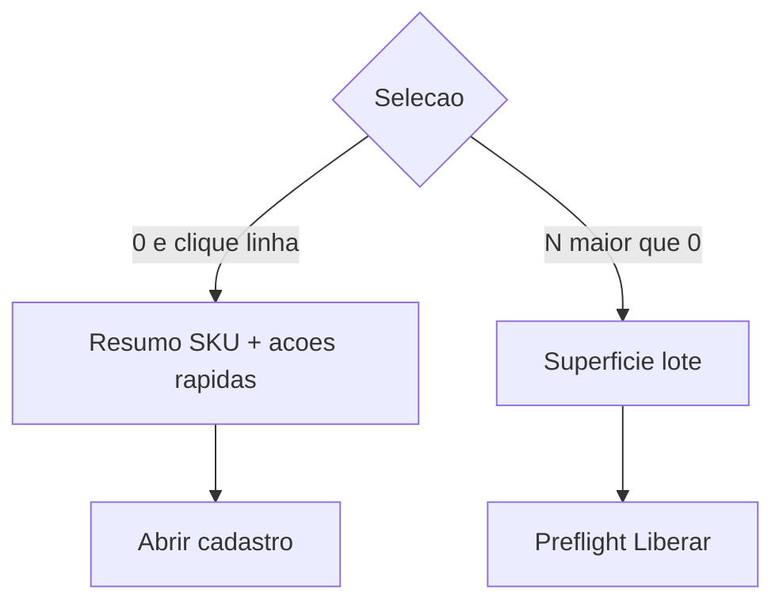

# Estudo — Produtos: AS-IS + experiência TO-BE (workspace)

**Data:** 2026-11-21 · **Branch alvo futura:** `dev`  
**Fase:** estudo / especificação — **sem implementação nesta marcha**  
**Plano:** Experiência de trabalho Produtos + Listas de Preço  

## Premissa

Não emendar split nas telas atuais. Repensar como o operador **consulta, compara, edita e executa** no catálogo, preservando **100%** das capacidades AS-IS. Central de Pedidos = referência de **interação** (lista + área de trabalho + guias + modos), não cópia de `OrderOpsSurface`.

---

## Parte A — AS-IS (inventário factual)

### A.1 Rotas e papéis

| Rota | Papel UI (`adminNavAccess`) |
|------|------------------------------|
| `/admin/produtos` | administrador, gerente, operador, estoque |
| `/admin/produtos/novo`, `/admin/produtos/:id` | idem |
| Importações sob `/admin/produtos/importar*` | geradas pelo header; hub histórico `/admin/importacoes` = MGMT |
| Kit na lista/editar | redirect `/admin/kits/:id` (K0 H8) |

### A.2 Navegação e listagem (`AdminProductsPage`)

**Header:** título Produtos; CTA Novo; links Importar, Aplicações, Importar aplicações/HF/imagens/kits, Kits, Histórico, Home/Destaques.

**Filtros (submit Buscar / Limpar):**

| Campo | Comportamento |
|-------|----------------|
| `q` | ILIKE name, sku, commercial_ref |
| Status | draft / published / archived |
| Natureza | item / kit |
| Estoque | is_available |
| Montadora→modelo→versão→motor | via PVC + vehicle_versions |
| Cascata categoria | subárvore published |
| Sem imagem | **client-side por página** carregada |
| Medidas | weight / dims / any / pol (gaps + POL) |

**Paginação:** `ADMIN_PRODUCTS_PAGE_SIZE = 200`, “Carregar mais”; ordenação `updated_at` DESC.  
**Seleção:** só itens em memória; reload limpa seleção.  
**UI:** mobile cards + desktop tabela (`max-h-[min(60dvh,640px)]`).  
**Colunas:** checkbox, código ref, nome (+ badge INCOMPLETO), status, disponibilidade, `products.price` (espelho — **não** preço resolvido da loja).

**Bulk (mesma página, acima da tabela):** Situação (publicar/arquivar/disponível/indisponível), Liberar com preflight checklist, Classificação, Medidas (`skip_manual` / `overwrite_manual`).

### A.3 Área de trabalho — ficha (`AdminProductFormPage`)

Scroll único. Dirty blocker **somente** no bloco Geral.

| Seção | Persistência |
|-------|----------------|
| Geral | upsert: nome, códigos, categoria folha, fabricante/fornecedor, posição/lado, status |
| Precificação | available, preço Base (novo), listas RO + links, override avulso, Liberar unitário |
| Frete próprio | POL, porte, veículo, compat, flag |
| Medidas + histórico RO | dims/peso + origins; histórico ≤30 |
| Descrição | curta + completa |

**Pós-`productId` (CRUD imediato, fora do blocker):** Usado em kits (+ substituir K8), Imagens, Relacionados, Equivalentes, Referências, Aplicações.

### A.4 Operação — mapa rápido

| Ação | Onde | Confirmação |
|------|------|-------------|
| Criar | `/novo` | — |
| Editar | ficha | save |
| Arquivar linha/bulk | lista | dialog |
| Publicar linha/bulk | lista | **sem** dialog; checklist no server |
| Liberar unitário | ficha | dialog se canRelease |
| Liberar lote | lista preflight → confirmar | dialog |
| Classificar / medidas | bulk | dialog condicional |

**Checklist D-LIBERAR (`releaseChecklist.ts`):** hard = nome, código, categoria, preço loja > 0 (`resolveProductPrice`), publicar neste passo se preciso; soft item = app/imagem.

### A.5 Inventário PRESERVAR 100%

Ver checklists detalhados no inventário de código (lista + ficha + service + rotas import + seções `AdminProduct*`). **Nenhuma capacidade desta lista pode sumir no TO-BE** — apenas mudar de lugar (lista / guia / full).

### A.6 Fricções AS-IS (drivers do redesign)

1. Sair da lista = perde contexto de filtros/seleção.  
2. Ficha = scroll infinito; seções pós-form sem blocker.  
3. Bulk compete verticalmente com a tabela.  
4. Preço na grade ≠ preço da loja.  
5. Seleção ≠ universo filtrado; “sem imagem” só na página carregada.  
6. Limpar filtros: Natureza pode ficar inconsistente (bug conhecido).  
7. Densidade de links de import no header compete com a tarefa principal.

---

## Parte B — TO-BE (experiência de trabalho)

### B.1 Decisão de design fechada — ficha vs guia

**Escolha:** modelo **híbrido alinhado à Central** (não “tudo na guia” nem “só preview RO eterno”).

| Camada | Conteúdo |
|--------|----------|
| **Primary (lista)** | Filtros compactos + grade + seleção; KPIs leves de incompletos (opcional) |
| **Guia / contextual** | (A) 1 SKU focado: resumo + ações rápidas + atalhos; (B) N selecionados: superfície de **lote** (hoje empilhada na página) |
| **Página completa** `/admin/produtos/:id` | Ficha **reorganizada em abas internas** (uma superfície de edição por registro) — Geral \| Precificação \| Mídia \| Aplicações \| Logística \| Relações |
| **Novo** | `/admin/produtos/novo` ou guia “rascunho” → após 1º save, promove a guia + oferece para full se necessário |

**Por quê:** OrderOps já muta no split em densidade compacta, mas a ficha FAL tem 6+ seções com CRUD próprio — forçar tudo no painel lateral fragmentaria e perderia scroll/salvar Geral. Abas na rota full resolvem a “ficha longa” sem dezenas de janelas. A guia recupera **contexto da lista** (comparar, lote, liberar).

### B.2 Arquitetura de experiência (cinco níveis Adaptive)

1. **Nav módulo** — Catálogo › Produtos (label futuro inalterado nesta frente).  
2. **Mini-menus** — filtros, chips ativos, ações de linha (Abrir guia / Abrir cadastro).  
3. **Área principal** — tabela/cards.  
4. **Painel contextual** — `ProductWorkSurface` (nome de trabalho; não OrderOps).  
5. **Tela completa** — ficha com abas + fullscreen Adaptive quando a guia precisa de espaço.

**Modos:** `split` \| `expanded` \| `fullscreen` \| `collapsed` — prefs `moduleKey: 'products'` em `fal-admin-workspace-v1`.

**Guias multi-SKU:** stack como `OrderSplitTabPanels` — vários produtos abertos; sem minimizar; fechar guia ≠ apagar seleção da lista.

### B.3 Lista TO-BE

- Filtros em barra colapsável / drawer (manter todos os campos AS-IS).  
- Chips dos filtros ativos + Limpar (corrigir Natureza no Limpar).  
- Badge INCOMPLETO + opcional contagem “elegíveis Liberar” na seleção.  
- Coluna preço: preferir **preço resolvido** (ou dual: espelho + resolvido) — decisão de implantação: **mostrar resolvido na grade** sem remover espelho no detalhe.  
- Vocabulário: **Abrir guia** · **Na guia** · **Abrir cadastro** · **+ Guia**.  
- Kit: continua link para hub Kits (não abre ProductWorkSurface). Ver [estudo Kits](./FAL_ESTUDO_KITS_WORKSPACE_TOBE_2026-11-21.md) (criação + BOM).

### B.4 Guia — modos de conteúdo

**Ações rápidas na guia (mutações leves):** arquivar, marcar disponível/indisponível, Liberar (com checklist), atalho Preços (`/admin/precos` com q), atalho Aplicações.  
**Não na guia (v1):** editar todas as seções da ficha; composição kit; import massivo.

### B.5 Ficha full — abas (reorganização sem perda)

| Aba | Consolida AS-IS |
|-----|-----------------|
| Geral | h2 Geral + Descrição |
| Precificação | h2 Precificação + Liberar |
| Mídia | Imagens |
| Aplicações | Aplicações (+ link gestão global) |
| Logística | Frete + Medidas + histórico |
| Relações | Relacionados, Equivalentes, Referências, Usado em kits |

Blocker dirty: estender para aba ativa (melhoria vs AS-IS só-Geral) — **preserva** intenção; não remove seções.

### B.6 Layout / densidade / responsivo

- Tokens `fal-*`, cartões `rounded-[14px] border-fal-line`, scroll `fal-admin-scroll`.  
- Desktop ≥ lg: split; &lt; lg: contextual fullscreen (já Adaptive).  
- Densidade lista ≈ Central (linhas compactas, badges, hint “Aberto na guia”).  
- Bulk **sai** do fluxo vertical principal → guia.

### B.7 Anti-objetivos Produtos

- Copiar wizard de pedido / `OrderOpsWizardNav`.  
- Abrir kit dentro do workspace de itens.  
- Perder Liberar, bulk medidas/classificação, seções K8, override, frete POL.  
- Implementar UI antes do gate do pacote de docs.

### B.8 Aceite deste estudo (docs)

- [x] AS-IS com inventário preservar  
- [x] Decisão ficha vs guia fechada  
- [x] Mapa lista / guia / full  
- [ ] Gate eFe no pacote completo (spec mestre)

---

## Arquivos-âncora

- `fal-pecas/src/pages/admin/products/AdminProductsPage.tsx`  
- `fal-pecas/src/pages/admin/products/AdminProductFormPage.tsx`  
- `fal-pecas/src/lib/releaseChecklist.ts`  
- `fal-pecas/src/components/admin/workspace/AdaptiveWorkspace.tsx`  
- Cruzamento: `FAL_SPEC_ADAPTIVE_WORKSPACE_2026-11-17.md`, K0 H8, `FAL_MARCHA_PRODUTOS_ALTERACOES_GLOBAIS_VAL_2026-11-04.md`
