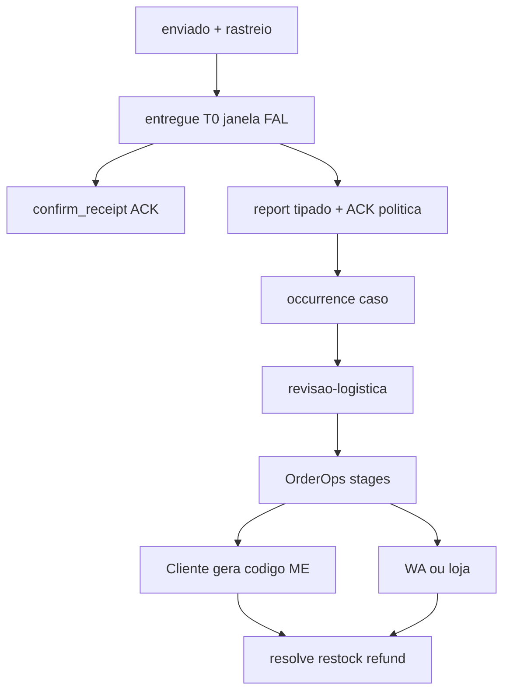
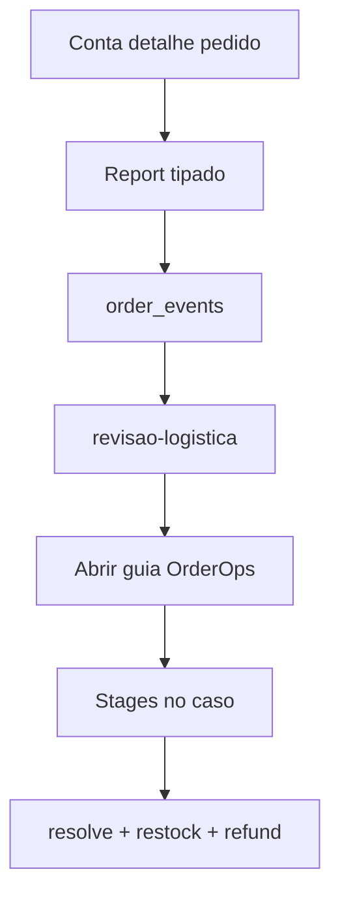

# FAL — Jornadas, funcionamento e UX: Camada pós-venda

**Data:** 2026-11-21  
**Status:** CANÔNICO de jornadas/UX — aplica D1–D18 sem redefini-los  
**Branch:** `dev`  
**Spec (decisões):** [FAL_SPEC_POS_VENDA_CAMADA_PEDIDO_2026-11-21.md](./FAL_SPEC_POS_VENDA_CAMADA_PEDIDO_2026-11-21.md)  
**Auditoria:** [FAL_AUDITORIA_INTEGRAL_POS_VENDA_2026-11-21.md](./FAL_AUDITORIA_INTEGRAL_POS_VENDA_2026-11-21.md)  
**Plano de implantação:** [FAL_PLANO_IMPL_POS_VENDA_2026-11-21.md](./FAL_PLANO_IMPL_POS_VENDA_2026-11-21.md)  
**Layout:** [FAL_PADRAO_TELAS_LAYOUT_DESIGN_v1_2026-11-21.md](./FAL_PADRAO_TELAS_LAYOUT_DESIGN_v1_2026-11-21.md) · [FAL_PADRAO_ADAPTIVE…](./FAL_PADRAO_ADAPTIVE_CENTRAL_PAINEL_CATALOGO_2026-11-21.md)

---

## 0. Anti-duplicidade (REUSAR / EVOLUIR / NÃO CRIAR)

| Tentação | Decisão |
|----------|---------|
| Rota `/conta/pos-venda` | **NÃO** — bloco no `/conta/pedidos/:id` |
| Menu `/admin/pos-venda` | **NÃO** — `revisao-logistica` + Abrir guia |
| Novo `moduleKey` / WorkSurface | **NÃO** — evoluir `OrderOccurrencesPanel` / OrderOps |
| Status `orders.status = devolucao_*` | **NÃO** no MVP — stages no caso |
| Segunda timeline | **NÃO** — só `order_events` |
| Visão `problemas` para RMA | **NÃO** — domínio pagamento/decisão |
| Cards/hero fora do padrão conta | **NÃO** — `rounded-fal border border-fal-line bg-fal-surface p-5` |
| Copy legal em 3 fontes | **NÃO** — `returnPolicyCopy` + legal |
| Auto-`deliver_order` via ME | **NÃO** — banner sugerir (D5) |
| Gerar código ME na abertura do caso | **NÃO** — só após autorização + clique cliente (D16) |

---

## 1. Funcionamento (máquina)



**Pedido comercial** permanece `entregue` durante o caso.  
**Caso** = ocorrência tipada + `stage` + payload (itens, policy_ack, return_mode).

### Dois relógios

| Relógio | Âncora | Controla | Não controla |
|---------|--------|----------|--------------|
| Janela FAL 7 dias | `entregue` / `delivered_at` / `order_delivered` | Abrir **novo** caso | Caso já aberto; confirm receipt |
| Validade código ME ~7 dias | Generate logística reversa | Postagem daquele código | Direitos do caso FAL |

**Confirm receipt ≠ T0.**

---

## 2. Matriz Fase × Tela × Controle × Período

### Fase 1 — Entrega / rastreio / problema tipado

| Tela | Evolução | Controle | Período |
|------|----------|----------|---------|
| `/conta/pedidos/:id` | Labels D6; rastreio; Confirmar + Problema tipado; gate 7d; ACK política | Cliente | T0 + gate abertura |
| `/conta/pedidos` | CTA opcional “Ajuda →” se janela aberta (abre detalhe) | Cliente | — |
| OrderOps (guia) | Banner ME delivered → `deliver_order` | Ops no pedido | — |
| `/trocas-devolucoes` | Bullets via `returnPolicyCopy` | Legal | — |

**Fora F1:** código ME, stages autorizada/peça, chips revisão.

### Fase 2 — Central

| Tela | Evolução | Controle | Período |
|------|----------|----------|---------|
| `/admin/pedidos/visao/revisao-logistica` | Lista = ocorrências ∪ own_manual_reviews; chips D12 | **Hub pós-venda** | Coluna/dias restantes (só leitura) |
| Hub Adaptive primary | Mesma lista; Abrir guia / + Guia | Vocabulário padrão | — |
| OrderOps | Tipos alinhados; start/notas | Execução | — |

**Fora F2:** compra reversa ME; CTA Gerar código.

### Fase 3 — Devolução / ME / fallback

| Tela | Evolução | Controle | Período |
|------|----------|----------|---------|
| Conta detalhe | Gerar código / WA caso / Devolver na loja | Cliente (D16) | Validade ME |
| OrderOps | Stages + override PAC/SEDEX + restock/estorno | Ops | — |
| Revisão | Chip/estágio aguardando peça (se útil) | Central | — |

---

## 3. Jornada do cliente (detalhe)

Legenda ação: **EXISTE** · **EVOLUIR** · **CRIAR**

| # | Status | Tela | Copy / o que vê | CTA | Função / evento | Fase | Ação |
|---|--------|------|-----------------|-----|-----------------|------|------|
| 1 | `enviado` | Detalhe + lista | **Aguardando entrega** + rastreio | Acompanhar envio / link rastreio | `ship_order`, tracking | 1 | EVOLUIR label; EXISTE link |
| 2 | `enviado` | Detalhe | Código/URL atualizados | — | `apply_me_tracking_update`, webhook | 1 | EXISTE |
| 3 | `entregue` | Detalhe | **Sua entrega chegou** + recebedor minimizado se houver | — | `deliver_order` / pickup confirm | 1 | EVOLUIR copy; CRIAR recebedor UI |
| 4 | `entregue` | Detalhe | Janela aberta/fechada | Problema só se aberta (ou caso já aberto) | Helper window + RPC gate | 1 | CRIAR |
| 5 | `entregue` | Detalhe | — | Confirmar recebimento | `customer_confirm_receipt` | 1 | EXISTE |
| 6 | `enviado`/`entregue` | Detalhe | Formulário motivos; se incompat/devolução: todo/itens + política ACK | Enviar | Report tipado → `occurrence_opened` | 1 | EVOLUIR RPC/UI |
| 7 | qualquer c/ caso | Detalhe timeline | Eventos customer do caso | — | `order_events` visibility customer | 1–3 | EVOLUIR labels stage |
| 8a | caso `autorizada` ME | Detalhe | Instruções + Gerar código | Gerar código de devolução | Edge reversa ME (FAL paga) | 3 | CRIAR |
| 8b | caso `autorizada` fallback | Detalhe | Texto loja + WA | Falar no WhatsApp / Devolver na loja | `buildOrderWhatsAppMessage` + return_mode | 3 | EVOLUIR texto |
| 9 | resolvido | Detalhe | Resultado (aprovado/recusado/reembolso) | — | `occurrence_resolved` customer | 3 | EVOLUIR |

### Variante retirada (pickup)

| Status | Copy cliente (já parcialmente no lifecycle) |
|--------|-----------------------------------------------|
| Pronto / autorizado | Pronto para retirar |
| `entregue` | Retirada feita |
| Pós | Mesmos Confirmar / Problema / caso |

T0 = confirmação de retirada (`admin_confirm_store_pickup` → `entregue`).

### Wireframe — detalhe `entregue` (Fase 1)

```
┌─────────────────────────────────────────┐
│ Pedido #… · Sua entrega chegou          │
│ Recebido por M. Silva (se houver)       │
│ Janela de suporte: X dias restantes     │
├─────────────────────────────────────────┤
│ [Confirmar recebimento]                 │
│ [Informar problema]                     │
├─────────────────────────────────────────┤
│ Frete / rastreio (histórico)            │
│ Atualizações do pedido (timeline)       │
│ (rodapé) Falar sobre este pedido · Legal│
└─────────────────────────────────────────┘
```

### Wireframe — formulário problema

```
┌─────────────────────────────────────────┐
│ Motivo: [suporte | incompat | devolução]│
│ Se incompat/devolução:                  │
│  ( ) Pedido inteiro  ( ) Selecionar itens│
│  [ ] item A qty  [ ] item B qty         │
│ Política (abundante) + [ ] Li e entendo │
│ Descreva: [________________]            │
│ [Enviar solicitação]                    │
└─────────────────────────────────────────┘
```

---

## 4. Jornada do operador (detalhe)

| # | Onde | O que faz | Função | Fase | Ação |
|---|------|-----------|--------|------|------|
| 1 | OrderOps expedição | Vê banner “ME: entregue — confirmar?” | `deliver_order` | 1 | CRIAR banner; EXISTE RPC |
| 2 | Inbox | Abre notificação → **mesmo** order id em guia | deep link | 1–2 | EXISTE inbox; EVOLUIR se preciso |
| 3 | `revisao-logistica` | Lista casos; chips D12; **Abrir guia** / **+ Guia** | lista corrigida | 2 | EVOLUIR lista; CRIAR chips |
| 4 | OrderOps ocorrências | Start, notas, autorizar/recusar | `admin_occurrence_action` + stages | 2–3 | EVOLUIR |
| 5 | OrderOps | Override PAC/SEDEX | metadata caso | 3 | CRIAR |
| 6 | OrderOps | Aguardando peça → conferência | stages | 3 | CRIAR |
| 7 | OrderOps | Resolve + **Repor estoque** + **Marcar estorno** | restock / `admin_mark_payment_refunded` | 3 | EXISTE botões |

**Vocabulário obrigatório:** Abrir guia · + Guia · Na guia · Fechar · Expandir · Tela cheia.  
**Proibido:** “Abrir pós-venda” como produto de navegação paralelo.

### Wireframe — revisão + chips (Fase 2)

```
┌─ PRIMARY (Adaptive orders) ─────────────────────────┐
│ Revisão e ocorrências                               │
│ [Todas] [Suporte] [Devolução/incompat.] [Aguard.ops]│
│ Pedido | Cliente | Tipo | Stage | Dias janela | …   │
│ …  [Abrir guia]  [+ Guia]                           │
├─ CONTEXTUAL ────────────────────────────────────────┤
│ OrderOpsSurface · ocorrência · ações                │
└─────────────────────────────────────────────────────┘
```

---

## 5. Inventário de funções

| Função | Quem | Quando | Arquivo / RPC atual | Fase | Status |
|--------|------|--------|---------------------|------|--------|
| `ship_order` | Ops | Despacho | adminOrderService | 1 | EXISTE |
| `apply_me_tracking_update` | System/ME | Rastreio | Edge webhook / RPC | 1 | EXISTE |
| `deliver_order` | Ops | Entrega | adminOrderService | 1 | EXISTE |
| `admin_confirm_store_pickup` | Ops | Retirada | adminOrderService | 1 | EXISTE |
| `customer_confirm_receipt` | Cliente | Pós-entregue | customerOrderActions | 1 | EXISTE |
| Report tipado (motivo, scope, items, ack) | Cliente | Janela | EVOLUIR RPC post_delivery | 1 | EVOLUIR |
| Gate janela 7d | Cliente/RPC | Abrir caso | helper + migration | 1 | CRIAR |
| Banner ME delivered | Ops UI | `enviado` + sinal | OrderOps slot | 1 | CRIAR |
| `admin_occurrence_action` | Ops | Ciclo ocorrência | OrderOccurrencesPanel | 2 | EXISTE |
| Stages autorizar/peça/conf | Ops | Devolução | orderOpsActions + RPC | 3 | CRIAR/EVOLUIR |
| Edge logística reversa ME | System | Cliente gera código | nova ação Edge | 3 | CRIAR |
| Cotação min PAC/SEDEX | System | Generate | Edge | 3 | CRIAR |
| `restock_order_item_physical` | Ops | Resolução | OrderOps | 3 | EXISTE |
| `admin_mark_payment_refunded` | Ops | Resolução | OrderOps | 3 | EXISTE |
| `buildOrderWhatsAppMessage` | Cliente | Rodapé / caso | whatsapp.ts | 1/3 | EVOLUIR texto caso |
| `returnPolicyCopy` | Conta+Legal | Formulário/legal | lib nova | 1 | CRIAR |
| Lista `revisao` unificada | Ops | Hub | adminListLogisticsQueue | 2 | EVOLUIR |

---

## 6. Caminhos canônicos vs proibidos



| Relação | Risco | Fechamento |
|---------|-------|------------|
| Report → Revisão | Lista só `own_manual_reviews` | F2: unir ocorrências |
| Inbox vs Revisão | Duas “filas” | Inbox = deep link; Revisão = lista |
| `problemas` vs revisão | RMA no lugar errado | Domínios separados na UI/copy |
| WA rodapé vs WA caso | Botões iguais | Mesmo helper; texto com occurrence_id no caso (F3) |
| Legal vs formulário | Drift | `returnPolicyCopy` |
| Timeline conta vs admin | Duas verdades | Só `order_events` |
| `entregue` vs stage | Status `devolucao` | Pedido fica `entregue` |
| Confirm vs janela | Confusão T0 | Copy + doc |
| Contador vs lista | Badge mentiroso | Contagens = listas (F2) |
| Etiqueta ida vs reversa | `reverse:false` misturado | Edge/ação separada (F3) |

### Checklist QA anti-erro

- [ ] Confirm receipt não inicia janela 7d  
- [ ] Caso aberto não fecha só por calendário  
- [ ] Sem auto-deliver  
- [ ] Sem código ME na abertura  
- [ ] Sem rota/módulo isolado  
- [ ] Sem usar visão `problemas` para pós-venda  
- [ ] Copy legal única  
- [ ] Lista revisão mostra ocorrência do cliente  

---

## 7. Layout (padrão FAL)

### Conta

- Evoluir bloco atual “Pós-entrega” → seções **Entrega** + **Ajuda com este pedido** no mesmo visual: `rounded-fal border border-fal-line bg-fal-surface p-5`.  
- Tokens: `text-fal-fg`, `text-fal-muted`, `border-fal-line`, `Button` existente.  
- Mobile: `flex flex-wrap gap-2` nos CTAs (já usado).  
- Sem purple/cream genérico; sem card-hero.

### Admin

- Shell: `AdaptiveWorkspace` `moduleKey="orders"` only.  
- Primary: lista + chips. Contextual: `OrderOpsSurface`.  
- Banner ME: faixa warning no slot expedição (padrão alertas OrderOps).  
- Bump de padrão: no máximo **PATCH** copy/densidade — **sem** novo moduleKey (MINOR).

### Wireframe — pós-autorização ME (Fase 3)

```
┌─────────────────────────────────────────┐
│ Devolução autorizada                    │
│ Frete de retorno por conta da FAL       │
│ [Gerar código de devolução]             │
│ Após gerar: código · validade · DC-e    │
│ Instruções Correios                     │
└─────────────────────────────────────────┘
```

---

## 8. Controle na Central — donos

| Necessidade | Dono canônico |
|-------------|---------------|
| Ver casos | `revisao-logistica` + chips |
| Executar | OrderOps (guia) |
| Confirmar entrega | OrderOps + `deliver_order` |
| Estorno / restock | Botões OrderOps existentes |
| Atalho | Inbox → mesmo pedido |

---

## 9. Referência rápida D1–D18

Ver Spec §1. Este doc **não** altera decisões; só as aplica em telas e jornadas.
