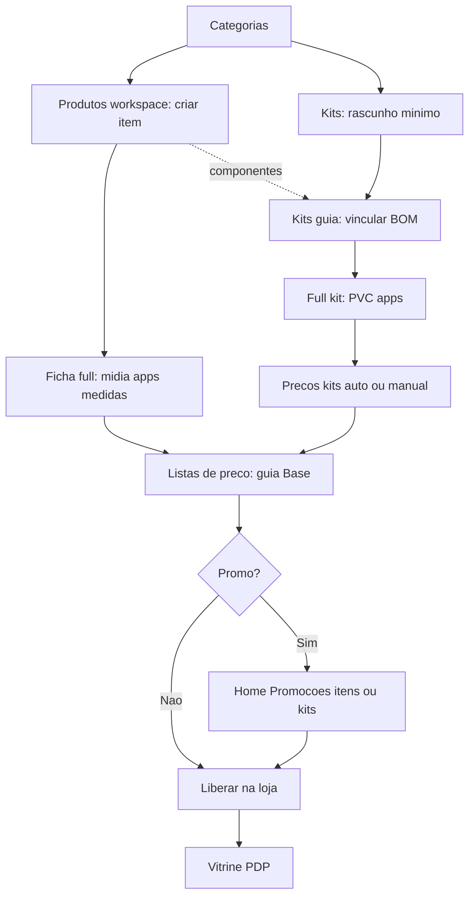

# Jornada cruzada — Produto ↔ Preço ↔ Promo ↔ Kits

**Data:** 2026-11-21 · Estudo (sem código)  
**Entradas:** estudos Produtos · [Kits](./FAL_ESTUDO_KITS_WORKSPACE_TOBE_2026-11-21.md) · Preços

## 1. Papéis e handoff

| Papel | Catálogo (Produtos/Kits/Apps) | Listas de preço / Promo / Import hub |
|-------|-------------------------------|--------------------------------------|
| operador / estoque | Sim | Não (menu) |
| gerente / administrador | Sim | Sim |

**Handoff típico:** operador cadastra e classifica → gerente precifica Base (e promo) → Liberar na loja (qualquer um com acesso + checklist).

## 2. Fluxo ponta a ponta (TO-BE mental)

## 3. Deep links que a UX deve preservar / melhorar

| De | Para | Uso |
|----|------|-----|
| Ficha Precificação | `/admin/precos`, `/admin/precos/:baseId` | Ver/editar listas |
| Guia Produto (TO-BE) | Listas de preço com q=SKU | Atalho gerente |
| Overview Preços | `/admin/produtos` | Classificar SKU |
| Promo | Cadastro produto/kit | Incluir e ativar |
| Lista produtos (kit) | `/admin/kits/:id` | K0 H8 |
| Guia Kit BOM | `/admin/produtos/:componentId` | Abrir item componente |
| Preços kits-manual | `/admin/kits/precos` | Não misturar no workspace listas |
| Kit sem apps | Aba Aplicações full kit | Fecha gap Liberar |

## 4. Anti-emendo (integração)

- **Não** embutir editor de listas dentro do workspace Produtos.  
- **Não** embutir ficha de produto dentro do workspace Preços (só add SKU + preço na lista).  
- **Não** fundir Promoções no split de Preços.  
- **Não** montar BOM dentro do workspace Produtos — só no hub Kits.  
- Kits: hub + Adaptive `kits`; Produtos/Preços apenas apontam.

## 5. Eixos na UI (item e kit)

1. **Status** draft/published/archived  
2. **Disponibilidade** is_available (kit: `compute_kit_is_available`)  
3. **Preço** listas + gate promo  
4. **Composição (só kit)** H2 + preview soma / modo auto\|manual  
5. **PVC** (kit: próprio; flag revisão H6)

TO-BE: guia Produto e guia Kit exibem esses eixos sem confundir `products.price` espelho com preço resolvido.

## 6. Aceite integração

- [x] Handoff RBAC documentado  
- [x] Diagrama ponta a ponta  
- [x] Fronteiras anti-emendo  
- [ ] Validação eFe no pacote mestre
