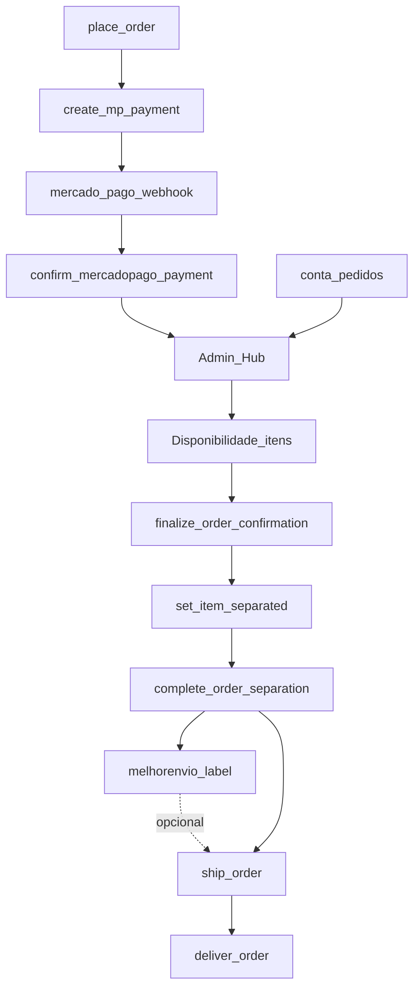
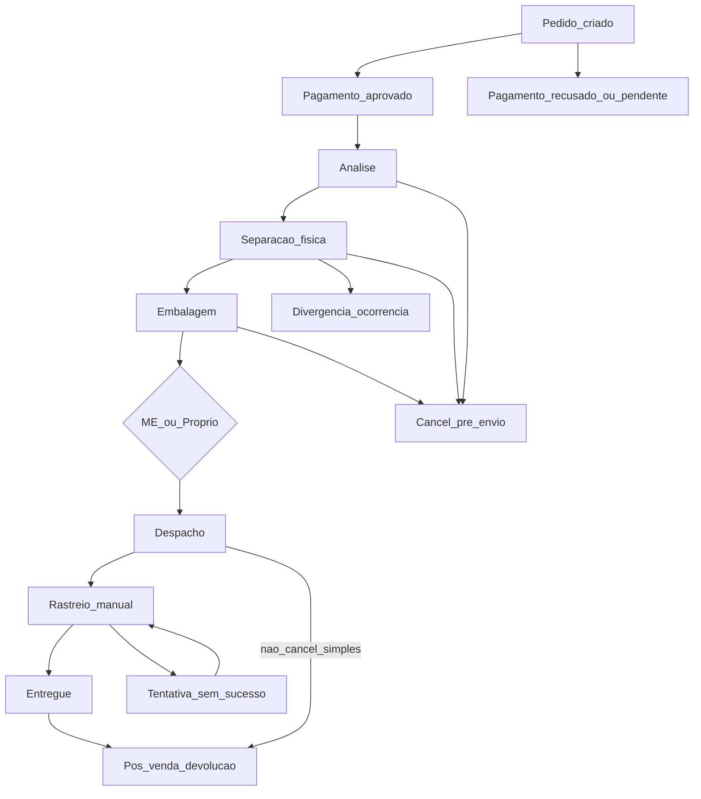
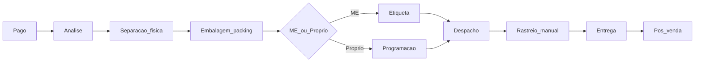

# Mapa da jornada — Central de Pedidos FAL

**Versão:** V2 · **Data:** 2026-11-11  
**Programa:** [FAL_PLANO_CENTRAL_PEDIDOS_4_FRENTES_2026-11-11.md](./FAL_PLANO_CENTRAL_PEDIDOS_4_FRENTES_2026-11-11.md)  
**Matriz:** [FAL_AUDITORIA_CENTRAL_PEDIDOS_MATRIZ_2026-11-11.md](./FAL_AUDITORIA_CENTRAL_PEDIDOS_MATRIZ_2026-11-11.md)

---

## Changelog V1 → V2

| Mudança | Motivo |
|---------|--------|
| Estoque como dependência externa, não etapa da Central | Escopo eFe |
| Ramificações (recusa, cancel, divergência, tentativa, devolução) | Jornada não linear |
| Packing neutro multi-volume + snapshot | Ressalva embalagem |
| Rastreio manual com histórico de eventos | Ressalva rastreio |
| Ocorrências com occurrence_id | Ressalva EVT |
| Multi-envio: não suportado | Limitação explícita |
| Separação integral por linha | Decisão V2 |

---

## 1. Jornada alvo (Central)

1. Criação do pedido  
2. Confirmação do pagamento  
3. Análise e liberação operacional  
4. Separação física e conferência  
5. Embalagem e volumes  
6. Cotação e contratação de frete  
7. Emissão de etiquetas (se ME)  
8. Despacho  
9. Rastreamento (manual)  
10. Entrega  
11. Ocorrências  
12. Atendimento e pós-venda / devolução  

**Fora da Central:** gestão de reserva/baixa/saldo (módulo estoque) — o pedido pode *exibir* modo/snapshot, mas não controla inventário.

Pedido = registro-mestre. Financeiro, logística, documentos e eventos vinculados a ele.

---

## 2. Jornada atual (código)



### 2.1 Status comercial (CHECK F7)

```text
aguardando_pagamento → (MP) → … → em_analise
  → [opcional] aguardando_decisao
  → confirmado → em_separacao → pronto_para_envio → enviado → entregue
  → cancelado (não pago / decisão / Onda2 / expire)
```

### 2.2 Eixos paralelos

| Eixo | Onde | Notas V2 |
|------|------|----------|
| Pagamento | `payments` | pending/approved/rejected/expired/refunded · cancel comercial ≠ estorno |
| Separação | `order_items.separated` | Integral por linha; sem qty_separated |
| Embalagem | quotes + metadata (hoje ME) | Alvo: `packing` neutro multi-volume |
| Etiqueta ME | `metadata.me.label_state` | ≠ status pedido |
| Expedição | `ship_order` | Despacho efetivo |
| Entrega | `deliver_order` | + proof_ref |
| Rastreio | manual + events | Histórico por transição (alvo V2) |
| Ocorrências | `order_events` | occurrence_id (alvo V2) |
| Estoque | inventory* | **Módulo externo** — Central não altera |

---

## 3. Ramificações (não só linear)



| Situação | Tratamento Central |
|----------|-------------------|
| Pagamento recusado/pendente | Fila aguardando pagamento; sem separação |
| Cancel pré-`enviado` | Paths comerciais existentes |
| Divergência separação | Ocorrência; não complete integral |
| Pós-despacho | Ocorrência + pós-venda; sem cancel “simples” |
| Tentativa sem sucesso | Evento rastreio + ocorrência |
| Devolução | Fluxo pós-venda; reintegração estoque = módulo estoque |
| Multi-envio | **Não suportado** nesta versão |

---

## 4. Frontend

| Rota | Papel |
|------|-------|
| `/admin/pedidos` | Hub |
| `/admin/pedidos/lista` | Lista avançada |
| `/admin/pedidos/{aguardando-pagamento\|analise\|separacao\|expedicao}` | Filas |
| `/admin/pedidos/visao/:viewId` | Visões |
| `/admin/pedidos/:id` | Operação |
| `/admin/logistica/*` | Config (não fila) |
| `/conta/pedidos` · `/:id` | Meus Pedidos |

Áreas × etapas: Pagamento 1–2 · Análise 3 · Separação 4 (+ emb parcial) · Expedição 5–10.

---

## 5. Backend (resumo)

RPCs ops: `place_order`, `confirm_mercadopago_payment`, disponibilidade, finalize, separated, complete, ship, deliver, transitions, cancel cliente/Onda2, expire, counts, refund mark.

Edges: create-mp-payment · mercado-pago-webhook · quote-shipping · quote-own-delivery · melhorenvio-label · melhorenvio-webhook (**stub** — rastreio auto fora; manual na Central).

Inventário (release/fulfill): existe no SQL; **Central V2 não altera**.

---

## 6. Banco

| Tabela | Papel Central |
|--------|---------------|
| orders / order_items | Cabeçalho + snapshot + separated |
| order_status_history / order_events | Timeline + ocorrências (occurrence_id alvo) |
| payments / payment_events | Financeiro |
| shipments | Frete, tracking, proof, metadata |
| shipping_quotes / shipping_box_templates | Cotação + catálogo caixas |
| inventory* | Dependência externa (leitura/contexto no máximo) |

RLS: UPDATE orders JWT revogado (bom) · INSERT orders ainda aberto (CP-SEC-030) · events customer só visibility=customer · shipments staff UPDATE (CP-SEC-035).

---

## 7. Packing alvo (spec — sem migration nesta MARCHA)

```text
packing.volumes[] = {
  id, length, width, height, weight, unit,
  operator_id, recorded_at, notes
}
shipping_quotes.volumes = snapshot da cotação
metadata.me.* = só dados Melhor Envio (label_state, urls, cart_id…)
```

Mudança dims/peso → invalida cotação. Contratação congela snapshot usado. Serve ME e frete próprio.

---

## 8. Ocorrências e rastreio (spec V2)

**Ocorrência:** cadeia `order_events` com mesmo `occurrence_id`; estado atual = último evento; nunca overwrite.

**Rastreio manual:** cada mudança (despachado / em transporte / saiu para entrega / tentativa / entregue / ocorrência) gera evento com responsável, data e informação.

---

## 9. Integrações

**MP:** create → webhook → confirm RPC. Liberação ≠ UI checkout.

**ME:** quote→prepare→purchase→generate→print; ship separado; webhook auto = evolução.

**Own:** quote ownq → ship/deliver manuais; sem painel ME.

---

## 10. Jornada proposta pós Fase 1–2



---

## 11. Admin vs cliente

| Info | Admin | Cliente |
|------|-------|---------|
| Status / próxima ação | Completo | Timeline simplificada |
| Pagamento | Refs MP | CTAs |
| Events internal | Sim | Não |
| Ocorrências customer-visible | Conforme visibility | Sim se marcado |
| Margem | Sim | Não |
| Etiqueta/romaneio | Sim | Não |
| Tracking | Manual + histórico | Quando customer-visible |

---

## 12. Âncoras de código

`fal-pecas/src/pages/admin/orders/*` · `adminOrderOps.ts` · `orderLifecycle.ts` · `adminOrderService.ts` · Edges MP/ME/quote · migrations F7–F9 / ME / Onda1–2.
