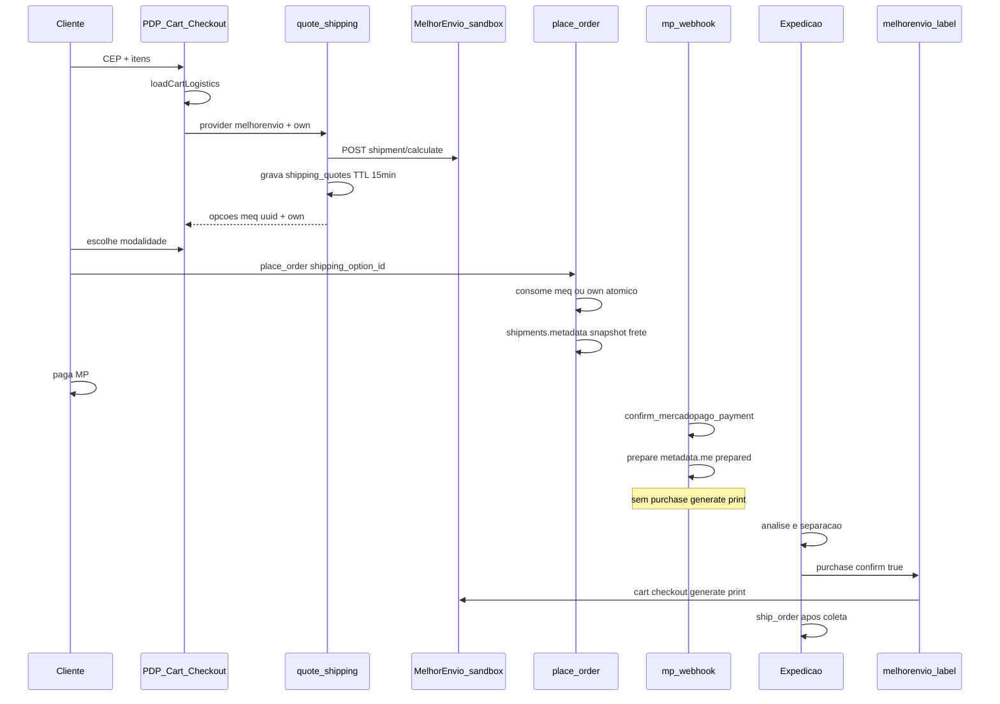
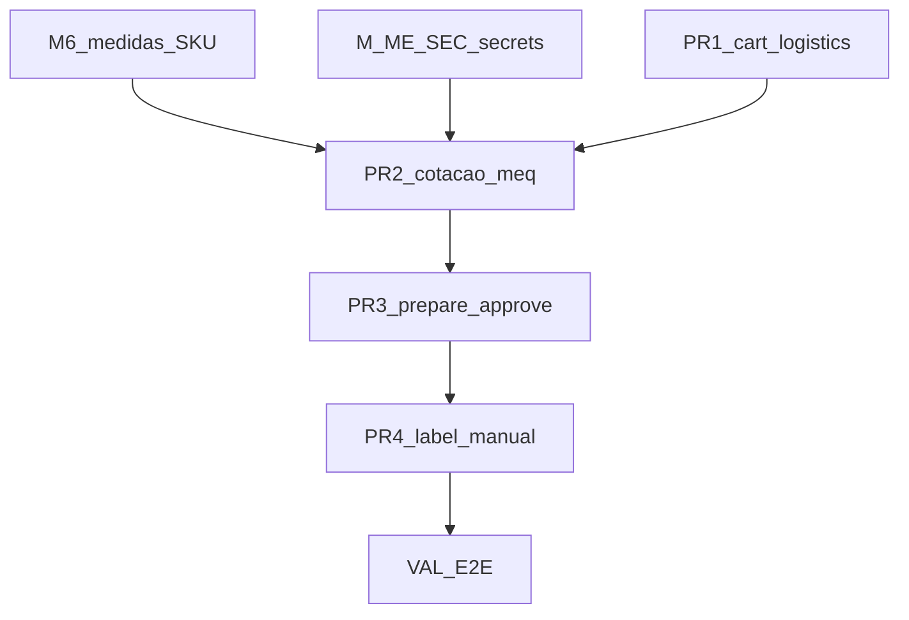

# MARCHA — Melhor Envio híbrido (planejamento detalhado)

**Data:** 2026-11-04  
**Tipo:** planejamento de implementação (este MD **não** executa código)  
**Decisão eFe:** D12 — cotação loja + prepare no approve + etiqueta manual  
**Política:** D-FRETE **B** (sandbox + disclaimer; sem default produção ME)  
**Canônico:** [FAL_PLANO_FUNCIONAL_LOGISTICA_MEDIDAS_2026-11-04.md](./FAL_PLANO_FUNCIONAL_LOGISTICA_MEDIDAS_2026-11-04.md)  
**Auditoria:** [FAL_AUDITORIA_LOGISTICA_ME_CONSOLIDACAO_2026-11-04.md](./FAL_AUDITORIA_LOGISTICA_ME_CONSOLIDACAO_2026-11-04.md)  
**VAL Expedição base:** [FAL_MARCHA_CENTRAL_PEDIDOS_ME_SANDBOX_VAL_2026-11-04.md](./FAL_MARCHA_CENTRAL_PEDIDOS_ME_SANDBOX_VAL_2026-11-04.md)

---

## 1. Objetivo

Entregar o ciclo logístico híbrido:

| Momento | Quem | O quê |
|---------|------|--------|
| PDP / carrinho / checkout | Cliente | Vê preço e prazo conforme itens; escolhe `own:*` ou `meq:*` (ou mock sob B) |
| `place_order` | Sistema | Cobra frete **server-side** (consome cotação) |
| Webhook MP approve | Sistema | Só **PREPARA** snapshot ME no shipment — sem comprar/gerar/imprimir |
| Análise → separação | Operador | Confirma itens / estoque |
| Expedição | Operador | Emite/imprime etiqueta **manualmente** |
| Pós coleta | Operador | `ship_order` |
| Cliente | — | `deliver_order` (fluxo já existente) |

---

## 2. Decisões fechadas (eFe)

| ID | Decisão |
|----|---------|
| D12.1 | Cotação ME na loja sob B com disclaimer (sandbox) — **autorizada** |
| D12.2 | Frete próprio + ME como modalidades concorrentes na cotação |
| D12.3 | Approve MP = prepare snapshot (`quoted` \| `prepared`; cart ME opcional sem checkout) |
| D12.4 | Emissão/impressão = **manual** na Expedição |
| D12.5 | Compra automática de etiqueta no webhook MP = **proibida** |
| D12.6 | Remetente = `store_shipping_origin` + token só em secrets Edge |
| D12.7 | Secrets: `MELHOR_ENVIO_TOKEN`, `MELHOR_ENVIO_USER_AGENT` (+ `MELHOR_ENVIO_WEBHOOK_SECRET` se webhook) |

### Ainda PENDENTE (não bloqueia o desenho; bloqueia go-live sandbox completo)

| ID | Pendência |
|----|-----------|
| P-ME-1 | Aplicar migration `shipping_quotes` + ledger (após fix RLS `profile_id`) — OK eFe no apply |
| P-ME-2 | Timing secrets: agora vs após M6 (recomendação: secrets após ter ≥1 SKU com medidas para smoke) |
| P-ME-3 | Quais `service_id` ME exibir (filtrar lista calculate) |
| P-ME-4 | Inserir item no carrinho ME no prepare do approve **ou** só snapshot até Expedição (recomendação v1: **só snapshot**; cart no prepare da Expedição) |
| P-ME-5 | Critérios avançados preço frete próprio |

---

## 3. Fluxo ponta a ponta



### Máquina `metadata.me.label_state`

| Estado | Quem escreve | Significado |
|--------|--------------|-------------|
| `none` | place_order / default | Sem ME ou ainda não preparado |
| `quoted` | cotação Expedição ou eco da loja | Valor cotado conhecido |
| `prepared` | webhook pós-approve | Snapshot pronto para operador (D12) |
| `cart` | Expedição `prepare` | No carrinho ME (ainda não pago) |
| `purchased` | Expedição `purchase` + `confirm:true` | Etiqueta comprada |
| `generated` | Expedição `generate` | Pronta para imprimir |
| `printed` | Expedição `print` | URL impressão obtida |

**Proibido no webhook MP:** `purchased` | `generated` | `printed`.

---

## 4. Entrega A — Cotação loja (detalhe técnico)

### 4.1 Registry

Arquivo: `fal-pecas/src/services/shipping/carrierRegistry.ts`

- Novo descriptor `melhorenvio`: `mode: 'live'` (HTTP real sandbox) **ou** `sandbox` se preferir disclaimer até secrets; `quoteRuntime: 'edge'`; `placeOrderReady: true` só após RPC `meq:` existir.
- Default `VITE_SHIPPING_PROVIDER` permanece `mock` em produção Netlify até decisão explícita de opt-in.
- Cotação híbrida UI: envelope deve poder **unir** opções `own:*` (se enabled + CEP na faixa) + opções ME, sem substituir mock quando provider=mock.

**Desenho recomendado v1 (PENDÊNCIA de implementação):**

- Função `quoteShippingEnvelopeHybrid` (ou flag em envelope): se `store_own_delivery.enabled` e CEP coberto → inclui rates own; se ME configurado → inclui `meq:*`; sob B com provider mock puro → só mock (comportamento atual).
- Alternativa mínima: `VITE_SHIPPING_PROVIDER=melhorenvio` opt-in + own injetado no envelope sempre que coverage ok.

### 4.2 Edge `quote-shipping`

Arquivo: `fal-pecas/supabase/functions/quote-shipping/index.ts`

- Branch `provider === 'melhorenvio'`:
  - Secrets `MELHOR_ENVIO_*`; sem token → `501 not_configured`.
  - `from.postal_code` de `store_shipping_origin` (service role read).
  - `to.postal_code` do body.
  - Products: id, qty, weight kg, height/width/length cm, `insurance_value` rateado pelo subtotal.
  - Descartar entradas com `error`.
  - Caixa única v1: peso Σ(qty×weight); dims = max por eixo.
  - Sem peso/dim → `422 missing_logistics` (sem inventar).
- Insert `shipping_quotes` (service role): fingerprint, postal_code, customer_id se auth, options jsonb, expires_at = now()+15min.
- Resposta UI: opções com `id: meq:<uuid>` **por serviço** (uma linha quote com N options **ou** N rows — preferir **1 row / fingerprint** com `options[]` e id estável `meq:<quoteId>:<serviceId>` **ou** 1 uuid por serviço em tabela filha).

**Contrato sugerido (v1 simples):**

- 1 registro `shipping_quotes` por request fingerprint.
- Cada opção: `id = meq:<quote_uuid>:<service_id>`, amount, label, eta, service_id, packages.
- `place_order` valida prefixo, carrega quote, checa option dentro de `options`, marca `consumed_at`.

### 4.3 Front

| Arquivo | Mudança |
|---------|---------|
| Provider ME client | Chama `edgeQuoteClient` com `provider: 'melhorenvio'` |
| `CartShippingQuoteBlock` | Usar `loadCartLogistics` (hoje só productId/qty) |
| PDP / Checkout | Já usam envelope; garantir items com dims |
| Disclaimer | `commercialShippingDisclaimer` honesto sob B |

### 4.4 `place_order`

- Preservar `mock:*` e `own:*`.
- Novo path `meq:%`:
  - Mesmo `customer_id`, CEP do endereço = quote.postal_code, fingerprint dos itens do pedido = quote.request_fingerprint, `consumed_at is null`, `expires_at > now()`.
  - `UPDATE … SET consumed_at, consumed_by_order_id WHERE id=… AND consumed_at IS NULL` → se 0 rows, fail.
  - `shipping_amount` = amount da option (nunca do client).
  - `shipments.metadata`: `option_id`, `quote_id`, `service_id`, `volumes`, `provider: melhorenvio_sandbox`, `charged_shipping`.

---

## 5. Entrega B — Prepare no approve

Arquivo: `fal-pecas/supabase/functions/mercado-pago-webhook/index.ts` (após `confirm_mercadopago_payment` OK).

### Comportamento

1. Carregar `shipments` do `order_id`.
2. Se provider/option for ME (`meq:` / metadata):
   - Merge `metadata.me`:
     - `label_state: 'prepared'`
     - `service_id`, `quoted_amount` / `label_amount` = frete cobrado
     - `volumes`, `quote_id`, `checkout_snapshot_ref`
     - `last_error: null` ou mensagem se faltou dado
3. **Não** chamar ME cart/checkout/generate/print.
4. Try/catch isolado: falha → log + `last_error`; resposta webhook continua **200** com approve ok.
5. Pedidos `own:` / `mock:` → skip prepare ME (ou `label_state: none`).

### Recomendação P-ME-4

v1 **não** inserir no carrinho ME no webhook (evita etiqueta órfã / saldo / agency). Prepare = só metadata. Carrinho ME na ação `prepare` da Expedição.

---

## 6. Entrega C — Expedição manual

Arquivo: `fal-pecas/supabase/functions/melhorenvio-label/index.ts` + `MeExpeditionPanel`.

| Ação | HTTP ME | Gate |
|------|---------|------|
| `status` | — | staff |
| `quote` | calculate (revalidar) | `pronto_para_envio` \| `preparando_envio` |
| `prepare` | POST `/api/v2/me/cart` | idempotente se `cart_item_id` |
| `purchase` | POST checkout | **`confirm:true`** + divergence check |
| `generate` | generate | após purchased |
| `print` / `tracking` | print / tracking | após generated |

### Correções obrigatórias vs código atual

- `from` = `store_shipping_origin` (não `01310100`).
- Destino: `address_snapshot.postal_code` (não `cep`/`zip`).
- Cart live: payload completo (service, from, to, products, volumes, options).
- `agency` se transportadora exigir — falha clara em `last_error`, sem `ship_order`.
- Divergência: `|label - charged| > 0.01` → bloqueia purchase.

### UX operador

1. Conferir itens físicos × pedido.  
2. Ver frete cobrado × cotação atual.  
3. Confirmar compra etiqueta.  
4. Gerar + imprimir.  
5. Levar ao ponto de coleta.  
6. `ship_order` (tracking se já disponível).

---

## 7. Entrega D — Docs, testes, VAL

| Artefato | Conteúdo |
|----------|----------|
| VAL novo | `FAL_MARCHA_ME_HIBRIDO_VAL_YYYY-MM-DD.md` |
| Testes | fingerprint/consumo meq; label_state transitions; prepare não sobe para purchased; divergence |
| Sync | Atualizar backlog pós-α P2-ME; auditoria §F fechada onde couber |

---

## 8. Migrations / secrets

### Migration (antes de apply)

Arquivo proposed: `20261104190000_melhorenvio_label_metadata_shipping_quotes.sql`

- Corrigir RLS: `customers.profile_id = auth.uid()` (não `user_id`).
- Comment `shipments.metadata` ok.
- `melhorenvio_webhook_events` ok para stub.
- Mover para `migrations/` só com OK eFe + apply controlado (sem `db push` cego).

### Secrets Edge (sandbox)

```
MELHOR_ENVIO_TOKEN=
MELHOR_ENVIO_USER_AGENT=FAL Pecas (email@dominio)
MELHOR_ENVIO_WEBHOOK_SECRET=   # opcional stub
# Base fixa no código: https://sandbox.melhorenvio.com.br
```

Carteira sandbox com saldo antes do primeiro `purchase` real.

---

## 9. Fatias de PR (menor vertical útil)

| PR | Escopo | Aceite mínimo |
|----|--------|---------------|
| **PR-1** | `loadCartLogistics` no carrinho + disclaimer | Cotação carrinho usa peso real |
| **PR-2** | Migration corrigida + quote-shipping ME + carrier + `meq:` place_order | Cotar e criar pedido com frete ME sandbox |
| **PR-3** | Prepare-on-approve (metadata only) | Approve deixa `prepared`; sem purchase |
| **PR-4** | Label HTTP real + origem DB + painel | Operador emite/imprime; ship_order separado |
| **PR-5** | VAL + smoke E2E documentado | Checklist §10 |

Recomendação: **PR-1** imediato (baixo risco); **PR-2** após M6 parcial + secrets; não juntar NF-e / D-FRETE C / auto-status webhook ME.

---

## 10. Aceite consolidado

- [ ] PDP / carrinho / checkout: modalidades com preço coerente aos itens  
- [ ] `place_order` grava frete server-side (`meq` / `own` / `mock`)  
- [ ] Approve MP: `label_state` ≤ `prepared`; sem purchase/generate/print  
- [ ] Operador emite/imprime manualmente só em Expedição  
- [ ] `ship_order` só após postagem / coleta  
- [ ] Sem token no front; disclaimer B se sandbox  
- [ ] Origem = `store_shipping_origin`  
- [ ] RLS `shipping_quotes` com `profile_id`  
- [ ] Divergência bloqueia compra indevida  

---

## 11. Fora desta marcha

- Token / base produção Melhor Envio  
- NF-e / envio comercial (`non_commercial: false`)  
- Webhook ME alterando status do pedido  
- Trocar default Netlify para ME sem assinatura C  
- Auto-purchase no approve  

---

## 12. Dependências



---

**Assinatura agente:** planejamento detalhado ME híbrido 2026-11-04 — docs only; sem implementação.
