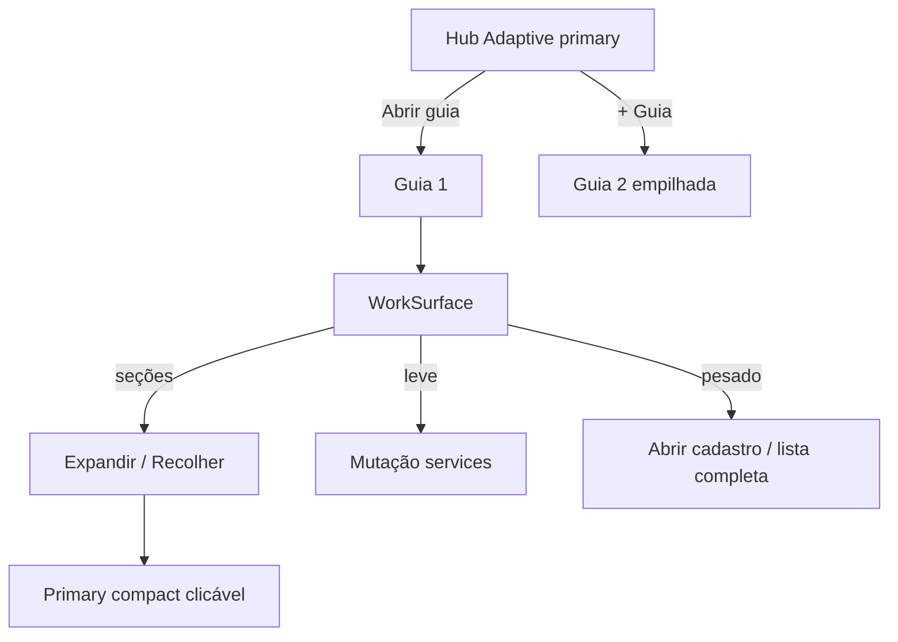

# FAL Marcha — UI Layout v1.0.4 VAL (versão + dinâmica detalhada)

**Data:** 2026-11-21 · Branch: **`dev`** (nunca main/prod sem gate eFe)  
**Padrão normativo:** [FAL_PADRAO_TELAS_LAYOUT_DESIGN_v1_2026-11-21.md](./FAL_PADRAO_TELAS_LAYOUT_DESIGN_v1_2026-11-21.md) → **FAL-UI-LAYOUT v1.0.4**  
**Antecessoras:** [v1.0.1](./FAL_MARCHA_UI_LAYOUT_v101_VAL_2026-11-21.md) · [v1.0.2](./FAL_MARCHA_UI_LAYOUT_v102_VAL_2026-11-21.md) · (v1.0.3 = filtros)  
**Antiregress:** `pnpm test:ui-layout-antiregress` · locks **FL1–FL15**

---

## 1. Linha de versão (o que cada PATCH fechou)

| Versão | Foco | Locks |
|--------|------|-------|
| **v1.0** | Baseline Adaptive catálogo + tokens + FL1–FL10 | FL1–FL10 |
| **v1.0.1** | Compact lista + loadingBom + title Listas de preço | FL4↑ FL4b |
| **v1.0.2** | Dedupe CTAs / Link>Button / vocabulário singular | FL11–FL13 |
| **v1.0.3** | Filtros Produtos compactos ↔ expansíveis + chips | FL14 |
| **v1.0.4** | Guia Produto rica + dinâmica Expandir/Recolher + empilhar | FL15 |

**Semântica:** PATCH = densidade/copy/contratos de superfície **sem** novo `moduleKey`. MINOR = novo hub Adaptive. MAJOR = quebra shell/prefs/vocabulário.

---

## 2. Dinâmica zin (modelo mental único)



### 2.1 Camadas

| Camada | Papel | Densidade |
|--------|-------|-----------|
| **Primary** | Lista + filtros + CTAs de linha | Compacta com guia aberta (`data-workspace-primary=compact`) |
| **Contextual** | WorkSurface do domínio | Chrome fino; scroll interno; seções sob demanda |
| **Full** | Ficha/F8 | Abas; formulários longos |

### 2.2 Vocabulário (travado)

| Termo | Quando aparece |
|-------|----------------|
| **Abrir guia** | Nenhuma guia aberta → abre a 1ª |
| **Na guia** | Registro já no stack (ativo ou não) |
| **+ Guia** | Já há guia(s) → **empilha** outro ID |
| **Fechar guia** | Fecha tab ou collapse contextual |
| **Mais filtros / Recolher filtros** | Produtos: bloco de filtros |
| **Expandir / Recolher** | Seções dentro da guia Produto |
| **Abrir cadastro** | Full produto/kit |
| **Abrir lista completa** | Full F8 preços |
| **Novo na guia / Cadastro completo** | Kits: rascunho vs `/kits/novo` |

### 2.3 Prefs / storage (UI only)

| Chave | Escopo | Conteúdo |
|-------|--------|----------|
| `fal-admin-workspace-v1` | localStorage | mode/splitWidth por `moduleKey` — **sem** selectedId |
| `fal.products.filtersExpanded` | session | `1`/`0` filtros |
| `fal.products.guideSections` | session | seções abertas da guia |
| `fal.kits.openGuideId` | session | ponte Produtos → hub Kits abre guia |
| QuickAdjust `fal.priceListQuickAdjust.*` | session | lista/filtros preços |

Ortogonal ao RGL Painel (`fal-admin-dashboard-layout-*`).

---

## 3. Dinâmica por hub (AS-IS código v1.0.4)

### 3.1 Produtos (`moduleKey=products`)

**Primary**
- Filtros: **compactos por padrão** → Buscar + Buscar/Limpar/**Mais filtros**; expandido = status/natureza/estoque/veículo/medidas/categoria.
- Chips “Ativos” quando recolhido com filtros aplicados.
- Linha: **Abrir guia** / **+ Guia** / **Na guia** + Abrir cadastro + Arquivar.

**Contextual — `ProductWorkSurface`**
| Seção | Default | Mutação na guia | Full |
|-------|---------|-----------------|------|
| Hero (foto + resumo) | sempre | — | — |
| Ações rápidas | sempre | Liberar / disponível / arquivar | idem |
| Identidade | aberta | nome + ref | aba Geral |
| Preço (Lista Base) | aberta | upsert item Base + espelho | Listas / Precificação |
| Categoria | fechada | cascata + bulk category | Geral |
| Aplicações | fechada | RO + atalho cadastro | aba Aplicações |
| Usado em kits | fechada | Abrir guia Kits (ponte) / Cadastro kit | KitUsage |
| Relacionados | fechada | **+ Guia** empilha SKU / Cadastro | aba Relações |
| Lote | quando seleção | bulk AS-IS | — |

**Kit na lista Produtos:** guia mostra aviso → hub Kits (não edita BOM aqui).

**Ponte kits:** `sessionStorage fal.kits.openGuideId` → `AdminKitsPage` no mount abre a guia e hidrata cache.

### 3.2 Kits (`moduleKey=kits`)

| Peça | Dinâmica |
|------|----------|
| **Novo na guia** | Rascunho mínimo → BOM na mesma guia |
| **Cadastro completo** | `/admin/kits/novo` |
| **Abrir guia / + Guia** | Stack BOM (`KitWorkSurface` + `OrderSplitTabPanels`) |
| Guia | Composição (Enter/multi/qty/reorder) + Liberar/Arquivar + Abrir cadastro |
| Full | Abas Geral \| Composição \| Precificação \| Mídia \| Aplicações \| Logística |

### 3.3 Listas de preço (`moduleKey=prices`)

| Peça | Dinâmica |
|------|----------|
| **Abrir guia / + Guia / Na guia** | Stack de listas (exceto kits-manual) |
| Guia | `PriceListWorkSurface` = QuickAdjust `embedded` (sem CTA Abrir lista duplicado) |
| kits-manual | 1 CTA **Preços dos kits** → `/admin/kits/precos` |
| Full | F8 `?tab=` |
| Form nova/config | Guia form curta + Fechar guia |

### 3.4 Central / Painel (âncora)

Inalterados: OrderOps + RGL. Catálogo **reusa** shell; **não** copia OrderOpsSurface.

---

## 4. Análise cruzada (docs × código) — achados desta marcha

| # | Achado | Severidade | Ação |
|---|--------|------------|------|
| A1 | Após salvar na guia, `onGuideProductUpdated` chamava `reload()` e **zerava seleção** | P1 UX | **Corrigido** — só patch local da linha |
| A2 | Header antiregress ainda dizia v1.0.2 | P2 doc | **Corrigido** → v1.0.4 |
| A3 | Rule `.cursor` apontava só VAL v101/v102 | P2 | **Corrigido** → v104 |
| A4 | Preços: sem **+ Guia** quando já havia lista na guia | P2 vocabulário | **Corrigido** |
| A5 | SPEC antiga: “Geral só no full” — superada por v1.0.4 (híbrido) | doc | Padrão § mapa + esta marcha |
| A6 | Novo produto guia curta | defer | candidato **v1.1** |
| A7 | Aplicações: edição completa só no full (RO na guia) | ok | política híbrida |
| A8 | Empilhar listas Preços sem chrome tabs multi (só select/active) | P3 | kit tem tabs; preços OK v1 |

---

## 5. Smoke checklist (operador)

### Produtos
- [ ] Filtros começam compactos; Mais filtros → todos; Recolher; chips se ativos
- [ ] Abrir guia → foto + preço/identidade abertos; Expandir categoria/apps/kits/relacionados
- [ ] Salvar preço/categoria/identidade **sem** perder filtros/seleção da lista
- [ ] Com guia aberta, outro SKU → **+ Guia**; tabs trocam
- [ ] Relacionado → + Guia empilha (busca se não estiver na página)
- [ ] Usado em kits → Abrir guia Kits → chega no hub Kits com guia aberta

### Kits / Preços
- [ ] Kits: Novo na guia vs Cadastro completo; + Guia
- [ ] Preços: Abrir guia Base; + Guia em 2ª lista; kits-manual só Preços dos kits

### Regressão
- [ ] Central Abrir guia / + Guia
- [ ] Painel KPI 2×2 em primary estreito (`@container`)
- [ ] `pnpm test:ui-layout-antiregress`

---

## 6. Garantias (locks FL* relevantes a esta marcha)

| ID | Contrato |
|----|----------|
| FL11 | Sem `<Link><Button>` nos hubs Adaptive |
| FL13 | Kits Novo na guia / Cadastro completo |
| FL14 | Filtros Produtos compact/expand + chips |
| FL15 | Guia Produto: foto, preço/cat, apps, kits, relacionados, + Guia, ponte kits |

Comando:

```bash
cd fal-pecas
pnpm test:ui-layout-antiregress
```

---

## 7. Fora desta marcha (backlog consciente)

| Item | Bump |
|------|------|
| Novo SKU guia curta (criar produto sem `/novo`) | MINOR v1.1 |
| Editar aplicações PVC completo na guia | PATCH futuro |
| Tabs multi-lista Preços estilo OrderSplitTabPanels | PATCH/VAL fino |
| Smoke E2E save 1 preço + PDP kit | VAL loja |

---

## 8. Veredito

**v1.0.4 FECHADA** como marcha de **versão + dinâmica detalhada** + correções A1–A4.  
Catálogo Adaptive opera com **mesmo modelo**: lista compactável · guia seccionada · empilhar · full para o pesado.  
Sem main/prod. Commit só sob pedido eFe.

**Assinatura:** marcha docs versão/layout/dinâmica + análise/correções · 2026-11-21 · `dev`
