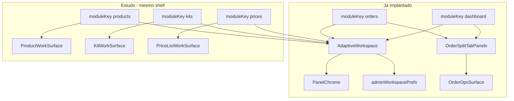

# Padrão zin — Adaptive já implantado (Central + Painel) → Catálogo

**Data:** 2026-11-21 · **Marcha estudo** (sem código)  
**Premissa eFe:** não inventar shell novo — **reusar** o que Central de Pedidos e Painel já validaram.

> **Padrão mestre (versionado):** [FAL_PADRAO_TELAS_LAYOUT_DESIGN_v1_2026-11-21.md](./FAL_PADRAO_TELAS_LAYOUT_DESIGN_v1_2026-11-21.md) — FAL-UI-LAYOUT **v1.1.0** (vigente) · nascimento deste doc = v1.0 · antiregress `pnpm test:ui-layout-antiregress`.

## 1. O que já é padrão de produção em `dev`

| Módulo | `moduleKey` | Primary | Contextual | Multi-guia | VAL |
|--------|-------------|---------|------------|------------|-----|
| **Central de Pedidos** | `orders` | Hub KPIs/tabs/lista | `OrderOpsSurface` compact | `OrderSplitTabPanels` + `useOrderSplitTabs` | Adaptive VAL 17/11 + OrderOps VAL 19/11 |
| **Painel** | `dashboard` | Widgets RGL | Pedido via mesmos tab panels **ou** `DashboardContextualPanel` | Mesmo stack de guias de pedido | Painel cockpit / modular VALs |

**Shell único:** [`AdaptiveWorkspace`](../../fal-pecas/src/components/admin/workspace/AdaptiveWorkspace.tsx) + [`PanelChrome`](../../fal-pecas/src/components/admin/workspace/PanelChrome.tsx)  
**Prefs:** `fal-admin-workspace-v1` — `mode` + `splitWidthPx` por módulo ([`adminWorkspacePrefs.ts`](../../fal-pecas/src/lib/adminWorkspacePrefs.ts))  
**Ortogonal:** layout RGL do Painel (`fal-admin-dashboard-layout-*`) **não** mistura com workspace.

### Comportamentos já fechados (copiar, não reinventar)

1. Modos: `split` | `expanded` | `fullscreen` | `collapsed`  
2. Desktop ≥ lg split; mobile contextual fullscreen  
3. Vocabulário: Abrir guia · + Guia · Na guia · Expandir · Tela cheia · Fechar  
4. Primary compacto: `data-workspace-primary=compact|full` — lista deve permanecer clicável (lição VAL: overflow sob aside)  
5. Persistência só layout do painel — **não** gravar ID selecionado nas prefs  
6. Página completa `/admin/pedidos/:id` para operação “comfortable” quando preciso  
7. Evolução: preview RO (spec 17/11) → surface com mutações leves no compact (OrderOps 19/11) — catálogo segue **esta** linha, com surface **própria** por domínio

## 2. Mapa 1:1 — padrão Central/Painel → Produtos / Kits / Preços

| Padrão zin (já tem) | Produtos | Kits | Listas de preço |
|---------------------|----------|------|-----------------|
| `AdaptiveWorkspace` | `moduleKey="products"` | `moduleKey="kits"` | `moduleKey="prices"` |
| Primary = lista/hub | `AdminProductsPage` lista | `AdminKitsPage` lista | Overview listas + KPIs |
| Contextual = work surface | `ProductWorkSurface` | `KitWorkSurface` (BOM 1º) | `PriceListWorkSurface` ← QuickAdjust |
| Multi-guia | Stack SKUs (padrão `OrderSplitTabPanels`) | 1 kit v1; stack opcional | 1 lista v1 |
| Full page | `/admin/produtos/:id` abas | `/admin/kits/:id` abas | `/admin/precos/:id` F8 |
| Compact primary clicável | Cards/tabela sem Ações sob aside | Idem | Idem |
| Prefs isoladas | Não tocar RGL nem `orders` | Idem | Idem |
| Mutação na guia | Leve (Liberar, lote) | BOM linkar/qty | Edit preço / add SKU |
| Não copiar | `OrderOpsWizardNav`, filas ME, análise | Idem | Idem |

## 3. O que **é** padrão vs o que é **conteúdo**

| É infraestrutura (reusar) | É conteúdo de domínio (novo, fino) |
|---------------------------|-------------------------------------|
| AdaptiveWorkspace, PanelChrome, prefs, modos | Product/Kit/Price **WorkSurface** |
| Split tabs pattern (empilhar IDs) | Checklist Liberar, BOM, F8 pricing |
| Tokens fal-*, chrome Expandir/Fechar | Abas de ficha produto/kit; abas F8 |
| Lições compact overflow | Picker BOM, QuickAdjust filters |

**Regra:** se a dúvida for “como divide a tela / guia / fullscreen” → olhar Central + Painel.  
Se a dúvida for “o que edita o operador” → olhar estudo de domínio (Produtos / Kits / Preços).

## 4. Invariantes herdados (não regredir Central/Painel)

| ID | Invariante |
|----|------------|
| PZ1 | `orders` e `dashboard` continuam com o mesmo shell e VALs verdes |
| PZ2 | Novas keys só adicionam entradas em `WorkspaceModuleKey` — sem migrar/apagar prefs antigas |
| PZ3 | Não montar segundo Adaptive aninhado |
| PZ4 | Não gravar selectedProductId / selectedListId em `fal-admin-workspace-v1` |
| PZ5 | Com split aberto, primary compact permanece operável (teste tipo VAL + Guia) |
| PZ6 | Painel: RGL e workspace continuam ortogonais |

## 5. Ordem de estudo / impl alinhada ao padrão

Já documentado na SPEC; reforço:

1. Estudo domínio (feito: Produtos, Kits, Preços, integração, auditoria).  
2. **Este doc** = âncora “padrão zin”.  
3. Pós-gate: I1 prefs keys → I2 Produtos (primeiro consumidor catálogo do shell) → I3 Kits → I4 Preços → I5 VAL.  
4. Cada fase UI: smoke **igual espírito** Central (abrir guia, +guia se houver, compact clicável, fechar → full).

## 6. Referências canônicas

| Doc / código | Por quê |
|--------------|---------|
| [FAL_SPEC_ADAPTIVE_WORKSPACE_2026-11-17.md](./FAL_SPEC_ADAPTIVE_WORKSPACE_2026-11-17.md) | Contrato original shell |
| [FAL_MARCHA_ADAPTIVE_WORKSPACE_VAL_2026-11-17.md](./FAL_MARCHA_ADAPTIVE_WORKSPACE_VAL_2026-11-17.md) | Aceite split |
| [FAL_MARCHA_ORDER_OPS_SURFACE_VAL_2026-11-19.md](./FAL_MARCHA_ORDER_OPS_SURFACE_VAL_2026-11-19.md) | Compact + guias + fix overflow |
| `AdminOrdersHubPage.tsx` | Referência hub + Adaptive |
| `AdminDashboardPage.tsx` | Referência Painel + mesmo stack |
| [FAL_SPEC_CATALOGO_PRECOS_WORKSPACE_2026-11-21.md](./FAL_SPEC_CATALOGO_PRECOS_WORKSPACE_2026-11-21.md) | SPEC catálogo |

## 7. Veredito marcha estudo

**Não há segundo design system de layout.** Catálogo (Produtos + Kits + Listas de preço) **entra no padrão zin Adaptive** já vivo na Central e no Painel; o trabalho é **WorkSurface + jornada de domínio**, não redesenhar split do zero.

**Assinatura:** marcha estudo padrão zin · 2026-11-21
