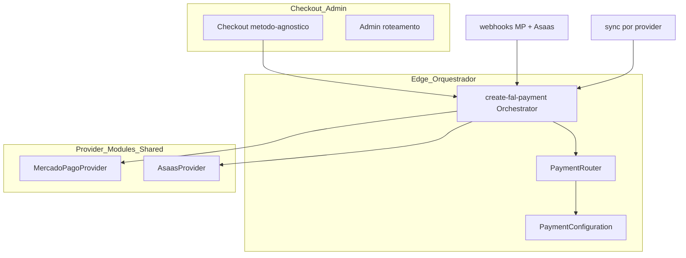

# FAL PAY — Auditoria assertiva e planejamento da arquitetura híbrida (Mercado Pago + Asaas)

**Projeto:** FAL Peças Automotivas  
**Data / horário:** 2026-11-16T12:14:00-03:00  
**Auth:** eFe — auditoria assertiva cartão / híbrido  
**Protocolo:** AUDITAR → EVIDENCIAR → CONFIRMAR CAUSA → PROPOR → **GATE**  
**Status:** Auditoria e planejamento concluídos — **implementação bloqueada** até aprovação expressa da direção  

**Refs:** [Protocolo operacional](./PROTOCOLO_OPERACIONAL_AUDITORIA_FAL_v1.0.md) · [Plano mestre pagamentos](./FAL_PLANO_MESTRE_PAGAMENTOS_INTEGRACOES_2026-11-09.md) · [Auditoria PAY consolidada 13/11](./FAL_AUDITORIA_PAY_CONSOLIDACAO_2026-11-13.md) · [Inventário secrets](./FAL_INVENTARIO_VARS_SECRETS_MP_ME_PG02_2026-11-09.md) · [Docs Asaas](https://docs.asaas.com/) · [Docs Mercado Pago MLB](https://www.mercadopago.com.br/developers)

---

## Registro de baseline (protocolo de execução)

| Campo | Valor |
|-------|--------|
| Branch | `main` |
| Commit-base | `4e7fab19b61c8006237f05b718d1f9b3ffa72c08` (`fix(admin): exibir capacidades de cartao Asaas`) |
| Tracking | `origin/main` sincronizado |
| Working tree | Sem arquivos modificados rastreados |
| Untracked preservados | `.deploy-compact.json`, `.deploy-mcp-full-args.json`, `scripts/` |
| Runtime loja (canônico) | Supabase `wtbpwuiayednvlhvuhbh` |
| Runtime MCP genérico (não loja) | Supabase `owllmfcpbodqmoerdfxx` — **sem** ledger PAY / Edges PAY |
| Netlify site | `fal-pecas-automotivas` (`e526b236-88b4-406c-9978-782dd92d287a`) |
| Ambiente local auditado | `localhost:5173` + `.env.local` apontando para `wtbp…` |
| Ações nesta fase | **Nenhuma** alteração de código, migration, secret, env ou deploy |

**Supersede:** a versão documental de 2026-11-15 (commit-base `9812487…`, “Asaas ausente no repositório”) descreve o estado **pré-implementação**. O código em `main` **já contém** roteamento híbrido e Edges Asaas; o problema atual é **desalinhamento produção + falha de orquestração**, não ausência de Asaas no repositório.

---

## 1. Resumo executivo

### Veredito

O cartão **não funciona de ponta a ponta** por duas causas **confirmadas** e independentes:

1. **Frontend publicado desalinhado** do backend/código atual (bundle sem Asaas / sem `create-fal-payment`).
2. **Orquestração Edge→Edge quebrada**: `create-fal-payment` espera `create-asaas-payment` até ~150 s e morre com HTTP **546** `WORKER_RESOURCE_LIMIT`; a filha encerra por **`WallClockTime`**. O pedido fica com stub `payments` `pending` Asaas, **sem** `provider_payment_id` / `invoiceUrl`.

### O que já existe e vale aproveitar

- Ledger `payments` + `payment_events`.
- Router híbrido em **centavos** (FE + Deno).
- `payment_routing_config` com regra estratégica ativa (PIX ≤ R$ 201 MP; cartão/boleto Asaas).
- Edges: `create-fal-payment`, `create-mp-payment`, `create-asaas-payment`, webhooks e syncs.
- RPCs `confirm_mercadopago_payment` / `confirm_asaas_payment`.
- Checkout atual em `main`: pedido primeiro → depois cobrança; cartão via `AsaasCardPanel` + `invoiceUrl` (sem PAN).
- PIX Mercado Pago operacional (aprovados recentes no ledger).
- Secrets Asaas/MP **presentes** no projeto `wtbp…` (valores não expostos nesta auditoria).

### O que deve ser recriado (reconstrução controlada)

- **Somente** a orquestração crítica Asaas no caminho de criação de cobrança:
  - eliminar dependência HTTP Edge→Edge no hot path;
  - timeout explícito nas chamadas Asaas;
  - estado `creating` / `inconclusive`;
  - lock por tentativa;
  - reconciliação por `externalReference` **antes** de retry (doc oficial Asaas).

### Gate

**Não implementar** até aprovação expressa da direção FAL após revisão deste documento.

---

## 2. Arquitetura atual (evidência 2026-11-16)

### 2.1 Fluxo desejado pelo produto (código `main`)

```mermaid
sequenceDiagram
  participant C as Cliente
  participant CH as Checkout
  participant PO as place_order
  participant GW as create_fal_payment
  participant MP as create_mp_payment
  participant AS as create_asaas_payment
  participant Ext as MP_ou_Asaas
  participant WH as webhooks
  participant Sync as sync_mp_ou_asaas

  C->>CH: finaliza pedido
  CH->>PO: payment_method + idempotency_key
  PO->>PO: stub payments com provider roteado
  Note over CH: Cartao: nao cria cobranca no finalize; abre AsaasCardPanel
  CH->>GW: createFalPayment orderId method
  GW->>MP: forward se Pix roteado MP
  GW->>AS: forward se Pix alto cartao boleto
  MP->>Ext: POST MP payments
  AS->>Ext: POST Asaas payments
  Ext-->>WH: eventos
  WH->>PO: confirm_* RPC
  CH->>Sync: poll se webhook atrasa
```

**Regra de roteamento (obrigatória, já no código):**

| Método | Valor | Provedor |
|--------|------:|----------|
| PIX | ≤ R$ 201,00 inclusive | Mercado Pago |
| PIX | > R$ 201,00 | Asaas |
| Cartão crédito/débito | qualquer | Asaas (`invoiceUrl`) |
| Boleto | qualquer | Asaas |

Limite em centavos: `20100`. Decisão no backend; FE espelha para UX.

### 2.2 Componentes e responsabilidades (`main`)

| Camada | Local | Responsabilidade |
|--------|--------|------------------|
| Checkout | `fal-pecas/src/pages/Checkout/CheckoutPage.tsx` | Pedido → método → `createFalPayment` (Pix) ou `AsaasCardPanel` (cartão) |
| Cartão UI | `components/payments/AsaasCardPanel.tsx` | Cria cobrança + `window.open(paymentUrl)` |
| Brick MP | `MercadoPagoCardBrickPanel.tsx` | **Fora** do checkout de produção (DEV / legado) |
| Motor | `services/payments/engine/paymentEngine.ts` | Híbrido → `invokeCreateFalPayment` |
| Gateway FE | `createFalPaymentService.ts` | Invoke Edge `create-fal-payment` |
| Router | `routing/paymentRouter.ts` + `_shared/paymentRouterCore.ts` | Regra única em centavos |
| Config | `payment_routing_config` + `paymentRoutingService.ts` | Flags provedores / limite |
| Comercial | `store_payment_display` + `effectivePaymentAvailability.ts` | Toggles Pix/cartão/parcelas |
| Edges | `create-fal-payment`, `create-mp-payment`, `create-asaas-payment`, `*-webhook`, `sync-*` | Criação / confirmação / poll |
| Confirmação | RPCs `confirm_*` (service_role) | Ciclo pedido pós-aprovação |

### 2.3 Separação conceitual (confirmada)

| Conceito | Implementação | Nota |
|----------|---------------|------|
| Pedido | `orders` | Status operacional F7 |
| Cobrança / tentativa | linha em `payments` | Stub pode existir antes do charge no gateway |
| Evento provedor | `payment_events` | Idempotência webhook |
| Provedor | `payments.provider` | Deve permanecer imutável após charge criado |
| Tentativa | múltiplas linhas `payments` + `metadata` | **Não** há tabela `payment_attempts` |

### 2.4 Estado remoto `wtbpwuiayednvlhvuhbh` (produção loja)

**Fatos confirmados (SQL / CLI / logs):**

- `payment_routing_config`: `asaas_enabled=true`, `mercadopago_enabled=true`, `pix_mp_max_amount_cents=20100`, `card_provider=asaas`, `rule_version=fal-pay-hybrid-v1`.
- `store_payment_display`: cartão/crédito/débito/Pix comerciais ON; parcelas até 3× sem juros.
- Edges PAY ativas: `create-fal-payment` (v2), `create-asaas-payment` (v31), `create-mp-payment` (v56), `asaas-webhook`, `sync-asaas-payment`, `mercado-pago-webhook`, `sync-mp-payment`.
- Secrets presentes (somente nomes auditados): `ASAAS_API_KEY`, `ASAAS_ENV`, `ASAAS_WEBHOOK_TOKEN`, `MP_ACCESS_TOKEN`, `MP_WEBHOOK_SECRET`, `MP_ENV`.
- Migrations PAY aplicadas sob versões remotas com timestamps distintos dos arquivos locais (histórico de apply via MCP/CLI — ver §8).
- Tentativas Asaas recentes (débito R$ 31,97 e R$ 1,00): `provider=asaas`, `status=pending`, `provider_payment_id` **null**, metadata `awaiting_provider_charge=true`.
- CPF 11 dígitos + e-mail auth + nome: **OK** nesses stubs (não é falha de cadastro).
- `payment_events` recentes: **apenas Mercado Pago** — zero eventos Asaas no intervalo auditado.
- PIX MP: múltiplos `approved` nos últimos 14 dias.

**`owllmfcpbodqmoerdfxx`:** projeto MCP genérico **sem** tabelas PAY / Edges PAY — não usar como runtime da loja.

### 2.5 Netlify / frontend publicado

| Evidência | Resultado |
|-----------|-----------|
| Site | `https://fal-pecas-automotivas.netlify.app/` |
| Bundle `assets/index-*.js` | **Sem** strings `asaas`, `create-fal-payment`, `create-asaas-payment`, `invoiceUrl` |
| Deploys recentes (MCP) | Predominantemente `deploy-preview` (branch `cursor/fal-pay-hibrido-impl-14df` e `main` preview) |
| Commit conhecido no ciclo híbrido inicial | `5638f33…` — adaptador Asaas ainda lançava *"Cartão Asaas em implementação"* e checkout usava Brick MP |
| `main` local | 12 commits à frente de `5638f33` com cartão `invoiceUrl` + gateway único |

**Causa confirmada P0-A:** frontend publicado **não** carrega o fluxo Asaas do código atual.

### 2.6 Falha runtime cartão no código atual (`localhost`)

| Evidência | Resultado |
|-----------|-----------|
| UI | Checkout local: “Continuar pagamento com cartão” → alerta `Edge Function returned a non-2xx status code` |
| Pedido | `b0304f49-…` / payment `0712bdf3-…` stub Asaas sem charge |
| Log `create-fal-payment` | POST **546**, `execution_time_ms≈149952`, `sb_error_code=WORKER_RESOURCE_LIMIT` |
| Log `create-asaas-payment` | Shutdown `reason=WallClockTime` (~mesmo request_id / janela) |
| Cliente HTTP Asaas | `asaasApiCore.ts` — `fetch` **sem timeout** |

**Causa confirmada P0-B:** orquestração Edge→Edge + chamada Asaas sem timeout estoura wall clock; cobrança não é gravada no ledger mesmo com roteamento e dados do pagador corretos.

---

## 3. Mapa de arquivos e dependências

### 3.1 Mercado Pago (inventário)

| Área | Arquivos |
|------|----------|
| Front Pix | `MercadoPagoPixPanel.tsx` / `CheckoutPixPanel.tsx` |
| Front cartão legado | `MercadoPagoCardBrickPanel.tsx`, `MpCardSecureFields.tsx`, `mpInstance.ts` |
| Serviços | `mpCreatePaymentService.ts`, `mpSyncPaymentService.ts`, `createMpPaymentFlow.ts`, `mpWebhookCore.ts` |
| Edges | `create-mp-payment`, `mercado-pago-webhook`, `sync-mp-payment` |
| Shared | `_shared/mpCreatePaymentCore.ts`, `mpWebhookCore.ts` |
| Admin | `AdminMercadoPagoPage.tsx`, `AdminPaymentWebhooksPage.tsx` |
| Env | `VITE_MP_PUBLIC_KEY`, `MP_ACCESS_TOKEN`, `MP_WEBHOOK_SECRET`, `MP_ENV` |

### 3.2 Asaas (inventário)

| Área | Arquivos |
|------|----------|
| Front cartão | `AsaasCardPanel.tsx` |
| Serviços | `createAsaasPaymentService.ts`, `asaasSyncPaymentService.ts`, `asaasAdapter.ts` |
| Edges | `create-asaas-payment`, `asaas-webhook`, `sync-asaas-payment` |
| Shared | `asaasApiCore.ts`, `asaasCreatePaymentCore.ts`, `asaasInstallmentsCore.ts`, `asaasPaymentStatusCore.ts` |
| Env | `ASAAS_API_KEY`, `ASAAS_ENV`, `ASAAS_WEBHOOK_TOKEN` |

### 3.3 Orquestração / roteamento

| Área | Arquivos |
|------|----------|
| Gateway único | `create-fal-payment/index.ts`, `createFalPaymentService.ts` |
| Router | `paymentRouter.ts`, `paymentRouterCore.ts`, `paymentRoutingConfigCore.ts` |
| Config DB | migrations `2026111501*`, `2026111514*`, `2026111516*`, `2026111520*` |
| Pedido | `placeOrderService.ts` + `place_order` (ledger gateway) |

### 3.4 Acoplamentos críticos (ainda problemáticos)

| Ponto | Impacto |
|-------|---------|
| `create-fal-payment` faz `fetch` interno para outra Edge | Duplo wall clock; 546 no pai |
| `asaasApiRequest` sem timeout / AbortSignal | Travamento até kill runtime |
| Retry de create sem reconciliar Asaas por `externalReference` | Risco de cobrança duplicada (doc oficial) |
| Webhook Asaas: token opcional; sem re-fetch/valor | Segurança inferior ao MP |
| Deploy Netlify desalinhado de `main` | Cliente nunca chega ao fluxo Asaas publicado |
| Brick MP ainda no repo | Confusão operacional se alguém publicar build antigo |

### 3.5 Dependências reutilizáveis (não recriar)

- Tabelas `payments` / `payment_events` + UK `(provider, provider_event_id)`.
- Política multi-tentativa (várias linhas por pedido).
- `store_payment_display` + enforce comercial.
- `pickActivePayment` / retomada.
- PIX MP create + webhook HMAC + sync.
- Admin hub de pagamentos (casca).

---

## 4. Mapa do fluxo financeiro atual

### 4.1 Happy path (código) vs realidade observada

| Etapa | Esperado | Observado cartão |
|-------|----------|------------------|
| `place_order` | Stub `payments` com provider roteado | OK — Asaas + `awaiting_provider_charge` |
| Create charge | `provider_payment_id` + `payment_url`/`pix_*` | **Falha** — timeout 546 / WallClock |
| Cliente paga | Fatural Asaas / Pix | Não alcança |
| Webhook | `payment_events` + `confirm_*` | Sem eventos Asaas |
| Pedido | `pagamento_aprovado` → `em_analise` | Fica `aguardando_pagamento` |

### 4.2 Idempotência atual

| Camada | Comportamento |
|--------|---------------|
| Pedido | `idempotency_key` → `already_existed` + payment mais recente |
| MP create | `X-Idempotency-Key` + reuso pending |
| Asaas create | Reuso se `provider_payment_id` + mesmo método/valor/parcelas |
| MP webhook | HMAC + claim `payment_events` |
| Asaas webhook | Insert evento; token **só se** secret definido |

**Lacuna confirmada:** se Asaas criou cobrança mas a Edge morreu antes do UPDATE local, o stub permanece sem `provider_payment_id` e um novo create pode **duplicar** cobrança (mesmo `externalReference=orderId`).

---

## 5. Diagnóstico Mercado Pago

### 5.1 Capacidades

| Recurso | Situação | Evidência |
|---------|----------|-----------|
| PIX create + QR | OK | Edges + ledger approved |
| Webhook HMAC | OK | `mpWebhookCore` + eventos processados |
| Sync atrasado | OK | `sync-mp-payment` |
| Cartão Brick | Desligado no gateway híbrido | 409 `payment_route_mismatch` se forçar cartão no MP |
| Reembolso API | Parcial / futuro | Admin mark; não é bloqueador cartão Asaas |

### 5.2 Segurança MP

- Secrets só Edge; public key só Vite.
- Valor cobrado = `orders.total` no servidor.
- Customer sem UPDATE em `payments`.
- Webhook: assinatura + freshness + re-fetch + `amountsMatch`.

### 5.3 Papel no híbrido

MP permanece **somente PIX ≤ R$ 201**. Não deve voltar a processar cartão no checkout.

---

## 6. Lacunas e diagnóstico Asaas

### 6.1 Capacidades API (documentação oficial — confirmadas)

| Necessidade FAL | Recurso Asaas | Notas |
|-----------------|---------------|-------|
| Cobrança Pix/boleto/cartão | `POST /v3/payments` | `billingType` PIX / BOLETO / CREDIT_CARD |
| QR Pix | `GET /v3/payments/{id}/pixQrCode` | GET **sem body** |
| Cartão via fatura | criar sem PAN → `invoiceUrl` | Alinhado ao checkout atual |
| Cartão via API | `creditCard` + holder + `remoteIp` | Exige HTTPS; FAL optou por fatura |
| Débito | via fatura (`CREDIT_CARD` / `UNDEFINED`) | Dados de débito **não** vão na API |
| Parcelas | `installmentCount` + value/total | Limites por bandeira |
| Webhooks | eventos `PAYMENT_CONFIRMED` / `RECEIVED` / risco / etc. | Entrega **at least once** |
| Idempotência webhook | campo `id` do evento | Persistência antes de processar |
| Retry create | **não** repetir após timeout sem consultar | Usar `externalReference` + verificação |

Fontes: [Cobranças cartão](https://docs.asaas.com/docs/cobrancas-via-cartao-de-credito), [Webhooks](https://docs.asaas.com/docs/webhooks-e-eventos), [Idempotência webhooks](https://docs.asaas.com/docs/como-implementar-idempotencia-em-webhooks), [Retries](https://docs.asaas.com/docs/retries-e-idempotência), [Cobrança duplicada](https://docs.asaas.com/docs/cobrança-duplicada-após-retry-sem-idempotência).

### 6.2 Findings (template protocolo)

### FIND-PAY-001

| Campo | Valor |
|-------|-------|
| ID | FIND-PAY-001 |
| Área | Checkout / Deploy |
| Problema | Frontend publicado sem fluxo Asaas / `create-fal-payment` |
| Comportamento atual | Bundle produção sem Asaas; deploys recentes em preview |
| Esperado | Produção alinhada a `main` com `AsaasCardPanel` + gateway |
| Causa confirmada | Deploy Netlify desalinhado do commit de cartão Asaas |
| Impacto | Cliente em produção **não** executa o fluxo híbrido atual |
| Severidade | **P0** |
| Status | proposto |
| Evidência | Fetch bundle site; MCP deploys; diff `5638f33..4e7fab1` |

### FIND-PAY-002

| Campo | Valor |
|-------|-------|
| ID | FIND-PAY-002 |
| Área | Orquestração Edge |
| Problema | Create cartão falha com non-2xx / stub sem charge |
| Comportamento atual | HTTP 546 `WORKER_RESOURCE_LIMIT` (~150 s); filha `WallClockTime` |
| Esperado | Cobrança Asaas criada em segundos com `invoiceUrl` |
| Causa confirmada | `create-fal-payment` aguarda HTTP de `create-asaas-payment`; Asaas fetch sem timeout |
| Impacto | Cartão bloqueado mesmo no código local atual |
| Severidade | **P0** |
| Status | proposto |
| Evidência | Logs Supabase 2026-11-16 ~14:56Z; UI localhost; SQL stubs |

### FIND-PAY-003

| Campo | Valor |
|-------|-------|
| ID | FIND-PAY-003 |
| Área | Integridade financeira Asaas |
| Problema | Timeout tratado como falha sem reconciliação |
| Comportamento atual | Stub pending sem `provider_payment_id`; retry pode POST novamente |
| Esperado | Timeout = inconclusivo → consultar por `externalReference` → reutilizar ou criar uma vez |
| Causa confirmada | Ausência de fluxo inconclusivo no create Asaas |
| Impacto | Risco de cobrança duplicada |
| Severidade | **P1** |
| Status | proposto |
| Evidência | Código `create-asaas-payment`; docs Asaas retries/duplicidade |

### FIND-PAY-004

| Campo | Valor |
|-------|-------|
| ID | FIND-PAY-004 |
| Área | Segurança webhook Asaas |
| Problema | Autenticação e prova de pagamento mais fracas que MP |
| Comportamento atual | Token só se `ASAAS_WEBHOOK_TOKEN` setado; confia no JSON; payload bruto no ledger |
| Esperado | Token obrigatório; re-fetch cobrança; validar valor; sanitizar payload |
| Causa confirmada | Implementação atual de `asaas-webhook` |
| Impacto | Risco de spoof / exposição se secret omitido |
| Severidade | **P1** |
| Status | proposto |

### FIND-PAY-005

| Campo | Valor |
|-------|-------|
| ID | FIND-PAY-005 |
| Área | Observabilidade / testes |
| Problema | Sem testes Edge Asaas; admin sem reprocessamento; conciliação extrato ausente |
| Severidade | **P2** |
| Status | proposto |
| Evidência | Inventário Vitest; `AdminPaymentWebhooksPage` só URL |

### FIND-PAY-006

| Campo | Valor |
|-------|-------|
| ID | FIND-PAY-006 |
| Área | Produto boleto |
| Problema | Backend/roteamento aceitam boleto; checkout/`place_order`/tipos TS incompletos |
| Severidade | **P2** |
| Status | proposto (fase posterior ao cartão) |

### 6.3 Hipóteses (não confirmadas como causa do cartão atual)

| ID | Hipótese | Por que não é causa confirmada agora |
|----|----------|--------------------------------------|
| H-01 | `ASAAS_API_KEY` ausente | Secret existe; falha é timeout, não 503 missing |
| H-02 | CPF/e-mail faltando | SQL mostra CPF 11 + e-mail |
| H-03 | `asaas_enabled=false` | SQL mostra `true` |
| H-04 | Popup bloqueado | Falha ocorre **antes** de obter `paymentUrl` |
| H-05 | Ambiente sandbox vs produção inconsistente | Valores de secret não lidos; validar na onda ops (hipótese operacional) |

---

## 7. Arquitetura híbrida proposta

### 7.1 Decisão: reaproveitar × recriar

| Bloco | Decisão | Motivo |
|-------|---------|--------|
| Ledger / RPCs / router / comercial / PIX MP / UI cartão fatura | **Reaproveitar** | Já alinhados à regra estratégica |
| Orquestração create Asaas (Edge→Edge + fetch sem timeout) | **Recriar (controlado)** | Causa raiz P0-B |
| Brick MP no checkout | **Não reativar** | Cartão = Asaas |
| Boleto / conciliação admin / painel avançado | **Incremental** após cartão estável | YAGNI até cartão OK |

### 7.2 Camadas alvo



**Mudança estrutural obrigatória:** `create-fal-payment` **não** deve `fetch` outra Edge no hot path. Deve importar módulos `_shared` (MP/Asaas) e executar create in-process, com timeout por etapa.

### 7.3 Payment Router

- Única implementação (Vitest T1–T6).
- Entrada: `method`, `amountCents` inteiro.
- PIX ≤ 20100 → MP; > → Asaas; cartão/boleto → Asaas.
- Persistir `routed_provider` + `rule_version` na tentativa no momento da decisão.
- Alteração futura do limite **não** retroage.

### 7.4 Payment Provider Interface

Contrato comum (FE types + Deno shared):

- `createCharge`
- `getCharge`
- `findChargeByExternalReference` (**obrigatório Asaas**)
- `cancelCharge` / `refundCharge` (onde suportado)
- `parseWebhook` / `normalizeStatus`

### 7.5 Payment Orchestrator

Garantias:

1. Pedido criado **antes** da cobrança.
2. Cobrança só no provider roteado; `provider` imutável após charge.
3. Estado local: `pending_stub` → `creating` → `pending_gateway` | `inconclusive` | `rejected` | `approved`…
4. Timeout Asaas → marcar `inconclusive` → **nunca** create cego.
5. Antes de novo POST: lock + busca Asaas por `externalReference`/`payment.id` interno.
6. Aprovação do pedido **somente** via evidência webhook/sync + RPC — nunca só pela resposta create.
7. Multi-tentativa = nova linha `payments`, sem sobrescrever histórico.

### 7.6 Webhook Handler

- Manter MP endurecido.
- Asaas: token **obrigatório**; persistir `event.id` com UK; responder 200 após persistir; processar efeitos depois; re-fetch cobrança + validar valor; sanitizar payload.

### 7.7 Reconciliation

- Sync cliente por `payments.provider`.
- Job/admin futuro: pendentes Asaas sem `provider_payment_id` → consulta API.
- Totais por provedor/método/status/período (visão admin).

---

## 8. Modelo de dados proposto

**Diretriz:** evoluir `payments` + `payment_events` (não criar banco paralelo).

| Mudança | Motivo |
|---------|--------|
| Manter multi-linhas por pedido | Histórico de tentativas |
| Colunas/metadata: `route_rule_version`, `charge_phase` (`stub`/`creating`/`gateway`/`inconclusive`) | Rastreio timeout |
| Índice/consulta por `external_ref` + provider | Reconciliação |
| UK parcial “uma cobrança gateway aberta” já existe com `provider_payment_id NOT NULL` | Completar política para stubs/creating |
| Não UPDATE `provider` após charge | Imutabilidade |
| `payment_routing_config` + audit de alteração | Admin |
| Boleto em `method` (já SQL) + alinhamento `place_order`/TS | Fase boleto |

**Histórico migrations:** remotas PAY usam timestamps diferentes dos arquivos locais (`20261115014134` vs `20261115010000`, etc.). Próximas mudanças devem **não** reaplicar DDL já presente; preferir migrations novas idempotentes e inventário de schema remoto antes do apply.

---

## 9. Regras de roteamento (obrigatórias)

| Método | Valor (R$) | Provedor |
|--------|------------|----------|
| PIX | ≤ 201,00 inclusive | Mercado Pago |
| PIX | > 201,00 | Asaas |
| Cartão | qualquer | Asaas |
| Boleto | qualquer | Asaas |

Exemplos de teste: 50 / 200 / 201,00 → MP; 201,01 / 500 → Asaas; cartão e boleto qualquer valor → Asaas.

Decisão **somente no backend**; FE apenas espelha.

---

## 10. Planejamento do checkout

Fluxo alvo (já pretendido no código `main`):

1. Cliente monta carrinho / compra direta.
2. `place_order` cria pedido + stub de pagamento com provider roteado.
3. Checkout chama gateway único `create-fal-payment`.
4. UI:
   - Pix: painel QR agnóstico de marca do gateway.
   - Cartão: `AsaasCardPanel` (fatura segura) — **sem** revelar “Asaas” ao cliente além do necessário operacional.
   - Boleto (fase posterior): linha digitável + PDF.
5. Confirmação: webhook + sync; UI “Já paguei — verificar”.
6. Erros: mensagens amigáveis; timeout → “pagamento em verificação”, não “tente criar de novo” cego.

**Não reintroduzir** Brick MP no checkout de produção.

---

## 11. Planejamento administrativo

| Área | Entrega |
|------|---------|
| Provedores | MP/Asaas ativo; ambiente; saúde webhook |
| Métodos | Pix/cartão/boleto comerciais |
| Roteamento | Limite PIX, providers; audit; **não** altera pendentes |
| Webhooks | URLs + últimos eventos + reprocessamento (PG13) |
| Secrets | Só flags “configurado”; valores via Supabase secrets |
| Conciliação | Totais por provider/método/status; lista inconclusivos |

Desativar provedor: bloqueia **novas** cobranças; pendentes intactas.

---

## 12. Segurança e integridade financeira

| Controle | Atual | Alvo |
|----------|-------|------|
| Valor | `orders.total` servidor | Manter |
| PAN | Não na FAL (fatura) | Manter |
| Webhook MP | HMAC + re-fetch + amount | Manter |
| Webhook Asaas | Token opcional / trust JSON | Token obrigatório + re-fetch + amount |
| Idempotência eventos | UK provider+event | Manter; Asaas = `body.id` |
| Timeout create | Kill 546 | Timeout curto + fase `inconclusive` + reconcile |
| Retry | Pode POST cego | Consultar antes |
| RLS | Customer read own | Manter; sanitizar eventos Asaas |
| Deploy | Preview/desalinhado | Produção = `main` validado |

---

## 13. Matriz de testes e cenários críticos

### 13.1 Roteamento (automatizado)

| ID | Caso | Esperado |
|----|------|----------|
| T1 | PIX 200,00 | MP |
| T2 | PIX 201,00 | MP |
| T3 | PIX 201,01 | Asaas |
| T4 | PIX 500,00 | Asaas |
| T5 | Cartão 50 / 5000 | Asaas |
| T6 | Boleto 100 / 2000 | Asaas |

### 13.2 Cartão (aceitação — bloqueador atual)

| ID | Caso | Esperado |
|----|------|----------|
| C1 | Create cartão sandbox/prod homolog | `< 10s`, `paymentUrl` preenchida, `provider_payment_id` set |
| C2 | Timeout simulado Asaas | `inconclusive`; **sem** segundo POST até reconcile |
| C3 | Retry após inconclusivo com cobrança já criada | Reutiliza ID Asaas |
| C4 | Pagar fatura → webhook | Pedido `em_analise`; evento ledger |
| C5 | Sync “Já paguei” | Idempotente |
| C6 | Duplo clique Continuar | Uma cobrança gateway |
| C7 | Deploy produção | Bundle contém fluxo cartão Asaas |

### 13.3 Fluxo financeiro geral

Aprovado, pendente, recusado, expirado, cancelado, reembolso, nova tentativa, webhook duplicado/atrasado/fora de ordem, gateway indisponível, perda pós-create.

### 13.4 Integridade

Duas tentativas; pedido pago + nova tentativa bloqueada; evento sem pedido; stub sem charge; divergência DB↔gateway.

### 13.5 Baseline testes existentes

Vitest cobre router, engine, MP webhook/create cores, disponibilidade, parcelas Asaas — **não** cobre Edge Deno Asaas/create-fal nem E2E cartão.

---

## 14. Análise de custos

**Não usar taxas públicas como contratadas.** Solicitar à direção:

- PIX MP (faixa ≤ 201) vs Asaas (faixa > 201)
- MDR cartão Asaas / parcelamento / antecipação
- Boleto emissão + compensação
- Estorno / chargeback
- Prazo de recebimento líquido

Comparativo só após tabela contratual FAL.

---

## 15. Plano de implantação por etapas (gated)

> **STOP global:** nenhuma etapa abaixo foi executada nesta auditoria. Cada etapa exige gate explícito do eFe.

| # | Etapa | Dependências | Critério de conclusão | Evidência |
|---|--------|--------------|------------------------|-----------|
| 0 | Contenção: alinhar produção Netlify a `main` validado **ou** isolar smoke só em preview/local documentado | — | Bundle contém `create-fal-payment` + cartão fatura | Diff deploy commit == HEAD; strings no bundle |
| 1 | Instrumentação create Asaas (logs etapa: customer/create/update) **sem** mudar regra | 0 | Cada falha mostra etapa | Log Edge |
| 2 | Timeout + AbortSignal no cliente Asaas; falha rápida | 1 | Sem wall clock 150s; erro tipado | C1/C2 |
| 3 | Orquestrador in-process (remover Edge→Edge hot path) | 2 | Uma Edge cria cobrança | Latência + ausência 546 |
| 4 | Fase `inconclusive` + lock + reconcile por `externalReference` | 3 | Retry não duplica | C2/C3 + conta Asaas |
| 5 | Webhook Asaas endurecido (token obrigatório, re-fetch, amount, sanitize) | 4 | Evento promove pedido | C4 |
| 6 | Smoke cartão homologado (crédito + débito via fatura) | 5 | Pedido `em_analise` | Checklist humano + SQL |
| 7 | Regressão PIX MP T1–T2 | 6 | Zero regressão | Ledger Pix approved |
| 8 | PIX Asaas T3–T4 | 6 | QR Asaas OK | Smoke |
| 9 | Boleto checkout (se direção autorizar) | 6 | Linha digitável | Smoke |
| 10 | Admin: eventos/reprocessamento/inconclusive | 5 | Operador resolve sem SQL | UI |
| 11 | Conciliação unificada (totais) | 10 | Relatório período | Admin |
| 12 | Testes automatizados Edge/orquestrador | 3–5 | CI verde | Vitest/Deno |
| 13 | Homologação + rollout gradual | 6–12 | Checklist assinado | VAL |
| 14 | Monitoramento pós-go-live | 13 | Alertas 546/inconclusivos | Dashboard |

**Ordem recomendada para destravar cartão rápido:** 0 → 2 → 3 → 4 → 5 → 6 → 7.

Não propor big-bang de reescrita do ledger ou troca de provedor de cartão de volta ao MP.

---

## 16. Critérios de aceite

- [ ] Cliente cria pedido e, no checkout, o gateway correto é escolhido no **backend**.
- [ ] PIX ≤ R$ 201 continua MP (T1–T2).
- [ ] Cartão qualquer valor → Asaas fatura; sem PAN na FAL.
- [ ] Create cartão retorna `paymentUrl` + `provider_payment_id` em tempo operacional (< 10 s típico).
- [ ] Timeout não gera segundo POST sem reconcile.
- [ ] Webhook/sync Asaas confirma pedido sem duplicar efeitos.
- [ ] Frontend produção = commit validado (não preview órfão).
- [ ] `payments.provider` imutável após charge; histórico multi-tentativa preservado.
- [ ] Cliente não depende de conhecer o nome técnico do gateway.
- [ ] Admin consegue ver pendentes/inconclusivos.

---

## 17. Riscos e medidas preventivas

| Risco | Mitigação |
|-------|-----------|
| Publicar frontend antigo | Gate deploy: checklist strings + commit SHA |
| Duplicar cobrança Asaas | Reconcile obrigatório pós-timeout |
| Regressão PIX MP | Smoke T1–T2 a cada release PAY |
| Secret Asaas ambiente errado | Validar `ASAAS_ENV` vs chave na onda ops (sem expor valor) |
| Webhook Asaas sem token | Fail-closed |
| Migrations timestamp divergente | Inventário remoto antes de qualquer DDL |
| Confundir `owll…` com prod | Runtime canônico = `wtbp…` |

---

## 18. Questões para decisão da direção FAL

1. **Deploy produção:** publicar `main@4e7fab1` (ou HEAD validado) agora, ou manter smoke só em ambiente controlado até o orquestrador?
2. **Cartão:** manter exclusivamente fatura Asaas (`invoiceUrl`) na v1, ou evoluir para tokenização na loja (exige liberação Asaas)?
3. **Débito:** confirmar que débito segue fatura Asaas (sem dados de débito na API).
4. **Boleto:** prazo de vencimento padrão e se entra na mesma onda do cartão ou depois.
5. **Limite PIX R$ 201:** fixo inicial ou editável no admin com audit desde o dia 1?
6. **Taxas contratadas** MP/Asaas para fechar §14.
7. **Conta Asaas:** sandbox vs produção no smoke de homologação; URL webhook produção confirmada.
8. **Rollback cartão MP:** **não recomendado**; confirmar desligamento definitivo do Brick no checkout.

---

## Anexo A — Evidências-chave (caminhos)

| Evidência | Onde |
|-----------|------|
| Router FE | `fal-pecas/src/services/payments/routing/paymentRouter.ts` |
| Gateway Edge | `fal-pecas/supabase/functions/create-fal-payment/index.ts` |
| Create Asaas | `fal-pecas/supabase/functions/create-asaas-payment/index.ts` |
| HTTP Asaas sem timeout | `fal-pecas/supabase/functions/_shared/asaasApiCore.ts` |
| Painel cartão | `fal-pecas/src/components/payments/AsaasCardPanel.tsx` |
| Checkout | `fal-pecas/src/pages/Checkout/CheckoutPage.tsx` |
| Runtime local | `fal-pecas/.env.local` → `wtbpwuiayednvlhvuhbh` |
| Site | `https://fal-pecas-automotivas.netlify.app/` |

---

## Anexo B — Gate final

| Entregável | Status |
|------------|--------|
| Diagnóstico consolidado | Este documento §§1–6 |
| Arquitetura recomendada | §7 |
| Modelo de dados | §8 |
| Regras roteamento | §9 |
| Checkout / admin | §§10–11 |
| Segurança | §12 |
| Matriz testes | §13 |
| Custos | §14 |
| Plano implantação | §15 |
| Aceite / riscos / decisões | §§16–18 |
| Implementação | **BLOQUEADA** até aprovação expressa |

### Diagnóstico consolidado (uma frase)

**O híbrido já está no código e no banco `wtbp…`, mas o cartão falha porque o frontend publicado não carrega esse fluxo e, no código atual, a criação Asaas estoura o limite de tempo da Edge antes de gravar a cobrança — e o retry sem reconciliação ainda pode duplicar cobrança.**

### Ordem de execução recomendada

1. Gate direção.  
2. Alinhar deploy.  
3. Timeout + orquestrador in-process + reconcile.  
4. Webhook Asaas endurecido.  
5. Smoke cartão.  
6. Regressão PIX.  
7. Boleto/admin/conciliação.

**Assinatura:** FAL PAY auditoria assertiva MP/Asaas · gate documental · 2026-11-16 · implementação não iniciada.
