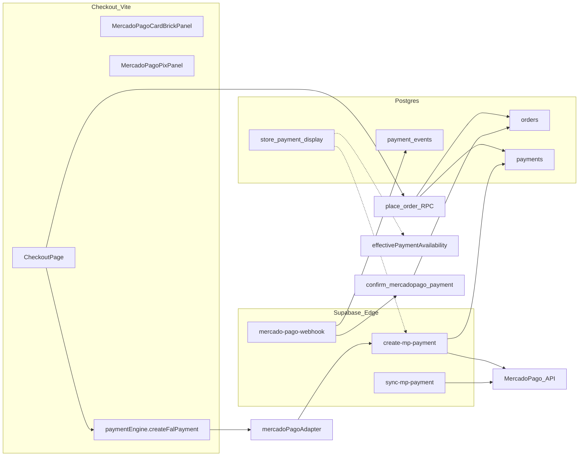
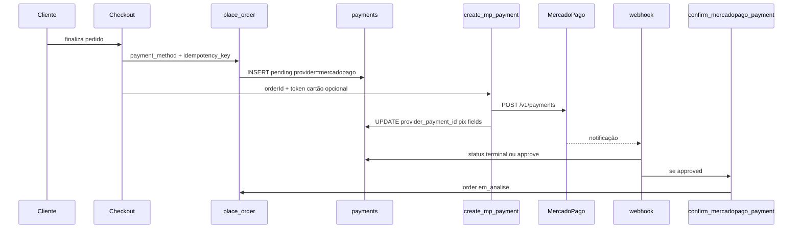
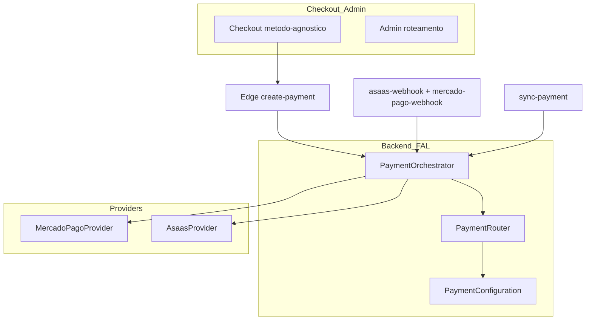

# FAL PAY — Auditoria e planejamento da arquitetura híbrida (Mercado Pago + Asaas)

**Projeto:** FAL Peças Automotivas  
**Data:** 2026-11-15  
**Auth:** eFe — evolução arquitetura financeira  
**Protocolo:** AUDITAR → EVIDENCIAR → CONFIRMAR CAUSA → PROPOR → **GATE**  
**Status:** Auditoria e planejamento concluídos — **implementação bloqueada** até aprovação expressa da direção

**Refs:** [Plano mestre pagamentos](./FAL_PLANO_MESTRE_PAGAMENTOS_INTEGRACOES_2026-11-09.md) · [PG08 modelo](./FAL_MARCHA_PAGAMENTOS_PG08_MODELO_2026-11-09.md) · [Auditoria PAY consolidada](./FAL_AUDITORIA_PAY_CONSOLIDACAO_2026-11-13.md) · [Inventário secrets MP/ME](./FAL_INVENTARIO_VARS_SECRETS_MP_ME_PG02_2026-11-09.md) · [Documentação Asaas](https://docs.asaas.com/)

---

## Registro de baseline (protocolo de execução)

| Campo | Valor |
|-------|--------|
| Branch no momento da auditoria | `main` |
| Commit-base | `98124877fc2b7f55a99e7c88f894a238c218d857` |
| Estado do working tree | Limpo (`## main...origin/main`) |
| Arquivos modificados antes da auditoria | Nenhum |
| Data/horário UTC | 2026-11-15T00:59:05Z |
| Asaas no repositório | **Ausente** (0 referências em código) |

Nesta atividade **não** foram criadas migrations, **não** foram editados arquivos de aplicação, **não** foram alteradas variáveis de ambiente nem configurações de deploy.

---

## 1. Resumo executivo

A FAL dispõe de fundação sólida para pagamentos: ledger (`payments` + `payment_events`), motor TypeScript (PG05–PG11b), integração Mercado Pago operacional (Pix e cartão via Edge + webhook endurecido) e hub administrativo em evolução. O modelo híbrido definido pela direção — **PIX até R$ 201,00 no Mercado Pago; PIX acima no Asaas; cartão e boleto sempre no Asaas** — **não é implementável no estado atual** sem uma camada central de roteamento no backend, adaptador Asaas, orquestração unificada de criação/confirmação e evolução do checkout.

**Veredito técnico:** reutilizar motor, ledger e padrões de idempotência do MP; introduzir `PaymentRouter`, `AsaasProvider`, Edge `create-payment` + `asaas-webhook`, RPC de confirmação genérica e configuração administrativa de roteamento. Preservar o **histórico de tentativas** como múltiplas linhas em `payments` (política F9-C já adotada) — **nunca** reatribuir `provider` em cobranças pendentes.

**Gate:** a implementação somente inicia após revisão deste documento e aprovação expressa da direção FAL.

---

## 2. Arquitetura atual

### 2.1 Visão em camadas

### 2.2 Componentes e responsabilidades

| Camada | Local | Responsabilidade |
|--------|--------|------------------|
| Contrato motor | `fal-pecas/src/services/payments/engine/paymentEngineTypes.ts` | `FalPaymentAdapter`, métodos incl. `boleto` no tipo; MP rejeita boleto em runtime |
| Motor | `fal-pecas/src/services/payments/engine/paymentEngine.ts` | Um adaptador registrado (`mercadoPagoAdapter`); `createPayment` → `primaryProviderId()` |
| Adaptador MP (FE) | `fal-pecas/src/services/payments/engine/mercadoPagoAdapter.ts` | Delega à Edge `create-mp-payment` |
| Env / simulado | `fal-pecas/src/services/payments/paymentService.ts` | `VITE_PAYMENT_PROVIDER`: `mercadopago` \| `gateway` \| `simulated` |
| Disponibilidade | `fal-pecas/src/services/payments/effectivePaymentAvailability.ts` | Integração técnica = Mercado Pago + `store_payment_display` |
| Criação cobrança | `fal-pecas/supabase/functions/create-mp-payment/index.ts` | Valor do `orders.total`; reuso/cancelamento de pending; enforce comercial |
| Webhook | `fal-pecas/supabase/functions/mercado-pago-webhook/index.ts` | HMAC `x-signature`, ledger, approve via RPC |
| Sync cliente | `fal-pecas/supabase/functions/sync-mp-payment/index.ts` | Poll MP quando webhook atrasa; **só** `provider = mercadopago` |
| Núcleo compartilhado | `fal-pecas/supabase/functions/_shared/mpCreatePaymentCore.ts`, `mpWebhookCore.ts` | Parse body, mapa de status, assinatura |
| Leitura cobrança (RLS) | `fal-pecas/src/services/payments/ownPaymentService.ts` | `getOwnPayment`, `listOwnPaymentStatusesByOrder` |
| Confirmação pedido | `confirm_mercadopago_payment` (migration F9-C) | Ciclo F7: `pagamento_aprovado` → `recebido` → `em_analise`; gate `provider = mercadopago` |
| Pedido | `place_order` (ex.: `20261112190100_place_order_idempotent_payment_id.sql`) | Cria stub `payments` com `provider = 'mercadopago'` para métodos reais |
| Admin pagamentos | `fal-pecas/src/pages/admin/payments/*` | Hub, provedores, métodos MP, webhooks (referência) |

### 2.3 Métodos suportados hoje

| Método | Provedor | Checkout | Confirmação |
|--------|----------|----------|-------------|
| PIX | Mercado Pago | Sim | Webhook + `sync-mp-payment` + `confirm_mercadopago_payment` |
| Cartão crédito/débito | Mercado Pago (Brick) | Sim | Idem; homologação cartão E2E documentada como pendente em [PAY consolidada](./FAL_AUDITORIA_PAY_CONSOLIDACAO_2026-11-13.md) |
| Boleto | — | Não | Placeholder admin apenas |
| Simulado / gateway sandbox | simulated / gateway | Dev | `confirm_simulated_payment` |

---

## 3. Mapa de arquivos e dependências

### 3.1 Integração Mercado Pago (inventário)

| Área | Arquivos |
|------|-----------|
| Front checkout | `CheckoutPage.tsx`, `MercadoPagoPixPanel.tsx`, `MercadoPagoCardBrickPanel.tsx`, `MpCardSecureFields.tsx`, `ResumeOrderPaymentPanel.tsx`, `mpInstance.ts` |
| Serviços FE | `mpCreatePaymentService.ts`, `mpSyncPaymentService.ts`, `createMpPaymentFlow.ts`, `mpWebhookCore.ts` (espelho testável) |
| Edge Functions | `create-mp-payment`, `mercado-pago-webhook`, `sync-mp-payment` |
| Migrations pagamentos | `20261006200000_fase9a_*`, `20261006210000_fase9c_*`, `20261010183109_fase9f_*`, `20261104191000_payments_status_*`, `20261112190100_place_order_idempotent_payment_id.sql` |
| Admin | `AdminMercadoPagoPage.tsx`, `AdminPaymentWebhooksPage.tsx`, `mpAdminStatus.ts` |
| Config CLI | `supabase/config.toml` — JWT em create/sync; webhook sem JWT |

### 3.2 Acoplamentos críticos ao modelo mono-gateway

| Ponto | Impacto no híbrido |
|-------|---------------------|
| `paymentEngine.ts` | Sem router; um `primaryProviderId()` por env |
| `place_order` | `provider = 'mercadopago'` antes de qualquer decisão de valor |
| `create-mp-payment` | Assume MP em insert/update de `payments` |
| `sync-mp-payment` L75–77 | Rejeita não-MP (`not_mercadopago`) |
| `confirm_mercadopago_payment` | RPC exclusiva MP |
| `useCheckoutOrderPaymentWatch` | Chama só `syncMercadoPagoPayment` |
| `effectivePaymentAvailability` | Capabilities só do adaptador MP |
| Checkout UI | SDK MP, public key, painéis nomeados Mercado Pago |

### 3.3 Dependências reutilizáveis

- Tabelas `payments` / `payment_events` e índice idempotente `(provider, provider_event_id)`.
- `decideWebhookTransition`, `mapMpProviderStatusToInternal`, política de reuso/expiração em `create-mp-payment`.
- `store_payment_display` (comercial) + enforce na Edge.
- `pickActivePayment` (`fal-pecas/src/services/orders/pickActivePayment.ts`) — UI de retomada prefere pending mais recente.
- Motor PG05 e páginas admin como casca para provedores/métodos.

---

## 4. Mapa do fluxo financeiro atual

### 4.1 Separação pedido × cobrança × evento (confirmada)

| Conceito lógico | Implementação FAL | Nota |
|-----------------|-------------------|------|
| Pedido | `orders` + lifecycle F7 | Status operacional independente do gateway |
| Cobrança / transação FAL | Linha em `payments` | Uma linha por tentativa; reuso do mesmo `id` enquanto pending válido |
| Evento provedor | `payment_events` | Auditoria + idempotência webhook |
| Tentativa | `metadata.mp_attempt` + linhas `expired`/`cancelled` | **Não** há tabela `payment_attempts` |
| Provedor processador | `payments.provider` | Deve permanecer imutável após criação no gateway |

### 4.2 Idempotência `place_order`

Retorno idempotente inclui `payment_id` e `payment_status` da cobrança mais recente (`order by created_at desc limit 1`). Retomada de checkout deve usar `pickActivePayment` / pending mais recente, não “o provider do pedido”.

---

## 5. Diagnóstico Mercado Pago

### 5.1 Capacidades implementadas

| Recurso | Situação | Evidência |
|---------|----------|-----------|
| Criação Pix | OK | `paymentMethodId: 'pix'` em `mpCreatePaymentCore` |
| QR + copia/cola | OK | `pix_qr_code`, `pix_qr_code_base64` |
| Cartão tokenizado | OK | Brick; campos proibidos no client em `parseCreateMpPaymentClientBody` |
| Valor | Servidor only | Rejeita `amount` no body do client |
| Webhook | Assinatura HMAC + ts freshness | `verifyMpWebhookSignature` |
| Idempotência eventos | Unique `(provider, provider_event_id)` | `payment_events` |
| Reuso cobrança | Pix pending válido; troca método cancela pending | `create-mp-payment` ~L211–315 |
| Expiração Pix | Marca `expired`, nova tentativa | `isPaymentExpired` |
| Sync atrasado | Edge autenticada | `sync-mp-payment` |
| Reembolso gateway | Parcial | `admin_mark_payment_refunded` (admin); API MP refund = futuro PG15 |

### 5.2 Problemas confirmados (impacto no híbrido)

| ID | Classificação | Descrição | Impacto operacional |
|----|---------------|-----------|---------------------|
| R-01 | **Confirmado** | Sem roteamento por valor/método | PIX R$ 500 sempre MP hoje |
| R-02 | **Confirmado** | `place_order` grava `mercadopago` no stub | Router no create não corrige provider já persistido errado para PIX alto |
| R-03 | **Confirmado** | RPC approve só MP | Asaas não promove pedido |
| R-04 | **Confirmado** | Sync e watch MP-only | Cliente Asaas sem fallback de poll |
| R-05 | **Confirmado** | `payments_method_check` sem `boleto` | Migration necessária para boleto |
| R-06 | Hipótese | Cartão Asaas pode exigir UX diferente do Brick | Spike antes da onda cartão Asaas |

### 5.3 Segurança (MP)

- Secrets: `MP_ACCESS_TOKEN`, `MP_WEBHOOK_SECRET` (Edge only) — ver [PG02](./FAL_INVENTARIO_VARS_SECRETS_MP_ME_PG02_2026-11-09.md).
- Public key: `VITE_MP_PUBLIC_KEY` apenas no front.
- Customer não escreve em `payments` / `payment_events` (RLS + revoke).
- FE nunca interpreta create como aprovação (`ownPaymentService` comentário explícito).

---

## 6. Lacunas para integração Asaas

### 6.1 Estado do repositório

Nenhum código, secret ou migration Asaas. Admin lista PagBank/Pagar.me como “futuro”, não Asaas.

### 6.2 Matriz API Asaas → necessidades FAL

Fonte: [docs.asaas.com](https://docs.asaas.com/) (consultado 2026-11-15). Base URL sandbox: `https://api-sandbox.asaas.com/v3`.

| Necessidade FAL | Operação Asaas | Endpoint / notas |
|-----------------|----------------|------------------|
| Criar cobrança Pix / boleto / cartão | Criar nova cobrança | `POST /v3/payments` — `billingType`: `PIX`, `BOLETO`, `CREDIT_CARD` ([criar cobrança](https://docs.asaas.com/reference/criar-nova-cobranca)) |
| QR Pix + copia/cola | Obter QR Code Pix | `GET /v3/payments/{id}/pixQrCode` — `encodedImage`, `payload`, `expirationDate` ([obter QR Pix](https://docs.asaas.com/reference/obter-qr-code-para-pagamentos-via-pix)) |
| Consultar status | Recuperar cobrança | `GET /v3/payments/{id}` |
| Boleto linha digitável | Obter linha digitável | `GET /v3/payments/{id}/identificationField` (sibling pages da doc) |
| Boleto URL/PDF | Resposta criação / `bankSlipUrl` | Campo `bankSlipUrl` no DTO de cobrança |
| Cartão | Criar cobrança com cartão | [Criar cobrança com cartão de crédito](https://docs.asaas.com/reference/criar-cobranca-com-cartao-de-credito) — validar fluxo de token/dados na conta FAL |
| Estorno | Estorno de cobrança | Endpoints de refund na família Cobranças (mapear na impl.) |
| Webhooks | Configurar + receber | `POST /v3/webhooks`; eventos `PAYMENT_CONFIRMED`, `PAYMENT_RECEIVED`, `PAYMENT_OVERDUE`, `PAYMENT_REFUNDED`, etc. ([webhook config](https://docs.asaas.com/reference/recuperar-um-unico-webhook)) |
| Autenticação API | Header | `access_token` (API key) — **não** enviar no browser |
| Autenticação webhook | Token no webhook | `hasAuthToken` na config; validar header/token em cada POST |

### 6.3 Normalização de estados (planejado)

Mapear status Asaas (ex.: `PENDING`, `RECEIVED`, `CONFIRMED`, `OVERDUE`, `REFUNDED`) para estados FAL via função compartilhada análoga a `mapMpProviderStatusToInternal`, reutilizando `decideWebhookTransition` quando semântica compatível.

### 6.4 Secrets previstos (não aplicados nesta fase)

| Secret Edge (proposta) | Uso |
|------------------------|-----|
| `ASAAS_API_KEY` | create/sync Asaas |
| `ASAAS_WEBHOOK_TOKEN` ou validação configurada no painel | `asaas-webhook` |
| `ASAAS_ENV` | `sandbox` \| `production` — parear com URL base |

Atualizar `.env.example` e [PG02](./FAL_INVENTARIO_VARS_SECRETS_MP_ME_PG02_2026-11-09.md) na onda de implementação.

---

## 7. Arquitetura híbrida proposta

### 7.1 Payment Router

- **Única** implementação (módulo puro, testes Vitest).
- Entrada: `method`, `amountCents` (inteiro, `Math.round(total * 100)`).
- Limite **inclusive**: `amountCents <= 20100` → MP para PIX; `> 20100` → Asaas para PIX.
- Cartão e boleto → Asaas sempre.
- Persistir decisão na cobrança (`metadata.routing` ou colunas dedicadas) no momento da criação — alteração futura do limite **não** retroage.

### 7.2 Payment Provider Interface

Estender `FalPaymentAdapter` + espelho Deno em `_shared`:

- `createCharge`, `getCharge`, `cancelCharge`, `refundCharge` (onde suportado)
- `parseWebhook`, `normalizeStatus`

Checkout chama **apenas** `create-payment` (orquestrador), não `create-mp-payment` diretamente.

### 7.3 Payment Orchestrator

- Dono da política de reuso/cancelamento (generalizar lógica atual do MP).
- Aprovação de pedido via `confirm_payment_approved(p_payment_id)` genérica ou facade que valida `payments.provider` e executa ciclo F7 comum.
- Idempotência: approved não reprocessa; webhook duplicado → noop.

### 7.4 Webhook Handler

- Manter `mercado-pago-webhook`.
- Adicionar `asaas-webhook` com validação de token e ledger em `payment_events` (`provider = 'asaas'`).
- Admin [`AdminPaymentWebhooksPage`](fal-pecas/src/pages/admin/payments/AdminPaymentWebhooksPage.tsx): estender com URL Asaas (hoje só MP).

### 7.5 Conciliação e monitoramento

Views/agregações sobre `payments` + `payment_events`: totais por provedor, método, status, período; futura cruzamento com extratos API (PG12+).

---

## 8. Modelo de dados proposto

**Diretriz:** reutilizar `payments` + `payment_events` ([PG08](./FAL_MARCHA_PAGAMENTOS_PG08_MODELO_2026-11-09.md)).

| Mudança | Motivo |
|---------|--------|
| `payments_method_check` incluir `boleto` | Boleto Asaas |
| `provider` valores `mercadopago` \| `asaas` | Já `text` livre |
| Tabela `payment_routing_config` (singleton versionada) | Limite centavos, provedor por método, flags ativo, audit |
| Tabela `payment_provider_config` (opcional) | Saúde, ambiente, último webhook — sem secrets |
| `place_order`: stub neutro **ou** provider definido só após router | Evitar R-02 |
| Colunas opcionais: `routed_at`, `route_rule_version` | Rastreabilidade |

**Histórico de transações (requisito eFe):** manter múltiplas linhas `payments` por pedido; proibir UPDATE de `provider` em cobranças `pending` com `provider_payment_id` setado.

---

## 9. Regras de roteamento (obrigatórias)

| Método | Valor (R$) | Provedor |
|--------|------------|----------|
| PIX | ≤ 201,00 inclusive | Mercado Pago |
| PIX | > 201,00 | Asaas |
| Cartão crédito/débito | Qualquer | Asaas |
| Boleto | Qualquer | Asaas |

**Exemplos de teste obrigatórios:** R$ 50 / 200 / 201,00 → MP; R$ 201,01 / 500 → Asaas; cartão e boleto em valores baixos e altos → Asaas.

Decisão **somente no backend** (Edge `create-payment`), nunca só no checkout.

---

## 10. Planejamento do checkout

- Exibir métodos sem revelar gateway (manter copy atual de canais Pix/cartão; adicionar boleto quando ativo comercialmente).
- `createFalPayment` → invoke `create-payment`; resposta unificada (`pixQrCode`, `paymentUrl`, boleto fields).
- **Pix MP:** manter painéis atuais quando router retornar MP.
- **Pix Asaas:** mesmo shell UI; dados de `pixQrCode`/`encodedImage` mapeados para colunas existentes.
- **Cartão:** novo fluxo Asaas (spike); desacoplar `MercadoPagoCardBrickPanel` atrás de interface `CardPaymentPanel`.
- **Boleto:** nova etapa pós-criação (linha digitável, link PDF, vencimento).
- `effectivePaymentAvailability`: união de capabilities dos provedores **ativos** ∩ `store_payment_display`.
- `useCheckoutOrderPaymentWatch`: `sync-payment` genérico por `payment.provider`.

---

## 11. Planejamento administrativo

| Área | Entrega |
|------|---------|
| Provedores | Asaas na lista com ativo/inativo; manutenção MP |
| Roteamento | Tela: limite PIX (default 20100 centavos), provedor cartão/boleto, audit log |
| Métodos | Toggles Pix/cartão/boleto (comercial + integração) |
| Webhooks | URLs MP + Asaas; último evento / falhas (PG13) |
| Secrets | Só flags “configurado” no admin; valores via Supabase secrets |

Desativar provedor: bloqueia **novas** cobranças; pendentes inalteradas.

---

## 12. Segurança e integridade financeira

| Controle | Atual | Híbrido |
|----------|-------|---------|
| Valor cobrado | `orders.total` no servidor | Igual |
| Webhook MP | HMAC + request-id | Manter |
| Webhook Asaas | — | Validar token configurado; rejeitar anon |
| Idempotência | `payment_events` | Mesmo padrão por `provider` |
| Aprovação pedido | Evidência webhook/RPC | Não aprovar só na resposta create |
| PCI | Token Brick | Token/campos Asaas; sem PAN na FAL |
| RLS | Customer read own | Manter |

---

## 13. Matriz de testes e cenários críticos

### 13.1 Roteamento

| ID | Valor | Método | Provedor esperado |
|----|------:|--------|-------------------|
| T1 | 200,00 | PIX | MP |
| T2 | 201,00 | PIX | MP |
| T3 | 201,01 | PIX | Asaas |
| T4 | 500,00 | PIX | Asaas |
| T5 | 50 / 5000 | Cartão | Asaas |
| T6 | 100 / 2000 | Boleto | Asaas |

### 13.2 Fluxo financeiro

Aprovar, pendente, recusado, expirado, cancelado, reembolso, nova tentativa, duplo clique, dupla cobrança, webhook duplicado/atrasado/fora de ordem, gateway indisponível, perda de comunicação pós-create.

**Comportamento esperado:** transições via `decideWebhookTransition`; pedido só avança em `approved` com RPC idempotente; pending expirado permite nova linha `payments` sem alterar provider da tentativa anterior.

### 13.3 Integridade

Pedido com duas tentativas; pedido pago + nova tentativa bloqueada; evento sem pedido → log + não approve; divergência status DB vs gateway → sync corrige ou alerta staff.

### 13.4 Testes automatizados existentes (baseline)

Cobertura atual **não** inclui router híbrido:

- `paymentEngine.test.ts`, `paymentStatuses.test.ts`, `mpCreatePaymentCore.test.ts`, `mpWebhookCore.test.ts`
- `pickActivePayment.test.ts` — retomada multi-tentativa
- `checkoutPaymentChannel.test.ts`, `isCheckoutPaymentSettled.test.ts`
- `fase9aPaymentsFoundation.test.ts`, `gatewaySandboxPaymentProvider.test.ts`

**Próxima onda:** `paymentRouter.test.ts` com casos T1–T6; testes de integração Edge mockadas.

---

## 14. Análise de custos

**Não utilizar taxas públicas como contratadas.** Informações a solicitar à direção/contabilidade:

- Taxa PIX MP (faixa ≤ R$ 201) vs Asaas (faixa > R$ 201) — impacto direto da regra estratégica.
- MDR cartão Asaas por banda/modalidade; parcelamento; antecipação.
- Boleto: emissão, compensação, prazo.
- Estornos e chargebacks.
- Prazo de recebimento líquido por provedor.

Comparativo só após receber tabela contratual FAL.

---

## 15. Plano de implantação por etapas

| # | Etapa | Dependências | Critério de conclusão |
|---|--------|--------------|------------------------|
| 1 | Contratos + `PaymentRouter` + testes centavos | — | T1–T6 verdes em Vitest |
| 2 | Modelo dados (`boleto`, routing config, `place_order`) | 1 | Migration aplicável em homolog |
| 3 | `AsaasProvider` + create sandbox | 2 | Cobrança Pix Asaas em sandbox |
| 4 | Edge `create-payment` + refator checkout | 1–3 | Checkout não chama `create-mp-payment` direto |
| 5 | Webhooks Asaas + RPC approve genérica | 3–4 | PAYMENT_RECEIVED promove pedido teste |
| 6 | Boleto checkout | 4–5 | Linha digitável exibida |
| 7 | Cartão Asaas | 4–5 | Smoke cartão sandbox |
| 8 | PIX Asaas faixa alta | 4–5 | T3–T4 E2E |
| 9 | Conciliação admin | 5 | Relatório por provedor |
| 10 | Painel roteamento + audit | 2 | Alteração limite com log |
| 11 | Testes + CI | 1–10 | Matriz 13 coberta |
| 12 | Homologação | 11 | Checklist assinado |
| 13 | Ativação gradual | 12 | Flag por método/provedor |
| 14 | Monitoramento pós-go-live | 13 | Dashboard eventos / alertas |

---

## 16. Critérios de aceite

- Router único; regras da seção 9 sem duplicação no FE.
- `payments.provider` imutável após charge criada; histórico de tentativas preservado.
- Cliente não vê nome de gateway.
- Webhooks idempotentes MP + Asaas.
- Admin altera limite sem migrar pendentes.
- PIX ≤ R$ 201 permanece MP após go-live híbrido (regressão zero nos casos T1–T2).

---

## 17. Riscos e medidas preventivas

| Risco | Mitigação |
|-------|-----------|
| Regressão Pix MP | Feature flags; deploy router antes de desviar cartão; smoke T1–T2 contínuo |
| UX cartão Asaas diferente | Spike + homologação antes onda 7 |
| Provider errado no stub | Migration `place_order` + orchestrator único escritor |
| Sync inexistente Asaas | `sync-payment` por provider |
| Conciliação divergente | `provider_payment_id` + eventos ledger |
| Atraso homologação Asaas | MP mantém faixa baixa PIX independente |

---

## 18. Questões para decisão da direção FAL

1. **`place_order`:** stub com `provider` neutro (`pending_route`) até `create-payment` **vs.** calcular router dentro do RPC (preferência técnica: neutro + orchestrator).
2. **Débito:** regra “cartão → Asaas” inclui débito na mesma data que crédito?
3. **Cartão MP:** desligamento total após Asaas ou janela de rollback?
4. **Conta Asaas:** sandbox, KYC, URL webhook produção.
5. **Taxas contratadas** para análise de custos (seção 14).
6. **Boleto:** prazo de vencimento padrão e política de expiração/cancelamento do pedido.
7. **Limite R$ 201:** permanece fixo inicial ou apenas default na config admin?

---

## Anexo A — Varredura complementar (ownPayment, sync, admin, testes)

### A.1 `ownPaymentService`

- `listOwnPaymentStatusesByOrder`: todas as linhas do pedido (suporta multi-tentativa no watcher).
- `getOwnPayment`: campos Pix/URL; **não** promove status no FE.

### A.2 `sync-mp-payment`

- Autenticação JWT (`verify_jwt = true`).
- Recusa `provider !== 'mercadopago'`.
- Usa mesma máquina de estados que webhook; chama `confirm_mercadopago_payment` em approve.

### A.3 Admin webhooks

- `AdminPaymentWebhooksPage`: documentação operacional MP; PG13 prevê reprocessamento.
- URL: `mpWebhookUrlHint()` a partir de `VITE_SUPABASE_URL`.

### A.4 Inventário secrets (resumo)

Ver [FAL_INVENTARIO_VARS_SECRETS_MP_ME_PG02_2026-11-09.md](./FAL_INVENTARIO_VARS_SECRETS_MP_ME_PG02_2026-11-09.md). Híbrido adicionará `ASAAS_*` sem `VITE_`.

---

## Anexo B — Gate final

| Entregável | Status |
|------------|--------|
| Diagnóstico consolidado | Este documento |
| Arquitetura recomendada | Seção 7 |
| Plano de implementação | Seção 15 |
| Riscos / dependências | Seções 17, 6 |
| Decisões pendentes | Seção 18 |
| Ordem de execução | Seção 15 |

**Implementação:** aguardando aprovação expressa da direção FAL após revisão técnica com eFe.

---

**Assinatura:** FAL PAY auditoria + planejamento híbrido MP/Asaas · gate documental · 2026-11-15.