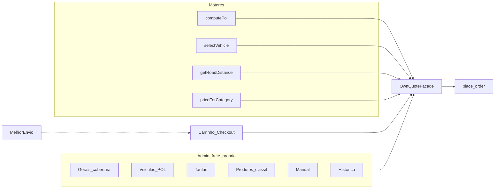

# Planejamento técnico — Frete Próprio FAL v2 (POL + veículo + distância)

**Data:** 2026-11-05  
**Tipo:** auditoria + planejamento funcional/arquitetural (**sem** implementação)  
**Política:** D-FRETE **B** · α encerrada  
**Canônico logística:** [FAL_PLANO_FUNCIONAL_LOGISTICA_MEDIDAS_2026-11-04.md](./FAL_PLANO_FUNCIONAL_LOGISTICA_MEDIDAS_2026-11-04.md)  
**Correções ME (paralelo):** [FAL_PLANO_CORRECOES_MELHOR_ENVIO_2026-11-05.md](./FAL_PLANO_CORRECOES_MELHOR_ENVIO_2026-11-05.md)  
**Runtime:** `wtbpwuiayednvlhvuhbh`

**Esta marcha não altera** código, migrations, secrets, config, deploy nem commits.

---

## Legenda

| Rótulo | Significado |
|--------|-------------|
| **APROVADO** | Decisão eFe / docs |
| **PROPOSTA** | Semântica sugerida; exige validação antes de codar |
| **HIPÓTESE** | Inferência técnica |
| **PENDÊNCIA** | Decisão ou dado operacional em aberto |
| **FATO** | Evidência no código / VAL / DB |
| **GAP** | Ainda não existe |

---

## 1. Resumo executivo

A FAL já opera frete próprio **v1**: faixas de CEP + preço **fixo** (`own:*`) em `/admin/logistica/frete-proprio`, desligado em produção. Melhor Envio híbrido (D12) cotação/`meq:`/prepare/Expedição está no código sob B (default loja = mock).

O **v2** aprovado (decisões A–H) introduz um motor próprio **independente do ME**, com contrato unificado desde o dia 1:

1. Cobertura + endereço com **número**  
2. Elegibilidade / POL do carrinho  
3. Menor veículo compatível (moto ≤ 12 POL; acima → carro)  
4. Distância rodoviária de **ida** (Google Routes via Edge)  
5. Tarifa da **categoria selecionada** (mínima + R$/km)  
6. Cotação versionada server-side → `place_order`

**Proibido:** tarifa única por km que force refatoração ao chegar POL; ida e volta; adicionais na v1; split automático de viagens; preço inventado em falha; R$ no código.

---

## 2. Estado atual do projeto (FATO)

| Capacidade | Estado | Evidência |
|------------|--------|-----------|
| Hub Logística | IMPLEMENTADO | `AdminLogisticsHubPage` |
| Origem/remetente | IMPLEMENTADO | `store_shipping_origin` · VAL ORIGEM |
| Medidas + Manual/Global + M6 | IMPLEMENTADO | VAL medidas / M6 |
| Frete próprio v1 (CEP + amount flat) | IMPLEMENTADO | `store_own_delivery_settings` · `AdminOwnDeliveryPage` · VAL FRETE_PROPRIO · `enabled=false` prod |
| Cotação mock + disclaimer B | IMPLEMENTADO | `carrierRegistry` default mock |
| Carrinho/checkout logistics | IMPLEMENTADO | `loadCartLogistics` |
| ME calculate + `meq:` + place_order | IMPLEMENTADO | VAL D12 · smoke calc |
| Prepare approve / Expedição label | IMPLEMENTADO / PARCIAL | D12; M7 E2E pendente |
| POL / veículos / Routes / tarifa por categoria | **GAP** | — |

Arquivos-chave v1:

- `fal-pecas/src/pages/admin/logistics/AdminOwnDeliveryPage.tsx`
- `fal-pecas/src/services/admin/adminOwnDeliveryService.ts`
- `fal-pecas/src/services/shipping/mockShippingProvider.ts`
- `fal-pecas/src/services/shipping/providers/melhorEnvioEdgeProvider.ts` (merge `own:*`)

---

## 3. Auditoria dos arquivos existentes (shipping)

| Artefato | Papel atual | Reuso no v2 |
|----------|-------------|-------------|
| `carrierRegistry.ts` | Providers mock/ME/… | Manter ME paralelo; own v2 como path `own:` enriquecido |
| `quoteShippingEnvelope.ts` | Orquestra cotação loja | Estender opções own / status `manual_review` |
| `loadCartLogistics.ts` | Peso/dims | Continuar; POL virá de perfil server-side |
| `place_order` + `resolve_mock` / `resolve_me` | Preço server-side | Novo resolve own v2 (quote consumível) |
| `store_shipping_origin` | Origem A da rota | **Reusar** (não duplicar) |
| `store_own_delivery_settings` | Flat rates | Evoluir: gerais + `pricing_mode` + max km |
| `shipping_quotes` | ME `meq:` | Padrão a espelhar para own (ou provider column) |
| Edges ME | Cotação/etiqueta nacional | **Não** misturar com Routes Google |

---

## 4. Funcionalidades reaproveitáveis

- Cadastro de origem único (ME + own).  
- Envelope de cotação + disclaimer B.  
- Prefixo `own:` no `place_order`.  
- Padrão de cotação TTL + consumo atômico (ME).  
- Form produto + bulk com preserve (analogia medidas → POL).  
- ViaCEP + campos de endereço com número no checkout.  
- RLS staff / anon read seletivo (rever PII).

---

## 5. Lacunas identificadas

| Lacuna | Pri |
|--------|-----|
| Schema veículos / tarifas / POL produto | P1 |
| Edge geocode + Google Routes + cache | P1 |
| Pipeline seleção veículo + preço | P1 |
| Admin 6 blocos na tela frete-próprio | P1 |
| Análise manual + histórico | P1 |
| Cotação own versionada + place_order | P0 |
| Checkout: bloquear own sem número | P1 |
| Testes POL/agrupamento/compat | P1 |
| Drift migrations own só no wtbp | P0 docs/ops |

---

## 6. Arquitetura funcional proposta



Módulos A–H do briefing original mapeiam assim: cobertura (A) · perfis (B) · frota (C) · cálculo (D) · roteamento (E) · precificação (F) · manual (G) · comercial (H).

---

## 7. Arquitetura técnica proposta

| Camada | Tecnologia |
|--------|------------|
| Admin | React — evoluir `AdminOwnDeliveryPage` (abas/seções) |
| Cotação loja | Client chama Edge/RPC; nunca calcula preço final |
| Rotas | Supabase Edge + Google Routes API + Geocoding |
| Secrets | `GOOGLE_MAPS_API_KEY` (nome canônico a confirmar) — nunca `VITE_*` |
| Persistência | Postgres (settings, categories, tariffs, profiles, quotes, reviews, audit) |
| Pedido | `place_order` resolve `own:` v2; snapshot em `shipments.metadata` |

Feature-flag: `pricing_mode: flat | distance_vehicle` em settings — v1 flat até cutover.

---

## 8. Modelagem de banco (proposta — sem migration nesta marcha)

### 8.1 `store_own_delivery_settings` (evoluir)

| Campo | Tipo | Nota |
|-------|------|------|
| id | uuid PK | singleton operacional |
| enabled | boolean | |
| coverage_label | text | |
| cep_ranges | jsonb | pré-filtro |
| rates | jsonb | **v1 flat** (manter até cutover) |
| pricing_mode | text | `flat` \| `distance_vehicle` |
| max_distance_km | numeric | APROVADO configurável |
| eta defaults | int | PENDÊNCIA se global |
| updated_at | timestamptz | |

### 8.2 `own_vehicle_categories`

| Campo | Tipo | Nota |
|-------|------|------|
| id | uuid PK | |
| code | text unique | `motorcycle`, `car`, … |
| label | text | |
| capacity_pol | numeric | moto seed **12** (APROVADO); carro = PENDÊNCIA operacional |
| sort_order | int | menor = preferido |
| active | boolean | |
| constraints | jsonb | opcional |

Seed inicial: motorcycle capacity 12; car capacity configurável (PENDÊNCIA valor).

### 8.3 `own_vehicle_tariffs`

| Campo | Tipo | Nota |
|-------|------|------|
| id | uuid PK | |
| category_id | uuid FK | |
| tarifa_minima | numeric | **piso** (PROPOSTA semântica) |
| valor_por_km | numeric | ida |
| active | boolean | |
| version | int | imutável após uso em quote |
| valid_from / valid_to | timestamptz | opcional |
| created_at | timestamptz | |

Histórico: não UPDATE destrutivo de versão usada — nova linha/versão.

### 8.4 Perfil logístico do produto

**PROPOSTA de modelagem:** tabela `product_shipping_profiles` 1:1 com `products` (evita inchamento e facilita bulk/audit), **ou** colunas em `products` se preferência de simplicidade (PENDÊNCIA de escolha na MARCHA).

Campos APROVADOS (D):

| Campo | Tipo | Nota |
|-------|------|------|
| pol_unit | numeric | |
| porte | text/enum | pequeno/médio/grande (valores iniciais = parâmetros) |
| vehicle_min_code | text | FK lógica categoria |
| compatible_vehicle_codes | text[] / jsonb | |
| restrictions | jsonb | |
| own_delivery_allowed | boolean | |
| *_origin | text | manual\|global (analogia medidas) — HIPÓTESE útil |

Categoria comercial: tabela de **sugestão** (defaults) — nunca aplica auto.

### 8.5 `own_shipping_quotes` (ou `shipping_quotes` com provider)

Espelhar padrão ME: TTL, fingerprint, consumed_at, customer/profile, amount, metadata (pol, vehicle, km, tariff_version).

Ids loja: `own:<quote_uuid>:<category_code>` (HIPÓTESE de formato — validar na MARCHA para não colidir com `own:fal` flat).

### 8.6 `own_manual_reviews`

Pedido ou pré-pedido: motivo, pol_total, itens snapshot, status (pending/approved/rejected/priced), amount autorizado, staff, timestamps.

### 8.7 Audit

`own_admin_audit_log`: quem, o quê, before/after, em.

### 8.8 RLS / integridade

- Staff: CRUD configs.  
- Cliente: não lê tarifas/POL internos desnecessários; quote própria via RPC.  
- `place_order`: service/security definer consome quote.  
- Imutável: quote consumida; tariff version referenciada; address_snapshot pedido.

---

## 9. Contratos TypeScript (esboço)

```ts
// Ilustrativo — não implementar nesta marcha
type OwnQuoteStatus =
  | 'priced'
  | 'manual_review'
  | 'out_of_coverage'
  | 'ineligible'
  | 'routing_error'
  | 'missing_number'

type OwnQuoteResult = {
  status: OwnQuoteStatus
  optionId?: string
  quoteId?: string
  amount?: number
  currency?: 'BRL'
  label?: string
  etaDaysMin?: number
  etaDaysMax?: number
  polTotal?: number
  vehicleCategoryCode?: string
  distanceKmOneWay?: number
  tariffMin?: number
  tariffPerKm?: number
  tariffVersion?: number
  expiresAt?: string
  message?: string // UI-safe
}
```

Cliente **não** envia amount/POL/vehicle para fechar pedido — só `shipping_option_id`.

---

## 10. Algoritmo de cálculo POL (APROVADO)

```
POL_TOTAL = 0
para cada item (product_id, qty) do conjunto cotado:
  perfil = loadOfficialProfile(product_id)  // server
  se perfil == null ou incompleto → ver PENDÊNCIA (block vs manual)
  se own_delivery_allowed == false → INELIGIBLE (produto)
  POL_TOTAL += qty * perfil.pol_unit
retornar POL_TOTAL
```

- Avaliar **conjunto** (carrinho/seleção), não cotas unitárias isoladas somadas na UI.  
- Sem limite fixo “2 amortecedores”; quantidade = consequência do POL.  
- Não usar cubagem como requisito do cálculo own v2.

---

## 11. Algoritmo de seleção de veículos (APROVADO)

Ordem de categorias: `sort_order` asc (ex.: motorcycle < car).

1. `POL_TOTAL` (§10).  
2. `required_min = max(vehicle_min)` entre itens.  
3. Candidatos = categorias `active` ∩ tarifas `active`.  
4. `capacity_pol >= POL_TOTAL`.  
5. Categoria ≥ `required_min`.  
6. Todo produto: categoria ∈ `compatible_vehicle_codes` e restrições OK.  
7. Se `POL_TOTAL > 12` → excluir motorcycle (regra APROVADA).  
8. Escolher menor `sort_order` restante.  
9. Vazio → `manual_review` (sem preço).  
10. Senão → `selected_vehicle`; seguir distância + tarifa **dessa** categoria.

Restrições/compatibilidade **prevalecem** sobre POL.

---

## 12. Roteamento e distância (APROVADO A)

1. Origem: `store_shipping_origin` (ativa).  
2. Destino: CEP + logradouro + **número** + bairro + cidade + UF.  
3. Sem número → `missing_number` (não geocodificar como exato).  
4. Geocode (Edge, secret Google).  
5. Routes API — distância **ida** apenas (nunca ×2).  
6. Se `distance_km > max_distance_km` → `out_of_coverage`.  
7. Falha → `routing_error` (sem haversine silencioso).  
8. Cache: hash endereço normalizado + TTL (PENDÊNCIA valor TTL).

---

## 13. Motor de precificação — fórmula (PROPOSTA B3)

### 13.1 Semântica proposta (validar eFe antes de codar)

| Termo | Significado proposto |
|-------|----------------------|
| `tarifa_minima` | **Piso** de cobrança da categoria |
| `valor_por_km` | Preço por km rodoviário de **ida** |
| Taxa fixa adicionada | **Fora da v1** |
| Adicionais extras | **Fora da v1** |

```
distance_km = km_ida_routes
raw = distance_km * valor_por_km   // categoria selecionada
frete = max(raw, tarifa_minima)
```

Exemplos **fictícios** (não são preços FAL):

| km | R$/km | mínima | raw | frete |
|----|-------|--------|-----|-------|
| 3 | 4 | 25 | 12 | 25 (piso) |
| 10 | 4 | 25 | 40 | 40 |

**Alternativa não adotada nesta proposta:** `taxa_fixa + km * R$/km`.

**Status:** **APROVADO** 2026-11-05 (eFe · MARCHA sequencial).

### 13.2 Ligação ao veículo

A tarifa aplicada é **sempre** a da categoria retornada por §11 — nunca uma tarifa global única.

---

## 14. Experiência do usuário

### Admin `/admin/logistica/frete-proprio` (6 blocos — APROVADO E)

1. Configurações gerais e cobertura (`enabled`, CEP, max km, `pricing_mode`)  
2. Tipos de veículos e capacidades POL  
3. Tarifas por categoria (mín + R$/km + ativo)  
4. Classificação logística de produtos (filtros + bulk com preview/confirmação)  
5. Análise manual  
6. Histórico  

Formulário de produto: campos POL/porte/veículo/compat/restrições/own_allowed.  
Categoria sugere; nunca altera auto.

### Loja

- Cliente vê: modalidade “Entrega FAL”, preço, prazo — ou mensagem de análise manual / indisponível.  
- **Não** expor POL.  
- Checkout: número obrigatório para own v2.  
- Recalcular ao mudar itens/CEP/endereço/número.  
- ME permanece opção paralela quando aplicável.

---

## 15. Segurança e integridade

| Regra | Comportamento |
|-------|----------------|
| Preço | Só server-side |
| Google key | Só Edge secrets |
| Quote | TTL + fingerprint + consume atômico |
| place_order | Revalida quote; rejeita amount do client |
| Falha rota | Sem preço fictício |
| Manual | Sem auto-split |
| ME | Motores separados; regressão obrigatória |
| D-FRETE B | Disclaimer até C |

---

## 16. Cenários de testes (planejados)

| # | Cenário | Esperado |
|---|---------|----------|
| 1 | 1 peça POL baixo | Moto se ≤12 e compatível; preço fórmula |
| 2 | Várias peças POL=12 | Moto ok |
| 3 | POL=13 | Carro |
| 4 | Veículo mín. carro com POL baixo | Carro |
| 5 | Restrição derruba moto | Próximo compatível ou manual |
| 6 | Agrupamento misto portes | POL soma; min veículo = max |
| 7 | Sem perfil / POL | ineligible ou manual (PENDÊNCIA) |
| 8 | own_allowed=false | ineligible |
| 9 | CEP fora faixa | out_of_coverage (pré-filtro) |
| 10 | Sem número | missing_number |
| 11 | km > max | out_of_coverage |
| 12 | Routes down | routing_error |
| 13 | Tarifa categoria inativa | próximo veículo ou manual |
| 14 | Quote expirada | place_order rejeita |
| 15 | Carrinho muda pós-quote | fingerprint inválido |
| 16 | Client manda amount falso | ignorado / rejeitado |
| 17 | place_order fluxo ok | snapshot vehicle/pol/km |
| 18 | Incompatível com carro | manual_review |
| 19 | Regressão ME `meq:` | intacto |
| 20 | Regressão checkout MP | intacto |
| 21–24 | Flat v1 mode / enabled off / dual own+ME / idempotência | conforme matriz VAL |

---

## 17. Plano de implementação por fases (futuro — pós aceite docs)

| Fase | Objetivo | Depende | Rollback |
|------|----------|---------|----------|
| 0 | Docs + aceite fórmula | — | n/a |
| 1 | Schema + contrato quote (vehicle, pol, km) | 0 | drop unused tables |
| 2 | Edge Routes + geocode + cache | 1 + secret Google | disable distance mode |
| 3 | Perfis POL produto + bulk | 1 | flag own_allowed false |
| 4 | Pipeline facade completo | 2+3 | pricing_mode=flat |
| 5 | Admin 6 blocos | 1–4 | UI read-only |
| 6 | Checkout número + place_order own v2 | 4 | só flat/ME |
| 7 | Testes + VAL | 6 | — |
| 8 | Deploy controlado sob B (`enabled` opt-in) | 7 | disable |

**Não** entregar “só km tarifa única” entre 2 e 3.

---

## 18. Riscos e dependências

| Risco | Mitigação |
|-------|-----------|
| Aceite fórmula atrasado | Bloquear MARCHA código |
| Custo Google | Cache + pré-filtro CEP; quotas |
| Drift migrations repo↔wtbp | Versionar DDL own/origem |
| Colisão id `own:fal` flat vs quote uuid | Namespace de option_id documentado na MARCHA |
| Dados POL ausentes no catálogo | Bulk + block cotação incompleta |
| Confusão ME × own | Motores e metadados separados |
| API_BASE ME prod sob B | Ver plano correções ME |

---

## 19. Decisões pendentes

| ID | Item | Tipo |
|----|------|------|
| P-OWN-1 | Aceite eFe da fórmula **piso** (§13) | **APROVADO** 2026-11-05 (MARCHA sequencial) |
| P-OWN-2 | R$ `tarifa_minima` / `valor_por_km` por categoria | Operacional |
| P-OWN-3 | Capacidade POL do **carro** | Operacional |
| P-OWN-4 | POL unitário / portes iniciais por SKU | Operacional |
| P-OWN-5 | Perfil incompleto: `ineligible` vs `manual_review` | Decisão |
| P-OWN-6 | ETA global vs por categoria | Decisão |
| P-OWN-7 | Perfis em `products` vs `product_shipping_profiles` | Técnico |
| P-OWN-8 | Formato `option_id` own v2 vs flat | Técnico |
| P-OWN-9 | TTL cache rota / quote | Técnico |
| P-OWN-10 | Nome secret Google no wtbp | Ops |
| P-OWN-11 | Billing/quotas Google | Ops |
| P-OWN-12 | D-FRETE **C** se frete v2 for produção comercial | Comercial |

---

## 20. Critérios gerais de conclusão

### Desta marcha (docs)

- [x] Auditoria estado real v1 vs v2  
- [x] Decisões A–H registradas  
- [x] Algoritmos POL / veículo / distância  
- [x] Modelo dados + contrato cotação  
- [x] Fórmula proposta (piso) explícita  
- [x] Admin 6 blocos + place_order  
- [x] Testes + fases + pendências  
- [x] Matriz prioridades (§21)  
- [x] Zero código/secrets alterados  

### Antes de liberar código v2

- [ ] P-OWN-1 fórmula aceita  
- [ ] MARCHA nomeada + auth  
- [ ] VAL testes §16  
- [ ] Regressão ME/MP  

---

## 21. Matriz de prioridades

| Item | Situação atual | Situação desejada | Ação | Pri |
|------|----------------|-------------------|------|-----|
| Own v1 flat | IMPLEMENTADO off | Manter até cutover | Flag `pricing_mode` | P1 |
| Contrato quote unificado | GAP | vehicle+pol+km+tarifa | Schema fase 1 | P0 |
| Google Routes Edge | GAP | Ida + cache + secret | Fase 2 | P1 |
| POL produto | GAP | Campos + bulk | Fase 3 | P1 |
| Seleção veículo moto≤12 | GAP | Algoritmo §11 | Fase 4 | P1 |
| Tarifa por categoria | GAP | Admin + fórmula piso | Fase 1+5 | P1 |
| Análise manual | GAP | Fila admin | Fase 5 | P1 |
| place_order own v2 | só flat | Consume quote | Fase 6 | P0 |
| Checkout exige número | PARCIAL | Block own sem número | Fase 6 | P1 |
| ME híbrido | VAL código | M7 + UI config | Plano correções ME | P1 |
| Docs canônico §4 | Desatualizado | Rebaseado 05/11 | Feito nesta marcha | P0 |
| Drift SQL own no repo | Ausente local | Versionar | Ops P0 | P0 |

---

## 22. Pipeline de cotação (orquestração F)

1. Validar cobertura CEP + endereço com número  
2. Validar elegibilidade produtos  
3. Calcular POL total  
4. Identificar menor veículo compatível (ou manual)  
5. Consultar distância ida  
6. Aplicar tarifa da categoria selecionada (fórmula §13)  
7. Persistir cotação id / versão / TTL  

Motores: `computePol` ⊥ `selectVehicle` ⊥ `getRoadDistance` ⊥ `priceForCategory` → facade.

---

## Histórico

| Data | Evento |
|------|--------|
| 2026-11-05 | Criação — auditoria + decisões A–H + proposta fórmula piso (docs only) |

**Assinatura agente:** planejamento frete próprio v2 2026-11-05 — documentação apenas.
