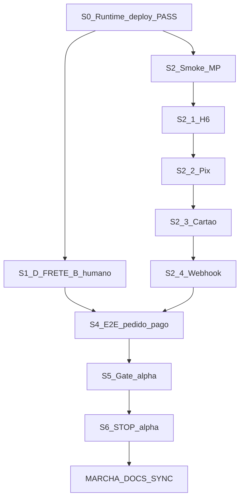

# Planejamento dos próximos passos — Fase α (FAL 3.0)

**Data-base:** 2026-11-04  
**Tipo:** consolidação executiva e técnica (somente planejamento)  
**Etapa:** Fase α — operação comercial controlada  
**Runtime canônico:** `wtbpwuiayednvlhvuhbh`  
**Produção:** https://fal-pecas-automotivas.netlify.app  
**Git remoto (FATO):** `origin/main` @ `9513dad` · `origin/dev` @ `b5925d1`  

**Premissa de planejamento:** D-FRETE = **B** (mock/sandbox com aviso honesto).  
**ATENÇÃO:** premissa ≠ assinatura comercial de eFe na ficha D-FRETE.

**Estimativa 80% código/docs · 20% aceite comercial:** ESTIMATIVA documental da auditoria 04/11 — não é percentual matemático de testes.

**Esta marcha não executa** smoke, pagamentos, pedidos, código, secrets, migrations nem deploy.

---

## 0. Legenda

| Rótulo | Significado |
|--------|-------------|
| **FATO** | Evidência documentada ou probe 04/11 |
| **PENDÊNCIA** | Ainda sem aceite / evidência comercial |
| **HIPÓTESE** | Inferência sem prova nesta data |
| **ESTIMATIVA** | Julgamento documental (ex.: 80/20) |
| **DECISÃO DE PLANO** | Premissa deste MD (ex.: D-FRETE B) — não assina pelo agente |

---

## 1. Diagnóstico atualizado

### 1.1 Onde estamos

A FAL 3.0 está na **Fase α**. Fundação, catálogo, admin, PDP, checkout/F9-F e frete sandbox estão prontos no código. Runtime e Netlify estão **vivos** (04/11). O gap para operação controlada é **aceitação comercial humana**: smoke MP (Pix/cartão/webhook), assinatura D-FRETE B, um pedido E2E pago e assinatura do Gate α.

### 1.2 Runtime e produção (FATO — 04/11)

| Item | Estado | Evidência |
|------|--------|-----------|
| Runtime `wtbp…` | UP | DNS resolve; `/auth/v1/health` responde (401 sem key) |
| Netlify | HTTP 200 | `fal-pecas-automotivas.netlify.app` |
| Bundle | Atual | `index-DYpbbWUS.js` |
| Catálogo | OK | 100 produtos · 24 na página; sem “Carregando…” |
| Admin | OK | Sessão autenticada; formulário de produto carrega |
| S0 sync deploy | **PASS** | Auditoria 04/11 |
| Diag NXDOMAIN 30/10 | Histórico | Superado no canônico |
| HF `owllm…` | Fora | Não é verdade comercial |

Fonte: [FAL_AUDITORIA_STATUS_PRD_CROSS_2026-11-04.md](./FAL_AUDITORIA_STATUS_PRD_CROSS_2026-11-04.md).

### 1.3 Desenvolvimento (FATO)

| Frente | Estado |
|--------|--------|
| F1–F7 | ENCERRADO |
| F8 / F8.1 base admin | VALIDADO |
| F10 Onda 0–1 | ENCERRADA |
| FIND-004 M1–M5 | ENCERRADO |
| PDP A–D | VALIDADO |
| Carrinho / Card UX | VALIDADO |
| F9-F (RPC + meios MP) | IMPLEMENTADO |
| E2E pré-pagamento | VALIDADO (até limite documentado) |
| Frete sandbox UI/estrutura | VALIDADO |

### 1.4 Mercado Pago

| Item | Estado | Nota |
|------|--------|------|
| H1–H5 | **PASS** (14/10) | Config/infra — **não** é smoke comercial |
| H6 | **PARCIAL** | App sandbox OK; usuário teste N/V |
| Smoke Pix | **Não executado** | PENDÊNCIA |
| Smoke cartão | **Não executado** | PENDÊNCIA |
| Webhook no smoke | **Não executado** | PENDÊNCIA |

Fonte H1–H5: [FAL_MP_SMOKE_H1H6_CHECK_2026-10-14.md](./FAL_MP_SMOKE_H1H6_CHECK_2026-10-14.md).  
Procedimento: [FAL_MP_SMOKE_PREP_2026-10-09.md](./FAL_MP_SMOKE_PREP_2026-10-09.md) §3.

### 1.5 Fase α — aceite

| Item | Estado |
|------|--------|
| Gate α assinado | **PENDÊNCIA** |
| D-FRETE assinado | **PENDÊNCIA** (plano assume B) |
| Pedido E2E pago | **Não executado** |
| Aceite comercial | **PENDÊNCIA** |

### 1.6 Divergências documentais (preferir evidência recente)

| Afirmação antiga | Fonte antiga | Verdade vigente |
|------------------|--------------|-----------------|
| F10 = próximo foco | PRD §32 / ROADMAP | Onda 0–1 encerrada; foco = **fechamento α** |
| Apps cobertura parcial | PRD §7/§31 | FIND-004 M1–M5 encerrado |
| STOP antes de F9-F | PRD / ROADMAP bloco C | F9-F **IMPLEMENTADO** |
| H5 FAIL / UI simulado | Gate α / E2E status / molde | H5 **PASS** 14/10; recheck visual no smoke |
| wtbp DOWN | Diag 30/10 | UP 04/11 |
| Webhook bloqueado por secret | docs anteriores a 14/10 | H3+H4 PASS; falta smoke |

Em divergência: **auditoria 04/11 + H1H6 14/10** vencem.

---

## 2. Inventário — não reabrir sem finding novo

| # | Entrega | Estado |
|---|---------|--------|
| 1 | F1–F7 fundação | ENCERRADO |
| 2 | F8 / F8.1 ops admin (base) | VALIDADO |
| 3 | F10 Onda 0–1 | ENCERRADO |
| 4 | FIND-004 M1–M5 | ENCERRADO |
| 5 | PDP A–D | VALIDADO |
| 6 | Card UX + carrinho | VALIDADO |
| 7 | Admin classif. / apps / preços UX | VALIDADO (VALs 10/10) |
| 8 | F9-F checkout/RPC meios MP | IMPLEMENTADO |
| 9 | E2E pré-pagamento | VALIDADO |
| 10 | Frete auditoria + UI sandbox | VALIDADO |
| 11 | H1–H5 MP (secrets + webhook v4 + provider prod) | PASS config |
| 12 | S0 Netlify + wtbp UP (04/11) | PASS |

**Regra:** regressão só com finding novo + MARCHA nomeada + auth.

**Proibido:** apontar produção/`.env` para HF `owllm…` como runtime comercial.

---

## 3. Sequência oficial de fechamento da Fase α



**S1 ∥ S2:** podem avançar em paralelo. Ambos são pré-requisitos de S4.  
Não há S3a–S3c (Correios live) neste fechamento — premissa **B**.

---

### S0 — Runtime e deploy

| Campo | Conteúdo |
|-------|----------|
| **Objetivo** | Garantir Netlify = `main` atual e wtbp respondendo |
| **Estado atual** | **PASS** (04/11) |
| **Evidência** | Bundle `index-DYpbbWUS.js`; catálogo 100 produtos; admin OK; DNS wtbp OK — auditoria 04/11 |
| **Pendências** | Nenhuma para reabrir S0 |
| **Responsável** | — (não reabrir) |
| **Dependências** | — |
| **Critério de aceite** | Já atingido; só reabre com finding (ex.: NXDOMAIN / bundle stale) |
| **Próxima ação** | Nenhuma. Seguir S1 ∥ S2 |

---

### S1 — D-FRETE B (assinatura humana)

| Campo | Conteúdo |
|-------|----------|
| **Objetivo** | Formalizar política mock/sandbox com aviso honesto para operação controlada |
| **Estado atual** | Ficha existe; **sem assinatura**. DECISÃO DE PLANO = B |
| **Evidência** | [FAL_D_FRETE_DECISAO_2026-10-10.md](./FAL_D_FRETE_DECISAO_2026-10-10.md); UI sandbox + disclaimer já no código (VALs frete) |
| **Pendências** | Confirmar B na ficha; mensagem ao cliente; expedição/comunicação; assinatura eFe + data |
| **Responsável** | **eFe** |
| **Dependências** | S0 PASS (ambiente estável para mensagem coerente na loja) |
| **Critério de aceite** | Ficha com opção **B** assinada; mensagem comercial definida; expedição documentada |
| **Próxima ação** | eFe preencher e assinar o bloco “Decisão eFe” na ficha D-FRETE |

**Nota:** escolher B neste planejamento **não** assina a ficha. Opção **C** (Correios live) fica **pós-α**, salvo nova decisão formal.

---

### S2 — Smoke Mercado Pago

| Campo | Conteúdo |
|-------|----------|
| **Objetivo** | Validar comercialmente Pix, cartão e webhook em sandbox na loja canônica |
| **Estado atual** | H1–H5 PASS; H6 parcial; smokes **não executados** |
| **Evidência** | H1H6 check 14/10; prep §3; F9-F código presente |
| **Pendências** | S2.1–S2.4 abaixo |
| **Responsável** | **eFe**; agente só com auth explícita `SMOKE MP` |
| **Dependências** | S0; usuário sandbox (H6); loja Netlify + wtbp |
| **Critério de aceite** | Pix + cartão + webhook com evidências reproduzíveis **ou** bloqueios explícitos aceitos por eFe. **Não** marcar PASS só por código, HTTP, H1–H5 ou evidência antiga |
| **Próxima ação** | Fechar H6 → executar Pix → cartão → webhook; registrar em MP status |

#### S2.1 — H6 (usuário teste)

| Campo | Conteúdo |
|-------|----------|
| **Objetivo** | Garantir conta/usuário sandbox MP utilizável |
| **Estado** | PARCIAL (app FALPecasSandbox listado; user teste N/V) |
| **Pendências** | Confirmar ou criar usuário teste por procedimento autorizado; **não** publicar credenciais em docs/chat |
| **Responsável** | eFe |
| **Critério** | Evidência de disponibilidade (sem secret) |
| **Próxima ação** | Confirmar user teste no painel MP |

#### S2.2 — Pix

| Campo | Conteúdo |
|-------|----------|
| **Objetivo** | Cobrança Pix sandbox ponta a ponta |
| **Procedimento** | Prep §3.2 — Netlify + wtbp; item available; total coerente |
| **Esperado** | QR/copia-cola; `create-mp-payment` 2xx; pedido em status aguardando/canônico |
| **Responsável** | eFe (+ agente se auth) |
| **Critério** | Prints/Network/order id sem secrets; resultado PASS/FAIL/BLOQUEADO registrado |
| **Próxima ação** | Executar checklist Pix na loja |

#### S2.3 — Cartão

| Campo | Conteúdo |
|-------|----------|
| **Objetivo** | Brick sandbox — approve (+ reject se previsto) |
| **Procedimento** | Prep §3.3 |
| **Responsável** | eFe (+ agente se auth) |
| **Critério** | Formulário carrega; approve/pending/reject documentados; UI honesta |
| **Próxima ação** | Executar após Pix ou em seguida no mesmo turno de smoke |

#### S2.4 — Webhook de aprovação

| Campo | Conteúdo |
|-------|----------|
| **Objetivo** | Confirmar evento → transição pagamento/pedido |
| **Estado config** | Secret + Edge v4 PASS (14/10) — ainda **não** prova o smoke |
| **Pendências** | URL wtbp no painel MP; evento Pagamentos; receive + transition |
| **Responsável** | eFe |
| **Critério** | Evidência de recebimento + estado do pedido atualizado (ou NÃO TESTÁVEL documentado + aceite) |
| **Próxima ação** | Conferir URL `…/functions/v1/mercado-pago-webhook` e capturar approve no smoke |

---

### S4 — Pedido E2E pago

| Campo | Conteúdo |
|-------|----------|
| **Objetivo** | Um pedido sandbox completo sob política frete **B** + MP |
| **Estado atual** | Não executado; E2E-pré VALIDADO até login |
| **Evidência prévia** | [FAL_E2E_PRODUCAO_STATUS_2026-10-10.md](./FAL_E2E_PRODUCAO_STATUS_2026-10-10.md); VAL E2E-pré |
| **Pendências** | Fluxo completo com pagamento aprovado e frete mock coerente |
| **Responsável** | **eFe** (+ apoio técnico autorizado) |
| **Dependências** | **S1 assinado** + **S2 concluído** (ou bloqueio formalmente tratado no aceite) |
| **Critério de aceite** | Pedido sandbox com pagamento aprovado; estados coerentes; frete compatível com B; order id + evidências. Bloqueios registrados sem mascarar |
| **Próxima ação** | Após S1+S2: catálogo → checkout → `mock:*` → pagar → webhook → admin/conta |

Validar explicitamente: produto · carrinho · checkout · frete mock · pagamento · webhook · pedido · coerência valores.

---

### S5 — Gate α

| Campo | Conteúdo |
|-------|----------|
| **Objetivo** | Aceite formal “Operação controlada OK” |
| **Estado atual** | Bloco de assinatura vazio; texto do gate cita H5 FAIL (**obsoleto**) |
| **Evidência a conferir** | S0; H1–H6; Pix; cartão; webhook; D-FRETE B; E2E pago; mensagem; expedição; riscos residuais |
| **Pendências** | Assinatura eFe + data + ressalvas |
| **Responsável** | **eFe** |
| **Dependências** | **S4 concluído** |
| **Critério de aceite** | [FAL_ALPHA_GATE_2026-10-10.md](./FAL_ALPHA_GATE_2026-10-10.md) preenchido com evidências e assinatura explícita. Sem aceite formal, α **permanece aberta** |
| **Próxima ação** | Após S4: preencher SIM / NÃO / ACEITE DE RISCO |

---

### S6 — STOP α

| Campo | Conteúdo |
|-------|----------|
| **Objetivo** | Congelar escopo α e registrar estado final |
| **Estado atual** | Não iniciado (gate aberto) |
| **Pendências** | Estado final + lista do que fica para pós-α |
| **Responsável** | eFe + agente (registro documental) |
| **Dependências** | S5 assinado |
| **Critério de aceite** | Escopo α congelado; sem novas frentes no mesmo fechamento; docs sync autorizável |
| **Próxima ação** | Autorizar `MARCHA_DOCS_SYNC_ALPHA_STATUS` para resultados comerciais plenos |

---

## 4. Matriz de prioridades P0–P3

### P0 — Fechamento comercial α

| ID | Item | Responsável | Critério |
|----|------|-------------|----------|
| P0-H6 | Usuário teste MP | eFe | Disponibilidade sem expor secret |
| P0-PIX | Smoke Pix | eFe | Evidência prep §3.2 |
| P0-CARD | Smoke cartão | eFe | Evidência prep §3.3 |
| P0-WH | Webhook approve | eFe | Evento + transição |
| P0-FR | Assinatura D-FRETE B | eFe | Ficha assinada |
| P0-GATE | Gate α | eFe | Assinatura explícita |

### P1 — Evidência operacional e documentação

| ID | Item | Responsável | Critério |
|----|------|-------------|----------|
| P1-E2E | Pedido E2E pago | eFe | Order id + coerência |
| P1-PRD | Sync PRD §7/31/32/36 | Agente (auth docs) | Texto = fatos; pendências continuam pendências |
| P1-RM | Sync ROADMAP C/D | Agente (auth docs) | Foco = fechamento α |
| P1-ST | Gate/molde/E2E/MP status | Agente (auth docs) | Remover H5 FAIL obsoleto; não antecipar smoke PASS |

### P2 — HOLD / fora do fechamento α

| ID | Item | Nota |
|----|------|------|
| P2-B3 | Migration repair | HOLD — não reabrir |
| P2-F | Bloco F permissões | HOLD |
| P2-F10 | Polimento amplo F10 | Pós aceite α / paralelo controlado |
| P2-IMG | Escala fotos/storage | Ops |

### P3 — Pós-α / lançamento

| ID | Item | Nota |
|----|------|------|
| P3-DOM | Domínio definitivo | Netlify = ponte até lá |
| P3-F11 | Catálogo mestre F11+ | Após gate α |
| P3-F13 | Escala comercial | Futuro |
| P3-COR | Correios live (D-FRETE C) | Só com decisão formal futura |

---

## 5. Responsáveis (resumo)

| Ação | Quem |
|------|------|
| S1, S2, S4, S5 | **eFe** |
| Apoio smoke / coleta de evidências | Agente **somente** com auth `SMOKE MP` (ou equivalente) |
| `MARCHA_DOCS_SYNC_ALPHA_STATUS` | Agente após auth; **nunca** promover pendência a concluído sem evidência |
| S0 / inventário encerrado | Ninguém — não reabrir |
| Secrets / vars Netlify / deploy | Humano; agente não altera sem pedido explícito |

---

## 6. Riscos e dependências bloqueadoras

| Risco | Impacto | Mitigação |
|-------|---------|-----------|
| wtbp pause / DNS NXDOMAIN de novo | Loja “Carregando…”; smoke inválido | Revalidar S0 antes de S2/S4; não migrar para HF |
| Checkout ainda “simulado” na UI | Falso negativo / venda errada | Recheck visual «Pagamento — Mercado Pago» no início do S2 |
| H6 sem usuário teste | Bloqueia Pix/cartão | Fechar S2.1 primeiro |
| Docs obsoletos (H5 FAIL, F10 próximo) | MARCHA errada / retrabalho | Preferir auditoria 04/11 + H1H6; depois docs sync |
| Assumir D-FRETE C no P0 | Escopo explode (secrets + HTTP live) | Manter B neste fechamento |
| Confundir H1–H5 com smoke | Aceite falso | Critério S2 exige evidência comercial |
| Agente executar smoke sem auth | Fora do protocolo | Exigir MARCHA nomeada |

---

## 7. Documentos que precisarão ser atualizados

### 7.1 Na `MARCHA_DOCS_SYNC_ALPHA_STATUS` (auth explícita)

| Documento | O que sincronizar |
|-----------|-------------------|
| [FAL_PRD_3.0.md](../entrada/FAL_PRD_3.0.md) | §7 FIND-004; §31 MP real; §32 F10 encerrado / F9-F implementado; §36 D-FRETE até assinatura |
| [ROADMAP_FASES_3.0.md](./ROADMAP_FASES_3.0.md) | Blocos C/D; foco = fechamento α; F11+ pós-α |
| [FAL_ALPHA_GATE_2026-10-10.md](./FAL_ALPHA_GATE_2026-10-10.md) | Corrigir H5 FAIL → H1–H5 PASS (ref 14/10); H6 parcial; **não** marcar smoke PASS antecipado |
| [FAL_STATUS_CONSOLIDADO_MOLDE_2026-10-09.md](./FAL_STATUS_CONSOLIDADO_MOLDE_2026-10-09.md) | H5 / F9-F / FIND-004 / F10 |
| [FAL_E2E_PRODUCAO_STATUS_2026-10-10.md](./FAL_E2E_PRODUCAO_STATUS_2026-10-10.md) | S0 atual; MP conforme evidência real |
| [FAL_MP_SMOKE_STATUS_2026-10-10.md](./FAL_MP_SMOKE_STATUS_2026-10-10.md) | Resultados S2 efetivos |
| [FAL_D_FRETE_DECISAO_2026-10-10.md](./FAL_D_FRETE_DECISAO_2026-10-10.md) | **Após** assinatura formal B |

**Regra:** trechos já FATO (S0, H1–H5, F9-F, FIND-004) podem ser corrigidos; pendências comerciais **permanecem** pendências até evidência.

### 7.2 Higiene

| Item | Estado |
|------|--------|
| Caractere `)` residual no fim de [FAL_AUDITORIA_STATUS_PRD_CROSS_2026-11-04.md](./FAL_AUDITORIA_STATUS_PRD_CROSS_2026-11-04.md) | **Confirmado** (linha final). Corrigir na MARCHA docs (ou higiene mínima autorizada) |

---

## 8. Roadmap sequencial (próximos passos)

```text
AGORA (humano, paralelo):
  S1  Assinar D-FRETE B (mensagem + expedição)
  S2  H6 → Pix → cartão → webhook  [auth SMOKE MP se quiser apoio agente]

DEPOIS:
  S4  1 pedido E2E sandbox pago (frete B + MP)
  S5  Assinar Gate α
  S6  STOP α (congelar escopo)

EM SEGUIDA (agente, auth):
  MARCHA_DOCS_SYNC_ALPHA_STATUS

PÓS-α (não agora):
  Domínio definitivo · F11+ · F13 · Correios live se C
```

---

## 9. Recomendação — próxima MARCHA técnica

| Campo | Conteúdo |
|-------|----------|
| **Nome** | `MARCHA_DOCS_SYNC_ALPHA_STATUS` |
| **Quando** | Após este MD + **autorização explícita**. Resultados comerciais (Pix/gate/D-FRETE) só após S2/S1/S5 conforme o trecho |
| **Escopo** | Sincronizar PRD, ROADMAP, gate, molde, E2E/MP status, higiene `)` na auditoria 04/11; refletir fatos 04/11 e 14/10 |
| **Fora** | Código · secrets · deploy · smoke · pedidos · Correios live · B3 · Bloco F · domínio · HF · reabrir FIND-004/PDP |
| **Aceite** | Docs alinhados aos FATOS; nenhuma pendência marcada como PASS sem evidência |

**Imediato (não é marcha de agente):** eFe executar **S1 ∥ S2**.

Se eFe quiser apoio no smoke: autorizar explicitamente `SMOKE MP` (escopo = execução prep §3 + registro de evidências; sem alterar secrets/código).

---

## 10. Encerramento

### Onde estamos
Fase α. S0 **PASS**. Código/config de pagamento e frete sandbox prontos. Aceite comercial **aberto**.

### O que falta para fechar a Fase α
1. S1 — D-FRETE **B** assinado  
2. S2 — Pix + cartão + webhook com evidências  
3. S4 — 1 pedido E2E pago  
4. S5 — Gate α assinado  

### Qual deve ser a próxima marcha
- **Humano agora:** S1 ∥ S2  
- **Agente depois (auth):** `MARCHA_DOCS_SYNC_ALPHA_STATUS`  

### O que não devemos fazer agora
- Integração Correios live / D-FRETE C como P0  
- Apontar para HF `owllm…`  
- Repair B3 / Bloco F / F11 / domínio fixo  
- Reabrir FIND-004, PDP A–D, Onda 0–1 sem finding  
- Marcar smoke ou gate como PASS sem evidência comercial  
- Executar pagamentos/pedidos nesta consolidação  

---

## STOP

Entrega desta marcha = **este documento de planejamento**.  

Aguardar autorização explícita antes de: smoke MP, assinatura operacional assistida, `MARCHA_DOCS_SYNC_ALPHA_STATUS`, código, secrets ou deploy.

**Assinatura agente:** consolidação do planejamento α gravada em 2026-11-04.
