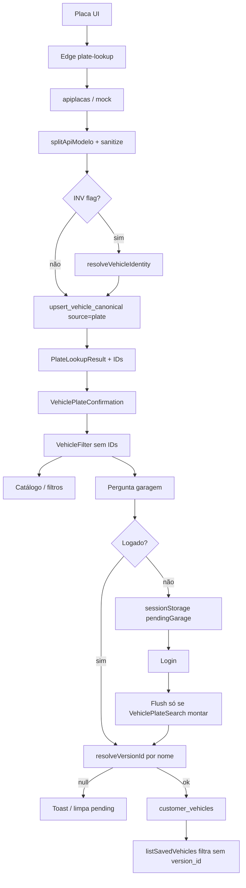
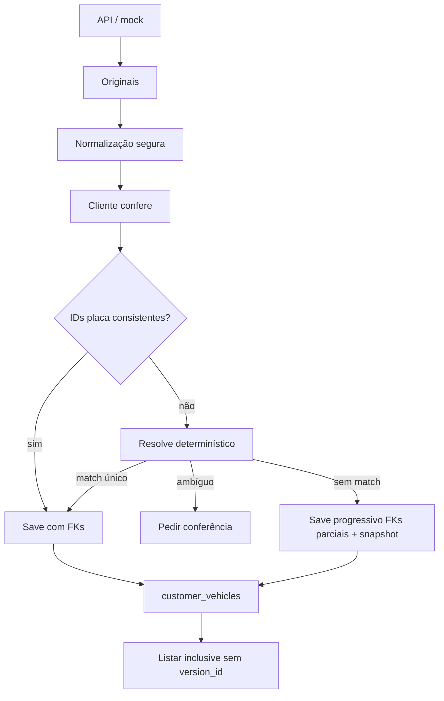

# FAL — PLANO 0 · Fundação do cadastro por placa e identidade canônica

**Projeto:** FAL — Plataforma de Peças Automotivas  
**Data:** 2026-11-17  
**Branch de referência:** `dev` (`22ad9e7` no momento da auditoria)  
**Workspace auditado:** `C:\Users\user\repos\FAL-PECAS-AUTOMOTIVAS\fal-pecas`  
**Natureza:** Auditoria + planejamento técnico (**sem implementação nesta etapa**)  
**Relacionados:** [FAL_AUDITORIA_GARAGEM_PLACA_V1.md](./FAL_AUDITORIA_GARAGEM_PLACA_V1.md) · [FAL_SPEC_BUSCA_POR_PLACA_2026-11-09.md](./FAL_SPEC_BUSCA_POR_PLACA_2026-11-09.md) · [FAL_GARAGE_VISAO_FUNCIONAL.md](../futuro/FAL_GARAGE_VISAO_FUNCIONAL.md)

---

## 0. Escopo desta entrega

| Faz | Não faz |
|-----|---------|
| Diagnóstico código + migrations atuais | Alterar código / migrations / banco |
| Arquitetura e regras propostas | Commits, push, PR, deploy |
| Critérios de aceite e etapas futuras | Planejamento 1 da Minha Garagem (UX completa) |
| Lista de arquivos afetados | Correção em massa de dados |

**Verificação de banco ao vivo:** o projeto Supabase ligado ao MCP da sessão (`owllmfcpbodqmoerdfxx`) **não** contém `public.customer_vehicles` — não é o schema FAL operacional. Nullability e FKs abaixo são **CONFIRMADAS pelas migrations do repositório**. Revalidar no projeto FAL de produção/homologação antes da implementação.

---

## 1. Diagnóstico atual

### 1.1 O que já funciona

| Capacidade | Evidência |
|------------|-----------|
| Consulta de placa (mock / API Placas) via Edge `plate-lookup` | `supabase/functions/plate-lookup/index.ts` |
| Split de modelo composto + sanitização de motor/versão | `_shared/apiPlacasPlateProvider.ts`, `splitApiModelo.ts` |
| Upsert canônico no mestre com `source: 'plate'` | Edge + RPC `upsert_vehicle_canonical` |
| Retorno de `manufacturerId` / `modelId` / `versionId` no payload | `PlateLookupResult` em `plateTypes.ts` |
| Confirmação humana editável (`VehicleSelector`) | `VehiclePlateConfirmation.tsx` |
| Fallback manual se API falha / incompleto | `VehiclePlateSearch` fase `manual` |
| Pending anônimo em `sessionStorage` | `pendingGarage.ts` |
| Garagem na conta (`/conta/veiculos`) e atalhos Home/catálogo | `AccountVehiclesPage`, `HomeGarageSection`, `SavedVehiclesQuickPick` |
| PVC **não** é tocado no save da garagem | `customerVehicleService` só lê/escreve `customer_vehicles` |
| Schema permite FKs nulas em `customer_vehicles` | Migration `20261003180000_fase2_schema_rls.sql` |

### 1.2 Divergência estrutural (núcleo do problema)

```
Edge                    Frontend save
─────                   ─────────────
upsert → versionId  →   IGNORADO
                        resolveVersionId(nomes) → exige match
                        addSavedVehicle(versionId obrigatório)
                        listSavedVehicles filtra version_id null
```

O **banco permite** veículo pessoal incompleto; a **aplicação exige** `version_id` resolvido e **oculta** registros sem ele.

---

## 2. Mapeamento do fluxo existente



### 2.1 Antes do login

1. Consulta placa → confirmação editável → aplica filtros (catálogo) ou pergunta “salvar na garagem?”.
2. Se “sim” e anônimo: grava `fal_pending_garage_vehicle` (+ `returnTo`) e redireciona `/login`.
3. Busca/filtro por veículo **não** exige login.

### 2.2 Depois do login

1. Flush do pending ocorre no `useEffect` de **`VehiclePlateSearch`** (único consumidor de `readPendingGarageVehicle` no `src/`).
2. Flush chama de novo `resolveVersionId`; se falhar, **apaga** o pending e pede ajuste na conta.
3. **Gap:** login que aterrissa em `/conta` (ou outra rota sem montar `VehiclePlateSearch`) pode deixar o pending órfão até o usuário abrir tela de placa/catálogo com o componente.

### 2.3 Campos da API Placas (`/basico`) hoje mapeados

| Campo API (exemplos) | Uso FAL |
|----------------------|---------|
| Placa (input) | Cache `cached_plates`, payload |
| `marca` | `maker` |
| `modelo` (composto) | Split → `model` + motor/versão |
| `ano` / `anoModelo` / `ano_modelo` | Prefere ano-modelo; um único `year` no filtro |
| `motor` / `motorizacao` / `cilindrada` | `sanitizeEngine` |
| `versao` / `versão` / `version` | `sanitizeVersionLabel` |
| `combustivel` | `fuel` (só informativo na confirmação) |
| Câmbio | `transmission: null` no mapper atual |

**Não reutilizados no `VehicleFilter` / garagem:** `fuel`, `transmission`, ano de fabricação separado do ano-modelo, IDs canônicos no save.

---

## 3. Problemas confirmados

| ID | Problema | Evidência |
|----|----------|-----------|
| P0-01 | Frontend **não usa** `versionId`/`manufacturerId`/`modelId` da placa no save | `VehiclePlateSearch.tsx` → só `resolveVersionId` por nomes |
| P0-02 | App exige `version_id` apesar do DDL nullable | `addSavedVehicle` + tipo `CustomerSavedVehicle.versionId: string` |
| P0-03 | `listSavedVehicles` descarta linhas sem `version_id` | `.filter((r) => r.version_id)` |
| P0-04 | Política 028 comentada: sem match → não salva (placa e conta) | `customerVehicleService.ts`, toasts na UI |
| P0-05 | `resolveVersionId` com motor/versão vazios não restringe esses campos e usa o **primeiro** `find` — ambíguo | Sem checagem de múltiplos matches |
| P0-06 | `plateResultToFilter` injeta `""` (“Não informado”) quando motor/versão ausentes | Pode confundir “vazio original” vs opção sintética |
| P0-07 | Flush pós-login acoplado a `VehiclePlateSearch` | Gap de recuperação |
| P0-08 | Falha no resolve **apaga** pending | Perda de dados originais da consulta |
| P0-09 | Edge pode **criar** VV canônica (incl. engine/version null) no lookup; garagem ainda pode falhar se nomes não casarem na re-resolução | Divergência Edge vs UI |
| P0-10 | `sanitizeEngine` rejeita `n < 0.8` ou `> 7.0` → `null` (inclui `0.1`) **sem preservar o bruto** no filtro | `splitApiModelo.ts` |

---

## 4. Hipóteses ainda não verificadas

| ID | Hipótese | Como fechar |
|----|----------|-------------|
| H-01 | Em produção, `PLATE_PROVIDER=apiplacas` com token válido | Secrets / logs Edge no projeto FAL |
| H-02 | Existem `customer_vehicles` órfãos (version_id null) invisíveis na UI | SQL no projeto FAL real |
| H-03 | Existem `vehicle_versions.engine` com lixo (`0.1`, etc.) no mestre | SQL + amostra admin |
| H-04 | INV (`resolveVehicleIdentity`) bloqueia upsert (`allowCanonicalUpsert=false`) em casos reais de placa | Telemetria `vehicle_resolution_events` |
| H-05 | Ano fab vs ano-modelo causa mismatch em PVC/busca | Casos VAL com placas reais |
| H-06 | Projeto MCP atual ≠ banco FAL | Confirmar `project-ref` operacional (docs citam `wtbpwuiayednvlhvuhbh`) |

---

## 5. Arquitetura proposta

### 5.1 Camadas de dados (obrigatórias)

| Camada | Conteúdo | Persistência sugerida |
|--------|----------|------------------------|
| 1. Originais da consulta | Payload bruto / campos API | Snapshot em pending + coluna(s) na garagem (ex. `source_snapshot` jsonb) e/ou cache placa |
| 2. Normalizados | Após split/sanitize **quando seguro** | Filtro UI + campos tipados |
| 3. IDs canônicos | `manufacturer_id`, `model_id`, `version_id` | FKs nullable em `customer_vehicles` |
| 4. Confirmados pelo cliente | Edição na confirmação / conta | Sobrescreve normalizados; não apaga originais |
| 5. Não identificados | Lacunas explícitas | Null / flags; **não** genéricos inventados |

### 5.2 Hierarquia canônica

**Fabricante → Modelo → Versão**

- Associar versão só se maker/model consistentes.
- Reutilizar IDs da Edge quando consistentes com o filtro confirmado.
- Re-resolver por nome **somente** se IDs ausentes ou inconsistentes.
- **Proibido:** criar versão fictícia/genérica só para preencher `version_id`.
- **Permitido:** `version_id` null no veículo pessoal.

### 5.3 Fluxo alvo (simplificado)



### 5.4 Identificação ≠ PVC

Salvar veículo **nunca** cria/atualiza `product_vehicle_compatibility`. Compatibilidade só após filtro/catálogo com dados suficientes; UI não afirma “garantida” se faltar versão/motor relevantes.

---

## 6. Regras de negócio

1. Placa identifica; não garante motor/versão.
2. Não descartar dado válido por falta de catálogo/PVC.
3. Não substituir originais por genéricos.
4. Não inventar ausentes.
5. Incompleto ≠ inválido automático.
6. Cliente confere e corrige.
7. Fabricante + modelo sem motor/versão → motor e versão **opcionais**.
8. Nunca pedir de novo dado já retornado (preservar pending/snapshot pós-login).
9. Salvamento progressivo: enriquecer o mesmo registro depois.
10. `source` de upsert deve refletir procedência real (`plate` / `admin` / `import`) — nunca mascarar.
11. Mínimo proposto para cadastro pessoal: **maker + model** (textuais confirmados) **ou** pelo menos um FK canônico de maker/model; placa opcional no snapshot. Justificativa: permite existência do veículo e filtro parcial no catálogo sem forçar VV.

---

## 7. Alterações necessárias no frontend

| Área | Mudança |
|------|---------|
| `plateResultToFilter` / tipos | Propagar IDs + snapshot original; não confundir “ausente” com label genérico sem marcar origem |
| `VehiclePlateSearch` | Save: preferir IDs da placa; soft-save sem exigir resolve; não apagar pending em falha parcial |
| Flush login | Ponto global (Account layout / auth callback) além de `VehiclePlateSearch` |
| `customerVehicleService` | `addSavedVehicle` com `versionId` opcional; `listSavedVehicles` sem filtrar null; update progressivo |
| `AccountVehiclesPage` | Salvar com maker+model; editar incompletos; copy se sem peças |
| `CustomerSavedVehicle` | `versionId` nullable; campos texto / snapshot |
| `SavedVehiclesQuickPick` | Aceitar veículos sem `versionName`; filtro parcial |
| Confirmação | Expor combustível; não forçar preenchimento de motor/versão |

---

## 8. Alterações necessárias no backend / Edge

| Área | Mudança |
|------|---------|
| `plate-lookup` | Manter upsert **apenas** quando seguro; considerar não upsertar VV ambígua; devolver originais brutos (motor pré-sanitize) no payload para preservação |
| `upsert_vehicle_canonical` | Revisar se lookup deve sempre criar VV; alinhar a “não criar versão fictícia” |
| Mapper API | Separar ano fab vs ano-modelo no payload se ambos existirem; mapear transmission se disponível |
| INV | Documentar quando `allowCanonicalUpsert` é false e o efeito no cliente |

---

## 9. Alterações de banco (se justificadas)

| Mudança | Justificativa | Risco |
|---------|---------------|-------|
| Confirmar nullability (já existe) | Nenhuma DDL se migrations = prod | Baixo |
| Colunas texto / `source_snapshot jsonb` / `plate` em `customer_vehicles` | Preservar originais sem correspondência | Médio — RLS + tipos |
| Índice / status `resolution_status` opcional | Listar “pendente de vínculo” | Baixo–médio |
| **Não** tornar `version_id` NOT NULL | Violaria salvamento progressivo | — |

Qualquer migration só após aprovação e validação no projeto FAL real.

---

## 10. Estratégia de preservação dos dados

1. **Pending:** não limpar em falha de resolve; marcar estado `needs_review`.
2. **Garagem:** persistir snapshot da consulta + campos confirmados; FKs quando houver.
3. **Normalize fail:** guardar bruto (ex. motor `0.1` da API) no snapshot; normalizado null.
4. **Dados existentes:** inventário SQL (H-02/H-03) antes de higiene; sem delete em massa; critério + reversão.
5. **Dedup canônico:** continuar chave natural; não fundir à força veículos pessoais.

---

## 11. Segurança e RLS

| Item | Estado atual | Ação futura |
|------|--------------|-------------|
| RLS `cvehicles_all_own` | Cliente só vê/edita os próprios | Manter; testar insert parcial |
| RPC `upsert_vehicle_canonical` | service_role / staff | Manter; não expor a anon |
| Edge plate-lookup | Service role no upsert | Rate limit / auth já existentes — revalidar |
| Isolamento multi-cliente | Via `customer_id` | Teste RLS #17 |
| `source` | enum plate/admin/import | Não usar admin/import para atalho de placa |

---

## 12. Testes (obrigatórios — a implementar na fase de código)

| # | Caso | Camadas |
|---|------|---------|
| 1 | Placa completa (maker/model/versão) | unit + e2e |
| 2 | Sem versão | unit + e2e |
| 3 | Sem motor | unit |
| 4 | Dados parciais | unit + e2e |
| 5 | API indisponível → manual | e2e |
| 6 | Cadastro manual na conta | e2e |
| 7 | Dados conflitantes / ambíguos | unit |
| 8 | Não mapeado no catálogo → save parcial | integração |
| 9 | Veículo sem `version_id` | integração |
| 10 | Listagem de incompletos | unit + e2e |
| 11 | Edição de incompletos | e2e |
| 12 | Recuperação após login (pending) | e2e |
| 13 | Múltiplos veículos | e2e |
| 14 | Integridade maker→model→version | unit |
| 15 | Sanitização motores (incl. preservação bruto) | unit |
| 16 | PVC não criado no save; busca sem garantia falsa | integração |
| 17 | RLS isolamento | integração |
| 18 | Regressão busca/filtros placa | e2e / VAL |

---

## 13. Critérios de aceite (fundação)

1. Com fabricante + modelo (e opcionalmente ano), o cliente autenticado **salva** na garagem **sem** motor e **sem** versão.
2. Veículos sem `version_id` **aparecem** em `/conta/veiculos` e na Home.
3. IDs retornados pela placa, se consistentes com a confirmação, são **reutilizados** (sem re-resolve desnecessário).
4. Dados originais da API sobrevivem a normalização falha e a pending pós-login.
5. Nenhuma versão genérica/fictícia criada só para satisfazer FK.
6. Nenhum vínculo PVC automático no save.
7. UI de confirmação permanece editável; conflitos não são resolvidos em silêncio.
8. Documentação VAL atualizada após implementação (fase seguinte).

---

## 14. Etapas de implementação (futuras — fora deste PLANO 0)

| Etapa | Conteúdo | Dependência |
|-------|----------|-------------|
| 0 | Este documento — aprovação eFe | — |
| 1 | Contratos TS + `customerVehicleService` (save/list/update progressivo) | Aprovação |
| 2 | Migration snapshot/texto (se aprovada) + RLS smoke | Etapa 1 |
| 3 | `VehiclePlateSearch` / pending / flush global | Etapa 1 |
| 4 | Conta + QuickPick + copy “sem peças” | Etapa 1–3 |
| 5 | Ajustes Edge (originais brutos / política upsert) | Paralelo 1–3 |
| 6 | Testes §12 + VAL | Etapas 1–5 |
| 7 | Planejamento 1 Minha Garagem (UX) | Fundação estável |

---

## 15. Riscos

| Risco | Mitigação |
|-------|-----------|
| Upsert de placa polui mestre com VV incompletas | Política: upsert só com maker+model limpos; não inventar version_name |
| Ambiguidade maker+model sem ano | Exigir conferência; não `find` silencioso |
| Consumidores TS com `versionId: string` | Migrar tipo + callers juntos |
| Pending perdido | Flush no auth + não clear em falha parcial |
| Banco MCP ≠ FAL | Validar no project-ref correto antes de migration |
| Regressão busca catálogo | Suite #18 + VAL placa |

---

## 16. Dependências

- Aprovação eFe deste PLANO 0.
- Acesso ao projeto Supabase FAL real (schema + secrets placa).
- Edge `plate-lookup` e RPC `upsert_vehicle_canonical` já deployados.
- Decisão sobre colunas de snapshot (sim/não) antes da migration.
- Não bloqueia Commerce G8; alinha com visão Garage seed.

---

## 17. Arquivos afetados (implementação futura)

### Frontend

- `fal-pecas/src/services/customers/customerVehicleService.ts`
- `fal-pecas/src/services/plates/pendingGarage.ts`
- `fal-pecas/src/services/plates/plateTypes.ts`
- `fal-pecas/src/services/plates/plateLookupService.ts`
- `fal-pecas/src/services/plates/splitApiModelo.ts` (preservação / sanitize)
- `fal-pecas/src/services/plates/reconcileVehicleFilter.ts`
- `fal-pecas/src/components/vehicle/VehiclePlateSearch.tsx`
- `fal-pecas/src/components/vehicle/VehiclePlateConfirmation.tsx`
- `fal-pecas/src/components/vehicle/VehicleSelector.tsx`
- `fal-pecas/src/components/vehicle/SavedVehiclesQuickPick.tsx`
- `fal-pecas/src/pages/Account/AccountVehiclesPage.tsx`
- `fal-pecas/src/components/home/HomeVehiclesPanel.tsx` / `HomeGarageSection.tsx`
- `fal-pecas/src/types/index.ts` (`CustomerSavedVehicle`)
- Possível: layout/auth para flush global

### Backend / Edge / SQL

- `fal-pecas/supabase/functions/plate-lookup/index.ts`
- `fal-pecas/supabase/functions/_shared/apiPlacasPlateProvider.ts`
- `fal-pecas/supabase/functions/_shared/vehicleCanonicalUpsert.ts` / `splitApiModelo.ts`
- Migrations novas (snapshot) — TBD
- RPC `upsert_vehicle_canonical` — revisão de política

### Testes / docs

- Specs/testes espelhando §12
- `fal-pecas/docs/VAL-placa-filtros-veiculo.md` (atualizar pós-código)
- Este arquivo: `docs/planejamento/FAL_PLANO0_FUNDACAO_CADASTRO_PLACA_2026-11-17.md`

---

## 18. Cenários A–G (comportamento alvo)

| Cenário | Alvo |
|---------|------|
| A Completa | IDs + campos; save canônico |
| B Sem versão | Save com `version_id` null; sem inventar VV |
| C Sem motor | Save com `engine` null; snapshot se API mandou lixo |
| D Parcial | Reaproveitar; pedir só ausentes |
| E API down | Manual assistido; sem upsert forçado |
| F Conflito | Conferência; preservar origem |
| G Anônimo | Pending completo → pós-login sem re-pedir; flush confiável |

---

## 19. Separação final

| Já funciona | Corrigir | Desenvolver (fundação) |
|-------------|---------|--------------------------|
| Consulta placa + cache | Uso dos IDs no save | Save progressivo + listagem incompletos |
| Confirmação editável | resolve ambíguo / política 028 | Snapshot originais |
| Upsert canônico no Edge | Pending clear agressivo | Flush login global |
| Schema FKs nullable | Filtro `listSavedVehicles` | Update progressivo na conta |
| Isolamento PVC no save | sanitize sem preservar bruto | Payload ano fab/modelo + fuel na garagem |

---

## 20. Resultado esperado (após implementação futura)

A FAL identifica e cadastra veículo pessoal mesmo sem versão/motorização da API; preserva dados; vínculos canônicos confiáveis quando existirem; ausência de `version_id` não impede existência nem listagem — fundação segura para a Minha Garagem (Planejamento 1).

---

**Status:** PLANO 0 documentado; **marcha Etapas 1–6 em andamento em `dev`** (2026-11-18).  
- Etapa 1: save progressivo + textos + UI placa/conta  
- Etapa 2: flush global pós-login (`PendingGarageFlush`), Home/QuickPick  
- Etapa 3: Edge/mapper com `engineRaw`/`versionRaw`; migration aplicada em **produção** `wtbpwuiayednvlhvuhbh` via `db query` (histórico `db push` ainda divergente — não usar repair sem ordem explícita)  
- Etapa 4–5: copy incompleto + GarageAskPrompt único; smoke GAF7032 (placa → catálogo → pending → login)  
- Etapa 6 (parcial): unit §12 #1–4/#8–10; `resolveAuthReturnPath` (returnTo após refresh no login); e2e flush autenticado ainda pendente de credencial de teste  
- Edge deploy + commit `6414cac` na `dev` feitos.
- Smoke UI `GAF7032` (2026-11-18): conferência 5 filtros OK → catálogo com chips → empty PVC esperado. Ver `fal-pecas/docs/VAL-placa-filtros-veiculo.md`.
