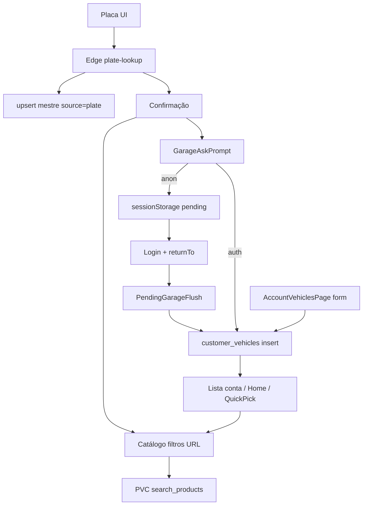
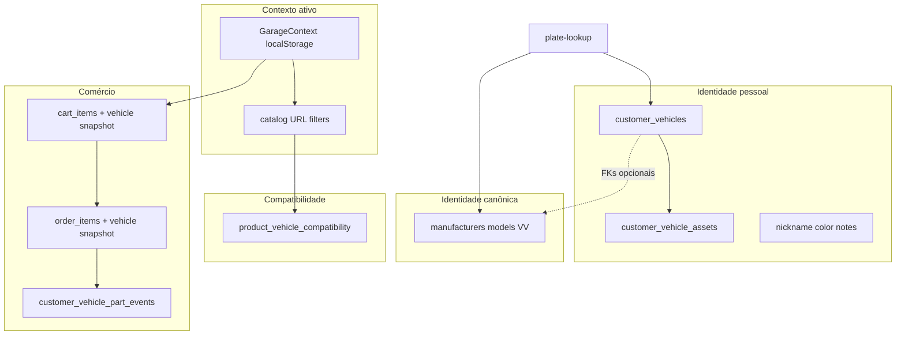
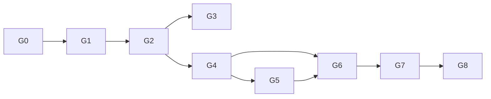

# FAL — PLANO 1 · Minha Garagem — Fundação e experiência inicial

**Projeto:** FAL — Plataforma de Peças Automotivas  
**Escopo:** Minha Garagem — Fundação e experiência inicial  
**Data:** 2026-11-18  
**Revisão eFe:** 2026-11-18 (R1–R8 — ver changelog §23)  
**Status:** G0–G4 ok na `dev` · **G5 motor compatibilidade 3 estados** em curso  
**Branch de implementação futura:** `dev` exclusivamente (`main` = produção)  
**Natureza deste documento:** Análise, auditoria e planejamento técnico — **sem implementação nesta entrega**  
**Workspace auditado:** `C:\Users\user\repos\FAL-PECAS-AUTOMOTIVAS\fal-pecas` (código em `dev`, pós-PLANO 0)

**Relacionados:**

- [FAL_PLANO0_FUNDACAO_CADASTRO_PLACA_2026-11-17.md](./FAL_PLANO0_FUNDACAO_CADASTRO_PLACA_2026-11-17.md) — fundação placa/garagem progressiva (**fechada com residuals**)
- [FAL_PLANO0_RESIDUALS_POS_FUNDACAO_2026-11-18.md](./FAL_PLANO0_RESIDUALS_POS_FUNDACAO_2026-11-18.md) — R1 update, R7 dedup, R2/R3 Edge/snapshot
- [FAL_GARAGE_VISAO_FUNCIONAL.md](../futuro/FAL_GARAGE_VISAO_FUNCIONAL.md) — direção de produto (Garage 1+)
- [VAL-placa-filtros-veiculo.md](../../fal-pecas/docs/VAL-placa-filtros-veiculo.md) — evidências smoke placa/flush
- [FAL_AUDITORIA_GARAGEM_PLACA_V1.md](./FAL_AUDITORIA_GARAGEM_PLACA_V1.md) — **supersedida** pelo PLANO 0 + este PLANO 1 (diagnósticos “sem VV não salva” estão obsoletos)

---

## 0. Escopo desta entrega (planejamento)

| Faz | Não faz |
|-----|---------|
| Diagnóstico do código/schema atuais | Alterar código, banco, migrations, Edge |
| Arquitetura, dados, UX, segurança, testes | Commits de feature, push de app, PR, deploy |
| Etapas G0–G8 de implementação futura | Planejamento 2 (3D, oficinas, manutenção avançada) |
| Separar reaproveitar / corrigir / desenvolver / futuro | Reconstrução desnecessária do que já funciona |

---

## 1. Diagnóstico do estado atual

### 1.1 O que já funciona (PLANO 0 + seed)

| Capacidade | Evidência |
|------------|-----------|
| Consulta placa → mestre (`source=plate`) | Edge `plate-lookup` → `vehicleCanonicalUpsert` → RPC `upsert_vehicle_canonical` |
| Confirmação editável + filtros catálogo | `VehiclePlateSearch`, `VehiclePlateConfirmation`, `VehicleSelector` |
| Save progressivo na garagem (sem `version_id`) | `ensureSavedVehicleFromFilter`, `addSavedVehicle`; migration `20261118010000_customer_vehicles_progressive_text.sql` |
| Listagem de incompletos | `listSavedVehicles` **não** filtra `version_id` null |
| Pending anônimo + flush pós-login | `pendingGarage.ts`, `GarageAskPrompt`, `PendingGarageFlush`, `resolveAuthReturnPath` |
| Conta seed `/conta/veiculos` | `AccountVehiclesPage` — add manual, primary, remove, link catálogo |
| Home “Meus carros” | `HomeVehiclesPanel` + aba Home |
| Quick pick no catálogo | `SavedVehiclesQuickPick` |
| PVC no catálogo + empty state | `search_products` + copy “Veículo reconhecido — sem peças compatíveis” |
| RLS dono | policy `cvehicles_all_own` |
| Design System loja/conta | tokens `fal-*`, `AccountLayout`, `MainLayout`, `MobileNav` |

### 1.2 Divergências vs experiência desejada (PLANO 1)

```
Hoje                              Alvo PLANO 1
────                              ────────────
Lista/form admin-like na conta    Dashboard híbrido + página do veículo
Só is_primary + URL no catálogo   Ativo (localStorage cross-session) ≠ principal (DB)
Insert-only                       Update progressivo + dedup placa
Sem cor/foto/galeria              Personalização + Storage + stock com confiança
Sem vínculo cart/order            Snapshot veículo + histórico eventos
Compat = apps estáticas / filtro  3 estados: confirmada / provável / não confirmada
```

### 1.3 Confirmação: a placa enriquece o cadastro?

| Camada | Enriquecida pela placa? |
|--------|-------------------------|
| Mestre (`manufacturers` / `models` / `vehicle_versions`) | **Sim** — na Edge, na consulta |
| Garagem (`customer_vehicles`) | **Sim** — após “Sim, salvar” + auth; **não** cria mestre |
| PVC | **Não** (proposital) |

---

## 2. Inventário de funcionalidades existentes

### 2.1 Frontend

| Área | Paths |
|------|-------|
| Conta veículos | `fal-pecas/src/pages/Account/AccountVehiclesPage.tsx` |
| Home | `fal-pecas/src/components/home/HomeVehiclesPanel.tsx` |
| HomeGarageSection | `…/HomeGarageSection.tsx` — **existe, não montado** (não remountar; Home já tem panel) |
| Placa / garagem | `VehiclePlateSearch`, `GarageAskPrompt`, `PendingGarageFlush`, `SavedVehiclesQuickPick`, `VehicleSelector` |
| Serviços | `customerVehicleService.ts`, `pendingGarage.ts`, `flushPendingGarage.ts`, `authReturnPath.ts`, `plateLookupService.ts`, `vehicleService.ts` |
| Catálogo | `CatalogPage.tsx`, `searchService.ts` |
| Auth shell | `AccountLayout.tsx`, `router.tsx` (`/conta/veiculos`), `MobileNav.tsx` |

### 2.2 Backend / schema

| Artefato | Estado |
|----------|--------|
| `customer_vehicles` | FKs nullable; `is_primary`; textos `maker_text`…`plate` |
| `upsert_vehicle_canonical` | Edge + admin import |
| `product_vehicle_compatibility` | Filtro catálogo / PDP apps |
| `cart_items` / `order_items` | **Sem** `customer_vehicle_id` |
| Storage | Bucket `product-images` (staff) — **sem** bucket cliente/garagem |

### 2.3 Tipos

`CustomerSavedVehicle` — `versionId` nullable, `nickname`, `plate`, nomes derivados. **Sem** cor, notes, assets.

---

## 3. Mapeamento dos fluxos atuais



**Gaps de fluxo:** sem página do veículo; sem contexto ativo global; sem update; sem fotos; cart/checkout ignoram garagem.

---

## 4. Problemas identificados

| ID | Problema | Impacto | Origem |
|----|----------|---------|--------|
| P1-01 | Sem `updateSavedVehicle` | Não dá para completar incompleto sem novo insert | Residual R1 |
| P1-02 | Sem dedup por placa | Duplicatas ao re-salvar | Residual R7 |
| P1-03 | Placa não exibida na UI da conta | UX/rastreio fraco | `AccountVehiclesPage` |
| P1-04 | Sem veículo ativo app-wide | Contexto só via URL/`is_primary` visual | Arquitetura |
| P1-05 | Sem página `/conta/veiculos/:id` | Não há “espaço do carro” | UX |
| P1-06 | Sem cor/foto/Storage cliente | Personalização impossível | Schema |
| P1-07 | Sem 3 estados de compatibilidade | Risco de percepção falsa | Catálogo/PDP |
| P1-08 | Cart/order sem veículo | Histórico e compra inteligente bloqueados | Commerce |
| P1-09 | Compra ≠ instalação não modelados | Histórico confuso no futuro | Domínio |
| P1-10 | `HomeGarageSection` órfão | Risco de UI duplicada se montado | Home |
| P1-11 | Edge pode criar VV “aberta” | Qualidade do mestre | Residual R2 (paralelo) |
| P1-12 | Auditoria v1 desatualizada | Decisão errada se lida isolada | Docs |

---

## 5. Arquitetura proposta

### 5.1 Três dimensões (obrigatório)

1. **Identidade pessoal** — veículo do cliente (`customer_vehicles` + assets + personalização).
2. **Identidade canônica** — mestre FAL (FKs opcionais; sem inventar VV na garagem).
3. **Compatibilidade técnica** — evidência PVC + regras; ausência de evidência ≠ confirmada.

### 5.2 Diagrama



### 5.3 Decisões travadas

| Tema | Decisão |
|------|----------|
| Rotas | Dashboard `/conta/veiculos`; detalhe `/conta/veiculos/:id` sob `AccountLayout` |
| Veículo **principal** | Preferência permanente (`is_primary` no cadastro). Independente do ativo |
| Veículo **ativo** | Contexto de navegação. `GarageContext` + `localStorage` chave `fal_active_garage_vehicle:{userId}` (`customerVehicleId` + filtro derivado). Sobrevive navegação **e** retorno em outro dia. Trocar ativo **nunca** altera `is_primary` nem FKs |
| Invalidação do ativo | Se veículo excluído, não pertence ao cliente ou id inválido → tentar cair no **principal** (se existir); senão limpar contexto |
| Exemplo | Cliente com 3 carros: principal = 1º; pesquisa peça para o 2º → 2º fica ativo temporariamente; 1º continua principal |
| Sync catálogo | Aplicar ativo → query string já existente (`maker/model/year/engine/version`) |
| Visitante | Só URL + pending (como hoje); sem Context persistente de id de garagem |
| Mínimo save | `maker_text` + `model_text`; motor/versão/placa/cor/foto opcionais |
| Home | Manter `HomeVehiclesPanel`; **não** montar `HomeGarageSection` em paralelo |
| Imagens stock | Quatro níveis (exata / representativa / genérica / placeholder) — ver §7.7; nunca apresentar outro ano/geração como “exata” |
| Fotos pessoais | Bucket privado + RLS; galeria completa (ver §6.4); capa pessoal ≠ identidade técnica |
| Compat confirmada | Calculada por **motor técnico** de compatibilidade (não badge ad-hoc); `version_id` sozinho **não** basta — ver §7.2 |
| Compra | Direta se confirmada; aviso + confirmação se provável; sem bloqueio amplo inventado |
| Snapshot pedido | Imutável no `order_items`; cópia na conversão cart→order — ver §6.3 |
| Histórico | Eventos **append-only** (linha do tempo); nunca sobrescrever `bought` → instalado |
| Dedup placa | Unique parcial sobre **placa normalizada** — ver §7.1 |
| Instalação | Declaração do cliente (`installed_declared`); ≠ compra |
| Branch | Só `dev` até autorização explícita de produção |

### 5.4 Preparação para evolução (sem implementar P2)

- Identidade pessoal ≠ assets ≠ canônico ≠ contexto ativo (localStorage).
- `customer_vehicle_part_events` com identidade própria (preparado para transferência de dono no P2 — ver §6.2 / R8).
- Sem tabelas de 3D/oficina/km/mecânicos/compartilhamento nesta fase.

---

## 6. Modelo de dados e relacionamentos

### 6.1 Alterações em `customer_vehicles`

| Coluna | Tipo | Notas |
|--------|------|-------|
| (existentes) | FKs + textos + plate + nickname + is_primary | Manter |
| `color_hex` | text null | Personalização visual |
| `color_label` | text null | Ex.: “Prata” |
| `notes` | text null | Observações pessoais |
| `primary_asset_id` | uuid null FK assets | Imagem principal pessoal |
| `source_snapshot` | jsonb null | Residual R3 — originais API (opcional nesta fase ou G1.5) |

**Constraints (R7 — dedup placa):** unique parcial `(customer_id, plate_normalized)` onde `plate_normalized IS NOT NULL`.  
- Coluna gerada/persistida `plate_normalized`: uppercase, sem hífen/espaços (função única de normalização no app + DB).  
- Placa vazia / null → **fora** do unique (vários veículos sem placa permitidos).  
- Alteração de placa: recalcula normalizado; conflito → erro UX / merge assistido.  
- Antes do constraint: script de consolidação de legado inconsistente (hífen vs sem hífen).  
**API:** `updateSavedVehicle` — update no mesmo `id` (residual PLANO 0 R1).

### 6.2 Novas tabelas (mínimo justificado)

**`customer_vehicle_assets`**

- `id`, `customer_vehicle_id`, `customer_id` (denormalizado para RLS), `storage_path`, `sort_order`, `is_primary`, `mime`, `byte_size`, `created_at`
- RLS: dono via `customer_id = current_customer_id()`
- Ao deletar asset: limpar Storage; se era `primary_asset_id` / `is_primary`, promover outra ou null (nunca apontar ID órfão)

**`vehicle_stock_images`** (curadoria admin)

- `id`, `maker`, `model`, `generation` null, `body_style` null, `year_from`, `year_to`, `match_level` (`exact` \| `family` \| `generic`), `image_url`/`storage_path`, `confidence` (0–1), `active`
- Resolver (§7.7): só promover nível superior se match + confiança ≥ limiar; UI deve rotular nível (exata vs representativa)

**`customer_vehicle_part_events`** (append-only — R6 / R8)

- `id` (identidade própria do evento — não é subdocumento do user)
- `customer_id` — dono operacional P1 (autorização/RLS)
- `customer_vehicle_id` null — vínculo atual (pode mudar de dono no P2 sem apagar eventos)
- `order_id` / `order_item_id` / `product_id` null — FKs estáveis de comércio
- Snapshot embutido no `payload` (produto/veículo no momento do evento) para leitura histórica
- `event_type`: `bought` \| `associated` \| `awaiting_install` \| `installed_declared` \| `returned` \| `corrected` \| `disassociated`
- `actor_id` null (user que registrou), `provenance`: `customer` \| `system` (oficina = P2)
- `created_at` — instante do acontecimento
- **Proibido:** UPDATE que transforme `bought` em `installed_declared`. Cada transição = **novo** insert.
- P2: transferência de histórico amplia ownership sem reconstruir a linha do tempo

### 6.3 Commerce (R2 — snapshot imutável)

| Tabela | Colunas |
|--------|---------|
| `cart_items` | `customer_vehicle_id` uuid null, `vehicle_snapshot` jsonb null |
| `order_items` | idem — snapshot **congelado** na criação do pedido |

**Contrato `vehicle_snapshot` (no momento da associação):**

```json
{
  "customerVehicleId": "uuid|null",
  "maker": "string",
  "model": "string",
  "year": "string|number|null",
  "version": "string|null",
  "engine": "string|null",
  "versionId": "uuid|null",
  "plate": "string|null",
  "associatedAt": "ISO-8601",
  "contextSource": "active|manual|suggested"
}
```

- Conversão carrinho→pedido: **copiar** snapshot do item; não reconsultar a garagem.
- Pedido antigo **não** muda de significado se o cliente editar/excluir o veículo depois.
- **Placa no snapshot:** incluir só se política LGPD/aprovação eFe permitir; na UI de pedido/pós-venda **mascarar** (ex. `GAF7***`) ou omitir em superfícies compartilháveis. Justificativa: rastreio técnico interno ≠ exposição pública.
- Item sem associação permanece válido (`customer_vehicle_id` null, snapshot null).

### 6.4 Storage e galeria (R5)

- Bucket privado `customer-vehicle-images`
- Path: `{customer_id}/{vehicle_id}/{asset_id}`
- Policies: upload/read/delete só do dono; staff read opcional
- **Operações obrigatórias:** upload, exclusão, reordenação (`sort_order`), escolha da imagem principal, substituição
- **Limites (valores iniciais a confirmar em G3):** máx. N fotos/veículo; máx. bytes/arquivo; MIME allowlist (`image/jpeg`, `image/png`, `image/webp`)
- Uploads interrompidos: não criar asset “completo” sem objeto no Storage; job/cleanup de órfãos
- URLs **assinadas** com expiração curta; sem bucket público
- `primary_asset_id` só referencia asset existente; ao remover capa → null ou próxima da galeria

### 6.5 O que não criar agora

`mileage_log`, oficinas, mecânicos, documentos avançados, entidades 3D, compartilhamento portátil, verificação documental.

---

## 7. Regras de negócio

### 7.1 Cadastro

1. Placa = porta principal; manual assistido sempre disponível.
2. Reaproveitar dados confiáveis da API; não pedir de novo o que já veio.
3. Salvar com maker+model; motor/versão opcionais; sem VV fictícia.
4. IDs da placa reutilizados se confirmação consistente.
5. Originais vs normalizados preservados (textos + raw; snapshot jsonb quando residual R3).
6. **Dedup (R7):** mesma `plate_normalized` do mesmo cliente → update/merge; nunca insert cego. Normalizar antes de validar/unique (hífen, espaços, caixa). Valores vazios não entram no unique.
7. Pessoal ≠ canônico ≠ PVC.

### 7.2 Compatibilidade (3 estados) — motor técnico (R3)

A classificação **não** é uma condição visual no frontend. É calculada por um **serviço/camada de compatibilidade** (entrada: produto + identificação do veículo ativo/filtro; saída: estado + evidências).

**Entradas mínimas a considerar:**

- Existência de PVC aplicável ao produto  
- Vigência e integridade do registro PVC  
- Correspondência de versão (`version_id` / VV) quando a regra exigir  
- Restrições de ano / faixa  
- Motor, quando a regra de compatibilidade exigir  
- Exceções e restrições técnicas cadastradas  

| Estado | Critério (resumo) |
|--------|-------------------|
| **Confirmada** | Evidência PVC suficiente e íntegra para afirmar aplicação (versão/ano/motor conforme regra). **`version_id` sozinho não basta.** |
| **Provável** | Há interseção parcial ou faltam dados no veículo/regra que impediriam certeza |
| **Não confirmada** | Sem evidência suficiente |

- Ausência de “incompatível conhecido” **não** é confirmada.  
- Proibido: similaridade textual de nome como prova única.  
- Sem evidência suficiente → a FAL **não** apresenta “compatibilidade confirmada”.  
- Copy: “compatibilidade limitada” quando o veículo pessoal está incompleto.

### 7.3 Compra inteligente

| Estado | Comportamento P1 |
|--------|------------------|
| Confirmada | CTA comprar normal |
| Provável | Aviso + confirmação explícita do cliente |
| Não confirmada | Não rotular como compatível; permitir browse; bloqueio amplo **não** inventado nesta fase |

### 7.4 Histórico (append-only)

- Compra ≠ associação ≠ instalação — cada um é um **evento** distinto com data própria.
- Ex.: comprada hoje → associada amanhã → `installed_declared` na semana seguinte = **três** inserts, não um update.
- Sugestão de veículo pelo contexto ativo; cliente corrige (`corrected` / `disassociated`) ou deixa sem associação.
- `installed_declared` = declaração; provenance `customer`.
- Eventos têm identidade própria (R8) para evolução P2 (troca de proprietário / oficina).

### 7.5 Contexto ativo vs principal (R1)

- `is_primary` = preferência **permanente** do cadastro.
- Ativo = contexto de navegação, persistido em **`localStorage`** (recupera ao voltar outro dia).
- Podem diferir (ex.: principal = carro 1; ativo = carro 2 durante uma busca).
- Trocar ativo **não** altera `is_primary` nem dados técnicos.
- Invalidação: exclusão / perda de ownership → principal ou limpar.

### 7.6 Personalização

- Nickname, cor, fotos, notes — **não** alteram dados técnicos oficiais / FKs canônicas.
- Foto principal pessoal substitui a apresentação visual sem mudar identidade técnica.

### 7.7 Imagens stock — quatro níveis (R4)

| Nível | Quando usar | UI |
|-------|-------------|-----|
| **Exata** | Match maker + model + geração + intervalo de anos (e carroceria se curada) com confiança ≥ limiar | Sem disclaimer de “aproximação” |
| **Representativa** | Família do modelo / geração próxima — **nunca** rotular como exata | Label explícito (ex. “Imagem ilustrativa da família”) |
| **Genérica** | Marca ou categoria | Label genérico |
| **Placeholder FAL** | Sem match confiável | Neutro FAL |

Não usar imagem de outro ano/geração como se fosse o veículo exato.

---

## 8. Fluxos completos de usuário

### A — Placa → garagem (auth)

1. Informa placa → Edge → confirmação.  
2. Confere/completa só ausentes → catálogo + ask.  
3. Sim, salvar → `customer_vehicles` (ou pending→login→flush).  
4. Aparece no dashboard; opcional abrir detalhe.

### B — Placa → visitante

1. Igual até ask → pending + login/cadastro → flush + returnTo.

### C — Manual assistido

1. Falha/incompleto da API ou “selecionar manualmente”.  
2. Preenche só faltantes (árvore + textos).  
3. Save progressivo maker+model.

### D — Completar incompleto

1. Abre detalhe → editar → `updateSavedVehicle`.  
2. Pode vincular `version_id` se resolver; senão permanece null.

### E — Navegar com veículo ativo

1. Seleciona ativo (dashboard, quick pick, header) → grava `localStorage`.  
2. Em visita futura (outro dia), Context reidrata o último ativo válido (ou cai no principal).  
3. Catálogo/PDP usam filtro + badges do **motor** de compatibilidade.  
4. Add to cart carrega `vehicle_snapshot` se ativo existir (`contextSource: active`).

### F — Histórico básico

1. Pedido pago → evento `bought` (e `associated` se havia snapshot — inserts separados).  
2. Depois: novos eventos `awaiting_install` / `installed_declared` / `disassociated` / `corrected` — **sem** alterar o `bought`.

---

## 9. Especificação UX/UI

### 9.1 Princípios

- Parecer nativo FAL (tokens `fal-*`, `rounded-fal`, `Button`/`Card`/`EmptyState`).
- **Garagem digital** para consumidor — funcional e densa o bastante, **sem** painel administrativo cheio de tabelas.
- Referência de direção visual: dashboard híbrido tipo “vehicle maintenance dashboard” (hero + cards); detalhe tipo CRM automotivo split imagem|dados — adaptar ao DS FAL, não copiar branding alheio.
- Hierarquia: 1 ação primária por seção; secundárias outline/light.
- Reutilizar `MobileDrawer`, padrões Account sidebar + tabs mobile.
- Distinguir visualmente **principal** (badge permanente) vs **ativo** (chip de contexto).

### 9.2 Telas

#### T1 — Dashboard `/conta/veiculos`

- **Hierarquia:** título “Minha Garagem” → **veículo principal em destaque** → demais em **cards compactos** → CTA “Adicionar veículo”.
- Informações essenciais visíveis no hero (apelido, maker/model/ano, incompleto, ativo?).
- **Principal (hero):** imagem (níveis §7.7 ou foto pessoal), chips técnicos, ações: Usar na loja (define ativo) / Abrir / Editar / Definir principal.
- **Cards:** compactos; indicador “ativo agora” se context id bater (pode não ser o principal).
- Interface funcional, sem excesso de widgets/decoração.
- **Vazio:** EmptyState + CTA placa / manual.
- **Loading / erro:** `Loading` / `ErrorState`.

#### T2 — Cadastro por placa

- Reusar `VehiclePlateSearch` (compact no hub “Adicionar”).
- Não reinventar Edge.

#### T3 — Manual assistido

- Evoluir form atual: só campos ausentes; labels “opcional” em motor/versão.
- Mensagem do que ainda falta para compatibilidade plena.

#### T4 — Confirmação placa

- Manter 5 selects + combustível informativo.
- Não inventar “Não informado” como dado real — manter semântica atual.

#### T5 — Página individual `/conta/veiculos/:id`

**Desktop:** imagem de um lado | informações técnicas do outro (split compacto); ações principais acessíveis.  
**Mobile:** imagem acima | informações abaixo; seções em sequência vertical; touch-friendly; sem scroll horizontal; sem menus fragmentados.

Não virar “admin de tabelas” — densidade de garagem digital.

Seções **integradas e expansíveis** (sem nova rota por seção):

1. Identificação (placa, apelido, principal vs ativo)  
2. Características técnicas (maker/model/ano/motor/versão + vínculo canônico)  
3. Produtos / compatibilidade contextualizados (atalho catálogo + badges do motor)  
4. Fotos e personalização  
5. Histórico básico (timeline de eventos)  

#### T6 — Edição / personalização

- Form: nickname, cor, notes, completar técnicos, set primary.
- Galeria: upload, reordenar, set capa, excluir, limites (§6.4).
- Técnico vs visual claramente separados na UI.

#### T7 — Seletor de veículo ativo

- Entrada no Header (desktop) e/ou chip no catálogo + MobileDrawer.
- Lista curta da garagem + “Nenhum / limpar contexto”.
- Persiste em `localStorage`; não confunde com “Definir como principal”.
- Visitante: só filtros manuais/placa.

#### T8 — Busca contextualizada

- Chips do filtro ativo; aviso se dados insuficientes.
- Empty PVC existente permanece.

#### T9 — Resultados / badges compatibilidade

- Badge nos cards e PDP: Confirmada | Provável | Não confirmada (+ tooltip com **evidência** vinda do motor, não texto genérico).
- Frontend só renderiza o resultado do serviço.

#### T10 — Associação peça/compra

- No pós-compra / detalhe pedido: “Este item é do seu Onix?” → sim / outro / nenhum (novos eventos).
- Na página do veículo: **timeline** de eventos; ações geram inserts (`installed_declared`, `disassociated`, …).

### 9.3 Componentes reutilizáveis

| Existente | Novo (planejado) |
|-----------|------------------|
| Button, Card, EmptyState, Loading, Select, Input, Badge, MobileDrawer | `GarageDashboard`, `GarageVehicleHero`, `GarageVehicleCard`, `GarageVehicleDetail`, `GarageActiveSwitcher`, `CompatibilityStateBadge` (consome motor), `VehicleImageResolver` (4 níveis), `VehiclePhotoGallery`, `GarageContext` + localStorage |

---

## 10. Especificação responsiva

| Breakpoint | Comportamento |
|------------|---------------|
| Mobile (< lg) | Stack; Accordion; bottom nav “Meus carros” → dashboard; seletor ativo em drawer |
| Tablet | Cards 2 col; detalhe ainda stack ou split suave |
| Desktop (lg+) | Dashboard destaque + grid; detalhe split imagem\|dados; Account sidebar |

Regras: touch targets ≥ 44px; sem overflow-x; imagens `object-cover` com aspect estável; sticky CTAs só se não cobrirem conteúdo crítico.

---

## 11. Componentes e integrações

### 11.1 Integrações internas

| Sistema | Uso |
|---------|-----|
| Edge plate-lookup | Cadastro A |
| `search_products` / PVC | Catálogo + badges |
| CartContext / place_order | Snapshot veículo |
| Auth / `current_customer_id` | RLS e flush |
| AccountLayout / router | Rotas G2 |
| Image CDN Netlify (futuro) | Otimizar URLs stock/pessoais **depois** do Storage estável |

### 11.2 Não integrar agora

Mercado Pago/ME além do checkout já existente; APIs de oficina; geradores 3D; LLM para inventar motor/versão.

---

## 12. Estratégia de segurança e RLS

| Recurso | Política |
|---------|----------|
| `customer_vehicles` | Manter `cvehicles_all_own` — cliente só lê/escreve os próprios; staff via `is_staff()` |
| `customer_vehicle_assets` | CRUD se `customer_id = current_customer_id()`; path Storage alinhado |
| `customer_vehicle_part_events` | SELECT/INSERT dono; **sem UPDATE destrutivo** de tipos históricos (preferir novos eventos); staff read |
| `vehicle_stock_images` | read authenticated/anon; write staff |
| Storage | privado; prefix `{customer_id}/…`; signed URL com expiração; validação MIME no edge/API |
| Placas | não em URL pública; mascarar em UIs compartilháveis; snapshot interno sob política LGPD |
| Contexto ativo | só no browser do dono (`localStorage`); validar ownership no servidor ao aplicar |
| Isolamento | testes RLS dois clientes + tentativa cross-id em assets/events |

Autorização: toda mutação de garagem/assets/events passa por `getCurrentCustomerId()` / RLS — nunca confiar só no id enviado pelo client sem checagem.

Validar grants `authenticated` em insert/update/delete (já existem para `customer_vehicles`).

---

## 13. Estratégia de migrações

1. Migrations **somente em `dev`**, aplicadas no projeto FAL `wtbpwuiayednvlhvuhbh` com processo acordado (cuidado: histórico `db push` ainda divergente — residual PLANO 0 R6; sem `repair` improvisado).
2. Ordem sugerida: colunas CV (`color`, `notes`, `plate_normalized`, …) → consolidação legado placas → unique parcial → assets → stock_images (+ `match_level`) → cart/order snapshot → part_events append-only → Storage policies.
3. Backfill: normalizar placas existentes; linhas antigas sem `version_id` já válidas.
4. RPCs `place_order` / sync cart: **copiar** `vehicle_snapshot` na mesma etapa G6 (inspecionar assinatura — **pendência**).

---

## 14. Plano de testes

| # | Caso | Camadas |
|---|------|---------|
| 1 | Placa completa | unit + e2e |
| 2 | Placa sem versão | unit + e2e |
| 3 | Placa sem motor | unit |
| 4 | API parcial | unit + e2e |
| 5 | API down → manual | e2e |
| 6 | Cadastro manual | e2e |
| 7 | Save progressivo | unit + e2e |
| 8 | Sem vínculo canônico | integração |
| 9 | Vários veículos | e2e |
| 10 | Troca veículo ativo | e2e |
| 11 | Recuperação pós-login | e2e (já smokado flush) |
| 12 | Edição / personalização | e2e |
| 13 | Upload/exclusão fotos | integração + RLS |
| 14 | Sem imagem stock | unit UI |
| 15 | Busca contextual | e2e |
| 16 | Compat confirmada / não | unit + e2e |
| 17 | Compra com associação | integração |
| 18 | Compra sem associação | integração |
| 19 | Devolução → evento returned | integração |
| 20 | Isolamento clientes | RLS |
| 21 | Legado `version_id` null | regressão |
| 22 | Dedup mesma placa | unit |
| 23 | Update não duplica | unit |

Harness: Vitest existente; e2e manual/VAL até Playwright estável.

---

## 15. Etapas de implementação (futuras)

Ordem: **integridade → UX garagem → contexto → comércio → histórico → VAL**.

### G0 — Aprovação

- **Objetivo:** eFe aprova este PLANO 1.  
- **Arquivos:** este doc.  
- **Aceite:** autorização explícita para codar na `dev`.

### G1 — Integridade (update + dedup placa normalizada + UI placa)

- **Objetivo:** `updateSavedVehicle`; `plate_normalized` + unique parcial; exibir/editar placa e nickname.  
- **Arquivos:** `customerVehicleService.ts`, `AccountVehiclesPage.tsx`, migration + script consolidação, testes.  
- **Depende:** G0.  
- **Testes:** #7, #12, #22, #23.  
- **Riscos:** merge de duplicatas existentes — dry-run SQL antes.

### G2 — Dashboard + detalhe

- **Objetivo:** redesign dashboard; rota `/conta/veiculos/:id`; seções base.  
- **Arquivos:** novas pages/components, `router.tsx`, `AccountLayout` labels.  
- **Depende:** G1.  
- **Testes:** #9, responsivo visual.  
- **Riscos:** regressão links MobileNav.

### G3 — Personalização visual

- **Objetivo:** cor, notes, Storage completo (R5), resolver stock em 4 níveis (R4).  
- **Arquivos:** migrations assets/stock, services upload/cleanup, UI galeria.  
- **Depende:** G2.  
- **Testes:** #13, #14, RLS storage, órfãos.  
- **Riscos:** custos storage; imagem errada — nunca promover família como “exata”.

### G4 — Veículo ativo (localStorage cross-session)

- **Objetivo:** `GarageContext` + `localStorage` por userId; seletor; sync catálogo; invalidação; ≠ `is_primary`.  
- **Arquivos:** context provider em AppChrome, Header/Catalog chips, QuickPick.  
- **Depende:** G2.  
- **Testes:** #10, #15; reidratação “outro dia”; exclusão invalida ativo.  
- **Riscos:** confundir ativo/principal — copy e ícones distintos; multi-aba (last-write-wins aceitável P1).

### G5 — Compatibilidade 3 estados (motor técnico)

- **Objetivo:** serviço servidor/cliente compartilhado de classificação (PVC+regras) + badges que só consomem o resultado.  
- **Arquivos:** novo módulo compatibilidade (não só UI), `ProductCard`, `ProductPage`, Catalog.  
- **Depende:** G4.  
- **Testes:** #16; casos sem PVC / parcial / completo.  
- **Riscos:** falso positivo — default não confirmada; `version_id` sozinho insuficiente.

### G6 — Commerce snapshot imutável

- **Objetivo:** colunas + contrato snapshot (§6.3); copiar cart→order; avisos compra.  
- **Arquivos:** migrations, `CartContext`, checkout/RPC, UI aviso.  
- **Depende:** G4–G5.  
- **Testes:** #17, #18; editar garagem após pedido **não** altera snapshot do pedido.  
- **Riscos:** RPC `place_order` — **pendência:** inspecionar assinatura na hora.

### G7 — Histórico append-only

- **Objetivo:** `customer_vehicle_part_events` timeline; associação/instalação/correção como novos eventos.  
- **Arquivos:** migration, service, seção Histórico, Account order detail hooks.  
- **Depende:** G6.  
- **Testes:** #17–#19; garantir que `bought` permanece intacto após install.  
- **Riscos:** não inferir instalação; não UPDATE de tipo de evento.

### G8 — VAL + suite

- **Objetivo:** VAL garagem + fechar matriz §14.  
- **Arquivos:** `fal-pecas/docs/VAL-garagem-*.md`, testes.  
- **Depende:** G1–G7.  
- **Aceite:** critérios §16.

---

## 16. Dependências entre etapas



- G3 e G4 podem paralelizar após G2.  
- G5 precisa de ativo (G4) para badges contextuais.  
- Residuals R2 (Edge VV) e R6 (migration history) são **paralelos ops**, não bloqueiam G2.

---

## 17. Riscos e mitigações

| Risco | Mitigação |
|-------|-----------|
| Duplicatas históricas de placa | Consolidação + unique em `plate_normalized` |
| Falso “compatível” | Motor §7.2; default não confirmada; `version_id` insuficiente |
| Snapshot quebra place_order / histórico | Colunas nullable; cópia cart→order; teste pós-edição garagem |
| Storage abusado / órfãos | Limites; MIME; cleanup; primary sem ID morto |
| Stock image errada | 4 níveis + label; nunca família como “exata” |
| Ativo confunde principal | Copy/ícones; persistência localStorage documentada |
| Remount HomeGarageSection | Proibido; um hub só |
| Escopo P2 vazar | Checklist “fora” em code review |
| db push divergente | Residual PLANO 0 R6 — processo eFe |

---

## 18. Critérios de aceite (fase PLANO 1 implementada)

1. Cadastro por placa e manual progressivo (maker+model; sem exigir motor/versão).  
2. Incompletos listados, editáveis (`update`), `version_id` null preservado.  
3. Dashboard híbrido + página individual (split/stack) no DS FAL — não admin-table.  
4. Ativo ≠ principal; ativo em `localStorage` cross-session; invalidação correta.  
5. Compatibilidade “confirmada” só via motor técnico com evidência suficiente (`version_id` sozinho insuficiente).  
6. Snapshot imutável no pedido; cart→order preserva associação.  
7. Histórico append-only; instalação ≠ compra.  
8. Fotos: RLS, limites, órfãos, signed URL; stock em 4 níveis.  
9. Dedup por placa normalizada.  
10. Sem regressão busca/checkout/placa; só `dev`; sem P2 (3D/oficinas/etc.).

---

## 19. Separação final

| Já existe — reaproveitar | Corrigir | Desenvolver (PLANO 1) | Futuro (P2) |
|--------------------------|---------|----------------------|-------------|
| plate-lookup + upsert mestre | R1 update | Dashboard + detalhe | 3D / configurador |
| Save/list progressivo | Dedup `plate_normalized` | GarageContext + localStorage | Oficinas / mecânicos |
| Pending/flush/ask | Exibir placa na UI | Cor, notes, assets, stock 4 níveis | Documentos avançados |
| Account/Home/QuickPick seed | Docs auditoria v1 | Motor compat + badges | Manutenção preditiva |
| PVC + empty catalog | — | Snapshot imutável cart/order | Compartilhamento histórico |
| DS FAL + AccountLayout | — | Part events append-only | km / lembretes avançados |
| RLS cvehicles | — | VAL garagem | — |

---

## 20. Arquivos que provavelmente serão modificados (implementação futura)

### Frontend

- `fal-pecas/src/pages/Account/AccountVehiclesPage.tsx` → dashboard  
- **Novo:** `AccountVehicleDetailPage.tsx` (ou equivalente)  
- `fal-pecas/src/app/router.tsx`  
- `fal-pecas/src/components/account/AccountLayout.tsx`  
- `fal-pecas/src/services/customers/customerVehicleService.ts`  
- `fal-pecas/src/types/index.ts`  
- `fal-pecas/src/contexts/CartContext.tsx`  
- `fal-pecas/src/components/product/ProductCard.tsx`, `ProductPage.tsx`  
- `fal-pecas/src/pages/Catalog/CatalogPage.tsx`  
- `fal-pecas/src/components/layout/Header.tsx` / `MobileNav.tsx`  
- `fal-pecas/src/components/vehicle/*` (QuickPick, PlateSearch — extensão)  
- **Novos:** `GarageContext`, badges, gallery, dashboard components  

### Backend

- Migrations: colunas CV, assets, stock_images, cart/order, part_events, storage  
- Possível ajuste RPC `place_order` / sync cart  
- Policies Storage  

### Docs / testes

- `fal-pecas/docs/VAL-garagem-*.md`  
- Specs Vitest §14  
- Atualizar links em PLANO 0 / residuals apontando implementação G*

---

## 21. Pendências (informação indisponível — não inventar)

1. Catálogo completo maker/model/geração/carroceria → imagem stock (curadoria).  
2. Assinatura exata e side-effects de `place_order` / sync de `cart_items` no G6.  
3. Threshold final de `confidence` por `match_level` (proposta inicial 0.8 exact / mais alto para promover).  
4. Política LGPD: retenção fotos; inclusão ou omissão de placa no `vehicle_snapshot`.  
5. Alinhamento migration history Supabase (residual PLANO 0 R6).  
6. Limites numéricos finais de Storage (qtde/tamanho) — proposta em G3 para eFe.

---

## 22. Instrução de implementação (quando autorizado)

1. Trabalhar **somente** em `dev`.  
2. Seguir G0→G8; TDD onde houver harness.  
3. Não montar `HomeGarageSection` em paralelo ao `HomeVehiclesPanel`.  
4. Não criar VV fictícia; não afirmar compatibilidade sem evidência do motor.  
5. Não implementar itens da coluna “Futuro (P2)”.  
6. `main` / produção só com autorização expressa do eFe.  
7. Ativo em `localStorage`; principal em DB — nunca confundir na UI.

---

## 23. Changelog — Revisão eFe 2026-11-18 (R1–R8)

| ID | Ajuste consolidado neste documento |
|----|-------------------------------------|
| **R1** | Ativo ≠ principal; persistência **`localStorage`** cross-session; invalidação; exemplo 3 carros |
| **R2** | Contrato `vehicle_snapshot` completo; cópia cart→order; imutabilidade do pedido; placa mascarada/política |
| **R3** | Compatibilidade via **motor técnico**; `version_id` insuficiente; entradas PVC/ano/motor/exceções |
| **R4** | Quatro níveis de imagem stock (exata / representativa / genérica / placeholder) |
| **R5** | Storage: exclusão, reorder, capa, limites, MIME, órfãos, signed URL, primary válido |
| **R6** | Eventos append-only; timeline; sem sobrescrever `bought` |
| **R7** | Unique em `plate_normalized`; normalização; legado; alteração de placa |
| **R8** | Eventos com identidade própria; preparado para transferência futura (P2) |
| **UX** | Dashboard híbrido + detalhe split/stack; não admin-table |
| **Fora** | 3D, oficinas, mecânicos, docs avançados, compartilhamento, manutenção avançada = P2 |

---

**Status:** PLANO 1 **revisado (R1–R8)** — **aguardando aprovação final eFe**. Sem código nesta entrega.  
**Próximo passo:** aprovação expressa → G1 (`updateSavedVehicle` + `plate_normalized`) na `dev`.
