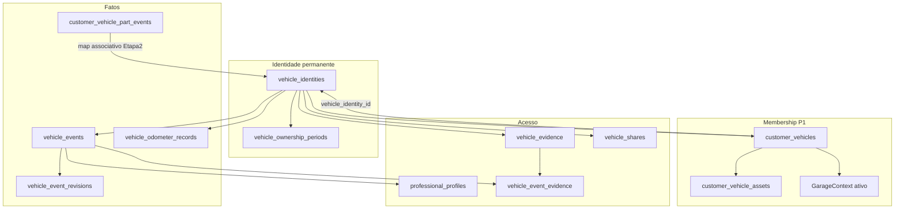
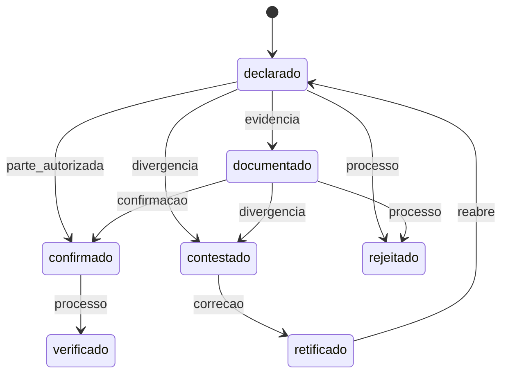
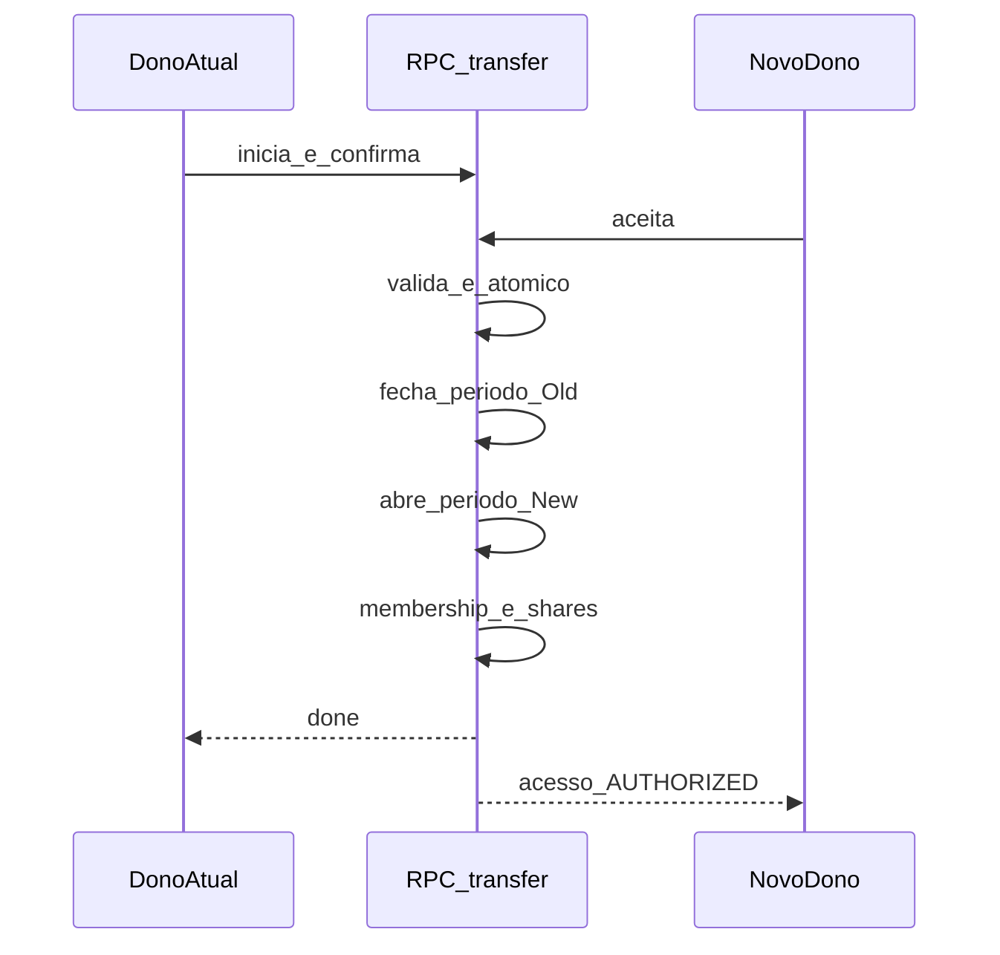

# FAL — PLANO 2A · Vehicle Identity — Identidade digital permanente do veículo

**Status:** **APROVADO eFe · IMPLEMENTADO na `dev` (E1–E5)** — conformidade detalhada na §24  
**Data:** 2026-11-18  
**Branch de trabalho:** `dev`  
**Branch de produção:** `main` (não usar para desenvolvimento / sem deploy neste ciclo)  
**Natureza:** documento canônico + registro de conformidade código↔doc (consolidação definitiva)  

**Pré-requisito:** [PLANO 1 — Minha Garagem](./FAL_PLANO1_MINHA_GARAGEM_FUNDACAO_EXPERIENCIA_2026-11-18.md) (**APROVADO eFe · IMPLEMENTADO · §24 PASS**) · [VAL-garagem-plano1](../../fal-pecas/docs/VAL-garagem-plano1.md)  
**VAL 2A:** [VAL-plano2a-vehicle-identity.md](../../fal-pecas/docs/VAL-plano2a-vehicle-identity.md)  
**Fundação placa:** [PLANO 0](./FAL_PLANO0_FUNDACAO_CADASTRO_PLACA_2026-11-17.md)  
**Direção futura (não é este plano):** [FAL_GARAGE_VISAO_FUNCIONAL.md](../futuro/FAL_GARAGE_VISAO_FUNCIONAL.md)  
**Shell comportamental (referência, não visual admin):** [FAL_SPEC_ADAPTIVE_WORKSPACE_2026-11-17.md](./FAL_SPEC_ADAPTIVE_WORKSPACE_2026-11-17.md)  
**2B:** apenas contratos de integração neste documento (§19) — **sem** implementação Immersive Garage / 3D neste ciclo

---

## Legenda de status das afirmações

| Marcador | Significado |
|----------|-------------|
| **Existente e confirmado** | Verificado em código/migration/doc P1 nesta auditoria read-only |
| **Existente, precisa adaptação** | Existe no P1; 2A exige extensão |
| **Proposto** | Modelo/UX/API planejados; ainda não existem |
| **PENDENTE DE VALIDAÇÃO TÉCNICA NA ETAPA DE IMPLEMENTAÇÃO** | Detalhe não confirmável só com leitura estática; fechar na Etapa N correspondente |

---

## 1. Objetivo e fora de escopo

### 1.1 Objetivo

Transformar a Minha Garagem em plataforma de **identidade digital permanente do veículo**, com histórico estruturado, propriedade temporal, manutenções, profissionais, evidências, compartilhamento, transferência e integração comercial FAL — sem depender da conta de um único proprietário.

Não é “mais uma página de histórico”. A identidade acompanha a vida útil do veículo.

### 1.2 Fora de escopo do PLANO 2A

- Módulo de oficinas / ERP / agenda comercial de profissionais  
- Compras externas como fluxo comercial FAL  
- Diagnóstico mecânico por IA; telemetria; OBD  
- Immersive Garage 3D / AR / VR (**PLANO 2B**) — só contratos  
- Marketplace independente de profissionais  
- Certificação profissional sem processo real  
- Deploy, commit ou alteração de `main` sem autorização eFe  

### 1.3 Resultado esperado ao concluir 2A (futuro)

Identidade permanente, ownership com início UNKNOWN permitido, histórico AUTHORIZED, compra≠instalação, professionals sem acesso automático, evidências e shares granulares, base segura de transferência — integrada ao P1 sem segundo fluxo de garagem.

---

## 2. Decisões definitivas eFe (não reabrir)

### 2.1 D1–D11

| ID | Decisão |
|----|---------|
| **D1 Dedup** | Merge **nunca** silencioso. Candidatos: chassi/VIN (se houver) e placa+fabricante+modelo+ano. Correspondência ≠ identidade confirmada. Estados: confirmada / possível duplicidade / não localizada / conflito. União só com confirmação humana autorizada + registro auditável. Placa sozinha **não** funde. |
| **D2 VIN/chassi** | Opcionais; consentimento explícito; não bloqueiam Etapa 1; não expor em UI/share sem autorização. |
| **D3 Bridge G7** | Etapa **2**: ligar eventos G7 à identity **sem mutar rows G7**. Mecanismo: tabela associativa de mapeamento (append-only) + backfill por INSERT; G7 permanece append-only; sem mudar semântica histórica. **Não** usar UPDATE nas linhas G7 (incompatível com triggers `cvpe_forbid_update`). |
| **D4 Criação** | Identity no primeiro `addSavedVehicle` / save bem-sucedido; backfill 1:1 legado; `plate-lookup` / INV **não** criam identity; criação **atômica** identity + ownership + FK membership; reutilizar fluxo P1. |
| **D5 Transferência** | Novo dono recebe histórico **AUTHORIZED** apenas. PII/docs/evidências privadas do período anterior **não** migram automaticamente. Opt-in granular auditável. |
| **D6 Etapa 1** | Identity + ownership + FK + ID FAL na ficha. **Sem** workspace completo nem timeline. |
| **D7 Histórico** | Modos: (1) vida completa, (2) meu período, (3) filtros — sempre sob permissões. |
| **D8 Profissionais** | `professional_profiles` independentes; sem módulo oficinas; sem acesso automático à garagem; vínculos explícitos. |
| **D9 Workspace** | Desktop A1/A2/A3; mobile adaptativo (drawer ou rota); **nunca** três colunas no mobile. |
| **D10 Commerce** | Compra ≠ Recebimento ≠ Instalação ≠ Substituição/Remoção. Commerce integrado = **compras originadas na FAL**. Manuais ≠ pedidos FAL. |
| **D11 Nomeação** | Não reutilizar `resolveVehicleIdentity` (INV). Prefixos `vehicleIdentity*` / tabelas `vehicle_identities`. Separar: versão/catálogo · resolução INV · identidade permanente. |

### 2.2 Decisões adicionais A1–A3

| ID | Decisão |
|----|---------|
| **A1 UNKNOWN** | Início de propriedade pode ser **desconhecido**. Não inventar data. Não usar data de cadastro FAL como aquisição. Não preencher `started_at` com `created_at`. Distinguir: início real (nullable), cadastro FAL (obrigatório), transferência (quando houver), fonte, certeza (`known` \| `estimated` \| `unknown`). Estimativa nunca como confirmada. Backfill legado não inventa aquisição. |
| **A2 FAL-only** | Sem importar compras externas como pedidos/eventos comerciais FAL. Sem eventos de compra FAL fictícios. Manutenção manual pode citar componentes sem origem comercial FAL. |
| **A3 AUTHORIZED** | Vida completa = só o autorizado. Transferência ≠ liberar privados. UI **não vaza** por títulos, contagens, previews, nomes de documentos ou metadados de itens ocultos. |

---

## 3. Diagnóstico — estado PLANO 1 (auditoria read-only 2026-11-18)

### 3.1 Existente e confirmado

| Área | Evidência |
|------|-----------|
| Membership `customer_vehicles` | Schema fase2 + progressive text + `plate_normalized` (G1) + personalização G3 + `source_snapshot` R3 |
| Assets + bucket | `customer_vehicle_assets` + Storage `customer-vehicle-images` (G3) |
| Snapshot commerce | `cart_items` / `order_items`.`vehicle_snapshot` + freeze trigger (G6) |
| Part events append-only | `customer_vehicle_part_events` (G7): tipos `bought`, `associated`, `awaiting_install`, `installed_declared`, `returned`, `corrected`, `disassociated`; triggers forbid UPDATE/DELETE |
| Serviços | `fal-pecas/src/services/customers/customerVehicleService.ts` (`addSavedVehicle`, `updateSavedVehicle`, `removeSavedVehicle`, …) · `GarageContext.tsx` · `activeGarageStorage.ts` · `vehiclePartEventService.ts` · `vehicleSnapshot.ts` · `vehicleAssetService.ts` · `compatibilityEngine.ts` · `vehicleImageResolver.ts` |
| UI | `/conta/veiculos` (`AccountVehiclesPage`) · `/conta/veiculos/:id` (`AccountVehicleDetailPage` — hero + CTAs + `
`) · `VehiclePartHistory` · `VehiclePhotoGallery` |
| Edge INV/placa | `plate-lookup`, `vehicle-confirm-upsert` · `resolveVehicleIdentity` = **catálogo INV**, não identity 2A |
| VAL P1 | `fal-pecas/docs/VAL-garagem-plano1.md` — G0–G8 / R1–R8 |

### 3.2 Lacunas (proposto no 2A)

`vehicle_identities`, `vehicle_ownership_periods`, odômetro formal, `vehicle_events` genéricos + revisions + validation, professionals, evidence library + `vehicle_event_evidence`, mapeamento G7 associativo `customer_vehicle_part_event_identities`, shares/permissions/access logs, transferência RPC, workspace 3 áreas loja, inteligência/schedules, UI pós-compra T10.

### 3.3 Colisão de nome (crítico)

| Nome hoje | Significado | Ação 2A |
|-----------|-------------|---------|
| `resolveVehicleIdentity` | INV — normalização → versão/candidato catálogo | **Manter separado**; APIs 2A = `vehicleIdentity*` |
| `ResolvedGarageIdentity` | Resultado de `resolveVersionId` (FKs catálogo) | Documentar como resolução PVC; não é identity permanente |
| `InvEvidence` / `CompatibilityEvidence` | Catálogo / fit | Não confundir com `vehicle_evidence` |

### 3.4 Riscos de migração

1. Modelo atual = 1 linha membership = “o carro do cliente”.  
2. Unique placa é por `customer_id`, não global.  
3. `removeSavedVehicle` hoje remove membership — 2A não pode apagar identity.  
4. RLS 100% `customer_id = current_customer_id()` — shares exigem novo contrato.  
5. Ativo em localStorage não sincroniza devices (aceito nas etapas iniciais).  
6. G7 sem tipo `received` (ver §12); bridge via associativa, não UPDATE (ver §12.3).

---

## 4. Arquitetura proposta

### 4.1 Separação de conceitos (obrigatória)

| Conceito | Significado | Persistência típica |
|----------|-------------|---------------------|
| **Identidade** | Quem é o veículo na vida útil | `vehicle_identities` **Proposto** |
| **Ownership** | Quem possui / possuiu em um período | `vehicle_ownership_periods` **Proposto** |
| **Membership** | Slot na garagem da conta (UX P1) | `customer_vehicles` **Existente, precisa adaptação** |
| **Ativo loja** | Seleção de sessão no funil | `GarageContext` + localStorage **Existente e confirmado** |
| **Fato / evento** | O que aconteceu (rastreável) | `vehicle_events` + G7 bridge **Proposto** |
| **Técnico documentado** | Componentes/intervenções registradas | eventos / manutenções **Proposto** |
| **Visual 2B** | Aparência 3D | fora deste plano (contrato §19) |

**Remover da garagem ≠ apagar identidade.** Encerrar ownership ≠ anônimização legal. Três operações distintas no doc de implementação.

### 4.2 Princípio central

A identidade permanente pertence ao **veículo**, não à conta. A conta tem períodos de propriedade e permissões. O workspace 2A opera sobre a identity via membership do usuário autenticado.

---

## 5. Modelo de dados conceitual

> Nomes e colunas = **Proposto**. Não autoriza migrations. Nomes finais podem ajustar na Etapa 1 desde que preservem as decisões.

### 5.1 `vehicle_identities`

| Campo | Regra |
|-------|--------|
| `id` uuid PK | ID FAL imutável; display curto derivado (ex. `FAL-…`) **PENDENTE** formato exato |
| FKs INV nullable | `manufacturer_id`, `model_id`, `version_id` |
| Textos progressivos | `maker_text`, `model_text`, `version_text`, `engine_text`, `year` |
| `vin` / `chassis` | Opcionais + `vin_consent_at` / `vin_consent_by` |
| `plate_current` / `plate_normalized_current` | Atributo **mutável**; histórico de placas = evolução futura documentada |
| `created_at`, `created_via` | `garage_save` \| `backfill` \| `merge` |
| `merged_into_id` | Soft-merge auditável (D1) |
| **Sem** `customer_id` dono | Dono = ownership vigente |

### 5.2 `vehicle_ownership_periods` (A1 UNKNOWN)

| Campo | Regra |
|-------|--------|
| `id`, `vehicle_identity_id`, `customer_id` | Obrigatórios |
| `started_at` | **Nullable** — null = início UNKNOWN |
| `started_certainty` | `known` \| `estimated` \| `unknown` |
| `started_source` | Nullable |
| `registered_at` / `created_at` | Momento do período **na FAL** — obrigatório; **≠** aquisição |
| `ended_at` | Null = vigente; no máximo **um** aberto por identity |
| `ended_reason` | `transfer` \| `abandoned` \| `admin` \| … |
| `transfer_id` | Nullable |

Período vigente **existe** sem data de aquisição.

### 5.3 Extensão `customer_vehicles`

- `vehicle_identity_id` uuid FK (**Existente, precisa adaptação**)  
- Demais colunas P1 preservadas (`is_primary`, plate membership, nickname, color, assets…)  
- Remoção da garagem: política documentada na Etapa 1 (encerrar membership / não DROP identity)

### 5.4 Atomicidade create-on-save (B1) — **Proposto**

Operação única (RPC SQL / transação servidor), **não** três inserts no frontend:

1. Insert `vehicle_identities`  
2. Insert `vehicle_ownership_periods` (started_at null, certainty `unknown` se usuário não informou; `registered_at=now()`)  
3. Insert/update `customer_vehicles` com FK  

**Idempotência:** retry não cria segundo período aberto nem segunda identity para a mesma membership.  
**Falhas:** rollback completo — sem identity órfã, sem membership sem FK, sem período duplicado.

Hook: estender `addSavedVehicle` / caminho de save P1 para chamar a RPC (**Existente, precisa adaptação**).

### 5.5 Backfill legado (B3)

- 1 identity por `customer_vehicles` existente  
- 1 período: `started_at=null`, `started_certainty=unknown`, `registered_at` = `customer_vehicles.created_at` quando disponível (só registro FAL)  
- `created_via` / origin = `backfill`  
- Testes: **não** converter cadastro em aquisição  

### 5.6 Dedup e contrato de merge (D1) — **Proposto**

Serviço `suggestIdentityDuplicates` → candidatos ranqueados; UI de revisão humana. **Nunca** merge automático (placa sozinha ≠ identidade).

#### Contrato de merge (só humano + auditável)

| Recurso | Tratamento na união |
|---------|---------------------|
| **Identity origem** | Status merged; `merged_into_id` → identity **survivor**; origem fica read-only |
| **Identity resultante (survivor)** | Continua como ID canônico permanente |
| **Memberships** | Repontar `customer_vehicles.vehicle_identity_id` para survivor |
| **Ownership periods** | Reassociar ao survivor; se dois períodos **abertos** colidirem, fechar/conciliar sob regra: **no máximo um aberto por identity** (detalhe operacional **PENDENTE** na Etapa 1) |
| **`vehicle_events` / odômetro / evidence / shares** | Repontar FKs `vehicle_identity_id` para survivor |
| **Mapeamento G7** (`customer_vehicle_part_event_identities`) | Repontar `vehicle_identity_id` do mapa (ou inserir correção append-only se UPDATE do mapa for proibido — preferir UPDATE só na tabela de mapa, que **não** é G7) |
| **Referências antigas (API/URLs/IDs)** | `resolveIdentityId(id)`: se `merged_into_id` preenchido, seguir cadeia até survivor |
| **Auditoria** | Registro de merge: ator, motivo, origem, survivor, timestamp, snapshot de contagens |
| **Correção de merge indevido** | Unmerge controlado / ops pós-merge — **PENDENTE DE VALIDAÇÃO TÉCNICA** se Etapa 1 entrega unmerge completo; no mínimo audit + procedimento documentado |

---

## 6. Eventos, revisions e validação

### 6.1 `vehicle_events` (**Proposto**, Etapa 2)

Campos: `id`, `vehicle_identity_id`, `ownership_period_id` nullable, `category`, `title`, `description`, `occurred_at`, `recorded_at`, `odometer_km` (snapshot contextual), `odometer_record_id` nullable FK, `author_user_id`, `recording_customer_id`, `provenance` (`customer` \| `system` \| `professional` \| `commerce`), `validation_state`, `origin_ref` jsonb (order_id, part_event_id…).

Sem DELETE físico; correção via `vehicle_event_revisions`.

### 6.2 Categorias (expansíveis)

Aquisição · Transferência · Manutenção · Reparo · Inspeção · Compra de peças · Recebimento · Instalação · Substituição/Remoção · Modificação · Documentação · Quilometragem · …

### 6.3 Máquina de estados

Cada transição registra: estado anterior, novo, autor, datetime, motivo, origem, ref evidência opcional (`vehicle_event_revisions`).

### 6.4 Quem pode (matriz — **Proposto**; detalhes finos **PENDENTE** na Etapa 2)

| Ação | Owner vigente | Co-responsável (grant) | Profissional (grant) | Sistema commerce |
|------|---------------|------------------------|----------------------|------------------|
| Declarar | sim | se permitido | se permitido | — |
| Documentar (anexar) | sim | se permitido | se permitido | — |
| Confirmar | sim / parte autorizada | config | config | — |
| Verificar | processo FAL / papel elevado | não default | não default | — |
| Contestar | partes com acesso ao evento | config | config | — |
| Retificar | autor/owner + regra | config | não default | — |
| Rejeitar | processo / owner conforme regra | — | — | — |

Autoridade de transição = **RPC/servidor**, não frontend.

### 6.5 Anexo mínimo pré-biblioteca (dependência Etapas 2–3)

**Decisão travada:** até a Etapa 4, permitir apenas **attachment stub** opcional — **sem** biblioteca/grid. Biblioteca completa + `vehicle_event_evidence` N:N = **Etapa 4**.

#### Stub (Etapas 2–3) — **Proposto**

| Aspecto | Regra |
|---------|--------|
| Capacidade | No máximo **1** arquivo por evento |
| Visibilidade | Sempre `private_owner` (sem promoção nesta fase) |
| MIME / tamanho | Limites restritos (espelhar ordem de grandeza G3; valores finais **PENDENTE**) |
| Persistência | Tabela `vehicle_event_attachment_stubs` **ou** FK fraca no evento: `stub_storage_path`, `stub_mime`, `stub_uploaded_by`, `stub_uploaded_at` |
| Storage | Bucket privado; path prefixado/versionado, ex. `{identity_id}/stubs/{event_id}/…`, para migração segura |
| Associação | Temporária e 1:1 com o evento; sem N:N |
| Permissões | Mesmas do evento + ownership/share; signed URL com TTL; auth no servidor |

#### Migração stub → biblioteca (Etapa 4)

1. Criar `vehicle_evidence` + `vehicle_event_evidence`.  
2. Para cada stub: criar evidência com **mesmo** `storage_path` (relink) **ou** copiar objeto + apontar novo path (se rename for necessário).  
3. Inserir vínculo N:N evento↔evidência; preservar `linked_at`/`linked_by` a partir do uploader do stub.  
4. Visibility permanece `private_owner` até o owner promover explicitamente.  
5. Marcar stubs como deprecated/migrated; **não** apagar bytes até confirmação de relink.  
6. Prevenir perda: migração idempotente; rollback = stub continua válido se evidence falhar.  
7. Prevenir exposição: migração **não** amplia visibility nem gera URL pública.

Detalhe de path definitivo: **PENDENTE DE VALIDAÇÃO TÉCNICA NA ETAPA DE IMPLEMENTAÇÃO** (§22).

---

## 7. Odômetro

| Elemento | Papel |
|----------|--------|
| `vehicle_odometer_records` | **Fonte canônica** de leituras (**Proposto**, Etapa 2) |
| `vehicle_events.odometer_km` | **Snapshot contextual** no momento do acontecimento |
| `vehicle_events.odometer_record_id` | FK opcional para a leitura canônica |

Regras: preservar data, autor, fonte, evidência; ausência de leitura **≠** zero km na UI; divergências entre leituras = regra de exibição documentada na Etapa 2 (**PENDENTE** algoritmo exato de “km mais recente confiável”).

---

## 8. Evidências

### 8.1 `vehicle_evidence` (**Proposto**, Etapa 4)

Tipos: NF, OS, recibo, foto, vídeo, laudo, doc técnico, comprovante compra/instalação, registro km…  
Campos: identity, storage_path, mime, type, uploader, visibility (`private_owner` \| `period` \| `shared` \| `public_vehicle`), timestamps.

Semântica de **visibility** — ver §10.3 (fonte canônica AUTHORIZED). Evolução a partir do stub: §6.5.

### 8.2 `vehicle_event_evidence` (associativa — **não** `linked_event_ids[]`)

- `event_id`, `evidence_id`, `linked_at`, `linked_by`, meta  
- Uma evidência → vários eventos; desvincular **≠** apagar arquivo  

### 8.3 Storage / signed URLs

- Bucket privado; autorização no servidor antes de assinar  
- TTL curto  
- **Honestidade:** URL já emitida pode permanecer válida até expirar — **não** prometer revogação instantânea da URL emitida  
- Logs de acesso relevantes; isolamento por identity  

---

## 9. Profissionais

### 9.1 `professional_profiles` (**Proposto**, Etapa 3)

Nome, foto, identificador FAL, descrição, região, contatos, links, certificações/docs, especialidades (M:N), estado de verificação.

**Não** são usuários com acesso automático à garagem. Vínculo ao veículo via eventos / `vehicle_event_professionals` + grants explícitos.

### 9.2 Trust — sem medalhas

Níveis = critérios verificáveis (texto honesto):

1. Perfil cadastrado  
2. Identidade confirmada (processo definido)  
3. Documentação analisada  
4. Atuação documentada (eventos/evidências)  
5. Histórico profissional na FAL  

Declarado ≠ verificado. Contestação possível. Sem selo sem processo.

---

## 10. Compartilhamento — contrato de permissões

### 10.1 `vehicle_shares` (**Proposto**, Etapa 4)

Não usar `permission_set[]` genérico sem contrato. Campos conceituais:

| Campo / grupo | Conteúdo |
|---------------|----------|
| Grantor / grantee | IDs + `grantee_type` (customer, professional, …) |
| Escopo | Identity + opcional subset de módulos |
| Módulos | visão, histórico, manutenções, evidências, … |
| Leitura | básicos / histórico autorizado / evidências / docs |
| Registro | criar evento / anexar / atualizar km |
| Prazo | `expires_at`, `revoked_at`, `revoked_by` |
| Auditoria | change history + `vehicle_access_logs` |

Papéis conceituais (implementados por permissões finas): proprietário · co-responsável · profissional convidado · viewer temporário.

Share **não** concede histórico total nem todos os arquivos por padrão.

### 10.2 Precedência ownership vs share

- Ownership vigente governa gestão (transferir, gerir shares).  
- Share limita-se ao escopo concedido.  
- Revoke remove o share mesmo se a UI estiver em cache.  
- Em conflito, gestão de ownership prevalece; share não eleva privilégios além do grant.

### 10.3 Visibilidade e histórico AUTHORIZED (**Proposto**)

Administração do ownership atual **≠** consulta histórica AUTHORIZED. Encerrar o ownership vigente **não** apaga automaticamente o direito de consultar o histórico do **próprio período encerrado** nem evidências já legítimas (`period` / `shared` / consentimentos).

#### Semântica de `visibility` (evidências / docs; eventos seguem regras equivalentes de escopo)

| Visibility | Criador / dono do período de origem | Owner vigente (outro período) | Via grant | Significado |
|------------|-------------------------------------|-------------------------------|-----------|-------------|
| `private_owner` | Sim | **Não** (salvo opt-in explícito na transferência) | Só grant **explícito** àquele recurso | PII / docs estritos |
| `period` | Sim (seu período) | Não por default | Grant pode incluir o período | Visível a quem tem direito àquele período |
| `shared` | Sim | Se autorizado no transfer/share | Sim no escopo do grant | Explicitamente compartilhado |
| `public_vehicle` | Sim | Sim (consulta AUTHORIZED da identity) | Leitura | Fato do veículo **sem** PII |

#### Matriz de acesso (resumo)

| Sujeito | Eventos | Evidências / docs |
|---------|---------|-------------------|
| **Proprietário atual** (ownership aberto) | Próprio período + AUTHORIZED de outros + `public_vehicle` | Conforme visibility + grants que ele gerencia |
| **Proprietário anterior** (período fechado) | Histórico do **seu** período; não admin da identity/ownership atual | `private_owner` dele; `period`/`shared` conforme regras; sem acesso automático a dados do novo dono |
| **Novo proprietário** (pós-transferência) | Vida completa **AUTHORIZED** apenas | Não herda `private_owner` do anterior sem opt-in granular auditável |
| **Grantee** | Só módulos/recursos do grant vigente e não expirado | Idem; share ≠ histórico total |

#### Anti-leak (UI + API)

- Listagens e contadores incluem **somente** o conjunto autorizado.  
- **Proibido:** “+N ocultos”, títulos, previews, nomes de arquivo ou metadados de itens negados.  
- 404/omit preferível a 403 revelador quando o recurso não deve ser admitido como existente.  
- Modo “vida completa” = vida completa **filtrada por AUTHORIZED**, nunca “tudo no banco”.

#### RLS conceitual (documentação — não implementar nesta Etapa 0)

Predicates combinam: (a) ownership periods do `customer_id` atual; (b) `visibility`; (c) grants vigentes; (d) consentimentos de transferência. Policies distintas para **admin ownership** vs **select histórico**. **PENDENTE** SQL concreto na Etapa 1/4.

### 10.4 Separação formal de permissões (**Proposto**)

| # | Domínio | Exemplos do que inclui | Quem tipicamente |
|---|---------|------------------------|------------------|
| 1 | **Admin da identity** | Attrs técnicos, placa na identity, consentimento VIN | Owner vigente e/ou papel elevado FAL |
| 2 | **Admin do ownership atual** | Transferir, gerir shares, membership, principal/ativo loja | Dono do período **aberto** |
| 3 | **Consulta histórico do período próprio** | Eventos/evidências do próprio `ownership_period` (aberto ou fechado) | Customer daquele período |
| 4 | **Consulta AUTHORIZED de outros períodos** | `public_vehicle` + itens `shared` / consentidos | Owner vigente / grantees conforme escopo |
| 5 | **Acesso a evidências** | Por `visibility` + grant + consentimento | Ver §10.3 |
| 6 | **Permissões por compartilhamento** | Subconjunto explícito de módulos/ações | Grantee |

**Regra explícita:** perda do ownership vigente remove (2) e parte de (1) conforme política; **não** implica perda automática de (3) nem de evidências já legítimas do período próprio.

---

## 11. Transferência de propriedade

Disclaimer: FAL **não** substitui órgãos oficiais (DETRAN etc.). Sem UPDATE client-side de dono.

### 11.1 Etapa 1 — base segura (**Proposto**) — **sem wizard**

| Inclui | Não inclui |
|--------|------------|
| Fundação `vehicle_ownership_periods` (UNKNOWN ok) | UI de solicitação / convite / aceite |
| Atomicidade create identity+period+membership | Fluxo produto de rejeição / expiração / cancelamento |
| Validação de autorização **no servidor** (RPC) | Revisão completa de shares na UI |
| Proteção de concorrência: **no máximo um** período aberto por identity (lock/constraint) | Consentimentos granulares de histórico/evidências na UI |
| Primitives / RPC mínima: fechar período + abrir período + associar membership (base para transferência) | Wizard completo |
| Auditoria de mudanças de ownership | Antecipar Etapa 4 |

A Etapa 1 entrega **fundação segura**; não antecipa o produto completo de transferência.

### 11.2 Etapa 4 — produto completo (**Proposto**)

| Capacidade | Detalhe |
|------------|---------|
| Solicitação | Dono inicia transferência |
| Convite | Identifica conta destino / mecanismo de convite |
| Aceite | Novo proprietário aceita |
| Rejeição | Destinatário ou sistema rejeita; audit |
| Expiração | Solicitação expira sem aceite |
| Cancelamento | Dono cancela antes do aceite |
| Execução atômica | Fecha período anterior; abre novo (`registered_at=now()`; `started_at` informado ou UNKNOWN); membership |
| Revisão de shares | Revoga/ajusta grants incompatíveis |
| Consentimentos | Opt-in granular de histórico/evidências compartilháveis (D5/A3) — auditável |
| Concorrência | Uma solicitação ativa por identity; conflito de ownership tratado |
| Wizard UI | Fluxo guiado desktop/mobile |

---

## 12. Commerce — ciclo da peça (FAL-only)

### 12.1 Quatro estados distintos

1. **Compra** — pedido/item FAL  
2. **Recebimento** — peça recebida (não confundir com compra)  
3. **Instalação** — efetivamente instalada (declarada ≠ verificada)  
4. **Substituição / remoção** — não apaga instalação anterior  

Rastreabilidade: pedido → item → veículo associado → evento G7 → evento instalação → componente documentado.

Snapshots **G6** permanecem imutáveis (**Existente e confirmado**). Mudança de catálogo/veículo depois **não** reescreve pedido antigo.

### 12.2 G7 — mapeamento e lacuna

**Existente e confirmado** (`20261118150000_g7_customer_vehicle_part_events.sql`):

| `event_type` | Leitura timeline 2A |
|--------------|---------------------|
| `bought` | Compra FAL |
| `associated` | Associação veículo/pedido |
| `awaiting_install` | Aguardando instalação (**≠** recebimento físico formal) |
| `installed_declared` | Instalação **declarada** |
| `returned` | Devolução |
| `corrected` | Correção append-only |
| `disassociated` | Desassociação |

**Lacuna:** não existe `received` / recebimento dedicado.  
→ **PENDENTE DE VALIDAÇÃO TÉCNICA NA ETAPA DE IMPLEMENTAÇÃO (Etapa 2/5):** evoluir contrato G7 (novo tipo) **ou** modelar recebimento só em `vehicle_events` sem inventar que `awaiting_install` = recebimento. Nesta Etapa 0: apenas documentado; **contrato G7 real não alterado**.

### 12.3 Bridge Etapa 2 (D3) — append-only preservado

#### Incompatibilidade (Existente e confirmado)

Triggers `cvpe_forbid_update` / `cvpe_forbid_delete` em `customer_vehicle_part_events` bloqueiam **qualquer** UPDATE/DELETE nas rows G7. Portanto, **não** é seguro nem coerente com a política append-only:

- `ADD COLUMN vehicle_identity_id` + `UPDATE` em massa nas rows G7, nem  
- Desabilitar triggers temporariamente para “backfill controlado” como caminho principal (risco operacional; enfraquece a garantia append-only).

#### Solução recomendada (**Proposto**)

Tabela associativa **`customer_vehicle_part_event_identities`**:

| Campo | Papel |
|-------|--------|
| `part_event_id` | PK ou unique → `customer_vehicle_part_events.id` |
| `vehicle_identity_id` | FK identity |
| `membership_id` | Opcional — `customer_vehicle_id` na época do mapeamento |
| `mapped_at` | Timestamp |
| `mapped_via` | `backfill` \| `on_insert` \| `manual` \| `merge` |

**Comportamento:**

1. Rows G7 **permanecem intocadas** (payload, tipos, proveniência intactos).  
2. Backfill legado = **INSERT** na associativa: `customer_vehicle_id` → membership → `vehicle_identity_id`.  
3. Novos inserts G7 pós-Etapa 2 = trigger/RPC que **insere mapeamento** (não UPDATE G7).  
4. Timeline = `customer_vehicle_part_events` ⟕ mapa ⟕ `vehicle_identities` (service/view).  
5. Merge de identities = atualizar/corrigir **apenas** a tabela de mapa (+ FKs 2A), não as rows G7.

| | Associativa (recomendado) | Coluna + UPDATE G7 (rejeitado) |
|--|---------------------------|--------------------------------|
| Append-only G7 | Preservado | Violado |
| Backfill | INSERT mapa | UPDATE rows |
| Risco | Mapa órfão se membership sumir — tratável | Disable trigger / dados mutáveis |
| Impacto timeline | JOIN; eventos sem mapa = só via membership legado até backfill | Coluna direta mais simples, mas incompatível |

Intenção do D3 (ligar G7→identity na Etapa 2, sem mudar semântica) **preservada**; mecanismo corrigido para associativa.

### 12.4 Compras externas

**Proibido** no fluxo comercial 2A criar pedido/evento `bought` FAL fictício. Manutenção manual pode descrever peça/serviço sem `origin_ref` comercial FAL.

### 12.5 Gap P1 T10 (UX pós-compra)

UI “associar / declarar instalada” após pedido pago: **não** encontrada como fluxo dedicado nas páginas de pedido nesta auditoria (eventos G7 via trigger). Planejada na **Etapa 5** (e ações pontuais na timeline Etapa 2).

---

## 13. Experiência — shell, URLs, design

### 13.1 Design system

Tokens loja (**Existente e confirmado**): `bg-fal-surface`, `border-fal-line`, `rounded-fal`, `text-fal-navy` / `fal-muted`, `min-h-11`, `Button`, `EmptyState`, `Loading`, `ErrorState`, `confirmDialog`.  
**Não** criar identidade visual paralela. **Não** copiar visual do Painel ADM; reutilizar só comportamento de `AdaptiveWorkspace`.

### 13.2 Desktop — três áreas (Etapa 2+)

| Área | Conteúdo |
|------|----------|
| **A1 ~260px** | Foto, ID FAL, maker/modelo/ano, placa (se permitido), chip ativo loja, nav módulos |
| **A2 flex** | Módulo + toolbar + filtros + lista/form/timeline |
| **A3** | Detalhe item, resumo, evidências autorizadas, ações, Expandir/Fechar |

Requisitos: preservar filtros, scroll e seleção ao abrir/fechar A3; um contextual por vez; sem drawer-sobre-drawer; A1 sempre em `lg+`; loading/empty/error **independentes por área**.

Prefs: `fal-garage-workspace-v1` (`mode`, `splitWidthPx`) — ortogonal ao ativo loja.

### 13.3 Mobile

Header compacto; A2 full width; módulos em chips/menu; A3 = `MobileDrawer` ou rota dedicada; forms em steps; ações sem hover; **nunca** três colunas comprimidas.

### 13.4 URLs (**Proposto**)

| Rota | Papel |
|------|--------|
| `/conta/veiculos` | Hub frota P1 |
| `/conta/veiculos/:membershipId` | Workspace (Etapa 2+) / ficha (Etapa 1 = evolução mínima) |
| `?modulo=visao\|historico\|manutencoes\|profissionais\|evidencias\|compartilhar\|inteligencia\|config` | A2 |
| `?modo=vida\|meu\|filtros` | Histórico |
| `&evento=:eventId` | Seleção A3 |
| `/conta/veiculos/:membershipId/evento/:eventId` | Full / mobile |
| `/conta/veiculos/:membershipId/transferir` | Wizard (Etapa 4) |

### 13.5 Degraus UX

1. Etapa 1: ID FAL na ficha atual (`AccountVehicleDetailPage`) sem shell 3 áreas.  
2. Etapa 2: `?modulo=` + `GarageWorkspace` básico + timeline.  
3. Etapas 3–5: módulos restantes.  

Hub [`AccountVehiclesPage`](../../fal-pecas/src/pages/Account/AccountVehiclesPage.tsx) permanece.

---

## 14. Módulos funcionais (M1–M10)

Cada módulo: objetivo · wire · dados · empty/error · permissões · aceite. Timeline/workspace a partir da **Etapa 2** (D6).

### M1 — Visão geral (`visao`)

Header identity + indicadores com selo `confirmado` \| `declarado` \| `estimado` (nunca inventar) + feed recente + CTAs (evento, manutenção, km, profissional, evidência, compartilhar).  
Empty indicador = “Sem dado”, nunca “0 km” falso.  
**Aceite:** ID FAL visível; ações sem hover.

### M2 — Histórico (`historico`) — D7 + A3

Modos vida / meu / filtros (de, até, cat, prof, km, validação, origem, período ownership). Divisores de períodos. Anti-leak absoluto.  
**Aceite:** filtros combináveis; permissões em todos os modos; sem delete silencioso.

### M3 — Detalhe do acontecimento

Campos §6; revisions; transições com motivo; links commerce se `origin_ref`.  
**Aceite:** `occurred_at` ≠ `recorded_at`; auditoria de estado.

### M4 — Manutenções (`manutencoes`)

Tipos preventiva/corretiva/preditiva/inspeção/emergência/instalação/substituição/modificação. Form completo. Cria eventos categoria manutenção.  
**Aceite:** instalação não nasce de compra automática.

### M5 — Profissionais (`profissionais`)

Lista vínculos + ficha; trust honesto; invite share limitado.  
**Aceite:** sem acesso total automático.

### M6 — Evidências (`evidencias`) — Etapa 4

Biblioteca, upload, N:N via `vehicle_event_evidence`, signed URL.  
**Aceite:** anexo ≠ autenticidade; desvincular ≠ apagar.

### M7 — Compartilhar (`compartilhar`) — Etapa 4

Grants + builder de permissões + expire/revoke + logs.  
**Aceite:** revoke efetiva no servidor; share ≠ histórico total.

### M8 — Transferência

Base Etapa 1; wizard Etapa 4 (§11).  
**Aceite:** impossível só com UPDATE client-side.

### M9 — Inteligência (`inteligencia`) — Etapa 5

Lembretes tempo/km; lacunas; fonte etiquetada.  
**Aceite:** estimativa ≠ diagnóstico.

### M10 — Configurações / privacidade

Attrs identity (placa); consentimento VIN; membership P1 (apelido/cor/fotos); privacidade; exportação; iniciar transferência; remover da **minha** garagem com copy clara.

---

## 15. Segurança e LGPD — contrato verificável

| # | Requisito | Comportamento esperado | Teste |
|---|-----------|------------------------|-------|
| 1 | RLS ownership + share | Leitura/escrita só se ownership vigente **ou** grant match | T-SEC-01 |
| 2 | Separação veículo / histórico / evidências | Grants por recurso | T-SEC-02 |
| 3 | RPC SECURITY DEFINER | Validação interna de authz antes de mutar | T-OWN-02 |
| 4 | Anti-IDOR | get-by-id sem membership/share → 404/403 | T-SEC-04 |
| 5 | Storage privado | Sem URL pública permanente | T-EVD-01 |
| 6 | Consentimento VIN | Campo oculto sem consent; não em share default | T-VIN-01 |
| 7 | Docs | Visibility enforced no server | T-EVD-02 |
| 8 | Access logs | Ações relevantes registradas | T-SHR-02 |
| 9 | Expire/expire | Revoke imediata no grant; URL assinada até TTL | T-SHR-01 |
| 10 | Exportação | Fluxo LGPD documentado | **PENDENTE** detalhe legal Etapa 4+ |
| 11 | Retenção / anônimização | Separado de “remover garagem” | **PENDENTE** política Etapa 4+ |
| 12 | PII dono anterior | Não migra na transferência sem opt-in | T-PRIV-01 |
| 13 | Anti-leak UI | Sem contagem/título/preview de ocultos | T-EV-04 |
| 14 | Audit ownership | Toda transferência logada | T-OWN-01 |
| 15 | Isolamento clientes | RLS cross-tenant | T-REG P1 #20 |

UI **nunca** é a única barreira.

Complemento: semântica AUTHORIZED / visibility / anti-leak → §10.3; separação admin vs consulta histórica → §10.4.

---

## 16. Serviços e arquivos-alvo (**Proposto**)

| Domínio | Artefato |
|---------|----------|
| Identity | `fal-pecas/src/services/garage/vehicleIdentityService.ts` |
| Ownership / transfer | service + RPC migration Etapa 1 |
| Events | `vehicleEventService.ts` |
| Bridge G7 | mapa `customer_vehicle_part_event_identities` + estender `vehiclePartEventService.ts` (sem UPDATE G7) |
| Odômetro | `odometerService.ts` |
| Professionals | `professionalProfileService.ts` |
| Evidence | `vehicleEvidenceService.ts` |
| Shares | `vehicleShareService.ts` |
| Insights | `maintenanceInsightService.ts` (Etapa 5) |
| Shell | `components/garage/workspace/GarageWorkspace.tsx` |
| Prefs | `lib/garageWorkspacePrefs.ts` |
| Módulos UI | `components/garage/modules/*` |
| Página | evoluir `AccountVehicleDetailPage.tsx` |
| Save P1 | estender `customerVehicleService.ts` → RPC atômica |

Edge placa/INV: **inalterados** no papel atual.

---

## 17. Roadmap e dependências

| Etapa | Escopo | Aceite-chave | Dependências |
|-------|--------|--------------|--------------|
| **0** | Este documento + aprovação eFe | Doc aprovado | — |
| **1** | Identity, ownership (UNKNOWN), FK, backfill, atomicidade, ID FAL na ficha, RLS ownership, **base RPC transferência** | Identity sobrevive; create atômico; sem inventar aquisição | Sem workspace/timeline |
| **2** | Events, revisions, validation, odômetro, bridge G7, timeline C, shell workspace, attachment stub opcional | Modos C + AUTHORIZED; compra≠instalação; G7 append-only | Etapa 1 |
| **3** | Manutenções + professionals + trust | Vínculos explícitos; sem acesso total auto | Events Etapa 2 |
| **4** | Evidence library + `vehicle_event_evidence` + shares + logs + wizard transferência + privacidade | Revoke; PII isolada; N:N evidências | Base transfer Etapa 1 |
| **5** | Inteligência + UX T10 + schedules | Estimativa≠diagnóstico; G6 intacto; FAL-only | Não antecipar |

### Dependências explícitas

1. Anexos: stub opcional nas Etapas 2–3; biblioteca na 4.  
2. Segurança ownership desde a 1.  
3. Base transferência na 1; UI wizard na 4.  
4. Odômetro canônico + snapshot na 2.  
5. Bridge G7 via tabela associativa (sem UPDATE nas rows G7).  
6. Inteligência só na 5.

---

## 18. Matriz de testes (conceitual — não executar ambiente nesta Etapa 0)

### 18.1 Identidade e propriedade

| ID | Caso | Etapa |
|----|------|-------|
| T-ID-01 | Create atômico identity+period+membership | 1 |
| T-ID-02 | Save idempotente | 1 |
| T-ID-03 | Backfill 1:1 sem duplicar | 1 |
| T-ID-04 | Início UNKNOWN; cadastro ≠ aquisição | 1 |
| T-ID-05 | Troca de placa sem novo identity id | 1 |
| T-ID-06 | Remover membership ≠ delete identity | 1 |
| T-ID-07 | Suggest dupes sem merge auto | 1 |

### 18.2 Transferência

| ID | Caso | Etapa |
|----|------|-------|
| T-OWN-01 | Fecha/abre período + audit | 1/4 |
| T-OWN-02 | UPDATE client-side bloqueado | 1 |
| T-OWN-03 | Concorrência / expire / cancel / reject | 4 |
| T-PRIV-01 | Novo dono sem docs privados | 4 |
| T-PRIV-02 | Só registros AUTHORIZED | 4 |

### 18.3 Histórico / odômetro / evidências / shares / commerce

| ID | Caso | Etapa |
|----|------|-------|
| T-EV-01 | Modos vida/meu/filtros | 2 |
| T-EV-02 | Revisions | 2 |
| T-EV-03 | Transição validação com motivo | 2 |
| T-EV-04 | Anti-leak contagem/preview | 2/4 |
| T-ODO-01 | Sem zero fictício; fonte/autoria | 2 |
| T-COM-01 | bought ≠ installed auto | 2 |
| T-COM-02 | Bridge: INSERT mapa G7→identity; row G7 imutável | 2 |
| T-MRG-01 | Merge humano reponta FKs; resolveIdentityId segue survivor | 1 |
| T-STUB-01 | Stub→evidence preserva path; visibility não amplia | 4 |
| T-COM-03 | Externas ≠ eventos FAL | 2/5 |
| T-COM-04 | G6 imutável | 2 |
| T-PRO-01 | Profissional sem histórico total | 3 |
| T-EVD-01 | Signed URL + sem public permanente | 4 |
| T-EVD-02 | N:N link/unlink sem apagar arquivo | 4 |
| T-SHR-01 | Expire + revoke | 4 |
| T-UX-01 | Mobile sem 3 colunas | 2+ |
| T-AI-01 | Label fonte estimativa | 5 |

### 18.4 Regressão PLANO 1

Suíte documentada em `fal-pecas/docs/VAL-garagem-plano1.md` (Vitest garagem + smoke manual) — **obrigatória** conceitualmente em cada etapa futura de implementação. Nesta Etapa 0: não executar suites que alterem ambientes.

---

## 19. Integração PLANO 2B — somente contratos

| Caso | 2A | 2B |
|------|----|----|
| Pintura no visualizador | Sem evento automático | Salva config visual |
| Compra rodas FAL | Evento compra + snapshot G6 | Preview visual opcional |
| Instalação | Evento 2A validado | Pode refletir “instalado” no modelo |
| Transferência | Governa privacidade | Configs privadas não seguem auto |
| Chave | `vehicle_identities.id` | FK única; sem segundo cadastro de veículo |

Sem segunda infraestrutura de identidade. Sem implementação 3D neste plano.

---

## 20. Checklist pré-implementação → pós-entrega

- [x] eFe aprova este documento / MARCHA E1–E5  
- [x] D1–D11 e A1–A3 confirmados no texto  
- [x] Lacuna G7 recebimento aceita como evolução futura documentada  
- [x] Etapas 1–5 na `dev` (migrations + UI + RPCs)  
- [x] Branch `dev` apenas (sem merge `main` / deploy produção)  
- [x] VAL + suite Vitest garagem 2A  

**Ainda fora:** alterar `main`; inventar compras externas; Immersive 2B; unmerge completo.

---

## 21. Apêndice — inconsistências resolvidas neste refinamento

| Antes (rascunhos) | Depois (canônico) |
|-------------------|-------------------|
| `started_at = created_at` no backfill | UNKNOWN; cadastro ≠ aquisição |
| `linked_event_ids[]` | `vehicle_event_evidence` |
| Transferência só na Etapa 4 | Base RPC Etapa 1 + wizard Etapa 4 |
| Odômetro ambíguo | Records canônico; event = snapshot |
| Commerce externo implícito | FAL-only |
| Vida completa = tudo | AUTHORIZED + anti-leak |
| Três inserts no frontend | RPC/transação atômica |
| Signed URL “revoga na hora” | TTL honesty |
| Trust com medalha | Critérios verificáveis |
| Recebimento assumido no G7 | Lacuna documentada |
| D3 como coluna `vehicle_identity_id` + UPDATE G7 | Associativa `customer_vehicle_part_event_identities` (append-only) |
| Encerrar ownership = perder todo histórico | Perde admin vigente; mantém consulta do próprio período / AUTHORIZED |
| Stub sem caminho para biblioteca | §6.5 migração stub→evidence sem ampliar visibility |

### 21.1 Revisão técnica das ressalvas (2026-11-18)

Incorporados: (1) G7 associativa, (2) AUTHORIZED/visibility §10.3, (3) fronteira transferência §11, (4) stub→biblioteca §6.5, (5) contrato merge §5.6, (6) separação de permissões §10.4. Decisões D1–D11 e A1–A3 de produto **preservadas**; apenas precisão de mecanismo.

---

## 22. Pendências de validação técnica (implementação)

1. Formato de display do ID FAL curto.  
2. Algoritmo exato de “km mais recente confiável” entre leituras.  
3. Evolução G7 para recebimento (`received` vs só `vehicle_events`).  
4. Detalhe legal de exportação/retenção/anônimização (LGPD operacional).  
5. Matriz fina “quem verifica” (papel staff vs owner) na Etapa 2.  
6. Path Storage final (`identity_id/…` vs membership) na migração Etapa 4 / stubs.  
7. Confirmação runtime de grants residuais G7 (`has_table_privilege`) — residual P1 §24.  
8. Unmerge completo vs procedimento ops pós-merge indevido.  
9. SQL concreto RLS AUTHORIZED (períodos + visibility + grants + consent).  
10. Conciliação de dois períodos abertos no merge (regra operacional).

Todas marcadas como **PENDENTE DE VALIDAÇÃO TÉCNICA NA ETAPA DE IMPLEMENTAÇÃO**.

---

## 23. Confirmação Etapa 0 / revisão de ressalvas → entrega

| Item | Valor |
|------|--------|
| Documento | `docs/planejamento/FAL_PLANO2A_VEHICLE_IDENTITY_2026.md` |
| Branch | `dev` |
| Implementação | E1–E5 (commits `62c27c0`…`43efc13` + consolidação) |
| Remote DB (wtbp) | migrations E1–E5 aplicadas via MCP |
| Deploy produção / `main` | **Não** |
| Próximo passo produto | Planejar **PLANO 2B** (Immersive) sob aprovação eFe — só depois desta consolidação |

---

## 24. Conformidade código ↔ doc (consolidação definitiva 2026-11-18)

| # | Requisito 2A | Veredito | Evidência |
|---|--------------|----------|-----------|
| 1 | Identity permanente + ID FAL | **PASS** | `vehicle_identities` · `vehicle_identity_fal_code` · UI ficha |
| 2 | Ownership temporal + UNKNOWN | **PASS** | `vehicle_ownership_periods.started_at` null · certainty unknown |
| 3 | Create atômico membership+identity+period | **PASS** | RPC `create_customer_vehicle_with_identity` |
| 4 | Membership ≠ identity | **PASS** | FK `customer_vehicles.vehicle_identity_id` |
| 5 | Events + revisions + validation | **PASS** | `vehicle_events` · `vehicle_event_revisions` · transition RPC |
| 6 | Odômetro canônico; ausência ≠ 0 | **PASS** | `vehicle_odometer_records` · UI “Sem dado” |
| 7 | Bridge G7 associativa (sem UPDATE G7) | **PASS** | `customer_vehicle_part_event_identities` + trigger on_insert |
| 8 | Compra ≠ instalação | **PASS** | `g7TypeToCategory` + T10 declareInstalled append-only |
| 9 | Timeline modos vida/meu | **PASS** | `VehicleIdentityTimeline` · `?modo=` |
| 10 | Shell `?modulo=` | **PASS** | prefs + tabs na ficha |
| 11 | Professionals + trust sem medalha / sem acesso auto | **PASS** | `professional_profiles` trust 1–5 · vínculo só em eventos |
| 12 | Manutenções tipadas | **PASS** | `vehicle_maintenances` · RPC append |
| 13 | Evidence + N:N; desvincular ≠ apagar | **PASS** | `vehicle_evidence` · `vehicle_event_evidence` |
| 14 | Shares granulares + revoke servidor | **PASS** | `vehicle_shares` · `revoke_vehicle_share` |
| 15 | Transfer wizard (request/accept/reject/cancel) | **PASS** | `vehicle_transfer_requests` · banner incoming |
| 16 | Access logs | **PASS** | `vehicle_access_logs` · `log_vehicle_access` |
| 17 | Inteligência / schedules; estimativa ≠ diagnóstico | **PASS** | schedules + `maintenanceInsightService` |
| 18 | UX T10 pós-compra | **PASS** | `OrderPostPurchaseGarageActions` |
| 19 | Só `dev`; sem deploy main | **PASS** | fluxo git E1–E5 |
| 20 | Contratos 2B sem código 3D | **PASS** | §19 intacto; sem Immersive |

**GAPs / NÃO VERIFICADOS (não bloqueiam fechamento 2A):**

| Item | Nota |
|------|------|
| Tipo G7 `received` | Lacuna §12.2 — recebimento modelável em `vehicle_events` |
| Unmerge completo | §5.6 / §22.8 — ops documentado; sem UI |
| Exportação LGPD operacional | §22.4 |
| RLS AUTHORIZED exhaustivo em todos os predicados edge | §22.9 — base ownership+visibility+share entregue; refinamento contínuo |
| Smoke E2E browser completo | VAL lista smoke manual |

**Status final:** PLANO 2A **APROVADO eFe** · **IMPLEMENTADO na `dev` (E1–E5)** · checklist §24 com vereditos evidentes.
