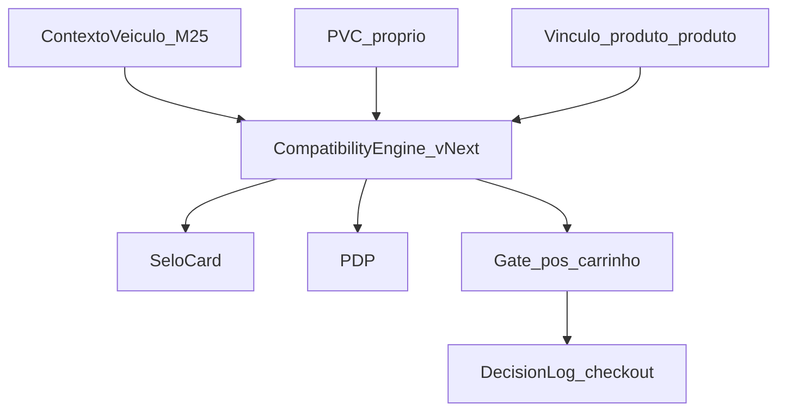

# FAL — PLANO · Busca, Equivalência e Compatibilidade de Peças

**Status:** **EM IMPLEMENTAÇÃO NA `dev`** — Fase 0 spec fechada; **Marcha 2026-11-19** executa **Fase 2+3 (E.1)** + sessão guest (auth só ao salvar na garagem). Sem main/prod neste ciclo.  
**Data:** 2026-11-19  
**Branch de trabalho:** `dev`  
**Branch de produção:** `main` (não usar para desenvolvimento / sem deploy neste ciclo)  
**Natureza:** documento canônico — diagnóstico + arquitetura + **spec completa de telas** + regras + fases  

**App:** [`fal-pecas/`](../../fal-pecas/) — Vite + React Router + Supabase  
**Pré-requisitos / irmãos (não supersedidos):**  
[PLANO 0 — Placa](./FAL_PLANO0_FUNDACAO_CADASTRO_PLACA_2026-11-17.md) · [PLANO 1 — Minha Garagem](./FAL_PLANO1_MINHA_GARAGEM_FUNDACAO_EXPERIENCIA_2026-11-18.md) · [PLANO 2A — Vehicle Identity](./FAL_PLANO2A_VEHICLE_IDENTITY_2026.md) · [SPEC Busca por Placa](./FAL_SPEC_BUSCA_POR_PLACA_2026-11-09.md)

**VAL futuro:** `fal-pecas/docs/VAL-busca-equivalencia-compatibilidade.md` (ainda não existe)

---

## Legenda

| Marcador | Significado |
|----------|-------------|
| **Existente e confirmado** | Verificado em código/migration |
| **Existente, precisa adaptação** | Existe; evolução exige extensão |
| **Proposto** | Planejado; ainda não existe |
| **Não verificado em runtime** | No repo; produção não conferida nesta etapa |
| **PENDENTE eFe** | Ainda aberto |

---

## Governança documental (decisão eFe = B)

Canônico substituto da frente busca/aplicações/compatibilidade.

### SUPERSEDED

| Documento | Motivo |
|-----------|--------|
| [FAL_PLANO_BUSCA_INTELIGENTE_V1_2026-11-11.md](./FAL_PLANO_BUSCA_INTELIGENTE_V1_2026-11-11.md) | Unificado aqui |
| [FAL_PLANO_MESTRE_BUSCA_INTELIGENTE_V1.md](./FAL_PLANO_MESTRE_BUSCA_INTELIGENTE_V1.md) | Drift 11/11 corrigido |
| [FAL_PLANO_EXECUCAO_BUSCA_INTELIGENTE_V1.md](./FAL_PLANO_EXECUCAO_BUSCA_INTELIGENTE_V1.md) | Vinculado ao mestre |
| [FAL_AUDITORIA_APLICACOES_COMPATIBILIDADE_V1.md](./FAL_AUDITORIA_APLICACOES_COMPATIBILIDADE_V1.md) | Revalidado |
| [FAL_AUDITORIA_ARQUITETURA_BUSCA_V1.md](./FAL_AUDITORIA_ARQUITETURA_BUSCA_V1.md) | Anexo do mestre |

### HISTÓRICOS

VALs/marchas `FAL_MARCHA_BUSCA_*` / `FAL_VAL_*busca*` — não reabrir.

### PRESERVAR

PLANO 0/1/2A/2B · SPEC/VAL placa · frete · pagamentos · jornada ops.

---

## Correções vs auditorias 11/11

| Afirmação antiga | Correção |
|------------------|----------|
| RPC ignora year range | Repo já tem `20261110160000` / `20261111140000`. Prod: **Não verificado em runtime** |
| `probable` = alternativa | Não: `probable` = partial. Alternativa no card = “A verificar” |
| Catálogo lê ativo Garagem | Falso até M23 (escolha explícita) |
| Stack Next.js | Vite + React Router |

---

## Síntese executiva

Núcleo atual: PVC + `search_products` + G5 + Garagem 2A + snapshot G6. Gap: confiança até o checkout.

### Marcha eFe M1–M32 — **FECHADA**

| Tema | Decisão |
|------|---------|
| Card | Selo na foto só com contexto; Compatível / Compatível similar / A verificar; incompatível some |
| PDP | Confirmado ou seleção rápida; ano+motor+versão **juntos** |
| Catálogo | Garagem **ou** filtros livres; pick ≠ chip ativo |
| Fit | Mais específico na tela; senão ativo Garagem |
| Compatível PVC | Barra rígida ano+motor+versão; todas categorias v1 |
| Equivalência | C; produto↔produto N; bidirecional; sem transitividade; similar se parceiro Compatível |
| Gate | Não confirmado → confirmar/seguir; incompatível → trocar (lista Compatível/similar)/seguir |
| Log | Só checkout |
| Conflitos | PVC > equivalência > nota; incompat vence |

ML = benchmark. Sem Figma nesta etapa — wireframes na Parte E.

### Marcha DEV 2026-11-19 (assertiva eFe)

- **Fase 2+3 / E.1:** selos card PVC + copy Compatível/similar/A verificar; incompatível some; ranking.
- **Guest:** confirmar compatibilidade **sem login**; cadastro/login **somente** ao salvar na Minha Garagem.
- **M24/M25:** picker catálogo ≠ chip; fit = chip/sessão → senão URL YMM → senão sem selo.
- Spec irmã: [`docs/superpowers/specs/2026-11-19-header-compat-switcher-design.md`](../superpowers/specs/2026-11-19-header-compat-switcher-design.md).

---

# PARTE A — Diagnóstico atual

## A.1 Stack e rotas

| Item | Path | Status |
|------|------|--------|
| Router | `fal-pecas/src/app/router.tsx` | Existente |
| Catálogo | `pages/Catalog/CatalogPage.tsx` | Existente |
| PDP | `pages/Product/ProductPage.tsx` | Existente |
| Admin apps/imports/busca | `pages/admin/products/*`, `admin/search/*` | Existente |

## A.2 Identidade da peça

`products` (sku ≠ commercial_ref) · `product_brands` · `product_references` (alias busca) · `supplier_products` · `posicao`/`lado`. Sem grafo equivalência. Sem entidade `parts`.

## A.3 Veículo e aplicação

`manufacturers`→`models`→`vehicle_versions` · PVC + year range · `customer_vehicles` + `vehicle_identities` · ativo em localStorage · catálogo hoje via QuickPick/URL (evoluir M23).

## A.4 Busca e motor

`searchService` → RPC `search_products` · G5: `confirmed`/`probable`/`unconfirmed` · cards com evidência fraca (`appGroupsToPvcRows`).

## A.5 Commerce

Snapshot G6 sem fit state · sem alerta · sem decision log · devolução só legal.

## A.6 Fluxo as-is


---

# PARTE B — Matriz de capacidades

| Domínio | Status |
|---------|--------|
| Catálogo + busca + PVC + G5 | Implementado / parcial |
| Selos M18 + barra M26 + gate M31 | Proposto (spec E) |
| Equivalência produto↔produto | Proposto |
| Decision log checkout | Ausente |
| Tipos DB gerados | Ausente |

---

# PARTE C — Gaps e riscos

| ID | Gap | Prioridade |
|----|-----|------------|
| G1 | G5 ≠ selos/barra pós-marcha | P0 |
| G2 | Card evidência fraca | P0 |
| G3 | Mitigado M23 — falta UI picker Garagem no catálogo | P1 |
| G4/G5 | Sem fit/log no pedido | P0 |
| G6 | Sem equivalência produto↔produto | P1 |
| G7 | RPC↔JS divergentes | P1 |

---

# PARTE D — Arquitetura proposta

## D.1 Princípios

Evoluir PVC+G5 · uma fonte de verdade · ausência ≠ compatível · equivalência não copia PVC · log só checkout · ML só benchmark.

## D.2 Fluxo alvo



## D.3 Estados

| Camada | Valores |
|--------|---------|
| Card | Compatível · Compatível similar · A verificar · (sem selo) · (não lista se incompatível) |
| Motor/PDP/gate | Compatível · Similar · Pendente · Alternativa · Sem dados · Incompatível |
| Barra Compatível | maker+model+ano+motor+versão + match campos PVC (M26); todas categorias v1 |

## D.4 Equivalência

Produto↔produto · N · bidirecional · sem B↔C automático · evidência default · similar se parceiro Compatível · admin na ficha.

## D.5 Decision log / conflitos

Log só checkout. Conflito: PVC > equivalência > nota; incompat vence; senão A verificar.

---

# PARTE E — Spec completa de telas (wireframes textuais)

Sem Figma. Desktop como base; mobile = stack + sheets.

## E.0 Jornada canônica


1. Catálogo: Garagem **ou** filtros · selos se houver contexto  
2. PDP: estado + completar ano/motor/versão  
3. Carrinho: estado por item · reavaliar se veículo muda  
4. Gate pós-Finalizar: confirmar/seguir ou trocar/seguir  
5. Checkout: alerta condensado + **log** no aceite  
6. Pedido: snapshot + log imutáveis  

---

## E.1 Catálogo — `/catalogo`

**Objetivo:** buscar peças; opcionalmente com contexto de veículo; selos honestos.

**Arquivos:** `CatalogPage.tsx`, `ProductCard.tsx`, `SearchBar.tsx`, `SavedVehiclesQuickPick.tsx`

### Layout desktop

```
+------------------------------------------------------------------+
| [Busca texto____________] [Carros da Garagem v] [Placa] [Filtros]|
| Contexto: Fiat Palio 2015 1.0 Attractive   [Limpar contexto]     |
+------------------------------------------------------------------+
| Filtros YMM: Marca | Modelo | Ano | Motor | Versão | Categoria   |
+------------------------------------------------------------------+
| Resultados (Compatíveis primeiro, depois A verificar)            |
| +--------+  +--------+  +--------+                               |
| |[Comp.] |  |[Simil.]|  |[A ver.]|                               |
| | foto   |  | foto   |  | foto   |                               |
| | nome   |  | nome   |  | nome   |                               |
| | preço  |  | preço  |  | preço  |                               |
| +--------+  +--------+  +--------+                               |
+------------------------------------------------------------------+
```

### Regras

| Regra | Detalhe |
|-------|---------|
| Picker Garagem | Lista carros salvos; aplica filtros URL; **não** muda chip ativo (M24) |
| Filtros livres | Sempre disponíveis (M23) |
| Contexto fit | Mais específico na tela; senão ativo Garagem (M25) |
| Sem contexto | **Nenhum** selo |
| Selo Compatível | PVC passa M26 |
| Selo Compatível similar | Mesmo visual + microtexto “similar” |
| Selo A verificar | Demais casos listáveis |
| Incompatível | **Não entra** no resultado |
| Ranking | Compatível / similar antes de A verificar |
| Evidência card | Usar PVC completo (corrigir G2) — não `appGroupsToPvcRows` fraco |

### Mobile

Picker e filtros em drawer/sheet; selo menor no canto da foto; grade 2 colunas.

### Copy selos

- `Compatível`  
- `Compatível` + `similar` (microtexto)  
- `A verificar`  

---

## E.2 PDP — `/produto/:slugOrId`

**Objetivo:** confirmar ou completar veículo; explicar estado; comprar com transparência.

**Arquivo:** `ProductPage.tsx`

### Layout desktop

```
+---------------------------+--------------------------------------+
| Imagens                   | Nome · marca · SKU · preço           |
|                           | [Adicionar ao carrinho]              |
|                           +--------------------------------------+
|                           | COMPATIBILIDADE                      |
|                           | Veículo: [Palio 2015...] [Trocar]    |
|                           | Estado: Compatível / similar / ...   |
|                           | Motivo: ...                          |
|                           | Falta: (se A verificar)              |
|                           | [Ano] [Motor] [Versão] [Verificar]   |
|                           | (passo único M30)                    |
+---------------------------+--------------------------------------+
| Aplicações conhecidas (PVC) · Referências · Relacionados         |
+------------------------------------------------------------------+
```

### Estados do bloco

| Estado | UI |
|--------|-----|
| Sem veículo | Mini-seletor (Garagem se logado + YMM); CTA Verificar |
| Compatível | Badge positivo; sem coleta |
| Compatível similar | Badge + “similar a [SKU/nome]” |
| A verificar | Motivo + faltante + form ano/motor/versão juntos |
| Incompatível | Não deveria ser destino de busca; se aberto sem contexto e depois filtrar: mensagem clara |

### Regras

- Prioriza ativo Garagem; permite Trocar (M5)  
- Completar dados **não** muda chip a menos que fluxo Garagem diga o contrário  
- Após Verificar: reexecuta motor e atualiza badge  

### Mobile

Bloco compatibilidade acima do CTA de compra (visível sem scroll longo); form em sheet.

---

## E.3 Carrinho

**Objetivo:** mostrar fit por item; reavaliar se contexto muda; iniciar gate ao Finalizar.

### Layout

```
+------------------------------------------------------------------+
| Item SKU · qty · preço                                           |
| Veículo: Palio 2015 ...                                          |
| Estado: A verificar — Falta motor e versão                       |
| Motivo: Aplicação exige motorização                              |
+------------------------------------------------------------------+
| [Continuar comprando]                    [Finalizar compra]      |
+------------------------------------------------------------------+
```

### Regras

- Linha: estado + motivo + o que falta (M9)  
- Troca de veículo no contexto do carrinho → **reavaliar todos** (M11)  
- Finalizar → **Gate** (sem log ainda)  

### Mobile

Mesma info empilhada; Finalizar sticky.

---

## E.4 Gate pós-carrinho (pré-pagamento)

**Objetivo:** decisão consciente antes de pagar.

### Wireframe — não confirmados

```
+------------------------------------------------------------------+
| Antes de pagar                                                   |
| Estas peças ainda não estão confirmadas para o veículo:          |
|                                                                  |
| · Pastilha XYZ — A verificar — Falta: motor, versão              |
|                                                                  |
| [Completar dados do veículo]     [Continuar sem confirmar]       |
+------------------------------------------------------------------+
```

### Wireframe — incompatível

```
+------------------------------------------------------------------+
| Peça incompatível com o veículo atual                            |
| Amortecedor ABC — Incompatível                                   |
| Motivo: Motor 1.6 não casa com aplicação 1.0                     |
|                                                                  |
| [Trocar peça]                    [Seguir mesmo assim]            |
+------------------------------------------------------------------+
```

### Trocar peça (M32)

```
+------------------------------------------------------------------+
| Substituir Amortecedor ABC                                       |
| Veículo: Palio 2015 1.0 ...                                      |
| Compatível / Compatível similar:                                 |
| [ ] Amortecedor DEF — Compatível                                 |
| [ ] Amortecedor GHI — Compatível similar                         |
| [Substituir no carrinho]  [Cancelar]                             |
+------------------------------------------------------------------+
```

### Regras

| Caso | Ações |
|------|-------|
| Não confirmado | Completar dados **ou** Continuar sem confirmar |
| Incompatível | Informar claro + Trocar (lista Compatível/similar) **ou** Seguir mesmo assim |
| Alerta condensado | Repetir **uma vez** no checkout mesmo após o gate (M7) |
| Decision log | Gravar **só** no aceite final do checkout (M8) |
| Conteúdo alerta | Estado + motivo + faltante (M9) — sem risco genérico obrigatório |

### Mobile

Bottom sheet full-height; CTAs empilhados (primário embaixo).

---

## E.5 Checkout / pagamento

- Exibe resumo condensado de itens não confirmados / seguidos mesmo assim  
- No confirmar pedido: persiste snapshot veículo + **estado fit** + decision log  
- Pedido detalhe: mostra o que foi registrado (imutável)

---

## E.6 Admin — ficha do produto · Equivalentes

**Objetivo:** vincular itens cadastrados (M19–M21).

```
+------------------------------------------------------------------+
| Equivalentes (técnicos) — distinto de “Relacionados” comerciais  |
| Buscar produto: [____________] [Vincular]                        |
| · SKU-DEF · Nome ...                          [Remover]          |
| · SKU-GHI · Nome ...                          [Remover]          |
| Evidência: cadastro interno FAL (default)                        |
| Vínculo bidirecional automático · sem transitividade             |
+------------------------------------------------------------------+
```

**Proposto:** tabela `product_equivalences` (ou nome final na Fase 6) — não reusar `product_related_links` sem flag clara.

---

## E.7 Desktop × mobile (resumo)

| Tela | Desktop | Mobile |
|------|---------|--------|
| Catálogo | Barra + grade | Drawer filtros; selo compacto |
| PDP | Bloco ao lado do preço | Bloco antes do CTA |
| Gate | Modal central | Sheet |
| Trocar peça | Modal lista | Sheet lista |

## E.8 Fora de escopo visual

Figma · polish de marca · ilustrações — após aprovação desta spec.

---

# PARTE F — Regras de negócio

## F.1 Decisões aprovadas (D1–D24) — ordenadas

| ID | Tema | Decisão |
|----|------|---------|
| D1 | Objetivo | Reduzir compras incompatíveis |
| D2 | Estratégia | Validação progressiva |
| D3 | Estados | Confirmada/Pendente/Alternativa/Sem dados no motor; card = Compatível/similar/A verificar |
| D4 | Incompatibilidade | Busca: some. Checkout: informar + trocar/seguir |
| D5 | Pendentes | Podem aparecer (como A verificar no card) |
| D6 | Compra não confirmada | Permitida após alerta |
| D7 | Registro | Detalhado; **só checkout** (M8) |
| D8 | Confirmação extra | Não além do gate |
| D9 | Update posterior | Só catálogo |
| D10 | Histórico pedidos | Preservar época |
| D11 | Dados adicionais | Só se resolvem dúvida |
| D12 | Veículo | Minha Garagem disponível |
| D13 | Ausência | Nunca = compatível |
| D14 | Fontes | Não confirmar com divergência relevante |
| D15 | Documento | Canônico B |
| D16 | Aviso | Selo→PDP→gate→log |
| D17 | Equivalência | Política C |
| D18 | Vínculo | Produto↔produto; PVC próprio |
| D19 | UX | Compatível vs Compatível similar |
| D20 | Admin | Multi vínculos na ficha |
| D21 | Contexto catálogo | Garagem ou filtros; pick≠chip; fit=mais específico |
| D22 | Barra Compatível | M26 rígida |
| D23 | Conflitos | Hierarquia + incompat vence |
| D24 | Coleta/gate | Ano+motor+versão juntos; M31–M32 |

## F.2 Marcha M1–M32 — **FECHADA** (anexo)

| # | Decisão |
|---|---------|
| M1 | Intensidade progressiva card→PDP→carrinho→checkout |
| M2 | Selo canto da foto; só com contexto |
| M3–M5 | PDP: confirmado ou seleção rápida Garagem/trocar/mini-seletor |
| M6–M8 | Gate ao Finalizar; alerta checkout; log só checkout |
| M9–M11 | Conteúdo alerta; CTAs evoluídos M31; reavaliar carrinho |
| M13–M22 | Equivalência C; produto↔produto; similar; limiar; admin |
| M23–M25 | Catálogo livre; pick≠ativo; fit mais específico |
| M26–M27 | Barra rígida; categorias iguais v1 |
| M29–M32 | Conflitos; coleta tripla; gate; trocar=lista Compatível/similar |

## F.3 Preservar

PVC unique · year range · sku≠commercial_ref · compra≠instalação · never auto-save placa · snapshot G6 (estender com fit).

## F.4 Ainda PENDENTE eFe (não bloqueiam spec de telas)

Hierarquia fina de fontes externas · Alternativa quando exibir além de “A verificar” · validação assistida · TecDoc/API · universal · metas KPI · recall pós-compra · exceções por categoria (backlog M27).

## F.5 Propostas de implementação (não código agora)

- `product_equivalences` · decision_log table · fit state em cart/order · enriquecer evidência no card · picker Garagem no catálogo.

---

# PARTE G — Fases futuras

Ordem: dados → motor → busca/telas → coleta → gate/log → equivalência admin → métricas.

| Fase | Objetivo | Telas/arquivos | Aceite resumido |
|------|----------|----------------|-----------------|
| **0** | Este doc | — | Spec E aprovável |
| **1** | Qualidade PVC/refs | admin apps/import | Dados mínimos p/ M26 |
| **2** | Motor vNext M26+selos | `compatibilityEngine.ts`, evidência card | Mesmo veredito PDP/serviço |
| **3** | Catálogo E.1 | `CatalogPage`, `ProductCard` | Selo M18; picker M23; ranking |
| **4** | PDP coleta E.2 | `ProductPage` | Form triplo; reavaliar |
| **5** | Carrinho+gate+log E.3–E.5 | cart, checkout, place_order | Gate M31; log M8; trocar M32 |
| **6** | Equivalência E.6 | admin product + tabela | Vínculos N; similar M22 |
| **7** | Métricas/RMA/LGPD | ops | Incompat separada; VIN ok |

### Rollback por fase

Flags UI/motor; log off; isolar tabela equivalência.

### Testes mínimos

Veículo completo/parcial · Compatível/similar/A verificar/incompat · gate confirmar/seguir/trocar · troca veículo no cart · log imutável · RLS.

### Marcha testes e validação (em andamento)

| # | Tema | Decisão |
|---|------|---------|
| T1 | Formato | **Smoke + correções** — rodar smoke, achar falha, corrigir, re-smoke; não só matriz documental |
| T2 | Escopo smoke | **C:** implementação mínima na `dev` + smoke contínuo (Vitest/fluxo) com correções |

---

## Critérios de aceite — Fase 0 (atualização spec telas)

- [x] Resumo marcha M1–M32 no topo  
- [x] Parte E tela a tela com wireframes  
- [x] D1–D24 ordenados; marcha fechada  
- [x] Contradições antigas (4 seções no card / um campo por vez) removidas  
- [x] Zero alteração em `fal-pecas/src`  

---

## Próximo passo

Aguardar avaliação eFe.  
**Não implementar. Não migrations. Não código. Não Figma. Não deploy.**

Após aprovação: autorizar Fases 1–2 na `dev`.
