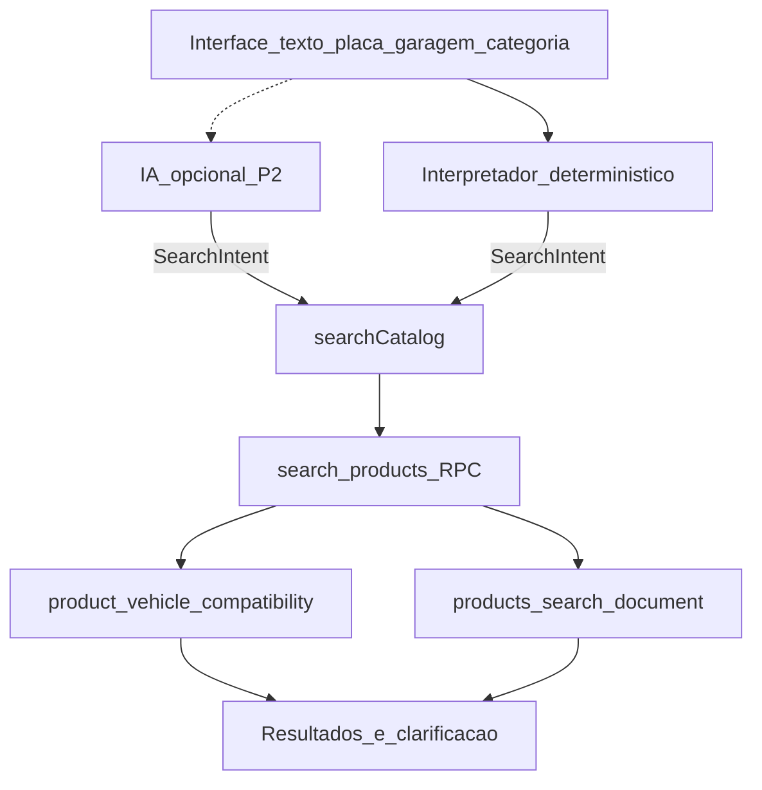

# FAL — Plano Mestre Executável: Busca Inteligente + Categorias

**Versão:** V1 · **Data:** 2026-11-11  
**Autor do plano:** auditoria funcional TinyFish (2 rodadas) + auditoria técnica do repositório local  
**Repo:** https://github.com/efe777-creator/FAL-PECAS-AUTOMOTIVAS.git (`main`)  
**App:** [`fal-pecas/`](../../fal-pecas/)  
**Design:** [`docs/superpowers/specs/2026-11-11-busca-inteligente-design.md`](../superpowers/specs/2026-11-11-busca-inteligente-design.md)  
**Plano P0 detalhado:** [`docs/superpowers/plans/2026-11-11-busca-inteligente-p0.md`](../superpowers/plans/2026-11-11-busca-inteligente-p0.md)

> **Regra de governança:** nenhuma alteração de código, migration ou publicação sem aprovação do eFe após o gate da entrega correspondente.

---

## 0. Veredito executivo

1. A falha `HB20 2015 → 0` vs seletor `→ 3` está **reproduzida** (TinyFish) e a **causa no código está localizada** (canal `p_q` ≠ canal PVC).
2. O motor atual (`searchCatalog` + `search_products` + PVC) **deve ser preservado** e unificado por um interpretador de query — não reconstruído.
3. Trabalho em **3 entregas sequenciais** + implementação por prioridade **P0 → P1 → P2**.
4. IA só na P2; busca tradicional obrigatória como fallback permanente.

---

## 1. Evidências consolidadas

### 1.1 Funcional (TinyFish)

Fonte: [run 098d4da4…](https://agent.tinyfish.ai/runs/098d4da4-73d9-40e4-9fed-40302cbf9077)

| Pesquisa | Resultado |
|----------|-----------|
| HB20 | 3 produtos |
| Hyundai HB20 | 3 sugestões (produtos) no autocomplete |
| HB20 2015 | 0 |
| HB20 1.0 2015 | 0 |
| HB20 1.6 2015 | 0 |
| HB20 One | 0 |
| Manual HB20 2015 1.0 | 3 (BRD2109, TDI2116, TDI2117) |

Pendentes na auditoria externa (completar na Entrega 1 / homologação): Pivô, Pivô Palio, Nakata PVI1032, HB20 One no seletor, placa, garagem/login.

### 1.2 Técnica (repositório) — causa raiz

| Camada | Achado |
|--------|--------|
| UI | [`SearchBar.tsx`](../../fal-pecas/src/components/navigation/SearchBar.tsx) → só `?q=` |
| Service | [`searchService.ts`](../../fal-pecas/src/services/search/searchService.ts) passa `p_q` e filtros veículo separados |
| Prep | [`searchPrepService.ts`](../../fal-pecas/src/services/search/searchPrepService.ts) — sinônimos de peça; **sem YMM** |
| RPC | `search_products` (`20261110160000_…wildcard.sql`) — `p_q` AND em produto; PVC só com `p_maker/model/year…` |
| Documento | `build_product_search_document` — **sem** aplicações |
| Suggestions | `search_product_suggestions` — só produtos |
| Spec legada | [`ESPECIFICACAO_FASE4_MOTOR_BUSCA.md`](./ESPECIFICACAO_FASE4_MOTOR_BUSCA.md) trata texto e YMM como aceites **distintos** |

### 1.3 Pseudo-bugs a não “corrigir” às cegas

| Sintoma | Explicação |
|---------|------------|
| `(12/...)` | Label intencional de período aberto (`formatVehicleAppYear`) |
| Apps “cortadas” no card | `maxEntries: 4` compact no catálogo |
| `Hb20` vs `HB20` | Cadastro + display; há `toCommercialTitleCase` / keys normalizadas |
| Preço em contextos diferentes | Auditar `resolved_amount` vs list/promo antes de patch |

---

## 2. Arquitetura alvo (híbrida)



**Decisão P0:** interpretador determinístico (`interpretSearchQuery`) mapeia texto → mesmos params do seletor; PVC continua validador único.

---

## 3. Três entregas (ordem obrigatória)

### Entrega 1 — Auditoria técnica (somente leitura)

**Objetivo:** fechar inventário, validar causa com SQL no ambiente publicado (wtbp), produzir matriz e lista do que está BOM vs QUEBRADO.

**Documentos a gerar em `docs/planejamento/`:**

| Arquivo | Conteúdo |
|---------|----------|
| `FAL_AUDITORIA_CATALOGO_INVENTARIO_V1.md` | Stack, arquivos, RPCs, migrations, fluxos |
| `FAL_AUDITORIA_BUSCA_INTELIGENTE_V1.md` | Canais de busca, causa HB20+ano, gaps autocomplete |
| `FAL_AUDITORIA_VEICULOS_APLICACOES_V1.md` | manufacturers/models/VV/PVC; períodos; duplicatas |
| `FAL_AUDITORIA_PRODUTOS_CLASSIFICACAO_V1.md` | product_categories L1–L3; SKUs; refs; produtos sem app |
| `FAL_AUDITORIA_PRECOS_REGRAS_COMERCIAIS_V1.md` | resolved vs list; divergências observadas |
| `FAL_AUDITORIA_IMPORTACAO_ADMIN_V1.md` | imports apps/produtos/mestre veículos |
| `FAL_MATRIZ_INCONSISTENCIAS_CATALOGO_V1.csv` | id, área, severidade, evidência, status |
| `FAL_TESTES_HOMOLOGACAO_CATALOGO_V1.md` | matriz de testes §11 do brief |

**Queries SQL obrigatórias (Supabase SQL editor / script read-only):**

```sql
-- A) Produtos do seletor HB20 2015 1.0 (espelho RPC PVC)
-- B) Produtos com q='HB20 2015' sem filtros veículo (deve ser 0 ou diferente)
-- C) PVC dos SKUs BRD2109, TDI2116, TDI2117 (year_start/end, engine, version)
-- D) Contagem models name ILIKE '%hb20%' (grafias)
-- E) Produtos published sem nenhuma PVC
-- F) Categories published órfãs / produtos sem category_id
```

**Checklist Entrega 1:**

- [ ] Inventário de arquivos/RPCs/tabelas publicado
- [ ] SQL A–F executados e anexados (resultado sanitizado)
- [ ] Confirmação escrita: causa = ausência de parser YMM + `p_q` sem PVC
- [ ] Matriz CSV com P0/P1/P2
- [ ] Lista “validado OK” (ex.: seletor YMM, wildcard engine vazio, prep sinônimos)
- [ ] Gate eFe: aprovar Entrega 1

**Estimativa:** 1 sessão focada (código já mapeado; falta SQL produção + docs).

---

### Entrega 2 — Especificação definitiva

**Objetivo:** congelar comportamento antes de codar.

**Documento:** `FAL_SPEC_BUSCA_INTELIGENTE_V1.md` (evolui o design em superpowers/specs).

Deve fechar:

1. Contrato `SearchIntent` + exemplos da tabela de tipos de busca do brief.
2. Regras de parse (ano 4 dígitos, motor `1.0`/`1.6`, versão, códigos, marca peça).
3. URL canônica pós-busca.
4. Autocomplete: seções, limites, veículo sem cobertura.
5. Clarificação (quando perguntar motor).
6. Integração placa/garagem/PDP/carrinho no mesmo contrato.
7. Política IA (P2): o que chama API, cache, fallback, o que é proibido.
8. Critérios de aceite = matriz de testes.

**Checklist Entrega 2:**

- [ ] Spec revisada pelo eFe
- [ ] Conflitos com Fase 4 documentados (CA texto vs YMM unificados)
- [ ] Gate eFe: autorizar implementação P0

---

### Entrega 3 — Implementação (fases)

Ordem fixa. Cada fase termina com VAL em `docs/planejamento/FAL_MARCHA_…_VAL_….md` + commit.

| Fase | Prioridade | Entrega | Dependência |
|------|------------|---------|-------------|
| 3.1 Inventário fechado | — | Entrega 1 | — |
| 3.2 Spec fechada | — | Entrega 2 | 3.1 |
| 3.3 Parser + unificação URL/RPC | **P0** | `HB20 2015` = seletor | 3.2 |
| 3.4 Autocomplete veículos/peças | **P1** | UI seccionada | 3.3 |
| 3.5 Normalização display + apps UI | **P1** | HB20 casing; label período; PDP apps | 3.3 |
| 3.6 Códigos/marcas/sinônimos | **P1** | Nakata + refs | 3.3 |
| 3.7 Placa + garagem no mesmo motor | **P1** | sem PoC falsa | 3.3 |
| 3.8 Auditoria dados (CSV → correções admin) | **P0/P1** | períodos PVC HB20 | 3.1 |
| 3.9 IA interpretadora | **P2** | NL → SearchIntent | 3.3–3.7 |
| 3.10 Homologação + monitor zero-result | **P0–P2** | go-live | tudo |

Detalhamento passo a passo da **fase 3.3 (P0):** ver plano em  
[`docs/superpowers/plans/2026-11-11-busca-inteligente-p0.md`](../superpowers/plans/2026-11-11-busca-inteligente-p0.md).

---

## 4. Matriz de prioridades (trabalho)

### P0 — Crítico (bloqueia confiança da busca)

| ID | Trabalho | Arquivos / superfície | Aceite |
|----|----------|----------------------|--------|
| P0-1 | Interpretador determinístico YMM+peça+código | **Novo** `fal-pecas/src/services/search/interpretSearchQuery.ts` + testes | Casos da matriz |
| P0-2 | SearchBar/Catalog passam intent → URL estruturada | `SearchBar.tsx`, `CatalogPage.tsx`, `searchService.ts` | `HB20 2015` → 3 |
| P0-3 | Empty state: veículo reconhecido sem peças vs query lixo | Catalog empty UI | Copy distinta |
| P0-4 | Auditar PVC BRD2109/TDI2116/TDI2117 períodos | SQL + admin se necessário | 2015 ∈ intervalo |
| P0-5 | Não afirmar compatibilidade sem PVC | PDP/cards | Badge só com PVC |

### P1 — Experiência

| ID | Trabalho | Aceite |
|----|----------|--------|
| P1-1 | Autocomplete VEÍCULOS + PEÇAS | Digitar HB20 sugere Hyundai HB20 |
| P1-2 | Motor/versão no parse (`1.0`, `One`) | `HB20 1.0 2015` e `HB20 One` |
| P1-3 | Display model UPPER (HB20) na vitrine de apps | Sem `Hb20` na UI |
| P1-4 | Copy de período mais legível (opcional: `2012–atual`) | Decisão UX no gate |
| P1-5 | Refs fabricante / Nakata | `Nakata PVI1032` |
| P1-6 | Placa/garagem usam interpretador+mesmos params | Mesmo total que seletor |

### P2 — IA

| ID | Trabalho | Aceite |
|----|----------|--------|
| P2-1 | NL → SearchIntent (Edge Function) | Frase exemplo do brief |
| P2-2 | Cache + rate limit + fallback determinístico | IA down ≠ site quebrado |
| P2-3 | Métricas zero-result | Dashboard/admin simples |

---

## 5. Matriz de testes obrigatórios

| # | Teste | Esperado P0 | Esperado P1+ |
|---|-------|-------------|--------------|
| T01 | HB20 | ≥1 produto OU veículo reconhecido | + sugestão veículo |
| T02 | HB20 2015 | Interseção PVC ano 2015 (≈3 no cenário atual) | idem |
| T03 | HB20 1.0 2015 | Só apps 1.0 (e curingas) | idem |
| T04 | HB20 1.6 2015 | Só apps 1.6 (e curingas) | idem |
| T05 | HB20 One | Versão se cadastrada; senão clarificação | autocomplete versão |
| T06 | terminal HB20 2015 | Terminais PVC | — |
| T07 | pivô | Categoria/sinônimo | — |
| T08 | pivô Palio 2010 | Peça + PVC | — |
| T09 | TDI2116 | Hit código | — |
| T10 | Nakata PVI1032 | Marca+ref | — |
| T11 | Veículo sem produtos | Reconhece + empty claro | autocomplete veículo |
| T12 | Produto sem app | Sem badge “compatível” | — |
| T13 | Typo leve | Sugestão se possível | sinônimos |
| T14 | Garagem | Reusa filter | — |
| T15 | Placa falha | Abre seletor manual | — |
| T16 | IA off | Busca C funciona | — |

---

## 6. O que já está BOM (preservar)

- RPC `search_products` com PVC + year_start/end + wildcard engine/versão vazios.
- Contrato único `searchCatalog` no front.
- Prep de sinônimos (`prepareSearchQuery` / admin Search Prep).
- Seletor YMM + `buildVehicleQuery`.
- Placa → confirmação → filtros (não misturar PoC).
- Canonical `vehicle_versions` unique keys.
- Árvore `product_categories` L1–L3 + filtro por subtree na RPC.
- Import de aplicações (`apply_catalog_applications_import`).

---

## 7. Riscos e mitigações

| Risco | Mitigação |
|-------|-----------|
| Parser falso positivo (ex.: “2015” em código) | Tokens de ano só se 19xx/20xx **e** modelo já casado; códigos têm prioridade absoluta |
| Modelos ambíguos (mesmo nome em montadoras) | Exigir maker ou clarificar |
| Performance LIKE | Manter pageSize; parser reduz termos inúteis; medir latência |
| Mudança quebra Fase 4 VAL | Suite T01–T16 + smoke seletor antigo |
| Escopo IA cedo | Gate: P0+P1 verdes antes de P2 |

---

## 8. Critérios de projeto “concluído”

Copiados do brief e amarrados a evidência:

- [ ] `HB20 2015` encontra apps cadastradas (VAL)
- [ ] Motor/versão/ano respeitados
- [ ] Peça, veículo, combinação e código OK
- [ ] Autocomplete separa veículos e peças
- [ ] Veículo sem produto identificável
- [ ] Sem compatibilidade inventada
- [ ] Garagem/placa no mesmo motor
- [ ] Apps legíveis (não “cortadas” de forma enganosa)
- [ ] IA não inventa fitment; busca funciona sem IA
- [ ] Preços com fonte consistente auditada
- [ ] Performance/segurança/custo aprovados

---

## 9. Próxima ação imediata (agora)

1. eFe **aprova este plano + design**.
2. Executar **Entrega 1** (docs + SQL read-only no Supabase de produção).
3. Gerar Entrega 2 (spec) a partir do design.
4. Só então implementar P0 conforme plano detalhado.

**Nada de deploy nesta etapa.**
