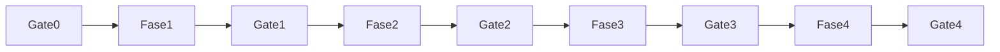

# Plano canônico — Central de Pedidos FAL (Auditoria + 4 Frentes)

**Versão:** V2 · **Data:** 2026-11-11  
**Status:** Gates **0–2 assinados** · Fase 3 matriz aberta  
**Auth:** eFe · MARCHA Gate 2 + Fase 3  
**VAL Fase 2:** [FAL_MARCHA_CENTRAL_PEDIDOS_FASE2_UX_VAL_2026-11-11.md](./FAL_MARCHA_CENTRAL_PEDIDOS_FASE2_UX_VAL_2026-11-11.md)  
**VAL Gate2/F3:** [FAL_MARCHA_CENTRAL_PEDIDOS_GATE2_FASE3_VAL_2026-11-11.md](./FAL_MARCHA_CENTRAL_PEDIDOS_GATE2_FASE3_VAL_2026-11-11.md)  
**VAL Fase3 A:** [FAL_MARCHA_CENTRAL_PEDIDOS_FASE3_EXEC_A_VAL_2026-11-11.md](./FAL_MARCHA_CENTRAL_PEDIDOS_FASE3_EXEC_A_VAL_2026-11-11.md)  
**Matriz testes:** [FAL_MATRIZ_TESTES_CENTRAL_PEDIDOS_FASE3_2026-11-11.md](./FAL_MATRIZ_TESTES_CENTRAL_PEDIDOS_FASE3_2026-11-11.md)  

**VAL FRE-022:** [FAL_MARCHA_CENTRAL_PEDIDOS_FRE022_VAL_2026-11-11.md](./FAL_MARCHA_CENTRAL_PEDIDOS_FRE022_VAL_2026-11-11.md)  
**VAL SEC-030:** [FAL_MARCHA_CENTRAL_PEDIDOS_SEC030_VAL_2026-11-11.md](./FAL_MARCHA_CENTRAL_PEDIDOS_SEC030_VAL_2026-11-11.md)  
**VAL CEN-040:** [FAL_MARCHA_CENTRAL_PEDIDOS_CEN040_VAL_2026-11-11.md](./FAL_MARCHA_CENTRAL_PEDIDOS_CEN040_VAL_2026-11-11.md)  
**VAL P1 parcial:** [FAL_MARCHA_CENTRAL_PEDIDOS_P1_PARCIAL_VAL_2026-11-11.md](./FAL_MARCHA_CENTRAL_PEDIDOS_P1_PARCIAL_VAL_2026-11-11.md)  
**VAL P1 EMB/EVT:** [FAL_MARCHA_CENTRAL_PEDIDOS_P1_EMB_EVT_VAL_2026-11-11.md](./FAL_MARCHA_CENTRAL_PEDIDOS_P1_EMB_EVT_VAL_2026-11-11.md)  
**Spec PRT-DOC:** [FAL_SPEC_PRT_DOC_ARCHIVE_2026-11-11.md](./FAL_SPEC_PRT_DOC_ARCHIVE_2026-11-11.md)  
**VAL CP-PAY Pix prod:** [FAL_MARCHA_CP_PAY_PIX_PROD_SMOKE_VAL_2026-11-11.md](./FAL_MARCHA_CP_PAY_PIX_PROD_SMOKE_VAL_2026-11-11.md)  

**Matriz:** [FAL_AUDITORIA_CENTRAL_PEDIDOS_MATRIZ_2026-11-11.md](./FAL_AUDITORIA_CENTRAL_PEDIDOS_MATRIZ_2026-11-11.md)  
**Mapa:** [FAL_MAPA_JORNADA_CENTRAL_PEDIDOS_2026-11-11.md](./FAL_MAPA_JORNADA_CENTRAL_PEDIDOS_2026-11-11.md)  
**Ajustes:** [FAL_MATRIZ_AJUSTES_001_034_2026-11-09.md](./FAL_MATRIZ_AJUSTES_001_034_2026-11-09.md) (006, 007, 014, 015, 016, 017, 031)  
**MVP:** [FAL_PLANO_MVP_PRONTIDAO_2026-11-09.md](./FAL_PLANO_MVP_PRONTIDAO_2026-11-09.md)  
**CP-NOT (P2 transversal):** [FAL_PLANO_CENTRAL_NOTIFICACOES_2026-11-13.md](./FAL_PLANO_CENTRAL_NOTIFICACOES_2026-11-13.md) · [FAL_SPEC_CENTRAL_NOTIFICACOES_2026-11-13.md](./FAL_SPEC_CENTRAL_NOTIFICACOES_2026-11-13.md) · [FAL_AUDITORIA_NOTIFICACOES_2026-11-13.md](./FAL_AUDITORIA_NOTIFICACOES_2026-11-13.md)

---

## Changelog V1 → V2

| Mudança | Por quê |
|---------|---------|
| Estoque fora do escopo da Central | Decisão eFe: não implementar reserva/baixa/release/F7F neste projeto |
| Removidos CP-STK-013 e CP-STK-051 dos P0/Gate 1 | Preservados na matriz como dependência do módulo estoque |
| P0 único: FRE-022 → SEC-030 → CEN-040 | Eliminar inconsistência A/B/C vs D da V1 |
| Financeiro: só “Recebido líquido = capturado − devolvido” | Evitar desconto duplo V1 |
| Ocorrências: `occurrence_id` + estado = último evento | Leitura sem ambiguidade |
| Packing multi-volume neutro + snapshot/invalidação | Spec operacional precisa |
| Segurança: inventário obrigatório antes de revoke | Não quebrar `place_order` |
| Rastreio manual com histórico por transição | Não sobrescrever status sem auditoria |
| Separação integral por linha; multi-envio não suportado | Alinhado a `separated` boolean |
| Testes STK da Central viram regressão/border ou módulo estoque | Escopo |

V1 permanece como base histórica; este arquivo é a referência vigente.

---

## 0. Acompanhamento

| Etapa | Objetivo | Estado |
|-------|----------|--------|
| 0. Auditoria | Diagnosticar e classificar | **Gate 0 assinado** (eFe · 2026-11-11) |
| 1. Estruturação | Funções, regras, integrações (sem estoque) | **Gate 1 assinado** |
| 2. Polimento | UX operacional | **Gate 2 assinado** (smoke staff pendente) |
| 3. Testes | Comprovar 1+2 | **Família A PASS** · M/H pendente Gate 3 |
| 4. Confirmação | Homologar e liberar (auth separada) | A planejar |

---

## 1. Visão e escopo

Central de Controle **comercial, financeira e logística** do pedido: criação → pagamento → análise → **separação física** → embalagem → frete → etiqueta → despacho → rastreio → entrega → ocorrências → pós-venda.

### Fora do escopo (módulo estoque)

Reserva · baixa · liberação de reserva · saldo · movimentações · reconciliação · alterações F7F / CP-STK-* de inventário.

### Dentro do escopo (separação física ≠ estoque)

Ver produtos/qtds · conferir SKU/qtd · marcar separados · registrar divergência/falta física · impedir conclusão integral se incompleto.

**Princípios:** pedido = registro-mestre · auditar antes de desenvolver · estrutura antes de aparência · botão ≠ aprovação · sandbox ≠ prod · sem fila paralela 001–034 · deploy só com auth separada.

---

## 2. Diagnóstico (Auditoria 0 + V2)

### Já existe (não reconstruir)

Hub 4 áreas · detalhe · RPCs F7 ops · MP · ME label cycle · frete próprio checkout · Meus Pedidos · print separação/romaneio.

### Prioridades V2

| Prio | ID | Tipo | Ação |
|------|-----|------|------|
| **P0-1** | CP-FRE-022 | Smoke | **PASS** (VAL 2026-11-11) — sem código |
| **P0-2** | CP-SEC-030 | Inventário → SQL | **CORRIGIDO** (revoke prod + VAL) |
| **P0-3** | CP-CEN-040 | Código | **CORRIGIDO** (filas server-side + VAL) |
| P1 | CP-CEN-011 | Código+doc | **FEITO** Hub + RPC fórmulas V2 |
| P1 | CP-EMB-* | Spec+código | **FEITO** packing multi-volume neutro |
| P1 | CP-OWN-ME / OPS | Código | **FEITO** branch ME vs OwnShipPanel |
| P1 | CP-EVT-01 | Código | **FEITO** ocorrências `occurrence_id` |
| P1 | CP-CAN-POST | UI+RPC | **FEITO** bloqueio approve pós-despacho |
| P1 | CP-PRT-DOC | Spec | **FEITO** spec archive (storage = P2) |
| P2 | polish / ME webhook auto | Evolução | — |
| **P2** | **CP-NOT** | Central de Notificações (transversal) | N0–N2 MARCHA · N3 WA = **FUTURO** ([spec](./FAL_SPEC_NOTIFICACOES_WHATSAPP_FUTURO_2026-11-13.md)) · N4 e-mail |
| **Fora** | CP-STK-* / F7F | Módulo estoque | Só documentado |
| H | CP-ME-PUR / CP-PAY-021 webhook prod / 006–007 | Humano Fase 4 | PAY create PASS · approve via sync; webhook prod aberto |

---

## 3. Gates

| Gate | Critérios |
|------|-----------|
| **0** | Matriz V2 · mapa V2 · plano V2 · lacunas · **aprovação eFe** |
| **1** | Regras P0/P1 Central · backend tocado validado · segurança com inventário · **sem** exigir F7F/estoque |
| **2** | UX observável (hub/detalhe/separação/wizard) |
| **3** | Matriz testes · retestes · regressão · zero crítico/alto sem decisão |
| **4** | Homologação real · consistência · **liberação auth separada** |

---

## 4. Fase 1 — Estruturação

### 4.1 P0 — ordem única (aprovada eFe)

#### 1) CP-FRE-022 — Smoke quotes

Validar remoto: insert em `shipping_quotes` + `place_order meq:`/`ownq:`.  
PASS → marcar validado. FAIL → correção mínima na Edge/schema.

#### 2) CP-SEC-030 — Segurança INSERT

**Antes de revogar:** inventário FE · RPCs · Edges · service_role · RLS · grants · anon/authenticated · SECURITY DEFINER.  
Depois: revoke INSERT JWT; `place_order` continua. Testes: place_order OK · insert JWT falha · admin OK · docs privados OK.  
Mesmo rigor para CP-SEC-035 (`shipments` metadata).

#### 3) CP-CEN-040 — Filas server-side

`adminListOrders` (ou RPC) com `status in (…)`, cancellation pending, paginação estável. Area/View/Lista sem filtro client sobre 200 recentes.

### 4.2 Decisões travadas (P1)

#### Indicadores CP-CEN-011

**Operacionais:** pedidos criados · por área · atrasados · cancelados · aguardando decisão · cancel request pending.

**Financeiros (convenção única):**

| Métrica | Definição |
|---------|-----------|
| Pagamentos aprovados | Valor capturado (`payments` approved vigentes; ≤1 canônico/pedido; sem somar tentativas) |
| Reembolsos/estornos | Valores devolvidos |
| **Recebido líquido** | capturado − devolvido |
| Valor bruto vendido | `orders.total` (exclui cancelados conforme regra) |
| Valor cancelados | totais `cancelado` |
| Pendente | payments pending de pedidos abertos |

Cancelamento comercial ≠ estorno financeiro. BRL · período · filtros. Sem dashboard duplicado (reusar 033/034).

#### Packing CP-EMB-*

- N volumes/pedido; cada um com **id**  
- L, A, P, peso + **unidade explícita** · operador · datetime · obs  
- Fonte neutra (`packing`); `metadata.me` só ME  
- Cotação: snapshot volumes; mudança invalida cotação; contratação preserva snapshot  
- Templates = catálogo; volumes do pedido = instância  

#### Separação

Integral **por linha** (`separated` boolean). Qty parcial (4 de 5) = divergência/ocorrência; não concluir. **Multi-envio: não suportado.**

#### Cancel / pós-venda (sem estoque)

| Estágio | Regra Central |
|---------|---------------|
| Pré-`enviado` | Cancel comercial paths existentes; sem alterar release/fulfill |
| Pós-despacho | Não cancel “simples”; ocorrência + pós-venda; UI bloqueia approve Onda2 como cancel normal |
| Pós-entrega | Devolução ≠ cancel: solicitação → auth → recebimento → conferência → reintegração (**estoque**) → reembolso se aplicável |

#### Ocorrências CP-EVT-01

`order_events` imutáveis; payload com **occurrence_id** (UUID compartilhado).  
Eventos: `occurrence_opened` · `occurrence_updated` · `occurrence_resolved`.  
Estado atual = **último** evento daquele id. Campos: tipo, gravidade, responsável, visibility, solução (na resolução).

#### Rastreio CP-ME-WH / OWN

Manual: cada transição gera evento (quem, quando, info). Estados: despachado · em transporte · saiu para entrega · tentativa sem sucesso · entregue · ocorrência.  
Webhook ME auto = evolução futura.

#### ME vs own

Esconder painel ME se provider ≠ ME. Own: programação, responsável, rota, saída, tentativa, entrega, comprovante.

### 4.3 Gate 1

P0 concluídos · regras P1 documentadas/implementadas no escopo Central · evidências · **sem** gate de estoque.

---

## 5. Fase 2 — UX

Hierarquia hub/detalhe · separação física · wizard Conferência→Volumes→Frete→Etiqueta(se ME)→Despacho · preservar filtros · desktop/tablet/mobile · design system FAL.

Critérios observáveis: próxima ação clara · filtros restaurados · incomplete não conclui · wizard ordenado · own sem ME · erro legível.

---

## 6. Fase 3 — Testes

Famílias: `CP-T-CEN|PAY|SEP|PKG|ME|OWN|SEC|UI|REG|EVT|TRK-*`  
(STK só regressão border / módulo estoque — não bloqueia Gate 3 da Central.)

Ampliação V2: cotação expirada · alteração pós-embalagem · multi-volume · qty parcial bloqueada · pagamentos múltiplos · estorno · webhook dup · URL etiqueta · inventário SEC · histórico rastreio · paginação concorrente · docs privados.

Corrigir ≠ concluir. Gate 3: zero crítico/alto sem decisão.

---

## 7. Fase 4 — Homologação

Cenários: pago+separação · pendente · recusado · divergência física · multi-volume · ME+etiqueta · próprio · ocorrência · despachado · entregue+cliente · rastreio manual.

Produção: backup · migrations auth · deploy auth · Edges · smoke · logs · rollback · monitoramento.  
**Sandbox ≠ prod. Este plano não autoriza cutover.**

---

## 8. Dependências

| Dependência | Bloqueia |
|-------------|----------|
| Assinatura Gate 0 | Fase 1 |
| P0 FRE→SEC→CEN | Fase 2 profunda |
| Inventário SEC | Revoke INSERT |
| Purchase ME / MP approve | Fechar 014/017 Fase 4 |
| Módulo estoque | Qualquer correção F7F/release/baixa |
| Auth deploy | Produção |

---

## 9. Primeira execução após Gate 0

1. Assinar Gate 0  
2. **CP-FRE-022** smoke  
3. **CP-SEC-030** inventário → revoke (se ok)  
4. **CP-CEN-040** filas server-side  
5. P1 conforme §4.2  
6. Gate 1 → Fase 2  

---

## 10. Riscos / decisões humanas

| Item | Dono |
|------|------|
| Purchase ME + CNPJ | eFe |
| Pix/webhook/cartão/cutover | eFe (017) |
| E2E 006/007 | eFe |
| Auth redirect smoke UI | eFe |
| Advogado PII (027) | eFe |
| Webhook ME auto (futuro) | eFe+eng |
| Liberação produção | Auth separada |
| Modelo packing: metadata vs coluna futura | Eng na Fase 1 (spec sem migration até inventário) |

---

## 11. Assinaturas

| Papel | Nome | Data | Nota |
|-------|------|------|------|
| Auditoria 0 + consolidação V2 | Agente Cursor | 2026-11-11 | Docs V2 |
| Aprovação conceitual V2 | eFe | 2026-11-11 | Com ressalvas incorporadas |
| Gate 0 formal | eFe | 2026-11-11 | MARCHA — assina docs V2 e libera P0 |
| Gate 1 formal | eFe | 2026-11-11 | MARCHA — P0+P1 Central sem estoque |
| Gate 2 formal | eFe | 2026-11-11 | MARCHA — UX observável (smoke staff residual) |
| Gates 3–4 | | | |
