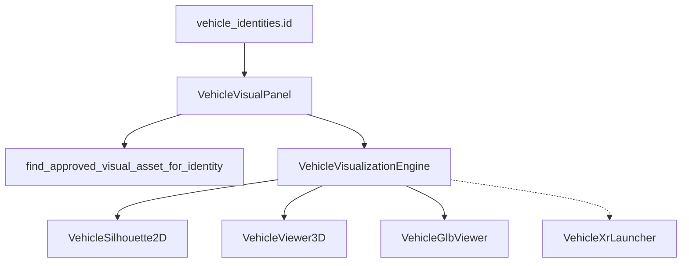
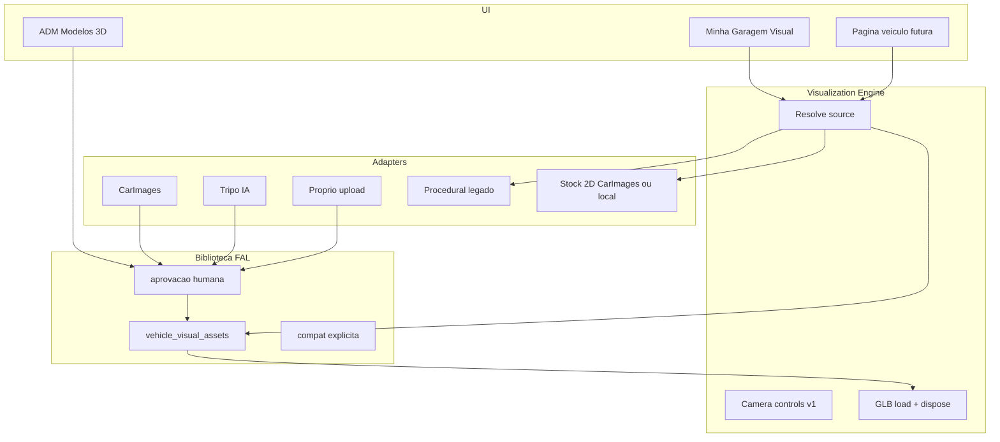

# Consolidação do sistema 3D automotivo FAL — diagnóstico e plano

**Status:** **APROVADO eFe · Fase 1 congelada · implementação Fases 2–6 em `feature/consolida-3d-automotivo` → `dev`.**  
**Data:** 2026-11-18  
**Branch:** `dev` / `feature/consolida-3d-automotivo`  

**Escopo do documento:** diagnóstico + especificação (Partes A–I). Implementação ocorre nas fases seguintes deste plano.

**Decisões de produto já aprovadas (não reabrir):** exterior completo primeiro; origem híbrida com aprovação humana; v1 = órbita/zoom/ângulos/framing (sem pintura interativa no GLB, sem interior, sem AR); compat por geração/carroceria/facelift comprovada.

---

## PARTE A — Estado atual (evidências)

### Fluxo real hoje

Entrada: [`AccountVehicleDetailPage`](fal-pecas/src/pages/Account/AccountVehicleDetailPage.tsx) `?modulo=visual` → [`VehicleVisualPanel`](fal-pecas/src/components/garage/VehicleVisualPanel.tsx) (`vehicleIdentityId` + `membershipId`).

Resolução GLB: [`findApprovedVisualAssetForIdentity`](fal-pecas/src/services/garage/vehicleVisualAssetService.ts) → RPC SQL em [`20261118240000_plano2b_fase_b_e2_visual_assets.sql`](fal-pecas/supabase/migrations/20261118240000_plano2b_fase_b_e2_visual_assets.sql) → signed URL bucket `vehicle-visual-assets` → [`VehicleGlbViewer`](fal-pecas/src/components/garage/VehicleGlbViewer.tsx).

### Inventário por peça

| Peça | Path | Estado |
|------|------|--------|
| Contrato Engine | [`visualizationEngine.ts`](fal-pecas/src/services/garage/visualizationEngine.ts) | Implementado e funcional (2d/procedural/glb/xr + fallbacks) |
| Engine UI | [`VehicleVisualizationEngine.tsx`](fal-pecas/src/components/garage/VehicleVisualizationEngine.tsx) | Implementado e funcional |
| Painel garagem | [`VehicleVisualPanel.tsx`](fal-pecas/src/components/garage/VehicleVisualPanel.tsx) | Implementado e funcional (wire identity→asset→engine) |
| 2D silhueta | [`VehicleSilhouette2D.tsx`](fal-pecas/src/components/garage/VehicleSilhouette2D.tsx) | Funcional (fallback) |
| Procedural | [`VehicleViewer3D.tsx`](fal-pecas/src/components/garage/VehicleViewer3D.tsx) | Funcional; câmera fixa + auto-rotação senoidal |
| GLB loader | [`VehicleGlbViewer.tsx`](fal-pecas/src/components/garage/VehicleGlbViewer.tsx) | Parcial: load/fit OK; **sem** OrbitControls/zoom/presets; **recolor heurístico** da carroceria |
| XR | [`VehicleXrLauncher.tsx`](fal-pecas/src/components/garage/VehicleXrLauncher.tsx) + `visualXrSession.ts` | Existe e gated (default off); HEADSET BLOCKED neste host |
| ADM Modelos 3D | [`AdminVisualAssetsPage.tsx`](fal-pecas/src/pages/admin/vehicles/AdminVisualAssetsPage.tsx) | Funcional: draft upload, approve/reject/revoke, compat Fiat/Palio smoke |
| Serviço ADM | [`adminVisualAssetService.ts`](fal-pecas/src/services/admin/adminVisualAssetService.ts) | Funcional (sem edit/re-upload/delete) |
| Schema assets+compat+bucket | migration E2 | Aplicado em `wtbp`; RLS + signed URL |
| Config visual 2D | `vehicle_visual_configs` E1 | Funcional (pintura/prefs Camada 1) |
| Stock 2D G3 | [`vehicleImageResolver.ts`](fal-pecas/src/services/customers/vehicleImageResolver.ts) | Código funcional; **tabela `vehicle_stock_images` com 0 linhas** → placeholder na prática |
| Testes | Vitest contratos Engine/tipos/sync/XR gate | Sem testes de componente GLB/câmera |

### Dados/ops já comprovados (MARCHA)

- Asset smoke `fal-smoke-palio-box` approved + compat Fiat/Palio 2015 → Engine resolve **3D GLB**.
- Sync G7 TDI1006 → “no modelo (2A)”.
- XR desktop: `navigator.xr` ok, `immersive-ar/vr=false`.

---

## PARTE B — Diagnóstico

### Implementado e funcional

- Pipeline FAL-owned: upload → draft → approve → compat → RPC → signed URL → GLB no Engine.
- Fallbacks Engine (WebGL off / GLB fail / reduced motion).
- Metadados origem `first_party|acquired|ai` + `commercial_ok` (IA sem commercial não entra no viewer público).
- Visual ≠ fato (copy + sync opt-in).

### Implementado parcialmente

- **Interação 3D v1 desejada:** órbita livre, zoom, ângulos predefinidos, framing inicial profissional — **ausentes** (só auto-rotação + fit bounding box).
- **Mobile 3D:** DPR/resize; **sem** gestos orbit/zoom nem tratamento de scroll conflict.
- **Compat fina:** colunas `generation`/`body_style`/`facelift`/`market` no DB; **RPC e ADM não usam** (só maker/model/year/version_id).
- **Status workflow:** só `draft|approved|rejected|revoked` — faltam `processing|review|retired`.
- **GLB “puro”:** viewer **recolore** meshes claros com `bodyColorHex` — conflita com decisão v1 “sem personalização interativa de pintura no GLB”.
- **Stock 2D:** resolver pronto; catálogo vazio; módulo visual **não** usa stock (usa silhueta).

### Existe tecnicamente, não integrado ao produto 3D desejado

- XR Fase C completa no código (fora do escopo v1 desta consolidação).
- `poly_count` / `texture_budget_mb` no schema, nunca preenchidos.
- `vehicle_stock_images.storage_path` selecionado mas ignorado no pick.

### Só estrutura / preparação

- Pipeline IA (Tripo etc.): só enum `source=ai` + gate commercial.
- Import em lote / URL externa / versionamento com rollback.
- Validação estrutural GLB (Draco/LOD/poly audit).

### Não existe

- Adapter CarImages (ou qualquer fornecedor externo) atrás do Engine.
- Camada de preview ampliado desktop/mobile com controles profissionais.
- Admin CRUD de stock 2D.
- Matching automático facelift/carroceria.
- Estados UI dedicados: incompatível / placeholder GLB / “3D indisponível + foto 2D”.
- Interior (correto — fora do escopo).

### Precisa correção (antes ou durante consolidação)

1. Remover ou gatear recolor GLB na v1 (alinhar produto).
2. RPC `find_approved_visual_asset_for_identity` é `SECURITY DEFINER` sem checagem de ownership — risco de enumeração por UUID.
3. Compat “aprovada” direto no ADM sem `pending/review`.
4. Chave CarImages já exposta em chat — **comprometida**; não reutilizar.

---

## PARTE C — CarImages API

### Capacidade técnica (docs públicas)

| Capacidade | Como |
|------------|------|
| Catálogo | `GET /api/v1/makes`, `.../models`, `.../models/{model}` com gerações |
| Geração retornada | Slug de gen no path (`g20`, `g05-g18-2023-now`); headers `X-CI-View` / `X-CI-Color` em imagens |
| GLB | `GET /api/v1/vehicles/{make}/{model}/{gen}/model` → JSON (`url`, flags `watermarked`/`fallback`) ou `?redirect=1` |
| Placeholder 3D | Docs: se não há 3D, retorna **masked-placeholder** (não erro) — **obrigatório detectar `fallback`** |
| Watermark | Free: malha com watermark baked; pago Cars: limpo |
| Auth | `key` público (domain lock pago) ou signed URL + `api_secret` server-side |
| 2D ângulos/cores | 8 views; 6 paints; **`color` NÃO aplica ao GLB** |
| CDN | Edge ~50ms; Cache-Control tipicamente curto em redirects |
| Limites Free | 5k req/mês, 60/min, WebP, watermark |

### Qualidade visual

Docs admitem GLB **gerado a partir da imagem de catálogo** — tipicamente silhueta/estúdio, **não** CAD OEM. Sem PoC medido nesta etapa: **não classificar como fiel**.

Classificação candidata pós-PoC (por veículo):
- Definitivo aprovado FAL | Provisório | Referência ADM | Fallback 2D only.

### Licença / redistribuição

Docs comerciais cobrem **exibição via API/CDN**. **Não** esclarecem direito de: baixar permanentemente, armazenar no bucket FAL, modificar malha, redistribuir. → **Pendência formal com fornecedor** antes de espelhar GLB no Storage FAL.

### Classificação FAL

**Recomendada com restrições — fonte complementar.**

Justificativa:
- Excelente para **estoque 2D** (G3 vazio) e **candidatos** 3D para revisão humana.
- **Não** como visualizador cliente apontando direto para `carimages.js` + key.
- **Não** como publicação automática no Engine.
- GLB só entra na biblioteca FAL após aprovação + (se contrato permitir) cópia/curadoria; senão streaming signed via adapter FAL com flag `provisional` e label explícito.
- Fuzzy make/model/year **não** substitui compat FAL por geração/facelift.

### PoC (sem alterar app) — checklist

1. Nova key + domain lock; **nunca** a key antiga.
2. Veículos: Fiat Palio ~2015, VW Gol, Onix, HB20, 1 SUV, 1 facelift conhecido.
3. Catalog REST → gen slug real vs esperado.
4. `/model` JSON → `watermarked`/`fallback`; tamanho GLB; tempo TTFB.
5. Abrir em visualizador offline (ex. glTF Sample Viewer); checklist visual Parte C.
6. Mobile: carga + orbit nativo model-viewer **só no PoC isolado**.
7. Relatório evidências (prints + headers + tempos) → decisão por veículo.

---

## PARTE D — Arquitetura final (alvo)

### Princípio

UI e Engine pedem **“modelo aprovado para identity”** à **biblioteca FAL**. Origem (CarImages / Tripo / próprio / procedural) fica atrás de **adapters**. Canônico 2A/identity **não** muda por causa do fornecedor.

### Responsabilidades

| Camada | Faz | Não faz |
|--------|-----|---------|
| Identity FAL | Verdade do veículo | Escolher GLB |
| Compat FAL | Associação explícita aprovada | Fuzzy de fornecedor |
| Adapters | Buscar candidato + metadados | Publicar sozinho |
| Biblioteca | Guardar versão, licença, status | Renderizar |
| Engine | Load, câmera, fallback, dispose | Conhecer CarImages |
| UI | Controles, estados, copy | Assinar secrets |

### Tecnologia

**Manter Three.js + GLTFLoader** já no projeto ([`VehicleGlbViewer`](fal-pecas/src/components/garage/VehicleGlbViewer.tsx)). Não migrar para `model-viewer` no produto; PoC CarImages pode usá-lo só para avaliação.

---

## PARTE E — Experiência visual (alvo v1)

### Apresentação

- Exterior full; fundo neutro (`#eef2f6` ou similar FAL); veículo dominante.
- Framing inicial: ¾ dianteiro, fit por bounding box (já existe base), depois **órbita livre**.
- Sem auto-rotação obrigatória (hoje: senoidal — **corrigir**).

### Controles

Desktop: drag orbit, wheel zoom, botões Front / ¾ / Side / ¾ rear / Rear / Reset (+ Top se estável).
Mobile: touch orbit sem roubar scroll (gesture zone / `touch-action`); pinch zoom; mesmos presets compactos.

### Estados UI (obrigatórios)

| Estado | UI |
|--------|----|
| Loading | Skeleton + “Carregando modelo 3D…” |
| Ready approved | Viewer + controles |
| Sem GLB aprovado | Foto 2D stock/CarImages/placeholder + “3D indisponível” |
| Incompatível / rejeitado | 2D + mensagem clara |
| Placeholder fornecedor | **Nunca** como real — tratar como indisponível |
| Erro load | Fallback procedural ou 2D + retry |
| Sem WebGL | Silhueta 2D |

Visual ≠ instalação / compra / fato 2A permanece.

---

## PARTE F — Biblioteca e administração

### Compatibilidade

Exigir associação explícita: manufacturer + model + (generation e/ou year range) + body_style + facelift quando relevante. **Proibir** compartilhar só por nome comercial. Ativar matching das colunas já existentes na RPC.

### ADM alvo (evoluir página atual)

Consultar, preview, upload próprio, **importar candidato** (CarImages/IA), origem, licença, compat, aprovar/reprovar com motivo, substituir com **nova versão** (sem overwrite silencioso), arquivar (`retired`), histórico.

Estados sugeridos (migração futura): `draft → processing → review → approved | rejected`; `approved → retired` (mapear `revoked`→`retired` ou alias).

Rastreabilidade: origem, fornecedor, data, responsável, versão, licença, compat, motivo review.

---

## PARTE G — Performance e segurança

### Performance (medir antes de metas rígidas)

PoC + smoke: tamanho GLB, TTI, FPS orbit mobile/desktop. Depois: Draco/Meshopt, KTX2, lazy, dispose rigoroso (já há `disposed` no GlbViewer), LOD se necessário. Procedural permanece fallback leve.

### Segurança

- Secrets só backend/Netlify Function; rotacionar key CarImages.
- Domain lock em plano pago.
- Sem espelho permanente de GLB terceiro sem contrato.
- Corrigir ownership na RPC de lookup.
- Bucket privado + signed URL curta (já padrão FAL).

---

## PARTE H — Plano de execução (fases)

### FASE 1 — Diagnóstico e arquitetura (esta entrega)

- **Objetivo:** congelar mapa A–G e gaps.
- **Conclusão:** este documento aprovado por eFe.

### FASE 2 — Fontes (CarImages, Tripo, próprios)

- **Objetivo:** PoC CarImages + política de adapters; draft especificação Tripo (humano-no-loop).
- **Escopo:** key nova; relatório qualidade; decisão espelho vs stream; **não** plugar no Engine de produção.
- **Riscos:** licença; placeholder disfarçado; cobertura BR fraca.
- **Testes:** matriz veículos + headers `fallback`/`watermarked`.
- **Done:** classificação por fonte + go/no-go contrato.

### FASE 3 — Biblioteca, compat, ADM

- **Objetivo:** compat fina + workflow review + import candidato.
- **Arquivos:** migration E2 evolutiva; `AdminVisualAssetsPage`; `adminVisualAssetService`; RPC find.
- **Riscos:** migrar status sem quebrar smoke atual.
- **Done:** não publicar sem approve; facelift não herda modelo errado.

### FASE 4 — Engine e visualizador v1

- **Objetivo:** OrbitControls + zoom + presets + framing; desligar auto-spin e recolor GLB v1; estados UI.
- **Arquivos:** `VehicleGlbViewer`, `VehicleVisualizationEngine`, `VehicleVisualPanel`; opcional viewer ampliado.
- **Dependências:** Fase 3 para assets reais aprovados (não só smoke box).
- **Done:** critérios Parte E + aceite interação 1.3.

### FASE 5 — Performance, segurança, testes

- **Objetivo:** ownership RPC; Vitest + smoke mobile; telemetria tamanhos; env secrets.
- **Done:** matriz Parte 13 mínima verde em `dev`.

### FASE 6 — Integração Minha Garagem (módulo Visual)

- **Objetivo:** hero/lista com 2D stock (CarImages via resolver) + Visual 3D aprovado; copy estados.
- **Não** misturar 3D com fatos G7 além do sync opt-in já existente.
- **Done:** Palio e N veículos BR com 2D e/ou 3D corretos.

### FASE 7 — Polish completo Minha Garagem

- **Explicitamente depois** da consolidação 3D. Não antecipar.

Cada fase futura, ao implementar: branch `feature/*` → `dev`; **sem** `main`/deploy sem auth.

---

## PARTE I — Pendências e decisões

### Já aprovadas (produto)

Exterior-first; híbrido + aprovação humana; v1 orbit/zoom/presets; sem pintura GLB / interior / AR na v1; compat comprovada.

### Podem ser técnicas (dev)

Manter Three.js; adapters atrás do Engine; mapear `revoked`↔`retired`; gesture zone mobile; desligar recolor GLB atrás de flag.

### Precisam aprovação produto

- Orçamento CarImages (Free smoke vs Pro Cars ~$41–49/mo).
- Permitir stream GLB externo no cliente vs só após cópia no bucket FAL.
- Exibir “3D provisório” ao cliente ou só ADM até approve.
- Prioridade: preencher 2D stock antes vs viewer 3D controles primeiro (**recomendação:** Fase 2 PoC paralelo; Fase 4 viewer em seguida; 2D stock na Fase 6 ou early Fase 3 se hero for crítico).

### Dependem do fornecedor

- Licença de armazenamento/modificação/redistribuição GLB.
- Cobertura real Palio/gerações BR e taxa de placeholder.
- Custom paint OEM (Enterprise) — fora do v1.

---

## Ordem de prioridade (resumo)

1. Arquitetura + diagnóstico (agora).
2. Validar fontes (CarImages/Tripo/próprios) com evidência.
3. Biblioteca/compat/ADM.
4. Engine/viewer profissional v1.
5. Perf/segurança/testes.
6. Integrar Visual na Garagem.
7. Só então polish amplo da Garagem.

**Veredito final:** o núcleo FAL (biblioteca própria + Engine + ADM) **está conectado e funciona** para o smoke atual, mas **não entrega ainda** o visualizador automotivo profissional desejado (controles, estados, compat fina, qualidade de modelo). CarImages **ajuda** como complemento 2D e candidato 3D sob restrições — **não** como substituto da biblioteca FAL nem publicação automática.