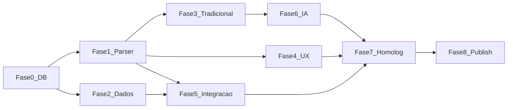

# FAL_PLANO_EXECUCAO_BUSCA_INTELIGENTE_V1

**Data:** 2026-11-11  
**Pré-requisito:** aprovação do eFe após leitura do plano mestre e auditorias.  
**Esta etapa de auditoria NÃO executa as tarefas abaixo.**

Detalhamento P0 de código (quando autorizado):  
`docs/superpowers/plans/2026-11-11-busca-inteligente-p0.md`

---

## Princípios

- Reaproveitar `searchCatalog` + PVC; não criar segundo motor.
- Corrigir drift DB antes/ou junto do parser (senão texto “corrigido” ainda falha no ano).
- IA só na Fase 6.
- Cada tarefa: Objetivo · Escopo · Arquivos · Dependências · Testes · Aceite · Risco.

---

## Fase 0 — Ops: alinhar produção ao repo (P0)

### T0.1 Inventário de migrations aplicadas
- **Objetivo:** listar o que falta em `owllmfcpbodqmoerdfxx` vs `fal-pecas/supabase/migrations`.
- **Escopo:** read-only `supabase_migrations.schema_migrations` + diff.
- **Aceite:** CSV gap documentado.
- **Risco:** aplicar tudo de uma vez quebra prod — priorizar search/PVC/commercial_ref.

### T0.2 Aplicar `search_products` year-range + wildcard
- **Tipo:** Corrigir (SQL já no repo `20261110160000_…`).
- **Dependência:** aprovação deploy.
- **Teste:** `search_products(...,'HB20','2015')` → TDI2116/TDI2117.
- **Aceite:** T07 passa.

### T0.3 commercial_ref + prep (decidir)
- **Tipo:** Corrigir/Criar objetos.
- **Aceite:** colunas/tabelas existem; app não quebra.

---

## Fase 1 — Motor: unificar texto ↔ PVC (P0)

### T1.1 `interpretSearchQuery` (criar)
- **Arquivos:** `src/services/search/interpretSearchQuery.ts` + testes Vitest.
- **Regras:** ano só com modelo; motor `\d.\d`; código prioritário; usar `normalizeEntityMatchKey`.
- **Aceite:** testes T03–T05/T09 unitários verdes.
- **Risco:** falso positivo de ano — mitigar regras.

### T1.2 `buildCatalogSearchParams` (criar)
- Intent → URLSearchParams + ProductSearchParams.
- **Aceite:** `HB20 2015` → model+year sem q poluído.

### T1.3 SearchBar (corrigir)
- **Arquivo:** `SearchBar.tsx` — navegar com params estruturados.
- **Aceite:** URL contém maker/model/year.

### T1.4 Defesa `searchCatalog` (corrigir)
- Se só `q` sem vehicle params → interpretar antes do RPC.
- **Aceite:** deep links antigos `?q=HB20%202015` funcionam.

### T1.5 Empty state intent (corrigir)
- CatalogPage: veículo parseado sem SKUs vs query lixo.
- **Aceite:** copies distintas.

---

## Fase 2 — Qualidade de dados (P0/P1)

### T2.1 Sanear HB20 motor
- Mover `version_name` 1.0/1.6 → `engine` (ou dual-write no import).
- **Tipo:** Corrigir dados + regra import.
- **Aceite:** VEI-01 fechado; filtro engine funciona.

### T2.2 Reimport BRD2109 se ativo comercialmente
- **Aceite:** PRO-02.

### T2.3 Preços TDI*
- Popular lista/override; **Aceite:** displayPrice > 0.

### T2.4 Auditoria PVC em massa
- Script SQL: duplicatas, períodos invertidos, published sem PVC.
- **Aceite:** matriz atualizada.

---

## Fase 3 — Busca inteligente tradicional (P1)

### T3.1 Ativar/aplicar sinônimos (`search_prep`)
### T3.2 Ranking códigos/OEM (garantir refs na RPC prod)
### T3.3 Normalização grafia display (HB20)
### T3.4 Avaliar pg_trgm se volume crescer

---

## Fase 4 — Experiência (P1)

### T4.1 Autocomplete VEÍCULOS + PEÇAS
- Nova RPC ou query models; UI seccionada SearchBar.
### T4.2 Copy período `2012–atual` (se eFe aprovar)
### T4.3 Mobile QA checklist

---

## Fase 5 — Integração (P1)

### T5.1 Placa/garagem: garantir mesmos params pós T1/T0
### T5.2 PDP link “ver peças do veículo”
### T5.3 Carrinho: não inventar fitment; só contexto URL/sessão se existir

---

## Fase 6 — IA (P2)

### T6.1 Edge interpret NL → SearchIntent (mesmo contrato T1.1)
### T6.2 Gate: só NL/ambíguo; códigos/YMM simples sem LLM
### T6.3 Cache + rate limit + fallback T1
### T6.4 Proibido: escrever PVC/preço/estoque

---

## Fase 7 — Homologação

- Executar `FAL_MATRIZ_TESTES_BUSCA_V1.csv` completo.
- Regressão seletor YMM, placa VAL, prep.
- Perf smoke pageSize 24.

---

## Fase 8 — Publicação

- Deploy migrations → app.
- Rollback: manter função RPC anterior versionada.
- Monitor: queries com total=0 (log anonimizado).

---

## Dependências entre fases

**Justificativa da ordem:** sem Fase 0, parser sozinho não faz `HB20 2015` funcionar no seletor/RPC atual. Sem Fase 1, IA não tem contrato seguro.

---

## Estimativa de complexidade (T-shirt)

| Fase | Complexidade |
|------|--------------|
| 0 | M |
| 1 | M |
| 2 | M–L (volume dados) |
| 3 | S–M |
| 4 | M |
| 5 | S |
| 6 | L |
| 7–8 | M |
