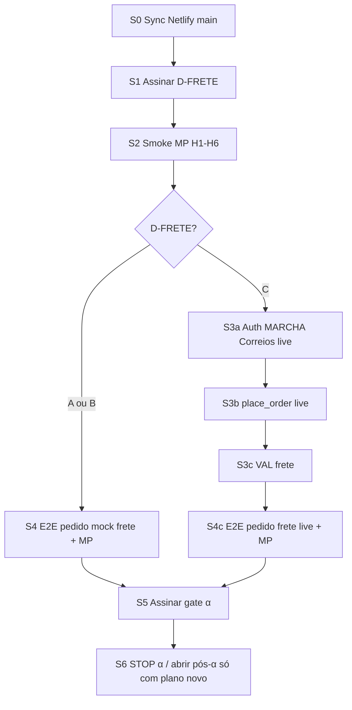

# FAL 3.0 — Plano soberano de finalização (Fase α)

**Data:** 2026-10-10  
**Tipo:** MARCHA SOBERANA DE PLANEJAMENTO (documento canônico)  
**Runtime:** `wtbpwuiayednvlhvuhbh`  
**Loja:** https://fal-pecas-automotivas.netlify.app  
**Estado do plano:** ATIVO — execução humana + MARCHAs técnicas gated  

Este documento **fecha o planejamento** da Fase α com ordem, critérios, evidências e STOP.  
Não autoriza secrets, repair B3, Bloco F, PDP-ML nem IMP-14/15 profundos.

---

## 0. Definições

| Termo | Significado |
|-------|-------------|
| **Fase α** | Primeira operação comercial **controlada** (aceite eFe no gate α) |
| **Projeto completo PRD** | F1→F13 / escala — **fora** do fechamento α |
| **VALIDADO agente** | Código + VAL/unit/smoke documentado |
| **ACEITE comercial** | Assinatura eFe + evidências humanas (MP/frete/E2E) |
| **STOP agente** | Sem próxima MARCHA técnica sem auth/decisão |

**Fontes oficiais cruzadas**

| Doc | Papel |
|------|--------|
| [Molde](./FAL_STATUS_CONSOLIDADO_MOLDE_2026-10-09.md) | Matriz de estados |
| [Gate α](./FAL_ALPHA_GATE_2026-10-10.md) | Aceite operação controlada |
| [D-FRETE](./FAL_D_FRETE_DECISAO_2026-10-10.md) | Política frete |
| [Plano frete](./FAL_PLANO_FRETE_FINALIZACAO_2026-10-10.md) | E1–E10 frete |
| [Auditoria frete A–J](./FAL_AUDITORIA_FRETE_COTACAO_ENTREGA_2026-10-10.md) | Evidências frete |
| [MP prep](./FAL_MP_SMOKE_PREP_2026-10-09.md) / [MP status](./FAL_MP_SMOKE_STATUS_2026-10-10.md) | Smoke pagamento |
| [E2E/prod](./FAL_E2E_PRODUCAO_STATUS_2026-10-10.md) | Compra + Netlify |
| [HOLD P2](./FAL_P2_HOLD_RECONFIRMACAO_2026-10-10.md) | Fora de α |
| ROADMAP / PRD | Escopo longo pós-α |

---

## 1. Veredito — onde estamos

```text
████████████████████████░░░░  ~80% caminho α (código/docs)
████░░░░░░░░░░░░░░░░░░░░░░░░  ~20% aceite comercial (humano)
```

| Camada | Situação |
|--------|----------|
| Dados / catálogo / admin | **Pronta** para operação controlada |
| Loja (browse → carrinho → checkout código) | **Pronta** (E2E-pré até login) |
| Pagamento MP | Código **pronto**; smoke **pendente humano** |
| Frete | UI sandbox **pronta**; live **gated** D-FRETE C |
| Deploy Netlify ↔ `main` | **Risco ops** — bundle às vezes atrasado vs git |
| Aceite gate α | **Pendente** assinatura eFe |

**Conclusão:** a α não falta “mais uma feature grande” do agente; falta **gate humano + evidência de compra + política frete (+ sync deploy)**.

---

## 2. Inventário do que já está FEITO (não reabrir)

| # | Entrega | Evidência | Estado |
|---|---------|-----------|--------|
| F01 | Onda 0–1 / schema-first | STATUS_ONDA1 | ENCERRADO |
| F02 | FIND-004 M1–M5 apps PVC | VALs M1–M5 | ENCERRADO |
| F03 | UI apps/anos + PDP A–D | VALs | VALIDADO |
| F04 | Card UX + carrinho smoke | VAL card | VALIDADO |
| F05 | Admin Cat→Grupo→Sub | VAL classif. | VALIDADO |
| F06 | Admin Aplicações | VAL apps | VALIDADO |
| F07 | Admin Preços UX `%` | VAL preços | VALIDADO |
| F08 | F9-F meios MP no place_order | VAL F9-F | IMPLEMENTADO |
| F09 | E2E pré-pagamento | VAL E2E-pré | VALIDADO |
| F10 | Frete auditoria A–J + plano | docs frete | VALIDADO |
| F11 | Frete registry/envelope/edge esqueleto/MCP | VAL estrutura | VALIDADO |
| F12 | Frete UI PDP/carrinho/checkout sandbox | VAL + PRs #29–#31 | VALIDADO |
| F13 | Carrinho → PDP (links) | PRs #33–#35 | IMPLEMENTADO (git) |

**Regra:** regressão só com finding novo + MARCHA nomeada.

---

## 3. Critérios de fechamento da Fase α (checklist mestre)

Marcar **PASS** só com evidência. Gate α só fecha com todos os **obrigatórios** PASS ou **ACEITE DE RISCO** explícito.

### 3.1 Obrigatórios

| ID | Critério | Responsável | Evidência | Status |
|----|----------|-------------|-----------|--------|
| α-OPS-1 | Netlify publicando `main` atual (bundle ≠ stale) | eFe / Netlify | Deploy log + hash asset / “Ver produto” no carrinho | **FAIL ops** (2026-10-10: bundle antigo) |
| α-MP-1 | H1–H6 preenchidos | eFe | [MP prep](./FAL_MP_SMOKE_PREP_2026-10-09.md) | PENDENTE |
| α-MP-H5 | Checkout **não** em «Pagamento (simulado)» | eFe | Local **PASS**; Netlify **PENDENTE deploy** — [MP status](./FAL_MP_SMOKE_STATUS_2026-10-10.md) | Parcial |
| α-MP-2 | Pix sandbox PASS (ou BLOQUEADO documentado) | eFe | MP status | PENDENTE (bloqueado por H5) |
| α-MP-3 | Cartão sandbox PASS (ou BLOQUEADO documentado) | eFe | MP status | PENDENTE (bloqueado por H5) |
| α-MP-4 | Webhook: PASS ou NÃO TESTÁVEL (secret) explícito | eFe | MP status | PENDENTE |
| α-FR-1 | D-FRETE assinado A **ou** B **ou** C | eFe | [ficha](./FAL_D_FRETE_DECISAO_2026-10-10.md) | PENDENTE |
| α-FR-2 | Mensagem ao cliente + expedição preenchidas | eFe | ficha D-FRETE | PENDENTE |
| α-E2E-1 | 1 pedido teste com pagamento sandbox + evidências | eFe | prints/Network/order id | PENDENTE |
| α-E2E-2 | Frete no pedido coerente com política assinada | eFe | order.shipping_* / UI | PENDENTE |
| α-GATE-1 | Assinatura “Operação controlada OK” | eFe | [gate α](./FAL_ALPHA_GATE_2026-10-10.md) | PENDENTE |

### 3.2 Condicionais (só se D-FRETE = C)

| ID | Critério | Responsável | Status |
|----|----------|-------------|--------|
| α-FR-C1 | Secrets `CORREIOS_*` no Edge (humano) | eFe | N/A até C |
| α-FR-C2 | MARCHA HTTP Correios + testes | Agente (auth) | NÃO INICIADO |
| α-FR-C3 | `place_order` além de `mock:*` | Agente (auth) | NÃO INICIADO |
| α-FR-C4 | VAL frete PDP→pedido live | Agente+eFe | NÃO INICIADO |
| α-FR-C5 | MCP Correios local com credenciais | eFe | PENDENTE setup |

### 3.3 Se D-FRETE = A ou B (atalho α)

| ID | Critério | Nota |
|----|----------|------|
| α-FR-AB1 | UI mantém disclaimer; sem apresentar mock como frete real | Já no código |
| α-FR-AB2 | Produção `VITE_SHIPPING_PROVIDER=mock` (ou default) | Confirmar Netlify H5-análogo frete |
| α-FR-AB3 | Pedido E2E usa opção `mock:*` aceita pelo RPC | Obrigatório |

---

## 4. Sequência soberana de execução (ordem fixa)



### S0 — Sync deploy (ops, imediato)

| Passo | Ação | Done when |
|-------|------|-----------|
| S0.1 | Netlify → Trigger deploy da `main` (ou religar Git) | Novo `index-*.js` |
| S0.2 | Hard refresh `/carrinho` | Link **Ver produto** visível |
| S0.3 | Confirmar catálogo + wtbp | Network `wtbpwuiayednvlhvuhbh` |
| S0.4 | Registrar em E2E/prod status | Data + asset hash |

**Bloqueio relativo:** sem S0, smokes de UI em produção são inválidos (falso negativo).

### S1 — D-FRETE (eFe)

| Passo | Ação |
|-------|------|
| S1.1 | Escolher A / B / C na ficha |
| S1.2 | Preencher mensagem ao cliente + expedição |
| S1.3 | Se C: escrever “Próxima MARCHA: HTTP Correios + place_order” e autorizar |
| S1.4 | Assinar + data |

**Recomendação α documentada (não assina pelo agente):** A ou B para 1ª operação; C se cotação real na PDP for requisito duro da α.

### S2 — Mercado Pago smoke (eFe)

Executar [FAL_MP_SMOKE_PREP](./FAL_MP_SMOKE_PREP_2026-10-09.md) na ordem H1→H6, depois Pix e cartão.  
Registrar template no [FAL_MP_SMOKE_STATUS](./FAL_MP_SMOKE_STATUS_2026-10-10.md).

**Bloqueio atual (FATO 10/10):** produção mostra **Pagamento (simulado)** → H5 incompleto.  
Antes do smoke Pix/cartão: Netlify `VITE_PAYMENT_PROVIDER=mercadopago` + `VITE_MP_PUBLIC_KEY` (TEST) + **Trigger deploy**.  
Critério visual: título vira **«Pagamento — Mercado Pago»**.

| Paralelo | Permitido? |
|----------|------------|
| S1 ∥ S2 | **Sim** |
| S3a (Correios) antes de S1=C | **Não** |
| Agente secrets MP / vars Netlify | **Não** |

### S3 — Bifurcação frete

**A/B:** pular S3a–S3c; ir a S4 com mock.  
**C:** autorizar MARCHA técnica (escopo fechado abaixo).

#### Escopo MARCHA técnica se C (auth explícita)

Nome sugerido: `MARCHA_CORREIOS_LIVE_PLACE_ORDER`

| Fatia | Entrega | Aceite |
|-------|----------|--------|
| C.1 | HTTP na edge `quote-shipping` | Cotação real com secrets; 4xx/501 honestos |
| C.2 | Sem inventar peso/dims | `missing_logistics` se ausente |
| C.3 | RPC `place_order` opções live | Servidor valida valor; não confia FE |
| C.4 | Produção env alinhado | Provider correios live só após VAL |
| C.5 | VAL frete separado do MP | Doc VAL + evidências |
| C.6 | Unit/integração | Suite verde + smoke UI |

**Fora desta MARCHA:** Frenet live, carriers, PDP-ML, B3, Bloco F.

### S4 — E2E pedido pago (eFe)

| Passo | Esperado |
|-------|----------|
| Login cliente teste | OK |
| Catálogo → PDP → carrinho → checkout | OK |
| Frete conforme S1 | mock:* (A/B) ou live (C) |
| Pagamento Pix ou cartão sandbox | Approve / pending documentado |
| Pedido visível conta/admin | IDs + valores |
| Evidências anexadas | prints / Network (sem secrets) |
| Atualizar [E2E status](./FAL_E2E_PRODUCAO_STATUS_2026-10-10.md) | PASS parcial/total |

### S5 — Gate α (eFe)

Preencher bloco de aceite em [FAL_ALPHA_GATE](./FAL_ALPHA_GATE_2026-10-10.md):

```text
Operação controlada OK: SIM / NÃO / ACEITE DE RISCO
Data:
Assinatura:
Ressalvas (MP/frete/E2E):
```

### S6 — STOP α

Após S5=SIM (ou ACEITE DE RISCO documentado):

- Agente **não** abre F11 / PDP-ML / B3 / Bloco F / IMP-14 sem novo plano + auth.  
- Pós-α vira plano separado (§6).

---

## 5. Matriz RACI (α)

| Atividade | eFe | Agente | Netlify/Supabase |
|-----------|-----|--------|------------------|
| Deploy sync | A | C (detectar stale) | R |
| Secrets MP / Correios | A/R | — | C |
| Assinar D-FRETE | A/R | C (ficha) | — |
| Smoke MP | A/R | C (prep docs) | C |
| Código frete live | A (auth) | R | C |
| E2E pedido | A/R | C (VAL docs) | — |
| Gate α | A/R | C | — |

R=executa · A=aprova · C=consulta · —=fora

---

## 6. Fora da α (backlog pós-fechamento)

Só após S5. Cada item exige MARCHA + auth própria.

| ID | Item | Pri | Dependência |
|----|------|-----|-------------|
| Pα-01 | IMP-15 frete produção plena / multi-carrier | P1 | D-FRETE C + VAL |
| Pα-02 | IMP-14 pedidos/estoque profundos | P1 | Schema gap concreto |
| Pα-03 | Remover simulação enganosa se ainda residual | P1 | MP smoke PASS |
| Pα-04 | Fotos Storage em escala | P2 | Ops |
| Pα-05 | Bloco F RLS | P2 | Auth |
| Pα-06 | B3 migration repair | P2 | Auth explícita HOLD |
| Pα-07 | PDP estilo ML | P2 | Escopo dedicado |
| Pα-08 | Dashboard/relatórios F11+ | P3 | Roadmap |
| Pα-09 | Smoke staff admin (classif/apps/preços) | P2 | Humano |
| Pα-10 | Domínio custom / SSL / backups F10 ops | P2 | Infra eFe |

---

## 7. Riscos e mitigações (α)

| Risco | Impacto | Mitigação |
|-------|---------|-----------|
| Netlify stale | UI “quebrada” falsa | S0 obrigatório antes de smoke UI |
| MP sem webhook | Approve manual/parcial | Documentar NÃO TESTÁVEL; não fingir PASS |
| D-FRETE C sem secrets | MARCHA travada | Não iniciar C.1 sem CORREIOS_* |
| Env correios + place_order mock | Checkout quebra | Guard `placeOrderReady` + prod em mock até C.3 |
| Aceite α sem E2E | Risco comercial | Gate exige α-E2E-1 ou ACEITE DE RISCO explícito |
| Escopo creep F11 | Atraso α | §6 só pós S5 |

---

## 8. Definição de pronto do **plano** (esta marcha soberana)

- [x] Documento único com sequência S0–S6  
- [x] Checklist α obrigatório + condicional C  
- [x] Bifurcação A/B vs C explícita  
- [x] Escopo MARCHA Correios live delimitado  
- [x] Pós-α listado e separado  
- [x] RACI + riscos  
- [x] Links para docs canônicos  
- [x] Sync molde + gate α apontando este plano  

**Esta marcha NÃO implementa** HTTP Correios, secrets, E2E pago nem assinaturas.

---

## 9. Encerramento / STOP

1. **Planejamento α finalizado** neste arquivo.  
2. **Próxima ação humana imediata:** S0 (deploy) + S1 (D-FRETE) ∥ S2 (MP).  
3. **Próxima MARCHA agente de código:** somente após S1=C + auth, ou bugs/regressões com evidência.  
4. **STOP agente** para features α novas sem gate.

```text
PLANO SOBERANO α: FECHADO COMO DOCUMENTO
EXECUÇÃO α: ABERTA (humano)
```
