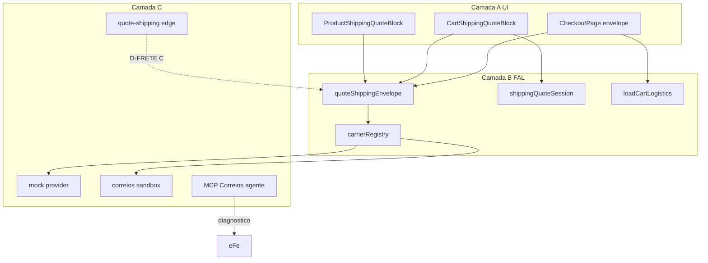

# FAL 3.0 — Plano completo de frete na finalização comercial

**Data:** 2026-10-10  
**Runtime:** `wtbpwuiayednvlhvuhbh`  
**Status do plano:** ATIVO — estrutura/UI sandbox **feita**; live **gated**  
**Relatório A–J:** [FAL_AUDITORIA_FRETE_COTACAO_ENTREGA_2026-10-10.md](./FAL_AUDITORIA_FRETE_COTACAO_ENTREGA_2026-10-10.md)  
**VAL estrutura:** [FAL_MARCHA_FRETE_ESTRUTURA_CARRIERS_VAL_2026-10-10.md](./FAL_MARCHA_FRETE_ESTRUTURA_CARRIERS_VAL_2026-10-10.md)  
**MCP:** [FAL_CORREIOS_MCP_SETUP_2026-10-10.md](./FAL_CORREIOS_MCP_SETUP_2026-10-10.md)  
**Decisão:** [FAL_D_FRETE_DECISAO_2026-10-10.md](./FAL_D_FRETE_DECISAO_2026-10-10.md)  
**Gate α:** [FAL_ALPHA_GATE_2026-10-10.md](./FAL_ALPHA_GATE_2026-10-10.md)  
**Molde:** [FAL_STATUS_CONSOLIDADO_MOLDE_2026-10-09.md](./FAL_STATUS_CONSOLIDADO_MOLDE_2026-10-09.md)  
**Plano soberano α (mestre):** [FAL_PLANO_FINALIZACAO_ALPHA_SOBERANO_2026-10-10.md](./FAL_PLANO_FINALIZACAO_ALPHA_SOBERANO_2026-10-10.md)

---

## 1. Objetivo

Incorporar frete à experiência comercial **PDP → carrinho → checkout → pedido → entrega**, com Correios como integração inicial a avaliar e arquitetura plugável para transportadoras futuras — **sem** abandonar MP smoke, E2E pago nem gate α.

---

## 2. Arquitetura (3 camadas)

| Camada | Papel | Estado |
|--------|-------|--------|
| A — Experiência | PDP / carrinho / checkout (CEP, opções, totais, erros) | **Implementada** (sandbox/mock) |
| B — Serviço cotação FAL | Envelope, fingerprint, disclaimer, registry | **Implementada** |
| C — Provedores | mock live-no-pedido; correios/frenet sandbox; edge esqueleto; MCP agente | **Parcial** (HTTP live pendente) |

---

## 3. Etapas e status

| Etapa | Descrição | Status | Auth |
|-------|-----------|--------|------|
| E1 | Auditoria A–J | **FEITA** | — |
| E2 | Sync molde / D-FRETE / gate α | **FEITA** | — |
| E3 | Registry + envelope + edge esqueleto + MCP | **FEITA** | — |
| E4 | UI PDP + carrinho + checkout + handoff + logística | **FEITA** | — |
| E5 | Decisão D-FRETE A/B/C | **PENDENTE eFe** | Humano |
| E6 | Smoke MP H1–H6 | **PENDENTE** | Humano |
| E7 | HTTP Correios na edge + secrets | **NÃO INICIADO** | Auth pós-C |
| E8 | `place_order` além de mock | **NÃO INICIADO** | Auth pós-E7 |
| E9 | VAL frete integrado (PDP→pedido) | **NÃO INICIADO** | Pós-E7/E8 |
| E10 | E2E pago + gate α | **PENDENTE** | Humano + evidências |

---

## 4. Critérios de aceite por etapa crítica

### E4 (feita) — UI sandbox
- [x] PDP: CEP, consultar, opções ou erro, disclaimer  
- [x] Carrinho: cotação do conjunto; invalida mudança itens/qty  
- [x] Checkout: envelope; guard se `!placeOrderReady`  
- [x] Unit shipping ≥ 17 verdes  

### E5 — D-FRETE
- [ ] Opção A/B/C assinada na ficha  
- [ ] Mensagem ao cliente + expedição preenchidas  
- [ ] Se C: autorização explícita MARCHA HTTP  

### E7–E8 — Live (futuro)
- [ ] Edge `quote-shipping` HTTP Correios com secrets  
- [ ] Sem inventar peso/dims  
- [ ] RPC aceita opções live validadas no servidor  
- [ ] Produção não usa amount do client como verdade  

### E9 — VAL frete
- [ ] Evidência PDP→carrinho→checkout→pedido com frete registrado  
- [ ] Documento VAL separado do smoke MP  

---

## 5. Encaixe na finalização α (não misturar)

| Frente | Relação |
|--------|---------|
| MP H1–H6 | Paralelo; não bloqueia docs frete |
| D-FRETE | Bloqueia live/secrets |
| E2E pago | Após MP + política frete |
| B3 / Bloco F / PDP-ML | HOLD — fora |
| Série residual agente (classif/apps/preços/E2E-pré) | Encerrada; não reabrir |

---

## 6. STOP / regras

- Sem secrets MP/Correios pelo agente.  
- Sem tratar mock/sandbox como frete de produção.  
- Sem IMP-14/15 profundo / B3 / PDP-ML sem auth.  
- Próxima MARCHA técnica código live só com D-FRETE **C** + auth explícita.

---

## 7. Índice de documentos

| Doc | Função |
|-----|--------|
| Este plano | Ordem, status, aceite |
| Auditoria A–J | Evidências e riscos |
| VAL estrutura | Escopo feito #29–#31 |
| D-FRETE | Assinatura comercial |
| MCP setup | Credenciais Cursor |
| Gate α / Molde | Aceite operação / matriz global |
