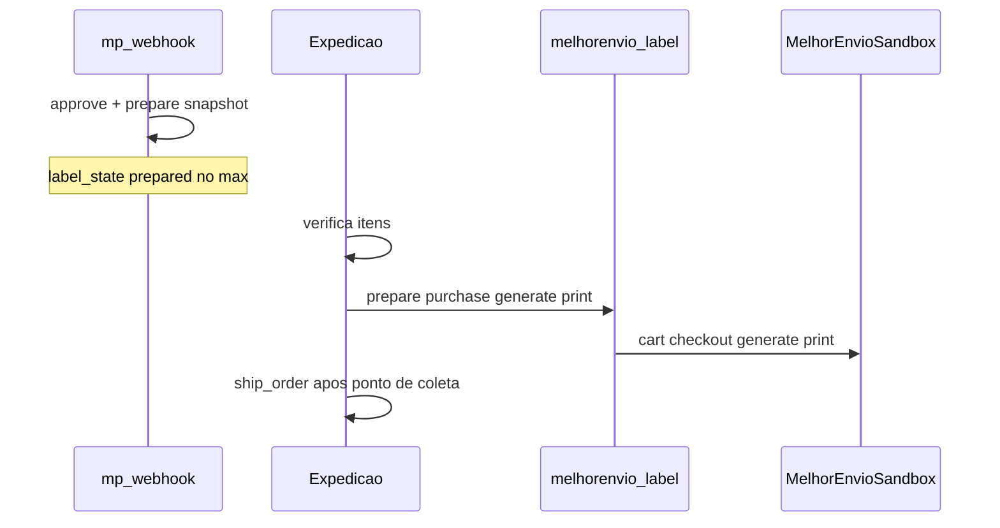

# Plano funcional — Logística e gestão de medidas (FAL)

**Data:** 2026-11-04 (revisão pós-auditoria ME)  
**Tipo:** planejamento canônico pós-α  
**Auditoria de consolidação:** [FAL_AUDITORIA_LOGISTICA_ME_CONSOLIDACAO_2026-11-04.md](./FAL_AUDITORIA_LOGISTICA_ME_CONSOLIDACAO_2026-11-04.md)  
**MARCHA ME híbrido (detalhe):** [FAL_MARCHA_ME_HIBRIDO_PLANEJAMENTO_2026-11-04.md](./FAL_MARCHA_ME_HIBRIDO_PLANEJAMENTO_2026-11-04.md)  
**D-FRETE vigente:** **B** assinada ([ficha](./FAL_D_FRETE_DECISAO_2026-10-10.md))  
**STOP α:** [FAL_STOP_ALPHA_FORMAL_2026-11-04.md](./FAL_STOP_ALPHA_FORMAL_2026-11-04.md)  
**Backlog cruzado:** [FAL_BACKLOG_POS_ALPHA_2026-11-04.md](./FAL_BACKLOG_POS_ALPHA_2026-11-04.md) · [próximos passos pós-#56](./FAL_MARCHA_PROXIMOS_PASSOS_POS_56_2026-11-04.md)

**Este MD não autoriza implementação sozinho.** Cada frente exige MARCHA nomeada + auth.

---

## 1. Objetivo e escopo

Configurar a logística da loja (origem, frete próprio, intermediador Melhor Envio, regras gerais) e a gestão de medidas no catálogo, preservando D-FRETE **B** (mock/sandbox com aviso) até nova assinatura **C**.

**Dentro:** Produtos/medidas · Hub Logística · Origem · Frete próprio · Config ME · Cotação loja híbrida (D12) · Prepare-on-approve · Critérios de aceite. Etiqueta manual = interface com plano Pedidos.

**Fora (plano Pedidos separado):** operação por pedido, contratação/etiqueta na Expedição, rastreio, entrega, cancelamentos. A Central já tem path ME na Expedição ([VAL](./FAL_MARCHA_CENTRAL_PEDIDOS_ME_SANDBOX_VAL_2026-11-04.md)) — Logística **configura**; Pedidos **opera**.

---

## 2. Organização das três áreas

| Área | Papel | Estado |
|------|--------|--------|
| Produtos/Catálogo | Medidas + origem Manual/Global + alteração global + filtros | **IMPLEMENTADO** (histórico/padrões categoria = GAP) |
| Logística | Hub: Origem, Frete próprio, Melhor Envio, Configurações | Hub/Origem/Frete próprio **IMPLEMENTADO**; ME/Config UI **GAP** |
| Pedidos | Análise → separação → Expedição (etiqueta ME) → `ship_order` → entrega | Central **PARCIAL** (VAL #56); fora do escopo ops deste plano |

---

## 3. Decisões aprovadas

| # | Decisão | Classificação |
|---|---------|---------------|
| D1 | Origem = cadastro próprio da Logística (não perfil empresa) | APROVADO |
| D2 | Evolui `store_shipping_origin` (não duplicar origem ME × próprio) | APROVADO · IMPLEMENTADO |
| D3 | Uma origem ativa inicial; schema preparado a multi-origem | APROVADO · PARCIAL (singleton) |
| D4 | Frete próprio FAL (SP capital) + Melhor Envio nacional (1 intermediador inicial) | APROVADO |
| D5 | Medidas novas vazias/zeradas; categoria **não** preenche auto | APROVADO · IMPLEMENTADO |
| D6 | Origem da medida por campo Manual × Global; bulk pergunta manuais | APROVADO · IMPLEMENTADO |
| D7 | Alterar padrão de categoria **não** altera produtos auto | APROVADO · GAP UI padrões |
| D8 | Produtos ≠ Logística ≠ Pedidos | APROVADO |
| D9 | D-FRETE **B**: cotação loja mock/sandbox + disclaimer; sem frete produção | APROVADO · ASSINADO |
| D10 | **Compra/geração/impressão** de etiqueta ME **não** no webhook MP — ação **manual** do operador na Expedição | APROVADO (VAL Central + eFe 04/11) |
| D11 | `ship_order` ≠ gerar etiqueta; `deliver_order` = cliente | APROVADO |
| D12 | **Híbrido eFe:** cotação ME/próprio na loja (preço/prazo reais sandbox); no approve MP só **preparar** snapshot (`metadata.me`, serviço, volumes, valor cobrado); operador verifica → emite/imprime → coleta | APROVADO (eFe 2026-11-04) — implementação = MARCHA |

### Propostas substituídas / rejeitadas

| Proposta | Destino | Motivo |
|----------|---------|--------|
| Edge que **compra/gera** etiqueta no webhook MP | **REJEITADA** | eFe: emissão manual; D10 |
| Prepare no approve (snapshot / opcional cart ME sem purchase) | **ADOTADA** via D12 | “Deixar no jeito” ≠ emitir |
| `shipments.status = ready` como sinal de etiqueta | **NÃO ADOTAR** como canônico | Preferir `metadata.me.label_state` |
| Secrets nomeados `MELHORENVIO_*` | **SUBSTITUÍDA** | Código usa `MELHOR_ENVIO_*` |

---

## 4. Fatos confirmados no código

| Item | Estado | Evidência |
|------|--------|-----------|
| Hub `/admin/logistica` 4 atalhos | IMPLEMENTADO | `AdminLogisticsHubPage` (ME/config “Em breve”) |
| Origem + remetente + ViaCEP | IMPLEMENTADO | `AdminShippingOriginPage` · migration `20261104130000_…` |
| Frete próprio + `own:*` em `resolve_mock_shipping_option` | IMPLEMENTADO | `20261104140000_…` · `enabled` default false em prod |
| Medidas `*_origin` + form + bulk | IMPLEMENTADO | VAL medidas · `adminProductService` |
| Alterações globais + filtros catálogo | IMPLEMENTADO | VAL alterações globais |
| Cotação PDP/carrinho/checkout envelope | IMPLEMENTADO | mock default; disclaimer B |
| Checkout usa `loadCartLogistics` | IMPLEMENTADO | `CheckoutPage` |
| Carrinho **não** carrega peso/dims na cotação | PARCIAL / GAP | `CartShippingQuoteBlock` só `productId`+`qty` |
| Edge `quote-shipping` | PARCIAL | Esqueleto Correios 501; sem ME |
| `carrierRegistry` | PARCIAL | mock/correios/frenet/carrier — **sem** `melhorenvio` |
| `place_order` frete | PARCIAL | `mock:*` + `own:*`; sem `meq:` |
| Edges `melhorenvio-label` / `melhorenvio-webhook` | PARCIAL | Deployed (doc pós-#56); dry-run / stub |
| Contrato `metadata.me.label_state` | IMPLEMENTADO (código) | `melhorEnvioCore` / `melhorEnvioLabelState` |
| Tabela `shipping_quotes` | GAP (só proposed) | `migrations/proposed/20261104190000_…` — **não aplicar** sem OK + fix RLS |
| RLS proposed `customers.user_id` | BUG documental | Schema: `profile_id` |

---

## 5. Gestão de medidas (Produtos)

**APROVADO / em grande parte IMPLEMENTADO.**

- Campos: `weight_kg`, `height_cm`, `width_cm`, `length_cm` + `*_origin` (`manual` \| `global`).  
- Cadastro inicia vazio; categoria não preenche.  
- Bulk/alteração global: skip vs overwrite de manuais.  
- **GAP:** histórico de alterações; padrões de categoria como referência editável; filtros logísticos peso/dims na listagem (se ainda incompletos — revalidar na MARCHA).  
- **PENDÊNCIA operacional (M6):** preencher medidas reais (~98/100 published sem peso no probe 04/11).

Analogia: `price_origin` nas listas de preço.

---

## 6. Hub Logística

Quatro atalhos (APROVADO):

1. Origem e expedição — **IMPLEMENTADO** (`ready: true`)  
2. Frete próprio FAL — **IMPLEMENTADO** (`ready: true`)  
3. Melhor Envio — UI config **GAP** (`ready: false`); operação de etiqueta fica em Pedidos/Expedição  
4. Configurações de envio — **GAP**

---

## 7. Origem e expedição

**IMPLEMENTADO** em `store_shipping_origin`: nome interno, remetente, CPF/CNPJ, telefone, endereço, ViaCEP, singleton ativo.

**Regras:**

- Fonte única para frete próprio e Melhor Envio (não duplicar cadastro).  
- Edge de etiqueta deve **ler** esta origem (hoje GAP: CEP hardcoded `01310100` em `melhorenvio-label`).  
- Remetente completo em secrets Edge = **PROPOSTA alternativa**; preferência auditoria: **DB origem** + token só em secret.  
- RLS: staff write; anon SELECT aplicado ([auditoria deploy](./FAL_AUDITORIA_DEPLOY_LOGISTICA_2026-11-04.md)) — rever antes de expor mais PII.

**PENDÊNCIA:** obrigatoriedade de todos os campos de remetente (default atual = obrigatórios exceto complemento).

---

## 8. Frete próprio FAL

**IMPLEMENTADO** config: faixas CEP, rates `own:*`, resolve no `place_order` alinhado.

- Cobertura alvo: SP capital.  
- Em produção: `enabled=false` (smoke 04/11).  
- **PENDÊNCIA:** critérios avançados de precificação; múltiplas modalidades além da tabela editável.  
- Sob D-FRETE B: se habilitado, continua disclaimer de homologação até C (decisão comercial).

---

## 9. Melhor Envio — modelo híbrido (D12) — APROVADO

Detalhamento executável: [FAL_MARCHA_ME_HIBRIDO_PLANEJAMENTO_2026-11-04.md](./FAL_MARCHA_ME_HIBRIDO_PLANEJAMENTO_2026-11-04.md).

### 9.1 Camadas

| Camada | Onde | Sob B? | Estado | Classificação |
|--------|------|--------|--------|---------------|
| A — Config Logística | `/admin/logistica/melhor-envio` | Sim | GAP UI | GAP |
| B — Cotação loja ME + own | PDP/carrinho/checkout | Sim (sandbox + disclaimer) | GAP | **APROVADO** D12.1 |
| B2 — `place_order` `meq:` | RPC | Sim | GAP | **APROVADO** |
| B3 — Prepare no approve | webhook MP | Sim | GAP | **APROVADO** D12.3 (só snapshot) |
| C — Etiqueta manual Expedição | `melhorenvio-label` | Sim | PARCIAL | **APROVADO** D12.4 |
| D — Produção / NF-e / auto-status | — | **C** | Fora | PENDÊNCIA assinatura |

### 9.2 Cotação loja (APROVADO — a implementar)

- Carrier `melhorenvio`, `quoteRuntime: edge`.
- `quote-shipping` → `POST /api/v2/me/shipment/calculate` (sandbox).
- `from` = `store_shipping_origin`; secrets `MELHOR_ENVIO_*`.
- `shipping_quotes` TTL 15 min; ids `meq:…`; preço só server-side.
- Modalidades concorrentes: `own:*` (se enabled + CEP) + ME.
- `CartShippingQuoteBlock` + `loadCartLogistics`.
- Default Netlify permanece mock até opt-in explícito; disclaimer B.

### 9.3 Pedido `meq:` (APROVADO — a implementar)

- Preservar `mock:*` e `own:*`.
- Consumo atômico: mesmo cliente, CEP, fingerprint, não expirada, não consumida.
- Snapshot frete em `shipments.metadata`.

### 9.4 Prepare no approve ≠ comprar etiqueta

| No webhook MP | Permitido? |
|---------------|------------|
| `confirm_mercadopago_payment` | Sim |
| Gravar `metadata.me` com `label_state: prepared` + service/volumes/valor | Sim |
| POST cart / checkout / generate / print ME | **Não** |
| Falha do prepare reverter pagamento | **Não** |

### 9.5 Expedição manual (APROVADO / PARCIAL no código)

- Só `pronto_para_envio` | `preparando_envio`.
- `purchase` exige `confirm:true` + check divergência.
- Completar HTTP cart + origem DB (hoje dry-run / CEP hardcoded).

### 9.6 Migration proposed

- Corrigir RLS `profile_id` → apply só com OK eFe.
- Ver §8 do planejamento híbrido.

## 10. Segurança, secrets e RLS

| Item | Regra |
|------|--------|
| Token ME | Só Edge secrets `MELHOR_ENVIO_*` — nunca `VITE_` |
| User-Agent | Obrigatório (nome app + e-mail) |
| Remetente | Preferir `store_shipping_origin`; não versionar documento/telefone no repo |
| Cotação | Preço só server-side se path `meq:` |
| Webhook MP | Não acoplar compra de etiqueta |
| Apply SQL | Sem `db push` cego (drift conhecido); `db query --remote` / OK explícito |

---

## 11. Configurações gerais de envio

**GAP / PENDÊNCIAS:** bloqueio cotação sem medidas; composição volumes; quais carriers exibir; timeouts; tolerância divergência (hoje 0,01 no código).

---

## 12. Experiência do frete na loja

| Superfície | Estado |
|------------|--------|
| PDP cotação | IMPLEMENTADO (provider ativo) |
| Carrinho | PARCIAL — sem `loadCartLogistics` |
| Checkout | IMPLEMENTADO logistics + disclaimer B |
| Handoff CEP sessão | IMPLEMENTADO `shippingQuoteSession` |
| Default provider | mock |

---

## 13. Relação com Fase α e D-FRETE

| Atividade | Autorização |
|-----------|-------------|
| Estrutura Logística / medidas / dry-run ME Expedição | Permitida sob B (já feita em parte) |
| Secrets + HTTP sandbox + cotação loja ME (disclaimer B) | Autorizada D12; MARCHA + auth; **não** exige C |
| Prepare snapshot no approve | Autorizada D12; sem purchase |
| Default Netlify = ME produção / token prod / NF-e / auto-status | Exige **C** + MARCHAs |

Nenhuma opção A/B/C nova é presumida. Vigente = **B**.

---

## 14. Sequência de desenvolvimento (ajustada)

Justificativa das mudanças vs sequência original: itens 1–4 já VALidados; ME etiqueta já começou em Pedidos (#56); cotação loja ME fica **depois** de dados + secrets + decisão.

1. ~~Gestão de medidas~~ → **FEITO** (dados = M6)  
2. ~~Hub Logística~~ → **FEITO**  
3. ~~Origem e expedição~~ → **FEITO** (ligar ME à origem = follow-up)  
4. ~~Frete próprio config~~ → **FEITO** (preço avançado = PENDÊNCIA)  
5. **M6** — preencher medidas (bloqueante cotação real)  
6. **PR-1** — `loadCartLogistics` no carrinho  
7. **M-ME-SEC** — secrets + migration `shipping_quotes` (RLS fix)  
8. **PR-2** — cotação ME loja + `meq:` + own híbrido  
9. **PR-3** — prepare-on-approve (metadata only)  
10. **PR-4** — label HTTP manual Expedição + origem DB  
11. UI hub Melhor Envio + Configurações  
12. VAL E2E + eventual D-FRETE **C**  

Detalhe PRs: [planejamento híbrido §9](./FAL_MARCHA_ME_HIBRIDO_PLANEJAMENTO_2026-11-04.md).

### Subetapas Melhor Envio (híbrido)

1. Cart logistics — GAP  
2. Cotação sandbox loja + `shipping_quotes` — GAP (APROVADO)  
3. `meq:` no `place_order` — GAP (APROVADO)  
4. Prepare no approve — GAP (APROVADO)  
5. Etiqueta manual Expedição — PARCIAL  
6. Testes / VAL — PENDÊNCIA  
7. Gate produção — D-FRETE C  

---

## 15. Critérios de aceite

### Híbrido sandbox (D12) — antes do VAL

- [ ] PDP/carrinho/checkout: preço/prazo coerentes aos itens (`loadCartLogistics`)  
- [ ] Modalidades `own:*` + `meq:*` (e mock se provider mock)  
- [ ] `place_order` server-side (`meq`/`own`/`mock`)  
- [ ] Approve: `prepared` no máximo; sem purchase/generate/print  
- [ ] Operador emite/imprime na Expedição; `ship_order` pós coleta  
- [ ] Origem DB; secrets só Edge; disclaimer B  

### Pré D-FRETE C / produção

- [ ] Medidas nos SKUs vendáveis  
- [ ] Secrets produção separados  
- [ ] Disclaimer B removido só com assinatura C  
- [ ] VAL + smoke E2E  

---

## 16. Gaps técnicos (lista curta)

1. Carrier + Edge cotação ME loja + híbrido own  
2. `shipping_quotes` + fix RLS + consumo atômico  
3. Carrinho sem logistics  
4. Prepare-on-approve  
5. Label HTTP cart real + `postal_code` + origem DB  
6. UI Logística ME / Configurações  
7. Histórico medidas / padrões categoria  
8. Dados de peso em massa (M6)  

---

## 17. Pendências explícitas

**Fechadas por eFe (D12):** cotação loja sob B; prepare no approve; etiqueta manual; sem auto-purchase MP; origem DB.

**Ainda abertas:** apply migration (P-ME-1); timing secrets vs M6 (P-ME-2); filtro serviços ME (P-ME-3); cart ME no approve vs só na Expedição — recomendação v1 = só Expedição (P-ME-4); precificação frete próprio (P-ME-5).

---

## Histórico deste documento

| Data | Evento |
|------|--------|
| 2026-11-04 | Versão inicial pós-α (planejamento) |
| 2026-11-04 | Revisão auditoria ME: estado código, rejeição fulfill-MP |
| 2026-11-04 | D12 híbrido + planejamento MARCHA detalhado |

**Assinatura agente:** plano funcional logística/medidas — D12 híbrido detalhado 2026-11-04 (docs only).
