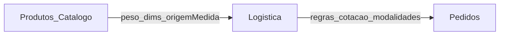

# Plano funcional — Logística e gestão de medidas (FAL)

**Data:** 2026-11-04  
**Tipo:** planejamento canônico pós-α (sem implementação de código neste doc)  
**Fonte de decisão:** plano Cursor `plano_logística_fal` + fechamento α  
**D-FRETE vigente:** **B** ([ficha](./FAL_D_FRETE_DECISAO_2026-10-10.md)) — sandbox/mock até nova assinatura C  
**STOP α:** [FAL_STOP_ALPHA_FORMAL_2026-11-04.md](./FAL_STOP_ALPHA_FORMAL_2026-11-04.md)

---

## 0. Separação de responsabilidades

| Área | Papel |
|------|--------|
| Produtos/Catálogo | Características logísticas do item + alteração global + filtros |
| Logística | Hub: Origem, Frete próprio, Melhor Envio, Configurações |
| Pedidos | Operação (contratação, etiqueta, rastreio, entrega própria) — **planejar depois** |

**Pedidos fora de escopo** deste plano de configuração: Logística configura; Pedidos opera.

---

## 1. Decisões aprovadas

| # | Decisão |
|---|----------|
| D1 | Cadastro da **origem = próprio da logística** (não depende de perfil empresa) |
| D2 | Evolui `store_shipping_origin` + `/admin/frete` existentes |
| D3 | Uma origem inicial; schema preparado para multi-origem futura |
| D4 | Frete próprio FAL (SP capital) + Melhor Envio nacional (híbrido; 1 intermediador) |
| D5 | Medidas de produto novos começam **zeradas**; categoria **não** preenche automaticamente |
| D6 | Origem da medida **por campo**: Manual × Global; bulk global pergunta como tratar manuais |
| D7 | Atualizar padrão de categoria **não** altera produtos automaticamente |
| D8 | Produtos ≠ Logística ≠ Pedidos |

---

## 2. Estado do código (FATO)

| Item | Estado |
|------|--------|
| `products.weight_kg` + dims | Existe; form em AdminProductForm |
| Origem por campo / bulk global | **Feito** (VAL medidas + DDL wtbp) |
| Alterações globais + filtros Categoria/Grupo/Subgrupo/Situação | **Feito** [VAL](./FAL_MARCHA_PRODUTOS_ALTERACOES_GLOBAIS_VAL_2026-11-04.md) |
| Padrões categoria / filtros logísticos peso-dims / histórico medidas | **Gap** |
| `store_shipping_origin` + ViaCEP + remetente | **Feito** (`/admin/logistica/origem`; VAL 2026-11-04) |
| Hub Logística 4 atalhos | **Feito** (`/admin/logistica`; VAL 2026-11-04) |
| Frete próprio configurável | **Feito** (`/admin/logistica/frete-proprio` + rates; VAL 2026-11-04; ainda B) |
| Melhor Envio | **Ausente** |
| Cotação PDP/checkout sandbox | Existe; carrinho ainda não carrega logistics completo |
| Edge `quote-shipping` | Esqueleto |

Analogia: `price_origin` nas listas de preço → replicar Manual/Global nos 4 campos logísticos.

---

## 3. Módulo Origem e expedição (próximo a implementar após auth)

**Modelo alvo (evolução):**

- Manter `store_shipping_origin` como fonte da verdade  
- Campos: nome interno, nome remetente, CPF/CNPJ, telefone (+ endereço existente)  
- Singleton operacional (1 origem ativa); estrutura sem amarrar “só uma linha para sempre”  
- CEP via `lookupCep` / ViaCEP  
- Remetente compartilhado por Melhor Envio e frete próprio a partir deste cadastro  
- UI: sob hub Logística (`/admin/frete` vira atalho “Origem e expedição”)  

**Fora deste módulo:** contratação, etiqueta, rastreio, operação por pedido.

**Default proposto (1ª versão — PENDÊNCIA até confirmar na MARCHA de código):** campos de remetente **obrigatórios** exceto complemento.

---

## 4. Hub Logística + medidas em Produtos

### Hub (4 atalhos)

1. Origem e expedição  
2. Frete próprio  
3. Melhor Envio  
4. Configurações de envio  

### Produtos / medidas

- Origem por campo (Manual × Global)  
- Bulk / alteração global com pergunta sobre manuais  
- Filtros logísticos  
- Histórico de alteração de medidas  
- Padrões de categoria = **referência**, não apply automático  

---

## 5. Sequência de desenvolvimento (após auth)

1. Gestão de medidas em Produtos  
2. Hub Logística (4 atalhos)  
3. Origem e expedição (`store_shipping_origin` + UI)  
4. Frete próprio FAL (SP; tabela editável; critérios preço = PENDÊNCIA)  
5. Melhor Envio (conexão, credenciais, cotação ≠ contratação)  
6. Configurações de envio  
7. Experiência loja (PDP/carrinho/`loadCartLogistics`)  
8. Pedidos — **plano separado**  
9. Auditoria pré-liberação vs D-FRETE (e eventual C)

---

## 6. Pendências explícitas (não “aprovado”)

| Pendência |
|-----------|
| Dados obrigatórios mínimos do remetente (afrouxar default?) |
| Mais de uma tabela/modalidade de frete próprio |
| Critérios de precificação da entrega própria |
| Quais serviços Melhor Envio exibir |
| Regra exata de bloqueio para produtos sem medidas |
| Composição de volumes |
| Detalhe fino das configurações gerais |

---

## 7. Relação com α / D-FRETE

- α **encerrada** com política **B**.  
- Este plano é **pós-α estrutural**.  
- Melhor Envio / Correios live **não** entram sem MARCHA + secrets + (se mudar política) nova assinatura D-FRETE **C**.

---

## STOP deste doc

Somente planejamento. Nenhuma implementação autorizada por este MD sozinho.

**Assinatura agente:** plano funcional logística/medidas 2026-11-04.
