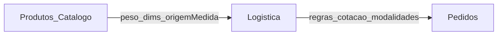
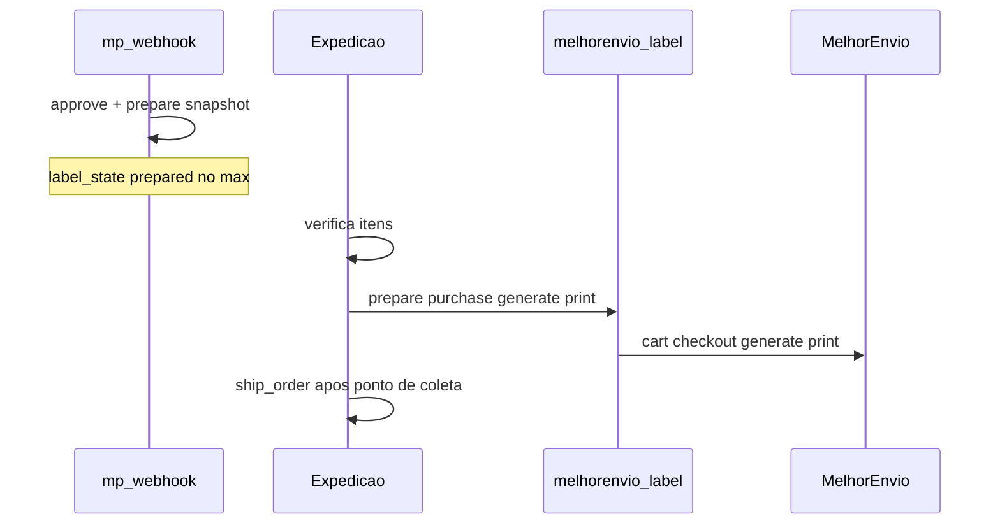

# Plano funcional — Logística e gestão de medidas (FAL)

**Data:** 2026-11-04 (revisão 2026-11-05 — frete próprio v2 + rebase ME)  
**Tipo:** planejamento canônico pós-α  
**Auditoria de consolidação:** [FAL_AUDITORIA_LOGISTICA_ME_CONSOLIDACAO_2026-11-04.md](./FAL_AUDITORIA_LOGISTICA_ME_CONSOLIDACAO_2026-11-04.md)  
**Frete próprio v2 (POL + distância + veículo):** [FAL_PLANEJAMENTO_FRETE_PROPRIO.md](./FAL_PLANEJAMENTO_FRETE_PROPRIO.md)  
**Correções Melhor Envio:** [FAL_PLANO_CORRECOES_MELHOR_ENVIO_2026-11-05.md](./FAL_PLANO_CORRECOES_MELHOR_ENVIO_2026-11-05.md)  
**MARCHA ME híbrido (detalhe):** [FAL_MARCHA_ME_HIBRIDO_PLANEJAMENTO_2026-11-04.md](./FAL_MARCHA_ME_HIBRIDO_PLANEJAMENTO_2026-11-04.md) · [VAL D12](./FAL_MARCHA_ME_HIBRIDO_VAL_2026-11-04.md)  
**D-FRETE vigente:** **B** assinada ([ficha](./FAL_D_FRETE_DECISAO_2026-10-10.md))  
**STOP α:** [FAL_STOP_ALPHA_FORMAL_2026-11-04.md](./FAL_STOP_ALPHA_FORMAL_2026-11-04.md)  
**Backlog cruzado:** [FAL_BACKLOG_POS_ALPHA_2026-11-04.md](./FAL_BACKLOG_POS_ALPHA_2026-11-04.md) · [próximos passos pós-#56](./FAL_MARCHA_PROXIMOS_PASSOS_POS_56_2026-11-04.md)

**Este MD não autoriza implementação sozinho.** Cada frente exige MARCHA nomeada + auth.

---

## 1. Objetivo e escopo

Configurar a logística da loja (origem, frete próprio, intermediador Melhor Envio, regras gerais) e a gestão de medidas no catálogo, preservando D-FRETE **B** (mock/sandbox com aviso) até nova assinatura **C**.

**Dentro:** Produtos/medidas · Hub Logística · Origem · Frete próprio · Config ME · Cotação loja híbrida (D12) · Prepare-on-approve · Critérios de aceite. Etiqueta manual = interface com plano Pedidos.

**Fora (plano Pedidos separado):** operação por pedido, contratação/etiqueta na Expedição, rastreio, entrega, cancelamentos. A Central já tem path ME na Expedição ([VAL](./FAL_MARCHA_CENTRAL_PEDIDOS_ME_SANDBOX_VAL_2026-11-04.md)) — Logística **configura**; Pedidos **opera**.

---

## 2. Organização das três áreas

| Área | Papel | Estado |
|------|--------|--------|
| Produtos/Catálogo | Medidas + origem Manual/Global + alteração global + filtros | **IMPLEMENTADO** (histórico/padrões categoria = GAP) |
| Logística | Hub: Origem, Frete próprio, Melhor Envio, Configurações | Hub/Origem/Frete próprio **IMPLEMENTADO**; ME/Config UI **GAP** |
| Pedidos | Análise → separação → Expedição (etiqueta ME) → `ship_order` → entrega | Central **PARCIAL** (VAL #56); fora do escopo ops deste plano |

---

## 3. Decisões aprovadas

| # | Decisão | Classificação |
|---|---------|---------------|
| D1 | Origem = cadastro próprio da Logística (não perfil empresa) | APROVADO |
| D2 | Evolui `store_shipping_origin` (não duplicar origem ME × próprio) | APROVADO · IMPLEMENTADO |
| D3 | Uma origem ativa inicial; schema preparado a multi-origem | APROVADO · PARCIAL (singleton) |
| D4 | Frete próprio FAL (SP capital) + Melhor Envio nacional (1 intermediador inicial) | APROVADO |
| D5 | Medidas novas vazias/zeradas; categoria **não** preenche auto | APROVADO · IMPLEMENTADO |
| D6 | Origem da medida por campo Manual × Global; bulk pergunta manuais | APROVADO · IMPLEMENTADO |
| D7 | Alterar padrão de categoria **não** altera produtos auto | APROVADO · GAP UI padrões |
| D8 | Produtos ≠ Logística ≠ Pedidos | APROVADO |
| D9 | D-FRETE **B**: cotação loja mock/sandbox + disclaimer; sem frete produção | APROVADO · ASSINADO |
| D10 | **Compra/geração/impressão** de etiqueta ME **não** no webhook MP — ação **manual** do operador na Expedição | APROVADO (VAL Central + eFe 04/11) |
| D11 | `ship_order` ≠ gerar etiqueta; `deliver_order` = cliente | APROVADO |
| D12 | **Híbrido eFe:** cotação ME/próprio na loja (preço/prazo reais sandbox); no approve MP só **preparar** snapshot (`metadata.me`, serviço, volumes, valor cobrado); operador verifica → emite/imprime → coleta | APROVADO (eFe 2026-11-04) · **código VAL** ([VAL D12](./FAL_MARCHA_ME_HIBRIDO_VAL_2026-11-04.md)) · default loja permanece mock |
| D13 | Frete próprio **v2** — contrato unificado POL + veículo + distância **ida** + tarifa por categoria; evoluir `/admin/logistica/frete-proprio` (sem hub paralelo) | APROVADO (eFe A–H 2026-11-05) · planejamento em [FAL_PLANEJAMENTO_FRETE_PROPRIO.md](./FAL_PLANEJAMENTO_FRETE_PROPRIO.md) · **não** implementado |
| D14 | Distância = só ida Routes (Google via Edge); número obrigatório; sem ida/volta nesta versão; sem adicionais extras v1 | APROVADO |
| D15 | Moto ≤ 12 POL inclusive; >12 → carro; restrições prevalecem; incompatível → análise manual; sem split automático | APROVADO |
| D16 | Contrato de cotação own **já prevê** `vehicle_category` + tarifa da categoria (proibido motor km com tarifa única descartável) | APROVADO |

### Frete próprio v2 — decisões A–H (resumo)

Detalhe completo: [FAL_PLANEJAMENTO_FRETE_PROPRIO.md](./FAL_PLANEJAMENTO_FRETE_PROPRIO.md).

| Bloco | Conteúdo | Status |
|-------|----------|--------|
| A | Km ida only · Routes Edge · número · max_distance | APROVADO |
| B | Tarifa por categoria (mín + R$/km + ativo); sem extras v1 | APROVADO · **fórmula piso = PROPOSTA** (validar eFe) |
| C | POL_TOTAL · moto 12 · manual se incompatível | APROVADO |
| D | Campos produto POL/porte/veículo/compat/restrições/own_allowed · bulk com confirmação | APROVADO |
| E | Admin frete-próprio em 6 blocos | APROVADO |
| F | Pipeline integrado; motores POL ⊥ distância ⊥ preço | APROVADO |
| G | Infra rota pode antecipar; contrato comercial unificado desde o dia 1 | APROVADO |
| H | Só docs nesta marcha | APROVADO |

### Propostas substituídas / rejeitadas

| Proposta | Destino | Motivo |
|----------|---------|--------|
| Edge que **compra/gera** etiqueta no webhook MP | **REJEITADA** | eFe: emissão manual; D10 |
| Prepare no approve (snapshot / opcional cart ME sem purchase) | **ADOTADA** via D12 | “Deixar no jeito” ≠ emitir |
| `shipments.status = ready` como sinal de etiqueta | **NÃO ADOTAR** como canônico | Preferir `metadata.me.label_state` |
| Secrets nomeados `MELHORENVIO_*` | **SUBSTITUÍDA** | Código usa `MELHOR_ENVIO_*` |

---

## 4. Fatos confirmados no código (rebase 2026-11-05)

| Item | Estado | Evidência |
|------|--------|-----------|
| Hub `/admin/logistica` 4 atalhos | IMPLEMENTADO | `AdminLogisticsHubPage` (ME/config “Em breve”) |
| Origem + remetente + ViaCEP | IMPLEMENTADO | `AdminShippingOriginPage` · wtbp + VAL ORIGEM |
| Frete próprio **v1** flat + `own:*` | IMPLEMENTADO | `store_own_delivery_settings` · `AdminOwnDeliveryPage` · `enabled=false` prod · [VAL](./FAL_MARCHA_LOGISTICA_FRETE_PROPRIO_VAL_2026-11-04.md) |
| Frete próprio **v2** (POL/veículo/km) | **IMPLEMENTADO** | Código `quote-own-delivery` + own/* · calibração operacional contínua · spec cotação [FAL_SPEC_COTACAO_CARRINHO_AGRUPADA_CAIXAS_POL_2026-11-13.md](./FAL_SPEC_COTACAO_CARRINHO_AGRUPADA_CAIXAS_POL_2026-11-13.md) |
| Medidas `*_origin` + form + bulk + M6 | IMPLEMENTADO | VAL medidas · VAL M6 (100 quote-ready) |
| Cotação PDP/carrinho/checkout envelope | IMPLEMENTADO | mock default; disclaimer B |
| Carrinho `loadCartLogistics` | **IMPLEMENTADO** | `CartShippingQuoteBlock` · VAL ME PR-1 |
| Checkout `loadCartLogistics` | IMPLEMENTADO | `CheckoutPage` |
| `carrierRegistry` entrada `melhorenvio` | **IMPLEMENTADO** | `placeOrderReady: true` · opt-in `VITE_SHIPPING_PROVIDER` |
| Edge `quote-shipping` path ME | **IMPLEMENTADO** | calculate + `shipping_quotes` · smoke calc PASS |
| `place_order` `meq:` + `own:*` + `mock:*` | **IMPLEMENTADO** | migration `20261104192000_me_hybrid_…` · wtbp |
| Prepare-on-approve (`prepared`, sem purchase) | **IMPLEMENTADO** | `mercado-pago-webhook` · D12 |
| Edges `melhorenvio-label` / webhook | PARCIAL | Label HTTP; E2E etiqueta humano pendente (M7) |
| UI hub Melhor Envio / Configurações | GAP | `ready: false` |
| Contrato `metadata.me.label_state` | IMPLEMENTADO | `melhorEnvioCore` / `melhorEnvioLabelState` |

**Nota:** trechos anteriores deste §4 (carrinho sem logistics / ME ausente / `meq:` GAP) ficam **obsoletos** após VAL D12 / PR #57. Preferir esta tabela + VALs.

---

## 5. Gestão de medidas (Produtos)

**APROVADO / em grande parte IMPLEMENTADO.**

- Campos: `weight_kg`, `height_cm`, `width_cm`, `length_cm` + `*_origin` (`manual` \| `global`).  
- Cadastro inicia vazio; categoria não preenche.  
- Bulk/alteração global: skip vs overwrite de manuais.  
- **GAP:** histórico de alterações; padrões de categoria como referência editável; filtros logísticos peso/dims na listagem (se ainda incompletos — revalidar na MARCHA).  
- **PENDÊNCIA operacional (M6):** preencher medidas reais (~98/100 published sem peso no probe 04/11).

Analogia: `price_origin` nas listas de preço.

---

## 6. Hub Logística

Quatro atalhos (APROVADO):

1. Origem e expedição — **IMPLEMENTADO** (`ready: true`)  
2. Frete próprio FAL — **IMPLEMENTADO** (`ready: true`)  
3. Melhor Envio — UI config **GAP** (`ready: false`); operação de etiqueta fica em Pedidos/Expedição  
4. Configurações de envio — **GAP**

---

## 7. Origem e expedição

**IMPLEMENTADO** em `store_shipping_origin`: nome interno, remetente, CPF/CNPJ, telefone, endereço, ViaCEP, singleton ativo.

**Regras:**

- Fonte única para frete próprio e Melhor Envio (não duplicar cadastro).  
- Edge de etiqueta deve **ler** esta origem (hoje GAP: CEP hardcoded `01310100` em `melhorenvio-label`).  
- Remetente completo em secrets Edge = **PROPOSTA alternativa**; preferência auditoria: **DB origem** + token só em secret.  
- RLS: staff write; anon SELECT aplicado ([auditoria deploy](./FAL_AUDITORIA_DEPLOY_LOGISTICA_2026-11-04.md)) — rever antes de expor mais PII.

**PENDÊNCIA:** obrigatoriedade de todos os campos de remetente (default atual = obrigatórios exceto complemento).

---

## 8. Frete próprio FAL

### 8.1 v1 — IMPLEMENTADO

Config: faixas CEP, rates `own:*` com **amount flat**, resolve no `place_order`.

- Cobertura alvo atual: SP capital (`01000000–05999999` default).  
- Produção: `enabled=false` (smoke 04/11).  
- Sob D-FRETE B: se habilitado, disclaimer de homologação até C.

### 8.2 v2 — IMPLEMENTADO (rebase 2026-11-13)

Contrato unificado: POL + seleção de veículo + km **ida** (Google Routes Edge) + tarifa **por categoria**.

- Edge `quote-own-delivery` + motores `ownPol` / `ownVehicleSelect` / `ownPricing`.  
- Admin `/admin/logistica/frete-proprio`.  
- Fórmula `frete = max(km × R$/km, tarifa_mínima) + adicional`.  
- Cotação agrupada no carrinho: [FAL_SPEC_COTACAO_CARRINHO_AGRUPADA_CAIXAS_POL_2026-11-13.md](./FAL_SPEC_COTACAO_CARRINHO_AGRUPADA_CAIXAS_POL_2026-11-13.md).  
- Planejamento histórico: [FAL_PLANEJAMENTO_FRETE_PROPRIO.md](./FAL_PLANEJAMENTO_FRETE_PROPRIO.md).

`pricing_mode: flat` (v1) permanece disponível até cutover comercial total.

---

## 9. Melhor Envio — modelo híbrido (D12) — APROVADO · código VAL

Detalhamento: [FAL_MARCHA_ME_HIBRIDO_PLANEJAMENTO_2026-11-04.md](./FAL_MARCHA_ME_HIBRIDO_PLANEJAMENTO_2026-11-04.md) · [VAL](./FAL_MARCHA_ME_HIBRIDO_VAL_2026-11-04.md) · [correções](./FAL_PLANO_CORRECOES_MELHOR_ENVIO_2026-11-05.md).

### 9.1 Camadas (estado 2026-11-05)

| Camada | Onde | Sob B? | Estado |
|--------|------|--------|--------|
| A — Config Logística | `/admin/logistica/melhor-envio` | Sim | GAP UI |
| B — Cotação loja ME + own | PDP/carrinho/checkout | Sim + disclaimer | **IMPLEMENTADO** (opt-in provider; default mock) |
| B2 — `place_order` `meq:` | RPC | Sim | **IMPLEMENTADO** |
| B3 — Prepare no approve | webhook MP | Sim | **IMPLEMENTADO** (`prepared` sem purchase) |
| C — Etiqueta manual Expedição | `melhorenvio-label` | Sim | PARCIAL — HTTP; E2E humano M7 pendente |
| D — Produção / NF-e / auto-status | — | **C** | Fora |

### 9.2 Cotação / pedido / prepare

- Carrier `melhorenvio` + Edge calculate + `shipping_quotes` TTL · ids `meq:…` · preço server-side.  
- Modalidades concorrentes: `own:*` (se enabled) + ME quando provider ME.  
- `loadCartLogistics` no carrinho e checkout.  
- Default Netlify = **mock** até opt-in; disclaimer B.  
- Approve: no máximo `prepared`; **nunca** purchase/generate/print no webhook MP.  
- Smoke calculate: PASS ([VAL](./FAL_MARCHA_ME_SMOKE_CALC_VAL_2026-11-04.md)).

### 9.3 Expedição manual

- Só em estados de expedição autorizados.  
- `purchase` exige `confirm:true` + check divergência.  
- Follow-up: smoke E2E etiqueta (M7).

## 10. Segurança, secrets e RLS

| Item | Regra |
|------|--------|
| Token ME | Só Edge secrets `MELHOR_ENVIO_*` — nunca `VITE_` |
| User-Agent | Obrigatório (nome app + e-mail) |
| Remetente | Preferir `store_shipping_origin`; não versionar documento/telefone no repo |
| Cotação | Preço só server-side se path `meq:` |
| Webhook MP | Não acoplar compra de etiqueta |
| Apply SQL | Sem `db push` cego (drift conhecido); `db query --remote` / OK explícito |

---

## 11. Configurações gerais de envio

**GAP / PENDÊNCIAS:** bloqueio cotação sem medidas; composição volumes; quais carriers exibir; timeouts; tolerância divergência (hoje 0,01 no código).

---

## 12. Experiência do frete na loja

| Superfície | Estado |
|------------|--------|
| PDP cotação | IMPLEMENTADO (provider ativo) |
| Carrinho | **IMPLEMENTADO** `loadCartLogistics` |
| Checkout | IMPLEMENTADO logistics + disclaimer B |
| Handoff CEP sessão | IMPLEMENTADO `shippingQuoteSession` |
| Default provider | mock |
| Own v2 (POL/km/número) | IMPLEMENTADO — ver spec cotação carrinho 13/11 |

---

## 13. Relação com Fase α e D-FRETE

| Atividade | Autorização |
|-----------|-------------|
| Estrutura Logística / medidas / dry-run ME Expedição | Permitida sob B (já feita em parte) |
| Secrets + HTTP sandbox + cotação loja ME (disclaimer B) | Autorizada D12; MARCHA + auth; **não** exige C |
| Prepare snapshot no approve | Autorizada D12; sem purchase |
| Default Netlify = ME produção / token prod / NF-e / auto-status | Exige **C** + MARCHAs |

Nenhuma opção A/B/C nova é presumida. Vigente = **B**.

---

## 14. Sequência de desenvolvimento (ajustada 2026-11-05)

1. ~~Gestão de medidas / Hub / Origem / Frete próprio v1~~ → **FEITO**  
2. ~~M6 / PR-1 cart / M-ME-SEC / PR-2–4 híbrido ME (código)~~ → **FEITO** (VALs)  
3. **M7** — smoke E2E etiqueta Expedição (humano)  
4. **UI hub ME + Configurações** + filtro serviços (P-ME-3)  
5. **Frete próprio v2** — MARCHAs conforme [FAL_PLANEJAMENTO_FRETE_PROPRIO.md](./FAL_PLANEJAMENTO_FRETE_PROPRIO.md) (contrato unificado → Routes → POL → pipeline → admin 6 blocos → place_order)  
6. Correções ME remanescentes: [FAL_PLANO_CORRECOES_MELHOR_ENVIO_2026-11-05.md](./FAL_PLANO_CORRECOES_MELHOR_ENVIO_2026-11-05.md)  
7. Eventual D-FRETE **C**  

### Subetapas Melhor Envio (híbrido) — pós VAL

1. Cart logistics — **FEITO**  
2. Cotação + `shipping_quotes` + `meq:` — **FEITO**  
3. Prepare no approve — **FEITO**  
4. Etiqueta Expedição — PARCIAL (falta M7 E2E)  
5. UI config Logística ME — GAP  
6. Gate produção — D-FRETE C  

---

## 15. Critérios de aceite

### Híbrido sandbox (D12)

- [x] Carrinho/checkout com logistics  
- [x] Path `meq:` + prepare sem purchase  
- [x] Secrets + smoke calculate  
- [ ] Smoke E2E etiqueta (M7)  
- [ ] Disclaimer B visível com provider ME opt-in  

### Frete próprio v2 (antes de MARCHA de código)

- [ ] eFe valida fórmula piso ([§6 do planejamento](./FAL_PLANEJAMENTO_FRETE_PROPRIO.md))  
- [ ] MARCHA nomeada + auth  
- [ ] Sem R$ hardcoded; admin configura tarifas  

### Pré D-FRETE C / produção

- [ ] Secrets produção separados  
- [ ] Disclaimer B removido só com assinatura C  
- [ ] VAL + smoke E2E  

---

## 16. Gaps técnicos (lista curta)

1. Frete próprio v2 (POL / veículo / Routes / tarifa por categoria)  
2. UI Logística ME / Configurações  
3. M7 E2E etiqueta  
4. Filtro `service_id` ME  
5. Histórico medidas / padrões categoria  
6. Drift: versionar no repo migrations own/origem só no wtbp  
7. Decisão `MELHOR_ENVIO_API_BASE` (prod vs sandbox) sob B  

---

## 17. Pendências explícitas

**Fechadas:** D12 híbrido (código); M6; cart logistics; etiqueta só na Expedição.

**Abertas (ME):** M7 E2E; UI config; P-ME-3 filtro serviços; P-ME-4 cart no approve (rec: só Expedição); API_BASE sob B.

**Abertas (frete próprio v2):** aceite fórmula piso; R$ tarifas; capacidade POL do carro; POL unitários/portes; perfil incompleto block vs manual; ETA; billing Google; D-FRETE C. Detalhe: [FAL_PLANEJAMENTO_FRETE_PROPRIO.md](./FAL_PLANEJAMENTO_FRETE_PROPRIO.md) §19.

---

## Histórico deste documento

| Data | Evento |
|------|--------|
| 2026-11-04 | Versão inicial pós-α (planejamento) |
| 2026-11-04 | Revisão auditoria ME: estado código, rejeição fulfill-MP |
| 2026-11-04 | D12 híbrido + planejamento MARCHA detalhado |
| 2026-11-05 | Rebase §4 FATO pós VAL D12; D13–D16 frete próprio v2 (A–H); links planejamento + correções ME |

**Assinatura agente:** plano funcional logística — rebase 2026-11-05 (docs only).
