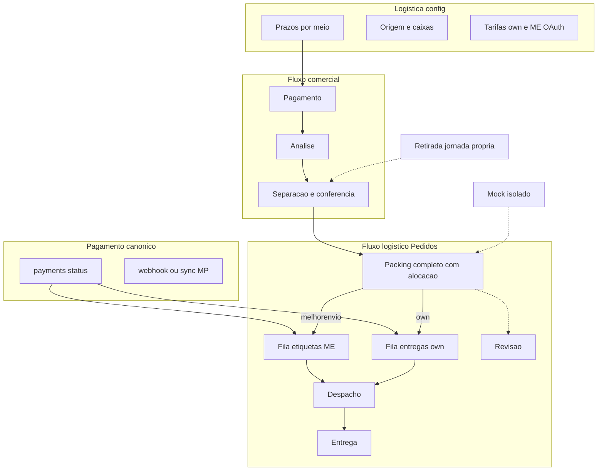
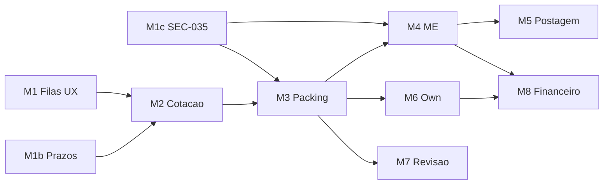

# Plano consolidado — Jornada Frete + Central Logística (Opção A híbrida)

**Versão:** V2.2.1 · Status de marcha + garantias de prazo (2026-11-12)  
**Base aprovada:** V2.2 (arquitetura A híbrida + prazos em Logística + integridade)  
**Modo de execução:** MARCHA SOBERANA — commits locais apenas; **sem** push/deploy/migrate remoto até ordem eFe.  
**Auth de referência:** decisões FAL + VALs Central Pedidos Gates 0–2 · Gate 3 bloqueado em ME-03.

---

## Changelog V2.1 → V2.2

| # | Ajuste | Impacto |
|---|--------|---------|
| 1 | Associação formal produtos↔volumes no packing completo | Marcha 3 + predicado |
| 2 | Fonte canônica de pagamento para ops irreversíveis | Marchas 4 e 6 |
| 3 | CP-SEC-035 elevado a **P0** + writes controlados | Nova Marcha 1c |
| 4 | Modelo de prazo completo (úteis/corridos, carrier, prep, buffer, exibido, snapshot) | Marcha 1b |
| 5 | Filas com próxima ação (não só “volumes”) | Marcha 1 |
| 6 | Semântica comprovada label_state ≠ postagem | Marchas 4–5 |
| 7 | Ciclo de vida completo da revisão/ocorrência | Marcha 7 |
| 8 | Liberação em 3 níveis (homologação / ops controlada / MVP) | Seção G |

**Não reaberto:** Opção A híbrida · sem segundo hub · sem dual-status EN · me ≠ own ≠ mock · estoque fora · detalhe único executor · prazos na Logística.

---

## Changelog V2.2 → V2.2.1 (análise + garantias de prazo)

| # | Ajuste | Evidência |
|---|--------|-----------|
| 1 | **Modelo de prazo simplificado e operacional:** `prazo_exibido = prazo_real_da_escolha + tempo_a_mais_FAL` | `shippingEtaPolicy.ts`, `LogisticsDeadlinePanel` |
| 2 | ME: prazo real = cotação transportadora (amostras na tela); FAL só edita **extra** | `/admin/logistica/melhor-envio` |
| 3 | Own: prazo real = base operacional (Gerais); FAL edita **base + extra** | `/admin/logistica/frete-proprio` |
| 4 | Anti-double-count: `extraDays` único; `prep/buffer` legado só migra, não soma de novo | parse + vitest |
| 5 | Edges `quote-shipping` / `quote-own-delivery` aplicam a mesma regra | commits locais |
| 6 | Status Marchas 1 / 1b / 1c / 2 = **código local concluído**; remoto pendente eFe | `main` ahead origin |
| 7 | Seção **I — Análise e garantias** (abaixo) | este doc |

### Decisão V2.1 (preservada) — Prazos na Logística

Controle dos prazos dos meios disponíveis = tela **Logística** (`/admin/logistica`). Pedidos só usam snapshot. Own: settings; ME: política FAL sobre carrier; Mock: sair do hardcode.

### Decisão V2.2 — Complementos de integridade

Detalhados nas seções D.2.1–D.9 e G abaixo.

### Decisão V2.2.1 — Controle real do prazo (operador)

Na Logística, o operador **vê** o prazo mínimo/máximo real da escolha e **só controla** o tempo a mais da FAL (ME) ou base+extra (Own). Cotação e checkout usam a mesma fórmula. Pedidos antigos **não** recalculam.

---

## A. Diagnóstico do plano original (V1) — preservado

Ver V2.1. Correções críticas mantidas: sem `own|mock` na fila própria; packing ≠ “tem volume”; fingerprint obrigatório; mock isolado.

**V2.2 acrescenta:** associação formal; pagamento canônico; SEC-035 P0; modelo de prazo; próximas ações; ciclo de revisão; 3 níveis de liberação.

---

## B. Mapa do sistema atual (evidência) — preservado

Ver V2.1 inventário. Destaques relevantes à V2.2:

| Tema | Evidência | Classificação |
|------|-----------|---------------|
| Packing | `admin_set_order_packing` — dims/peso; **sem** alocação produtos | Parcial |
| Pagamento → ops | `confirm_mercadopago_payment` (service_role) + status pedido; Edge label **não** lê `payments` | Parcial / gap |
| Shipments write | staff policy `shipments_staff_write` + RPCs/Edges | Risco SEC-035 |
| label_state | `melhorEnvioLabelState.ts` — none→printed; `canShipAfterLabel` separado | Existe; postagem = `ship_order`/`enviado` |
| Reviews | `own_manual_reviews` sem insert | Parcial |
| Prazos own | base `eta_days_*` + `own.extraDays` em Logística/Gerais + Edge | **Controle local OK** (migrate remoto pendente) |
| Prazos ME | `carrier_eta_*` preservado + `me.extraDays`; painel + Edge | **Controle local OK** |
| Prazos mock/pickup | política `store_shipping_eta_policy` (sem hardcode comercial) | **Local OK** |
| Pickup | `mock:pickup` / resolve mock — **não** é own | Isolar jornada ops se habilitado |

---

## C. Matriz de divergências (atualizada V2.2)

| Decisão | Atual | Correção | Prio |
|---------|-------|----------|------|
| Filas em Pedidos | Sem filas ME/Own | Marcha 1 | P0 |
| Packing completo + alocação | Sem produtos↔volumes | Marcha 3 | P0 |
| Pagamento canônico p/ etiqueta/despacho | Status pedido / sem ler payments na Edge | Marchas 4/6 | P0 |
| SEC-035 metadata | Staff UPDATE genérico | Marcha 1c | **P0** |
| Fingerprint place_order | Não revalida carrinho | Marcha 2 | P0 |
| Fila own ≠ mock | Storage OK; plano V1 errava | Manter regra V2.1 | P0 |
| Prazos modelo completo | **Local:** real+extra ME/Own; Edges alinhadas | Marcha 1b ✅ local · migrate/deploy eFe | P0 residual remoto |
| Próxima ação nas filas | Tabs genéricas | Marcha 1 | P0 |
| Label ≠ postagem | Código distingue; UX/gates reforçar | Marchas 4–5 | P0 |
| Reviews ciclo de vida | Tabela sem write/CRUD | Marcha 7 | P1 |
| Liberação 3 níveis | Definição MVP ambígua | Seção G V2.2 | P0 doc |
| ME-03 | Purchase prod pendente | Humano | Humano |

---

## D. Plano consolidado V2.2

### D.1 UX (Opção A híbrida) — preservada

Hub: 4 áreas comerciais + bloco Expedição logística + atalhos. Detalhe = único executor. Logística = config (prazos, origem, tarifas, ME OAuth).

### D.1.1 Filas e próxima ação (V2.2)

Filas operacionais ME/Own **não** misturam pendências genéricas. Subestados / próxima ação (coluna ou badge na lista):

| Próxima ação (PT) | Condição típica | Onde aparece |
|-------------------|-----------------|--------------|
| Aguardando separação | `confirmado` / não iniciado | Área Separação (comercial) |
| Aguardando conferência | `em_separacao` parcial | Separação |
| Conferência com divergência | ocorrência/divergência qty | Separação + Revisão |
| Aguardando embalagem | `pronto_para_envio` + sem packing | Fila **Preparar volumes** |
| Embalagem incompleta | packing iniciado, predicado falso | Preparar volumes |
| Embalagem inválida | dims/peso/alocação inválidos | Preparar volumes + Revisão |
| Revisão aberta | review/ocorrência aberta | **Revisão** (exclui ME/Own) |
| Emitir etiqueta | packing_completo + ME + não purchased+ + **pago canônico** | Etiquetas ME |
| Organizar entrega própria | packing_completo + own + **pago canônico** | Entregas próprias |
| Aguardando postagem/coleta | label purchased/generated/printed + ainda não `enviado` | Pós-etiqueta (não = trânsito) |
| Em trânsito | `enviado` | Trânsito |
| Entregue | `entregue` | Entregues |

**Precedência:** cancelado/reembolsado fora ops · revisão aberta exclui Etiquetas/Own · packing incompleto só Preparar volumes · ME vs Own mutuamente exclusivos por provider · mock fora de filas reais · contagens = mesma regra server-side.

**Pickup/retirada:** se habilitada, **não** é entrega própria; jornada operacional específica (visão/fila própria de retirada), fora de `entregas-proprias`.

### D.2 Arquitetura



### D.2.1 Modelo de prazo (Marcha 1b — V2.2.1 operacional)

**Fórmula única (obrigatória):**

```text
prazo_exibido = prazo_real_da_escolha + tempo_a_mais_FAL
```

| Meio | Prazo real (não inventado) | Controle FAL na Logística |
|------|----------------------------|---------------------------|
| **ME** | `carrier_eta_min/max` da cotação Melhor Envio | Só `me.extraDays` (tempo a mais) |
| **Own** | `eta_days_min/max` base operacional (Gerais) | Base + `own.extraDays` |
| **Mock** | Faixas em `store_shipping_eta_policy.mock` | Só Logística (sem hardcode checkout) |
| **Retirada** | `pickup.availableInDays*` | Logística; **≠** own |

Campos persistidos (política + snapshot):

| Campo | Significado |
|-------|-------------|
| `day_count_mode` | `business_days` ou `calendar_days` |
| `carrier_eta_min/max` | Prazo real ME — **somente leitura** no painel |
| `me.extraDays` | Tempo a mais FAL sobre o carrier |
| `own.extraDays` | Tempo a mais FAL sobre a base own |
| `display_eta_min/max` | Real + extra (o que o cliente vê na cotação) |
| `snapshot_eta_*` | Congelado no pedido; **imutável** se política mudar depois |

**Legado:** `prepDays` / `bufferDays` / `prepIncludedInCarrier` — só migração para `extraDays`; **não** somar de novo na cotação.

**Anti-duplicação (garantia):** um único extra aplicado; Edges não reaplicam prep+buffer em cima de `extraDays`.

**Telas de controle:**
- `/admin/logistica/melhor-envio` → `LogisticsDeadlinePanel` (amostras reais + extra)
- `/admin/logistica/frete-proprio` → Gerais (base + extra)
- `/admin/logistica/prazos` → visão consolidada

**Commits locais (1b):** `33ae8e8` · `4cbf7c9` · `e732234`.

### D.3 Packing completo + associação formal (V2.2)

Predicado `order_packing_is_complete` (backend):

1. `metadata.packing.volumes` não vazio.
2. Cada volume: id; L/A/P **> 0**; weightKg **> 0**.
3. **Alocação formal (obrigatória no modelo padrão):**
   - Toda unidade comprada alocada a exatamente um volume.
   - Nenhuma unidade alocada duas vezes.
   - Soma por `order_item_id` = quantidade do pedido.
4. Persistido só via RPC controlada (`admin_set_order_packing` evoluída).
5. Mudança de itens/qtds do pedido → packing **inválido** / exigir revisão (não liberar filas).
6. **Exceção** à alocação: só se flag explícita + justificativa + validação staff/autorização; ausência de associação **sem** exceção ≠ completo.

**STOP:** filas ME/Own, purchase ME e despacho own rejeitam se predicado falso.

### D.3.1 Pagamento canônico (V2.2)

**Fonte canônica:** tabela `payments` do pedido (status do registro confirmado por `confirm_mercadopago_payment` / sync / webhook service_role) — **não** metadata de shipment nem “status visual” sozinho.

Estados a distinguir (mapear aos valores reais do schema na Marcha 1 inventário):

| Conceito | Uso ops |
|----------|---------|
| Aprovado / capturado | Permite filas irreversíveis se demais gates OK |
| Pendente | Bloqueia etiqueta/despacho próprio |
| Processando | Bloqueia até terminal |
| Recusado | Bloqueia |
| Estornado / reembolsado | Bloqueia novas ops irreversíveis; trata etiqueta já comprada à parte |
| Cancelado (pedido/pagamento) | Fora filas ops |

**Reconciliação:** se MP indica aprovado e FAL ainda pendente → sync antes de liberar; **dúvida = bloqueio** de compra de etiqueta e despacho próprio.

### D.3.2 SEC-035 P0 — shipments / metadata (V2.2)

**Marcha 1c (P0):** inventariar todos os writers (`shipments_staff_write`, RPCs, Edges, client updates).

Campos críticos — **somente** RPC/Edge com auth + validação + idempotência + evento:

- `provider`, option/quote ids, `amount` / charged_shipping
- `metadata.me.*` (label_state, cart_item, transaction, PDF/tracking)
- `metadata.packing`
- timestamps / status de despacho (`shipped_at`, tracking, proof)
- overrides financeiros

Atualização genérica de metadata **não** pode contornar gates. Updates admin legítimos não críticos (ex.: nota interna permitida) permanecem, se inventário comprovar.

### D.4 Precedência de filas / contagens

Como V2.1 + exclusão por revisão + pagamento canônico + pickup fora de own + próxima ação (D.1.1). Contagens hub = mesma RPC.

### D.5 Cotação, fingerprint, snapshot

Mantém V2.1. Snapshot inclui etas do modelo D.2.1 (`carrier` + `fal_policy` + `display` / own params). Fingerprint revalidado no `place_order`.

### D.6 Melhor Envio + estados de etiqueta (V2.2)

**Semântica comprovada (código atual `melhorEnvioLabelState`):**

| label_state | Significa | NÃO significa |
|-------------|-----------|---------------|
| `none` | Sem fluxo de etiqueta | — |
| `quoted` | Cotação/ref de etiqueta | Postado |
| `prepared` | Preparado p/ emitir (no fluxo ME) | Postado |
| `cart` | Item no carrinho ME | Comprado/pago ME / postado |
| `purchased` | Compra efetuada | Postado / `enviado` |
| `generated` | Documento/PDF disponível | Postado |
| `printed` | Impressão registrada | Postado / entregue |

Postagem/coleta = transição pedido/`ship_order` → `enviado` (+ evento). Trânsito/entrega = `enviado` / `entregue` + eventos.

Purchase exige: staff · pagamento **canônico** · não cancelado/reembolsado · packing_completo · status expedição · cotação compatível · dims vs quote · divergence/override auditado · idempotência com reconcile · ME-03 em prod.

### D.7 Entrega própria

Mantém POL/veículo/Routes/origem. Ops irreversíveis exigem pagamento canônico. Eventos reais: saída, tentativa, confirmação. Sem etiqueta ME. Sem conversão mock→own. Pickup ≠ own.

### D.8 Ciclo de vida da revisão (V2.2)

`own_manual_reviews` + ocorrências unificadas (origem ME/Own):

| Campo | Obrigatório |
|-------|-------------|
| Responsável | sim |
| Prioridade | sim |
| Ação necessária | sim |
| Atribuição | sim |
| Situação | aberta / em andamento / resolvida / reaberta |
| Resolução | ao encerrar |
| Histórico | append-only (eventos) |
| Reabertura | permitida com motivo |
| Motivo de encerramento | sim |

Ocorrências **não** desaparecem por UI ou patch de metadata. Write path na Edge quando `manual_review`.

### D.9 Segurança

- `place_order` único para criar pedido.
- Fingerprint + cotação no servidor.
- Pagamento canônico para ops irreversíveis.
- SEC-035 P0 (D.3.2).
- Secrets server-side.
- Sem estoque neste programa.

### D.10 Marchas e dependências



| Marcha | Objetivo | PASS | STOP |
|--------|----------|------|------|
| **1** | Filas + próxima ação; mock fora | Contagens = listas; ações distintas | Inventário remoto sem VAL |
| **1b** | Prazo real + tempo a mais; pickup≠own | Cotação = real+extra; snapshot antigo intacto; carrier preservado | Extra/prep somados 2x; hardcode comercial |
| **1c** | SEC-035: inventário + drop policy staff write (local) | Patch genérico não altera provider/label/packing/quote | Remoto ainda com policy antiga |
| **2** | Fingerprint + snapshot + isolamento | G1–G3 smoke | Bypass place_order |
| **3** | Packing + alocação + invalidação | G4; incompleto fora ME/Own | Completo sem alocação e sem exceção |
| **4** | Fila ME + gates + idempotência + override + ME-03 | G5 evidenciado | Purchase sem packing ou sem pagamento canônico |
| **5** | Postagem/rastreio/cliente | G6–G7 ME; cliente ≠ enviado só com label | generated/printed tratados como enviado |
| **6** | Own ops reais | G6–G7 own | Mock na fila own |
| **7** | Reviews ciclo completo | Registro append-only; reabertura | Ocorrência some sem resolução |
| **8** | Financeiro frete | G8 mínimo no caminho habilitado | Sem custo efetivo registrado |

**Ordem crítica:** 1 ∥ 1b ∥ 1c → 2 → 3 → (4→5) e/ou 6 → 7 → 8.

---

## E. Matriz de testes (ampliada V2.2)

| Cenário | Marcha |
|---------|--------|
| Próxima ação “embalagem incompleta” ≠ “revisão aberta” | 1 |
| Prazo ME: UI mostra carrier real; extra só FAL; display = real+extra | 1b |
| Prazo Own: base + extra; Edge soma uma vez | 1b |
| Migração legado buffer/prep → extraDays sem double-count | 1b |
| Pedido antigo não muda ETA após salvar política nova | 1b |
| Retirada não lista em entregas-proprias | 1b |
| Staff UPDATE metadata.me.label_state direto falha ou é ignorado pós-1c | 1c |
| Fingerprint mismatch → place_order rejeita | 2 |
| Packing sem alocação → não completo | 3 |
| Dupla alocação mesma unidade → rejeita | 3 |
| Item qty muda → packing inválido | 3 |
| Payment pending → purchase 4xx | 4 |
| MP aprovado FAL pendente → block até sync | 4 |
| Purchase timeout → reconcile sem 2ª compra | 4 |
| printed + status pronto_para_envio → cliente não vê enviado | 5 |
| Own sem evento saída → não marcar entregue | 6 |
| Review resolvida + reabertura com motivo | 7 |
| G8: charged vs label/own cost no pedido | 8 |

---

## F. Pendências e dependências

### Já existe (inclui Marchas 1–2 **locais**)
Hub 4 áreas, detalhe, wizard, packing básico, ME/Own panels, place_order, quotes, divergence, ocorrências staff, SEC-030, origem/tarifas/POL, label_state machine, confirm MP.

**Local (commits, sem push):** filas hub · política ETA + painéis ME/Own · Edges real+extra · inventário SEC-035 + drop `shipments_staff_write` · fingerprint `place_order`.

### Corrigir / desenvolver (a partir de Marcha 3)
packing+alocação · pagamento canônico nas Edges de etiqueta/despacho · override auditado · idempotência dura · write reviews + ciclo · own ops eventos · financeiro · pickup isolado ops · testes I/E2E · **migrate/deploy remoto** do que já está em `main` local.

### Dependências humanas / externas
- Auth eFe ME-03.
- Webhook MP prod (sync mitiga).
- Tarifas own comerciais.
- Push/deploy/migrate com auth eFe.
- `day_count_mode`: default **úteis** (já no código); ajuste fino por meio se necessário.

### Ainda aberto para execução
- Lista fechada status `payments` nas Edges de ops irreversíveis (Marchas 4/6).
- Smoke G1 prazo + G4 packing em ambiente com migrate aplicado (Nível 1).
- Schema alocação: **fechado local** — `volumes[].lines[{orderItemId,quantity}]` + `itemsFingerprint` + `allocationStatus` + `allocationException`.

---

## G. Critério de liberação — 3 níveis (V2.2)

### Nível 1 — Pronto para homologação
UX, regras e controles em ambiente de teste. Sem operação comercial real. Mock permitido só como simulação.

### Nível 2 — Pronto para operação controlada
Pelo menos **um** caminho real homologado (ME **ou** Own), com autorização, integridade, controles financeiros mínimos e acompanhamento. Mock **não** conta.

- **Caminho ME:** G1–G5 (cotação→etiqueta); G6–G7 quando postagem/trânsito/entrega forem liberados nesse nível.
- **Caminho Own:** G1–G4 (cotação→preparação); G6–G7 (saída/tentativas/entrega).
- **G8 mínimo:** frete cobrado + custo efetivo do caminho habilitado registrados.

### Nível 3 — MVP logístico concluído
Gates aplicáveis G1–G8 aprovados, jornadas completas do(s) caminho(s) habilitado(s), evidências (VALs) registradas. Mock nunca é caminho real de produção.

| Gate | ME | Own |
|------|----|-----|
| G1 Cotação | sim | sim |
| G2 Pagamento | sim | sim |
| G3 Snapshot/integridade | sim | sim |
| G4 Separação/packing | sim | sim |
| G5 Etiqueta | sim | N/A |
| G6 Despacho real | postagem/coleta | saída |
| G7 Acompanhamento/entrega | trânsito/entrega | tentativa/entrega |
| G8 Financeiro | cobrado vs custo etiqueta | cobrado vs custo entrega |

---

## H. Entregável final V2.2.1

### 1. Alterações incorporadas (plano)
Itens 1–8 do V2.2 + simplificação operacional de prazos (V2.2.1): **prazo real + tempo a mais**.

### 2. Status de implementação local (2026-11-12)

| Marcha | Status local | Remoto |
|--------|--------------|--------|
| 1 Filas | ✅ `bcb7d43` | pendente push/migrate |
| 1b Prazos | ✅ `33ae8e8` `4cbf7c9` `e732234` | pendente |
| 1c SEC-035 | ✅ inventário + drop policy em `e356a84` | pendente migrate |
| 2 Fingerprint | ✅ `e356a84` | pendente |
| 3 Packing+alocação | ✅ local (`order_packing_is_complete` + UI) | pendente migrate |
| 4 ME purchase gates | ✅ pay+packing+override+idempotência local | Edge deploy + ME-03 eFe |
| 5 label≠postagem | ✅ ship gates + copy + packing→cart | migrate/deploy eFe |
| 6 own ops | ✅ saída/tentativa/entrega + gates | migrate eFe |
| 7 reviews | ✅ ciclo open→…→reopen + fila | migrate eFe |
| 8 financeiro G8 | ✅ charged vs cost + painel | migrate/deploy eFe |

### 3. Pendências ainda abertas
Marcha 3+ · migrate/deploy eFe · ME-03 · webhook MP prod · strings `payments` nas Edges irreversíveis · VAL G1 prazo pós-migrate.

### 4. Dependências
Técnicas: packing/RPCs/Edges Marchas 3–8. Humanas: eFe ME-03, deploy auth, tarifas comerciais.

### 5. Matriz final de riscos

| Risco | Mitigação | Severidade | Estado |
|-------|-----------|------------|--------|
| Bypass metadata shipment | SEC-035 drop policy + RPCs | Crítica | Local OK · remoto pendente |
| Etiqueta sem pagamento real | Pagamento canônico + sync | Crítica | Aberto (M4) |
| Packing “completo” falso | Alocação formal | Alta | Aberto (M3) |
| Double count no prazo | `extraDays` único + Edges | Média | **Mitigado local** |
| Operador altera “prazo ME” como se fosse inventável | UI: real só leitura + extra | Alta | **Mitigado local** |
| Mock em fila own | Provider strict | Alta | Regra mantida |
| Dupla compra etiqueta | Idempotência + reconcile | Alta | Aberto (M4) |
| Ocorrência sumir | Append-only eventos | Alta | Aberto (M7) |
| Declarar MVP com mock | 3 níveis liberação | Alta | Doc OK |

### 6. Marchas
1 ✅ ∥ 1b ✅ ∥ 1c ✅ → 2 ✅ → 3 ✅ → 4 ✅ (ME-03 humano) → 5 ✅ → 6 ✅ → 7 ✅ → 8 ✅.

**Código local das marchas do plano V2.2.1 concluído.** Próximo bloco humano: migrate/deploy + ME-03 + VALs Nível 1–2.

### 7. Aceite / STOP / PASS
Por marcha em D.10; liberação em G; garantias de prazo em **I**.

### 8. Recomendação de autorização

**Marchas 1–8 (código local): concluídas.**  
**VAL fechamento local:** `FAL_MARCHA_FRETE_LOGISTICA_V2_2_1_FECHAMENTO_LOCAL_2026-11-12.md`  
**Próximo:** ordem eFe para migrate/deploy Edges + ME-03 + VALs (checklist no VAL).  
**Não autorizar:** purchase ME prod (ME-03), push/deploy/migrate remoto sem ordem eFe, Nível 2/3 sem VALs.

Arquitetura A híbrida e fórmula de prazo **não reabertas**.

---

## I. Análise e garantias — controle real dos prazos (V2.2.1)

### I.1 Análise (o que estava errado / incompleto)

| Problema | Por que quebrava o controle | Correção |
|----------|-----------------------------|----------|
| ME: operador sem ver o prazo da transportadora | “Buffer” solto sem âncora real | Amostras `carrier_eta` na tela + extra explícito |
| Prep + buffer somáveis | Double-count no display | Campo único `extraDays`; legado só migra |
| Own: só base, sem “tempo a mais” simétrico | Dinâmica diferente de ME | Base + `own.extraDays` na mesma regra |
| Cotação Edge desalinhada da UI | Cliente via um número; ops outro | Edges usam a mesma fórmula |
| Pedidos vivos recalculando | SLA contratado mudaria | Snapshot no pedido; política só afeta **nova** cotação |

### I.2 Garantias (PASS / STOP)

| # | Garantia | PASS | STOP |
|---|----------|------|------|
| G-P1 | Fonte do prazo real ME = cotação/carrier | UI e metadata preservam `carrier_eta_*` | Inventar min/max ME na Logística |
| G-P2 | FAL só controla tempo a mais (ME) | Campo único `me.extraDays` | Somar prep+buffer+extra juntos |
| G-P3 | Own = base operacional + extra | Gerais + política | Own sem extra ou Edge ignorando extra |
| G-P4 | `display = real + extra` | `computeMeDisplayEta` / `computeOwnDisplayEta` + Edges | Display ≠ soma |
| G-P5 | Pedido antigo imutável | Snapshot no place_order | Reaplicar política em pedidos fechados |
| G-P6 | Pickup ≠ own | Política/pickup isolada | Retirada na fila own |
| G-P7 | Mock ≠ comercial real | Mock só política Logística | Hardcode checkout / mock em fila real |

### I.3 Evidência de código (local)

- `fal-pecas/src/lib/shippingEtaPolicy.ts` (+ testes)
- `fal-pecas/src/components/admin/logistics/LogisticsDeadlinePanel.tsx`
- Páginas ME / Own / Prazos
- `quote-shipping` / `quote-own-delivery`
- Migration `20261112184000_own_extra_days_eta_policy.sql`

### I.4 O que ainda **não** está garantido em produção

1. Migrations/Edges **não** aplicadas no remoto (marcha soberana).  
2. Smoke G1 de prazo em ambiente com dados reais ME pós-migrate.  
3. Snapshot ETA completo no `place_order` para todos os campos D.2.1 (revisar na M3/M4 se faltar campo no metadata).

---

## Restrições permanentes

Sem segundo hub. Sem dual-status EN. Sem misturar ME/Own/Mock. Pickup ≠ own. Sem estoque. Secrets só servidor. Pedidos antigos não mudam com nova tarifa/prazo. Commits locais até ordem eFe (sem push/deploy).
