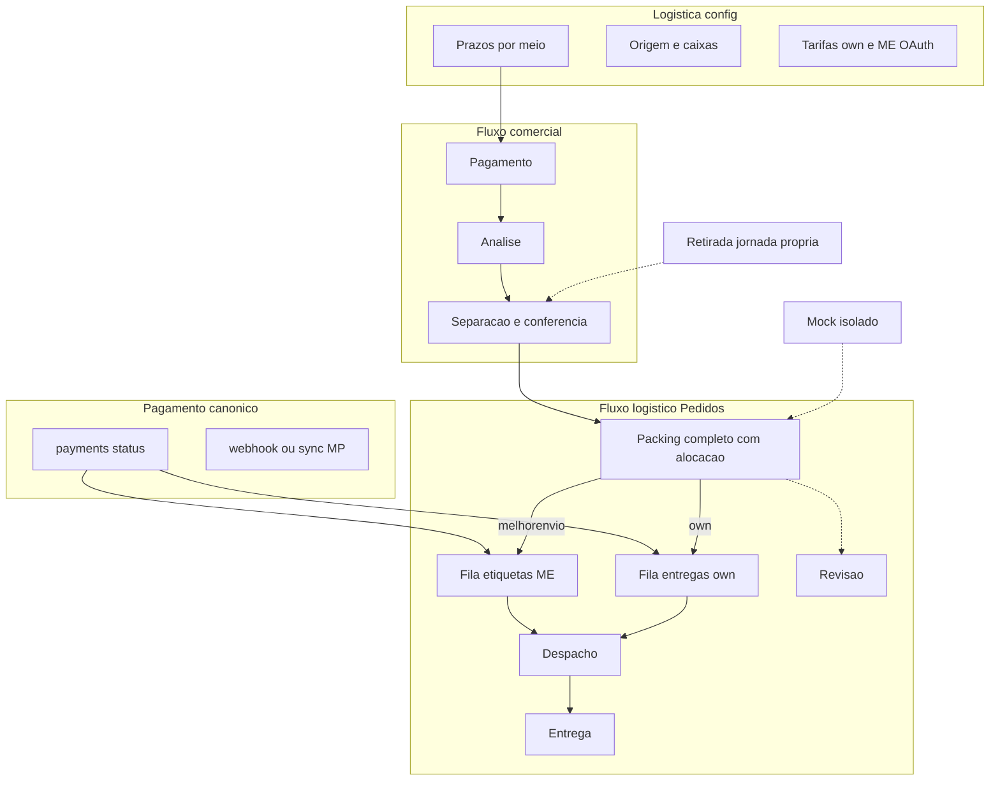
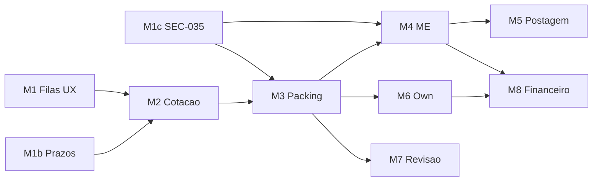

# Plano consolidado — Jornada Frete + Central Logística (Opção A híbrida)

**Versão:** V2.2 · Integridade, segurança e liberação (2026-11-12)  
**Base aprovada:** V2.1 (arquitetura A híbrida + prazos em Logística)  
**Escopo desta etapa:** planejamento apenas — sem código, migrations, deploy ou dados.  
**Auth de referência:** decisões FAL + VALs Central Pedidos Gates 0–2 · Gate 3 bloqueado em ME-03.

---

## Changelog V2.1 → V2.2

| # | Ajuste | Impacto |
|---|--------|---------|
| 1 | Associação formal produtos↔volumes no packing completo | Marcha 3 + predicado |
| 2 | Fonte canônica de pagamento para ops irreversíveis | Marchas 4 e 6 |
| 3 | CP-SEC-035 elevado a **P0** + writes controlados | Nova Marcha 1c |
| 4 | Modelo de prazo completo (úteis/corridos, carrier, prep, buffer, exibido, snapshot) | Marcha 1b |
| 5 | Filas com próxima ação (não só “volumes”) | Marcha 1 |
| 6 | Semântica comprovada label_state ≠ postagem | Marchas 4–5 |
| 7 | Ciclo de vida completo da revisão/ocorrência | Marcha 7 |
| 8 | Liberação em 3 níveis (homologação / ops controlada / MVP) | Seção G |

**Não reaberto:** Opção A híbrida · sem segundo hub · sem dual-status EN · me ≠ own ≠ mock · estoque fora · detalhe único executor · prazos na Logística.

---

### Decisão V2.1 (preservada) — Prazos na Logística

Controle dos prazos dos meios disponíveis = tela **Logística** (`/admin/logistica`). Pedidos só usam snapshot. Own: settings; ME: política FAL sobre carrier; Mock: sair do hardcode.

### Decisão V2.2 — Complementos de integridade

Detalhados nas seções D.2.1–D.9 e G abaixo.

---

## A. Diagnóstico do plano original (V1) — preservado

Ver V2.1. Correções críticas mantidas: sem `own|mock` na fila própria; packing ≠ “tem volume”; fingerprint obrigatório; mock isolado.

**V2.2 acrescenta:** associação formal; pagamento canônico; SEC-035 P0; modelo de prazo; próximas ações; ciclo de revisão; 3 níveis de liberação.

---

## B. Mapa do sistema atual (evidência) — preservado

Ver V2.1 inventário. Destaques relevantes à V2.2:

| Tema | Evidência | Classificação |
|------|-----------|---------------|
| Packing | `admin_set_order_packing` — dims/peso; **sem** alocação produtos | Parcial |
| Pagamento → ops | `confirm_mercadopago_payment` (service_role) + status pedido; Edge label **não** lê `payments` | Parcial / gap |
| Shipments write | staff policy `shipments_staff_write` + RPCs/Edges | Risco SEC-035 |
| label_state | `melhorEnvioLabelState.ts` — none→printed; `canShipAfterLabel` separado | Existe; postagem = `ship_order`/`enviado` |
| Reviews | `own_manual_reviews` sem insert | Parcial |
| Prazos own | `eta_days_min/max` em Logística | Parcial |
| Prazos ME/mock | API / hardcode | Fragmentado |
| Pickup | `mock:pickup` / resolve mock — **não** é own | Isolar jornada se habilitado |

---

## C. Matriz de divergências (atualizada V2.2)

| Decisão | Atual | Correção | Prio |
|---------|-------|----------|------|
| Filas em Pedidos | Sem filas ME/Own | Marcha 1 | P0 |
| Packing completo + alocação | Sem produtos↔volumes | Marcha 3 | P0 |
| Pagamento canônico p/ etiqueta/despacho | Status pedido / sem ler payments na Edge | Marchas 4/6 | P0 |
| SEC-035 metadata | Staff UPDATE genérico | Marcha 1c | **P0** |
| Fingerprint place_order | Não revalida carrinho | Marcha 2 | P0 |
| Fila own ≠ mock | Storage OK; plano V1 errava | Manter regra V2.1 | P0 |
| Prazos modelo completo | Own só; ME/mock incompleto | Marcha 1b | P0 |
| Próxima ação nas filas | Tabs genéricas | Marcha 1 | P0 |
| Label ≠ postagem | Código distingue; UX/gates reforçar | Marchas 4–5 | P0 |
| Reviews ciclo de vida | Tabela sem write/CRUD | Marcha 7 | P1 |
| Liberação 3 níveis | Definição MVP ambígua | Seção G V2.2 | P0 doc |
| ME-03 | Purchase prod pendente | Humano | Humano |

---

## D. Plano consolidado V2.2

### D.1 UX (Opção A híbrida) — preservada

Hub: 4 áreas comerciais + bloco Expedição logística + atalhos. Detalhe = único executor. Logística = config (prazos, origem, tarifas, ME OAuth).

### D.1.1 Filas e próxima ação (V2.2)

Filas operacionais ME/Own **não** misturam pendências genéricas. Subestados / próxima ação (coluna ou badge na lista):

| Próxima ação (PT) | Condição típica | Onde aparece |
|-------------------|-----------------|--------------|
| Aguardando separação | `confirmado` / não iniciado | Área Separação (comercial) |
| Aguardando conferência | `em_separacao` parcial | Separação |
| Conferência com divergência | ocorrência/divergência qty | Separação + Revisão |
| Aguardando embalagem | `pronto_para_envio` + sem packing | Fila **Preparar volumes** |
| Embalagem incompleta | packing iniciado, predicado falso | Preparar volumes |
| Embalagem inválida | dims/peso/alocação inválidos | Preparar volumes + Revisão |
| Revisão aberta | review/ocorrência aberta | **Revisão** (exclui ME/Own) |
| Emitir etiqueta | packing_completo + ME + não purchased+ + **pago canônico** | Etiquetas ME |
| Organizar entrega própria | packing_completo + own + **pago canônico** | Entregas próprias |
| Aguardando postagem/coleta | label purchased/generated/printed + ainda não `enviado` | Pós-etiqueta (não = trânsito) |
| Em trânsito | `enviado` | Trânsito |
| Entregue | `entregue` | Entregues |

**Precedência:** cancelado/reembolsado fora ops · revisão aberta exclui Etiquetas/Own · packing incompleto só Preparar volumes · ME vs Own mutuamente exclusivos por provider · mock fora de filas reais · contagens = mesma regra server-side.

**Pickup/retirada:** se habilitada, **não** é entrega própria; jornada operacional específica (visão/fila própria de retirada), fora de `entregas-proprias`.

### D.2 Arquitetura

### D.2.1 Modelo de prazo (Marcha 1b completa)

Campos conceituais (persistir política + snapshot):

| Campo | Significado |
|-------|-------------|
| `day_count_mode` | `business_days` ou `calendar_days` (definir por meio na Logística) |
| `carrier_eta_min/max` | Prazo original do transportador (ME) — **preservar** |
| `prep_days_fal` | Tempo de preparação/expedição FAL |
| `buffer_days` | Buffer operacional FAL |
| `display_eta_min/max` | Prazo exibido ao cliente = política aplicada |
| `snapshot_eta_*` | Congelado no pedido na contratação |

**Regra anti-duplicação:** se o prazo do provedor **já inclui** preparação acordada, **não** somar `prep_days_fal` de novo. Documentar na Logística se o buffer é adicional ao carrier ou substitui.

- **ME:** metadata guarda `carrier_eta_*` + `fal_policy` (prep/buffer/mode) + `display_eta_*`.
- **Own:** semântica de contagem configurável; `eta_days_min/max` existentes alinhados ao modelo.
- **Mock:** prazos só da config Logística.
- **Retirada:** prazo próprio (ex.: “disponível em X”); **não** classificar como own delivery.

### D.3 Packing completo + associação formal (V2.2)

Predicado `order_packing_is_complete` (backend):

1. `metadata.packing.volumes` não vazio.
2. Cada volume: id; L/A/P **> 0**; weightKg **> 0**.
3. **Alocação formal (obrigatória no modelo padrão):**
   - Toda unidade comprada alocada a exatamente um volume.
   - Nenhuma unidade alocada duas vezes.
   - Soma por `order_item_id` = quantidade do pedido.
4. Persistido só via RPC controlada (`admin_set_order_packing` evoluída).
5. Mudança de itens/qtds do pedido → packing **inválido** / exigir revisão (não liberar filas).
6. **Exceção** à alocação: só se flag explícita + justificativa + validação staff/autorização; ausência de associação **sem** exceção ≠ completo.

**STOP:** filas ME/Own, purchase ME e despacho own rejeitam se predicado falso.

### D.3.1 Pagamento canônico (V2.2)

**Fonte canônica:** tabela `payments` do pedido (status do registro confirmado por `confirm_mercadopago_payment` / sync / webhook service_role) — **não** metadata de shipment nem “status visual” sozinho.

Estados a distinguir (mapear aos valores reais do schema na Marcha 1 inventário):

| Conceito | Uso ops |
|----------|---------|
| Aprovado / capturado | Permite filas irreversíveis se demais gates OK |
| Pendente | Bloqueia etiqueta/despacho próprio |
| Processando | Bloqueia até terminal |
| Recusado | Bloqueia |
| Estornado / reembolsado | Bloqueia novas ops irreversíveis; trata etiqueta já comprada à parte |
| Cancelado (pedido/pagamento) | Fora filas ops |

**Reconciliação:** se MP indica aprovado e FAL ainda pendente → sync antes de liberar; **dúvida = bloqueio** de compra de etiqueta e despacho próprio.

### D.3.2 SEC-035 P0 — shipments / metadata (V2.2)

**Marcha 1c (P0):** inventariar todos os writers (`shipments_staff_write`, RPCs, Edges, client updates).

Campos críticos — **somente** RPC/Edge com auth + validação + idempotência + evento:

- `provider`, option/quote ids, `amount` / charged_shipping
- `metadata.me.*` (label_state, cart_item, transaction, PDF/tracking)
- `metadata.packing`
- timestamps / status de despacho (`shipped_at`, tracking, proof)
- overrides financeiros

Atualização genérica de metadata **não** pode contornar gates. Updates admin legítimos não críticos (ex.: nota interna permitida) permanecem, se inventário comprovar.

### D.4 Precedência de filas / contagens

Como V2.1 + exclusão por revisão + pagamento canônico + pickup fora de own + próxima ação (D.1.1). Contagens hub = mesma RPC.

### D.5 Cotação, fingerprint, snapshot

Mantém V2.1. Snapshot inclui etas do modelo D.2.1 (`carrier` + `fal_policy` + `display` / own params). Fingerprint revalidado no `place_order`.

### D.6 Melhor Envio + estados de etiqueta (V2.2)

**Semântica comprovada (código atual `melhorEnvioLabelState`):**

| label_state | Significa | NÃO significa |
|-------------|-----------|---------------|
| `none` | Sem fluxo de etiqueta | — |
| `quoted` | Cotação/ref de etiqueta | Postado |
| `prepared` | Preparado p/ emitir (no fluxo ME) | Postado |
| `cart` | Item no carrinho ME | Comprado/pago ME / postado |
| `purchased` | Compra efetuada | Postado / `enviado` |
| `generated` | Documento/PDF disponível | Postado |
| `printed` | Impressão registrada | Postado / entregue |

Postagem/coleta = transição pedido/`ship_order` → `enviado` (+ evento). Trânsito/entrega = `enviado` / `entregue` + eventos.

Purchase exige: staff · pagamento **canônico** · não cancelado/reembolsado · packing_completo · status expedição · cotação compatível · dims vs quote · divergence/override auditado · idempotência com reconcile · ME-03 em prod.

### D.7 Entrega própria

Mantém POL/veículo/Routes/origem. Ops irreversíveis exigem pagamento canônico. Eventos reais: saída, tentativa, confirmação. Sem etiqueta ME. Sem conversão mock→own. Pickup ≠ own.

### D.8 Ciclo de vida da revisão (V2.2)

`own_manual_reviews` + ocorrências unificadas (origem ME/Own):

| Campo | Obrigatório |
|-------|-------------|
| Responsável | sim |
| Prioridade | sim |
| Ação necessária | sim |
| Atribuição | sim |
| Situação | aberta / em andamento / resolvida / reaberta |
| Resolução | ao encerrar |
| Histórico | append-only (eventos) |
| Reabertura | permitida com motivo |
| Motivo de encerramento | sim |

Ocorrências **não** desaparecem por UI ou patch de metadata. Write path na Edge quando `manual_review`.

### D.9 Segurança

- `place_order` único para criar pedido.
- Fingerprint + cotação no servidor.
- Pagamento canônico para ops irreversíveis.
- SEC-035 P0 (D.3.2).
- Secrets server-side.
- Sem estoque neste programa.

### D.10 Marchas e dependências

| Marcha | Objetivo | PASS | STOP |
|--------|----------|------|------|
| **1** | Filas + próxima ação; mock fora; inventário legado `own:%` | Contagens = listas; ações distintas | Inventário remoto sem VAL |
| **1b** | Modelo prazo completo; pickup≠own; sem hardcode comercial | Nova cotação reflete Logística; snapshot antigo intacto; carrier preservado | Prep somada 2x sem regra |
| **1c** | SEC-035: inventário writers + RPCs campos críticos | Patch genérico não altera provider/label/packing/quote | Staff ainda bypassa gates via UPDATE |
| **2** | Fingerprint + snapshot + isolamento | G1–G3 smoke | Bypass place_order |
| **3** | Packing + alocação + invalidação | G4; incompleto fora ME/Own | Completo sem alocação e sem exceção |
| **4** | Fila ME + gates + idempotência + override + ME-03 | G5 evidenciado | Purchase sem packing ou sem pagamento canônico |
| **5** | Postagem/rastreio/cliente | G6–G7 ME; cliente ≠ enviado só com label | generated/printed tratados como enviado |
| **6** | Own ops reais | G6–G7 own | Mock na fila own |
| **7** | Reviews ciclo completo | Registro append-only; reabertura | Ocorrência some sem resolução |
| **8** | Financeiro frete | G8 mínimo no caminho habilitado | Sem custo efetivo registrado |

**Ordem crítica:** 1 ∥ 1b ∥ 1c → 2 → 3 → (4→5) e/ou 6 → 7 → 8.

---

## E. Matriz de testes (ampliada V2.2)

| Cenário | Marcha |
|---------|--------|
| Próxima ação “embalagem incompleta” ≠ “revisão aberta” | 1 |
| Prazo ME: carrier + buffer; sem double prep | 1b |
| Retirada não lista em entregas-proprias | 1b |
| Staff UPDATE metadata.me.label_state direto falha ou é ignorado pós-1c | 1c |
| Fingerprint mismatch → place_order rejeita | 2 |
| Packing sem alocação → não completo | 3 |
| Dupla alocação mesma unidade → rejeita | 3 |
| Item qty muda → packing inválido | 3 |
| Payment pending → purchase 4xx | 4 |
| MP aprovado FAL pendente → block até sync | 4 |
| Purchase timeout → reconcile sem 2ª compra | 4 |
| printed + status pronto_para_envio → cliente não vê enviado | 5 |
| Own sem evento saída → não marcar entregue | 6 |
| Review resolvida + reabertura com motivo | 7 |
| G8: charged vs label/own cost no pedido | 8 |

---

## F. Pendências e dependências

### Já existe
Hub 4 áreas, detalhe, wizard, packing básico, ME/Own panels, place_order, quotes, divergence, ocorrências staff, SEC-030, origem/tarifas/POL, label_state machine, confirm MP.

### Corrigir / desenvolver (V2.2)
Filas + próxima ação · prazos modelo · SEC-035 · fingerprint · packing+alocação · pagamento canônico nas Edges · override auditado · idempotência dura · write reviews + ciclo · own ops eventos · financeiro · pickup isolado · testes I/E2E.

### Dependências humanas / externas
- Auth eFe ME-03.
- Webhook MP prod (sync mitiga).
- Tarifas own comerciais.
- Push/deploy com auth eFe.
- Decisão final `day_count_mode` (úteis vs corridos) por meio — default proposto: **úteis** para ME display FAL e Own, salvo config.

### Ainda não resolvido nesta consolidação (ok deixar para execução)
- Schema exato dos campos de alocação em `metadata.packing` (desenhar na Marcha 3 com migration).
- Lista fechada de status strings de `payments` (inventário Marcha 1).
- Política exata “prep já inclusa no carrier” por serviço ME (config Logística).

---

## G. Critério de liberação — 3 níveis (V2.2)

### Nível 1 — Pronto para homologação
UX, regras e controles em ambiente de teste. Sem operação comercial real. Mock permitido só como simulação.

### Nível 2 — Pronto para operação controlada
Pelo menos **um** caminho real homologado (ME **ou** Own), com autorização, integridade, controles financeiros mínimos e acompanhamento. Mock **não** conta.

- **Caminho ME:** G1–G5 (cotação→etiqueta); G6–G7 quando postagem/trânsito/entrega forem liberados nesse nível.
- **Caminho Own:** G1–G4 (cotação→preparação); G6–G7 (saída/tentativas/entrega).
- **G8 mínimo:** frete cobrado + custo efetivo do caminho habilitado registrados.

### Nível 3 — MVP logístico concluído
Gates aplicáveis G1–G8 aprovados, jornadas completas do(s) caminho(s) habilitado(s), evidências (VALs) registradas. Mock nunca é caminho real de produção.

| Gate | ME | Own |
|------|----|-----|
| G1 Cotação | sim | sim |
| G2 Pagamento | sim | sim |
| G3 Snapshot/integridade | sim | sim |
| G4 Separação/packing | sim | sim |
| G5 Etiqueta | sim | N/A |
| G6 Despacho real | postagem/coleta | saída |
| G7 Acompanhamento/entrega | trânsito/entrega | tentativa/entrega |
| G8 Financeiro | cobrado vs custo etiqueta | cobrado vs custo entrega |

---

## H. Entregável final V2.2

### 1. Alterações incorporadas
Itens 1–8 do complemento (packing formal, pagamento canônico, SEC-035 P0, modelo prazo, próximas ações, label≠despacho, ciclo revisão, 3 níveis liberação).

### 2. Pendências ainda abertas
Schema alocação packing; inventário strings `payments`; política prep-inclusa por serviço ME; ME-03 humano; webhook MP prod.

### 3. Dependências
Técnicas: migrations/RPCs/Edges nas marchas 1c–8. Humanas: eFe ME-03, deploy auth, tarifas comerciais.

### 4. Matriz final de riscos

| Risco | Mitigação | Severidade |
|-------|-----------|------------|
| Bypass metadata shipment | SEC-035 P0 / RPCs | Crítica |
| Etiqueta sem pagamento real | Pagamento canônico + sync | Crítica |
| Packing “completo” falso | Alocação formal | Alta |
| Double prep no prazo | Modelo 1b anti-soma | Média |
| Mock em fila own | Provider strict | Alta |
| Dupla compra etiqueta | Idempotência + reconcile | Alta |
| Ocorrência sumir | Append-only eventos | Alta |
| Declarar MVP com mock | 3 níveis liberação | Alta |

### 5. Marchas
1 ∥ 1b ∥ 1c → 2 → 3 → 4→5 e/ou 6 → 7 → 8 (tabela D.10).

### 6. Aceite / STOP / PASS
Por marcha em D.10; liberação em G (níveis 1–3).

### 7. Recomendação de autorização

**Autorizar início da implementação na Marcha 1 (+ 1b e 1c em paralelo), sob V2.2.**

Não autorizar ainda: purchase ME produção (ME-03), push/deploy prod, nem declarar Nível 2/3 sem VALs.

Pré-condição de kickoff: eFe confirma V2.2 como base; execução começa em Agent mode sem alterar arquitetura A híbrida.

---

## Restrições permanentes

Não implementar nesta etapa de planejamento. Sem segundo hub. Sem dual-status EN. Sem misturar ME/Own/Mock. Pickup ≠ own. Sem estoque. Secrets só servidor. Pedidos antigos não mudam com nova tarifa/prazo.
