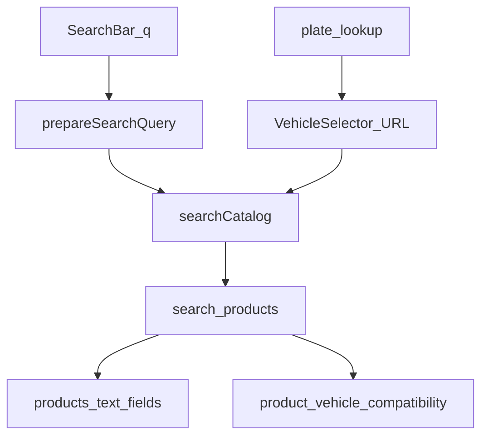

# FAL_PLANO_MESTRE_BUSCA_INTELIGENTE_V1

**Projeto:** FAL Peças Automotivas  
**Módulo:** Busca Inteligente, Catálogo, Veículos e Compatibilidade  
**Data:** 2026-11-11  
**Tipo:** Auditoria técnica/funcional + planejamento (sem implementação nesta entrega)  
**Repo:** https://github.com/efe777-creator/FAL-PECAS-AUTOMOTIVAS.git  
**Supabase SQL auditado:** `owllmfcpbodqmoerdfxx` (sa-east-1)  
**Evidência funcional externa:** [TinyFish 098d4da4](https://agent.tinyfish.ai/runs/098d4da4-73d9-40e4-9fed-40302cbf9077)

### Anexos obrigatórios

1. [FAL_AUDITORIA_ARQUITETURA_BUSCA_V1.md](./FAL_AUDITORIA_ARQUITETURA_BUSCA_V1.md)  
2. [FAL_AUDITORIA_VEICULOS_V1.md](./FAL_AUDITORIA_VEICULOS_V1.md)  
3. [FAL_AUDITORIA_PRODUTOS_CLASSIFICACAO_V1.md](./FAL_AUDITORIA_PRODUTOS_CLASSIFICACAO_V1.md)  
4. [FAL_AUDITORIA_APLICACOES_COMPATIBILIDADE_V1.md](./FAL_AUDITORIA_APLICACOES_COMPATIBILIDADE_V1.md)  
5. [FAL_AUDITORIA_GARAGEM_PLACA_V1.md](./FAL_AUDITORIA_GARAGEM_PLACA_V1.md)  
6. [FAL_AUDITORIA_EXPERIENCIA_CLIENTE_V1.md](./FAL_AUDITORIA_EXPERIENCIA_CLIENTE_V1.md)  
7. [FAL_AUDITORIA_SEGURANCA_PERFORMANCE_V1.md](./FAL_AUDITORIA_SEGURANCA_PERFORMANCE_V1.md)  
8. [FAL_MATRIZ_INCONSISTENCIAS_V1.csv](./FAL_MATRIZ_INCONSISTENCIAS_V1.csv)  
9. [FAL_MATRIZ_TESTES_BUSCA_V1.csv](./FAL_MATRIZ_TESTES_BUSCA_V1.csv)  
10. [FAL_PLANO_EXECUCAO_BUSCA_INTELIGENTE_V1.md](./FAL_PLANO_EXECUCAO_BUSCA_INTELIGENTE_V1.md)

---

## 1. Resumo executivo

A FAL já possui um **motor de busca estruturado utilizável** (`searchCatalog` → `search_products` + PVC), seletor YMM, placa com upsert canônico, garagem e categorias em árvore. O problema crítico não é “falta de IA”: é a **desunião entre busca textual e filtro veicular**, agravada por **drift do banco de produção** (RPC ainda casa ano só em `vehicle_versions.year`, ignorando `PVC.year_start/end`) e por **dados HB20 com motor em `version_name`**.

| Canal | Resultado atual (SQL 11/11) |
|-------|------------------------------|
| Texto `HB20` / `HB20 2015` | 0 |
| YMM HB20 + ano **2015** | 0 (RPC antiga) |
| YMM HB20 + ano **2012** | 2 (TDI2116, TDI2117) |
| PVC direto ano 2015 | 2 (intervalo 2012–∞) |

TinyFish (seletor 2015→3 SKUs incl. BRD2109) **diverge** do estado SQL atual (BRD ausente; 2015→0). Tratar TinyFish como evidência histórica/externa; **causa técnica no código e no SQL atuais está identificada**.

**Ordem ideal:** alinhar DB (Fase 0) → parser texto→YMM (Fase 1) → sanear dados (Fase 2) → UX/autocomplete (Fase 4) → IA só depois (Fase 6).

---

## 2. Escopo auditado

- Front: SearchBar, CatalogPage, VehicleSelector, PDP, nav categorias, hooks.  
- Serviços: search, prep, vehicles, products, pricing, plate, garage, categories.  
- SQL: RPC vigente em produção + migrations do repo.  
- Contagens catálogo/PVC/veículos no projeto Supabase acima.  
- Não auditado E2E nesta sessão: placa live com token, login garagem, TinyFish replay, Netlify env binding.

---

## 3. Arquitetura encontrada

**FATO:** `q` e YMM são ramos distintos dentro da mesma RPC.

---

## 4. Inventário de componentes

Ver anexo Arquitetura (§ inventário). Destaques: contrato único `searchCatalog`; suggestions separadas; enrich pós-RPC (preço, apps, imagens).

---

## 5. Estrutura do banco

Mestre: `manufacturers` / `models` / `vehicle_versions`.  
Fitment: `product_vehicle_compatibility` (`year_start`/`year_end`).  
Catálogo: `products`, `product_categories`, `product_brands`, `product_references`, `product_images`.  
Garagem: `customer_vehicles`.  
Placa: `cached_plates` (repo).  

**Produção faltando vs repo:** `commercial_ref`, `search_synonyms`, `store_search_prep`, corpo novo de `search_products`.

---

## 6. Diagnóstico do cadastro de veículos

Mestre **independente** e usado por seletor/placa/admin.  
Gaps: geração, combustível, transmissão, carroceria, ano-modelo.  
HB20: 2 VV; motor em `version_name`; `vv.year=2012` pontual.

---

## 7. Diagnóstico do catálogo

49 published; 0 sem categoria; 1 sem PVC; preços TDI* = 0,00; BRD2109 ausente; árvore L1=4 / 19 published.

---

## 8. Diagnóstico das aplicações

PVC é a verdade; texto não a consulta.  
Produção: match de ano quebrado na RPC.  
Classificar apps textuais em `notes` como não confirmadas.

---

## 9. Diagnóstico do motor de busca

Respostas às 12 perguntas do brief:

1. Texto e seleção manual **não** usam o mesmo predicado (só a mesma RPC com params diferentes).  
2. Um motor RPC + suggestions + espelho JS — não Meilisearch.  
3. Interpretação texto: só sinônimos (`prepareSearchQuery`); **sem** YMM parser.  
4. Ano: só se `p_year` (seletor); em texto vira token AND.  
5. Motor: `p_engine` (dados HB20 estão em version_name).  
6. Versão: `p_version`.  
7. Resolução veículo: equality case-insensitive maker/model no mestre.  
8. Aplicação: CTE PVC (quando params preenchidos).  
9. Perda: (a) sem parse; (b) AND do ano no texto; (c) RPC prod `vv.year`.  
10. Consultas: RPC set-returning + enrich client.  
11. Filtros: AND texto restritivo; ano prod restritivo demais.  
12. Dev/prod: **sim, drift** — repo ≠ SQL prod.

---

## 10. Diagnóstico garagem e placa

Mesmo mestre; catálogo via URL; save exige login; placa upsert + confirmação + fallback manual; sem segundo motor de fitment.

---

## 11. Problemas comprovados

Ver [FAL_MATRIZ_INCONSISTENCIAS_V1.csv](./FAL_MATRIZ_INCONSISTENCIAS_V1.csv). Top P0: BUS-01, BUS-02, VEI-01, PRO-01/02/03, OPS-02.

---

## 12. Hipóteses pendentes

- Binding Netlify → este projeto Supabase.  
- Por que TinyFish viu BRD2109 e 3 hits em 2015 (estado anterior?).  
- Token apiplacas em produção.  
- EXPLAIN de `search_products` sob carga.

---

## 13. Causas-raiz identificadas

1. **Arquitetural:** ausência de interpretador texto → params PVC.  
2. **Operacional:** migrations de busca/PVC não aplicadas em prod.  
3. **Dados:** motor no campo errado; VV.year pontual; SKU/preço incompletos.

---

## 14. Riscos

- Aplicar migrations sem checklist → regressão checkout/preço.  
- Indexar anos em `search_document` → falsos positivos (evitar como fix principal).  
- IA cedo → mascara dados ruins e custo.  
- Tratar TinyFish como verdade absoluta do DB atual.

---

## 15. Arquitetura futura recomendada

Híbrida sobre o existente:

1. Interface (texto, placa, garagem, categoria)  
2. Interpretador determinístico (`SearchIntent`)  
3. Orquestrador = `searchCatalog`  
4. Catálogo + mestre + PVC  
5. Validador = RPC/PVC apenas  
6. Ranking + UI + métricas zero-result  
7. IA opcional → mesmo `SearchIntent`

Não criar dez microserviços novos.

---

## 16. Projeto de IA

| Abordagem | Papel |
|-----------|-------|
| Normalização + sinônimos | Fase 3 (barato) |
| Parser determinístico | Fase 1 (obrigatório) |
| LLM | Fase 6 — só NL/ambiguidade |
| Semântica/embeddings | Avaliar depois; sem pgvector hoje |

IA **não** inventa PVC/preço/estoque/veículo.  
Chamada LLM: confiança baixa / frase longa; nunca SKU puro.  
Fallback = parser + RPC. Cache + rate limit obrigatórios.

---

## 17. Experiência futura do cliente

Autocomplete seccionado; URL unificada; empty states honestos; apps legíveis; mobile first; clarificação de motor quando necessário.

---

## 18. Plano de correções

Priorizar P0 da matriz CSV: drift DB → parser → dados HB20/preço/BRD → copy/UX.

---

## 19. Plano de implementação por fases

Ver [FAL_PLANO_EXECUCAO_BUSCA_INTELIGENTE_V1.md](./FAL_PLANO_EXECUCAO_BUSCA_INTELIGENTE_V1.md) (Fases 0–8).  
Ordem ajustada vs brief: **Fase 0 Ops DB** inserida antes da correção do motor — justificativa §19 do anexo.

---

## 20. Dependências entre fases

F0 → F1/F2 → F3/F4/F5 → F6 → F7 → F8 (diagrama no plano de execução).

---

## 21. Estimativa de complexidade

F0 M · F1 M · F2 M–L · F3 S–M · F4 M · F5 S · F6 L · F7–8 M.

---

## 22. Critérios de aceitação (projeto)

- `HB20 2015` (texto) = conjunto PVC do ano.  
- Motor/versão respeitados.  
- Código TDI2116 prioridade.  
- Autocomplete separa veículos/peças.  
- Sem compatibilidade inventada.  
- Garagem/placa no mesmo validador.  
- Busca funciona sem IA.  
- Preços com fonte resolvida consistente.  
- Prod = migrations de busca alinhadas ao repo.

---

## 23. Matriz de testes

[FAL_MATRIZ_TESTES_BUSCA_V1.csv](./FAL_MATRIZ_TESTES_BUSCA_V1.csv) — linhas `nao_executado` não foram inventadas.

---

## 24. Estratégia de publicação

1. Backup / note RPC atual.  
2. Migrations search/PVC em janela controlada.  
3. Deploy app parser.  
4. Smoke T01–T08/T14–T15.  
5. Rollback = restore function SQL anterior.  
6. Monitor zero-results.

---

## 25. Pendências que exigem decisão do eFe

1. **Autorizar Fase 0** (aplicar migrations de busca no Supabase `owllmfcpbodqmoerdfxx`)?  
2. Confirmar se este projeto é o backend do site TinyFish / Netlify.  
3. Reimportar **BRD2109**?  
4. Corrigir preços TDI* agora (comercial)?  
5. Copy de período: manter `12/...` ou `2012–atual`?  
6. Prioridade pós-P0: autocomplete vs placa E2E?  
7. Orçamento/fornecedor IA (só após Fases 0–5)?  
8. Autorizar implementação Fase 1 (código parser) após F0?

---

## Síntese ao responsável (eFe)

**O que encontramos:** dois canais de busca; RPC prod desatualizada; dados HB20 inconsistentes; catálogo pequeno (49) com preços zerados em SKUs-chave.  

**O que preservar:** `searchCatalog`, PVC, mestre canônico, placa com confirmação, RLS published, pageSize 24.  

**Crítico primeiro:** sync DB (year range) + parser texto→YMM + sanear motor/preço.  

**IA:** agrega em linguagem natural depois que o determinístico funciona.  

**Não implementamos nada nesta entrega** — aguardamos suas decisões da §25.
