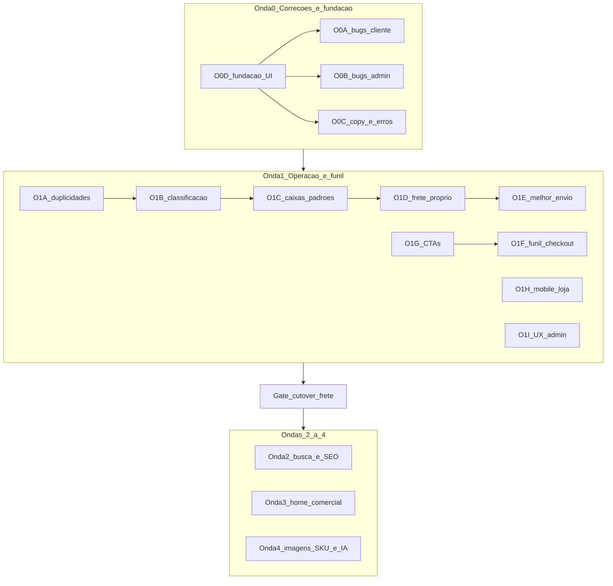

# Plano mestre FAL — Melhoria do site como um todo

**Data:** 2026-11-05  
**Tipo:** plano canônico de execução (matriz 29 + auditoria UX loja/admin)  
**Status:** CÓDIGO ENCERRADO (2026-11-09) — tip `main` #247; produção plena = gates humanos  
**Relatório final:** [FAL_MARCHA_RELATORIO_FINAL_PLANO_MESTRE_2026-11-09.md](./FAL_MARCHA_RELATORIO_FINAL_PLANO_MESTRE_2026-11-09.md)  
**Fonte:** plano aprovado (Opção A ampliada)  
**Backlog:** [FAL_BACKLOG_POS_ALPHA_2026-11-04.md](./FAL_BACKLOG_POS_ALPHA_2026-11-04.md)

---
## 0. Análise crítica do plano anterior

O plano anterior estava **certo nos 29 itens, mas enviesado para logística**. A auditoria mostrou que o cliente e o operador sofrem hoje com problemas que **não estão nos 29**:

- fluxos que **não terminam** (redefinir senha, cartão recusado);
- botões **invisíveis** (variant `outline` branco sobre fundo branco, na loja e no admin);
- **jargão interno exposto** ao cliente (`VITE_MP_PUBLIC_KEY`, “D-FRETE C”, “webhook”, “Brick”, erros do Supabase em inglês);
- listas admin **cortadas em 200** sem aviso (contadores mostram N e a fila exibe menos).

**Mudança de ordem:** entra uma **Onda 0** (correções críticas + fundação de UI), curta e de baixo risco, **antes** da Onda 1. Motivo: corrige o que é percebido todo dia e cria os componentes (Button, Toast, ConfirmDialog) que as ondas seguintes vão reutilizar — evita refazer telas duas vezes.

**Premissas travadas**
- Fase α encerrada; runtime `wtbpwuiayednvlhvuhbh`; Netlify.
- **D-FRETE B** permanece (loja `mock`; frete próprio `enabled=false`; ME D12; etiqueta só Expedição). Cutover = gate humano.
- Não reabrir itens implementados sem finding; uma MARCHA = uma frente com VAL próprio.
- Toda correção de UI usa os componentes da fundação O0-D (sem novos estilos avulsos).

---

## 1. Matriz consolidada dos 29 (resumo)

Legenda: **I** implementado · **P** parcial · **C** corrigir/revalidar · **N** não desenvolvido.

| # | Item | Status | Falta / onda |
|---|------|--------|--------------|
| 01 | Frete próprio | P | Código hub OK; tarifas eFe + cutover C = gate — O1-D |
| 23 | Prévia frete | I | PDP/carrinho com mensagem sem opção; recota — residual fino se finding |
| 24 | Melhor Envio | P | Hub OK sob B; etiqueta M7 prod = gate — O1-E |
| 29 | Frete integrado | P | Caixas + packing no código; padrões categoria finos / ops eFe — O1-C |
| 02 | Cadastro produtos | I | Toast + blocker O0-B entregues |
| 03 | Árvore classificação | P | Merge no código; massa = revisão eFe — O1-B |
| 04 | Org. admin | I | Lote só com seleção; nav/breadcrumbs O1-I |
| 05 | Classif. produtos | I | Cascata publicada; form alinhado |
| 20 | Integridade classif. | P | Painel + merge; massa = eFe — O1-B |
| 17 | Import imagens SKU | P | Página + matching no código; robustez escala = Onda 4 |
| 26 | Relacionados | I | Curadoria em escala = futuro |
| 27 | Imagens cards | I | Card → PDP; lightbox só PDP — O1-G |
| 21 | Ano ini/fim | I | — |
| 14 | Filtros catálogo | I | Drawer mobile — O1-H |
| 15 | Busca itens | I | Combobox / ver todos — Onda 2 |
| 16 | Filtros admin | I | Form Enter + paginação — O1-I |
| 22 | Evolução busca | P | Facetas OK; prep IA = Onda 4 / gate sinônimos |
| 06 | Home | I | Veículo/topo/campanhas — Onda 3 |
| 07 | Carrossel imagens | I | Onda 3 |
| 08 | Carrossel produtos | I | Onda 3 |
| 09 | Destaques personalizados | I | Onda 3 |
| 10 | Admin destaques | I | Onda 3 |
| 11 | Cond. pag. nos cards | P | UI admin existe; ligar = decisão eFe (12) |
| 12 | Cond. pagamento | P | Admin existe; decisão comercial eFe |
| 13 | Cards / CTAs | I | Comprar agora + Adicionar — O1-G |
| 25 | Admin pedidos | I | Paginação + reload silencioso + romaneio — O0-B / O1-I |
| 28 | Checkout auth/CPF | I | CPF readonly + `from` — O1-F |
| 18 | Notif. carrinho | I | Toast no router + desfazer — O0-D / O1-F |
| 19 | Duplicidade funções | I | Inventário O1-A + consolidação UX |

Reclassificações (I para P) vieram da auditoria de usabilidade: o recurso existe, mas com defeito de uso.

---

## 2. Onda 0 — Correções críticas e fundação (executar primeiro)

### O0-D — Fundação de UI (primeiro dentro da Onda 0)

Base para todas as correções seguintes. Arquivos em `fal-pecas/src/components/common/`.

1. [`Button.tsx`](fal-pecas/src/components/common/Button.tsx): renomear o atual `outline` para `outlineDark` (fundo escuro, Home) e criar `outline` para fundo claro (`bg-white text-fal-navy border-fal-navy/30`); adicionar `focus-visible:ring-2 ring-fal-navy`. Corrigir todos os usos em fundo branco (loja: `AccountOrderDetailPage.tsx:286`; admin: `AdminOrderDetailPage.tsx:461,500`, `AdminMelhorEnvioPage.tsx:183`, `AdminOwnDeliveryPage.tsx:341,350,392,549,729`).
2. `ButtonLink` (Link com estilo de botão) para eliminar `<Link><Button>` aninhado (card, carrinho, checkout, Home, `EmptyState`).
3. Mover `ToastProvider` para dentro do router e trocar `<a href>` por `<Link>` em [`Toast.tsx`](fal-pecas/src/components/common/Toast.tsx); erro usa `role="alert"`. Adotar Toast no admin (hoje zero uso).
4. `ConfirmDialog` sobre o `Modal` existente, substituindo `window.confirm`/`window.prompt` (cerca de 30 no admin + conta do cliente). `Modal`/`MobileDrawer` com focus trap, Escape e travamento do scroll.
5. Contraste: `--fal-muted` de `#6f7a85` para tom com contraste mínimo 4,5:1.
6. Helper único `toUserMessage(err)` (traduz erros do Supabase e evita “[object Object]”).

**Gate:** nenhum botão invisível; toast com `Link`; ConfirmDialog usado em pelo menos as ações destrutivas do admin.

### O0-A — Bugs bloqueantes da loja

| Bug | Correção |
|-----|----------|
| Redefinir senha não termina (não há `updateUser` no código) | Página `/redefinir-senha` que ouve `PASSWORD_RECOVERY` e chama `supabase.auth.updateUser({ password })`; `redirectTo` em `authService.ts` aponta para ela |
| Cartão recusado trava em “aguardando” (`MercadoPagoCardBrickPanel.tsx:87`) | Em `rejected`/`cancelled`, limpar `paymentId`, mostrar motivo em PT-BR e “Tentar novamente” |
| “Carregar mais” rola para o topo (`ScrollToTop` reage a `search`) | `ScrollToTop` só reage a `pathname`; avaliar `ScrollRestoration` (O1-H) |
| Falha no “Carregar mais” apaga a lista | Erro separado ao lado do botão |
| Trocar endereço mantém frete antigo (`CheckoutPage.tsx:97`) | Invalidar `shippingOptionId` ao trocar endereço/CEP e bloquear pular para Revisão |
| Copiar Pix falha silenciosa | try/catch + fallback de seleção de texto |
| CPF antigo após salvar perfil | Atualizar `user` do AuthContext após salvar perfil |

### O0-B — Bugs bloqueantes do admin

| Bug | Correção |
|-----|----------|
| `limit(200)` em pedidos/produtos/clientes/estoque sem aviso | Paginação e filtro no servidor com “exibindo X de N” (pedidos e clientes primeiro) |
| Detalhe do pedido vira spinner a cada ação e desmonta o painel ME | `reload` silencioso (sem trocar página por `<Loading>`) |
| Romaneio nunca abre (`window.open` com `noopener` retorna `null`) | Blob URL + escape de HTML |
| Salvar produto sem confirmação nem aviso de não salvo | Toast de sucesso/erro perto do botão + `useBlocker`/`beforeunload` quando alterado |
| Excluir lista de preços Base/Promo permitido | Bloquear exclusão de listas de sistema + checagem de permissão nas ações |
| Ações de imagem/referência/aplicação sem `.catch` e sem confirmação | ConfirmDialog + tratamento de erro |
| Relatórios apontam para `/admin/pedidos?status=` (hub ignora) | Apontar para `/admin/pedidos/lista?status=` |
| Operador pode se rebaixar | Bloquear a própria linha + confirmação |

### O0-C — Jargão técnico e textos

Varredura em loja e admin trocando texto interno por linguagem de cliente/operador:

- Checkout: remover `VITE_MP_PUBLIC_KEY`, `VITE_SHIPPING_PROVIDER=mock`, “D-FRETE”, `MP_ACCESS_TOKEN` (linhas 101, 105, 287, 321, 338, 550, 555) — mensagem para o cliente: “Pagamento indisponível no momento, tente mais tarde”; detalhe técnico só em `console`.
- Cartão: “webhook”, “Brick”, “PAN/CVV”. Login “Fase 1”; recuperar senha “(Supabase Auth)”; perfil “Role”; veículos “cadastro mestre”.
- Status em inglês para PT-BR (Pix `expired/pending`, “Pagamento rejected”, “mercadopago · approved”, “pending (expirado)”), num mapa único `paymentStatusLabel`.
- Home: “Preço resolvido abaixo do preço de lista”, “categorias raiz e subgrupos”.
- Admin: D-FRETE B, D-LIBERAR, F8, Onda 2, M8, `ship_order`, `list_extra_cost`, nomes de tabela, “sandbox” fixo no texto.
- Preço: “A partir de R$ X” com riscado vira “Por R$ X” + “De R$ Y” riscado (`productLabels.ts:73`).
- Unificar mapas de rótulo de status de pedido (`orderStatusAdminLabel` x `orderStatusOperatorLabel` x `STATUS_FILTERS`).

**Gate Onda 0:** grep sem `VITE_`, `D-FRETE`, `webhook`, `Brick` em texto renderizado; smoke senha + cartão recusado + carregar mais + pedido admin.

---

## 3. Onda 1 — Operação e funil

### O1-A — Inventário de duplicidades (19)
Mapa “manter / consolidar / não tocar”. Além de frete/preço/busca/PVC, incluir as duplicações de UI: tabela de pedidos (`AdminOrdersPage` x `AdminOrdersListPanel`), “Retirar não pagos” em 3 lugares, cascata de categoria reimplementada no form de produto, import de custo em 2 lugares, formação de preço editável em 3 lugares, CRUDs Fabricantes/Montadoras/Fornecedores, máscaras duplicadas em `AdminShippingOriginPage`. Entrega: `FAL_INVENTARIO_DUPLICIDADES_ONDA1_2026-11-05.md`. Sem remoção sem teste.

### O1-B — Classificação: merge e integridade (03, 20, 05)
Relatório (em uso, arquivados com produto, duplicatas por nome normalizado, contagem com subárvore); ação **Mesclar A para B** (reatribui `products.category_id`, arquiva A); cascata mostra só `published`; form de produto passa a usar `CategoryCascadeSelects`; árvore preserva expandido/recolhido. Revisão de dados com eFe antes de merge em massa.
**Gate:** 1 merge de teste com contagens antes/depois e zero órfão.

### O1-C — Embalagens e padrões por categoria (29)
`shipping_box_templates` (nome, dimensões, peso da embalagem, ativo) + admin no hub Logística; padrões de peso/dimensão por categoria aplicados via `adminApplyGlobalProductMeasures` com `skip_manual`; regra v1: **menor caixa que comporta peso e volume somados, 1 caixa por cotação**; integrar em `quote-shipping`/volumes ME.

### O1-D — Frete próprio sob B (01, 23)
Smoke checkout + `place_order` com `ownq:`; prévia na PDP/carrinho mostra mensagem quando faltar medida ou não houver opção (hoje some); subtotal usa preço pago, não preço de lista; recotar automaticamente ao mudar qty com CEP válido; tarifas reais = dados eFe. Frete próprio admin: permitir valor 0, remover opção de preço, formulários controlados.

### O1-E — Melhor Envio sob B (24)
Seguir [plano ME](docs/planejamento/FAL_PLANO_CORRECOES_MELHOR_ENVIO_2026-11-05.md): decisão API_BASE, M7 etiqueta, hub não-stub, disclaimer, allowlist; “Atualizar catálogo” avisa antes de descartar edições; transportadora/rastreio pré-preenchidos com o retorno ME.

### O1-F — Funil carrinho, checkout e autenticação (18, 28)
- CPF/CNPJ já validado no perfil: Identificação em modo leitura e avanço automático.
- Cadastro preserva `from` (aba “Criar conta” e `RegisterPage`) e volta ao checkout; aviso “confirme seu e-mail” quando não houver sessão.
- Login: remover “Manter conectado” inerte e “E-mail ou usuário” (só e-mail); `autoComplete` corretos; regra de senha visível.
- Checkout: “Voltar” na Revisão; “Salvar e continuar” avança; formulário de endereço abre sozinho sem endereços; erro com scroll/foco no campo; resumo de itens no painel lateral; etapa de pagamento nomeada “Pagamento”.
- **Página de confirmação do pedido** (“Obrigado, pedido nº X” + próximos passos + acompanhar pedido).
- Carrinho: preço unitário por linha; Remover com desfazer no toast; `aria-label` em −/+; texto “sincronizado” sai.
- Item 18: smoke add → badge → carrinho com item (após correção do Toast em O0-D).

### O1-G — CTAs e disposição de botões (13)

Hierarquia travada:

| Intenção | Verbo | Onde |
|----------|-------|------|
| Ver detalhe | sem botão (imagem + título) | Card |
| Continuar comprando | **Adicionar ao carrinho** | Card + PDP |
| Ir decidir a compra | **Comprar agora** → `/carrinho` (não checkout) | Card + PDP |
| Ajustar qty / remover | −/+ / Remover | Só no carrinho |
| Pagar | Finalizar compra | Só no carrinho |
| Canal humano | WhatsApp (terciário) | Só PDP |

- **Card:** imagem e título levam à PDP (lightbox sai do card; fica só na PDP); preço; chip “No carrinho: N” sem stepper; **Comprar agora** (primary) + **Adicionar ao carrinho** (light); sai o botão “Ver produto”. Favorito com alvo de toque de 44px.
- **PDP:** qty local antes dos botões → Comprar agora → Adicionar → “Já há N no carrinho · Ver carrinho” → WhatsApp (envia a qty escolhida) → frete.
- **Comprar agora:** garante o item no carrinho (sem duplicar qty se já estiver) e navega para `/carrinho`; nunca abre vazio.
- Labels em [`productLabels.ts`](fal-pecas/src/lib/productLabels.ts): `COMPRAR_AGORA_LABEL`; teste atualizado.
- Não fazer: checkout direto, limpar carrinho, stepper no card, três botões amarelos.

### O1-H — Mobile da loja
- Header 768–899 px sem acesso ao carrinho: alinhar `MobileNav` para `lg:hidden` (ou `CartButton` fora do `lg:flex`).
- Catálogo: filtros num `MobileDrawer` com botão “Filtros (N)”; barra de contagem sticky corrigida (classe inválida, z-index).
- Voltar da PDP ao catálogo preserva posição (`ScrollRestoration`).
- Meus pedidos em cards clicáveis no mobile; “Continuar pagamento” vira botão real.
- Lightbox acima da bottom nav; padding inferior dobrado removido.
- Página 404 com busca e link ao catálogo (loja) e 404 do admin.

### O1-I — UX do admin
- Paginação server-side reutilizável (tabela + “exibindo X de N”) aplicada a pedidos, produtos, clientes, estoque, aplicações.
- Lista de produtos: `<form>` (Enter busca), filtros consistentes, **barra de ações em lote só quando há seleção** (substitui o painel sempre aberto), “Publicar” em lote passa pelo checklist D-LIBERAR.
- Menu filtrado pelo papel do usuário; sidebar mobile com `inert` e Escape; título da página no header mobile; breadcrumbs padronizados.
- Dashboard com loading real (hoje mostra 0 e “Nenhuma pendência” enquanto carrega).
- Detalhe do pedido: painel de confirmação abre junto do botão; numeração de seções coerente; motivo obrigatório ao recusar.
- Quebrar os maiores arquivos ao tocar neles: form de produto (1.375 linhas) por seção; detalhe de preços (1.556) por aba; frete próprio (1.076) por aba.

### Critérios de Onda 1 concluída
- Merge de classificação e relatório usáveis; caixa + padrão por categoria funcionando.
- VAL `ownq` place_order + VAL M7.
- Funil: guest cria conta e volta ao checkout; logado com CPF não reconfirma; página de confirmação.
- CTAs conforme O1-G; mobile 768–899 com carrinho visível; filtros em drawer.
- Admin sem listas cortadas silenciosamente.
- Cutover de frete **não** feito sem assinatura eFe.

---

## 4. Ondas seguintes (visão)

| Onda | Conteúdo |
|------|----------|
| **2 — Busca e SEO** | SearchBar com teclado/combobox, “Ver todos os resultados”, sugestões com imagem/preço, RPC leve de sugestão; facetas de classificação (22); `document.title` por página, slug na PDP, JSON-LD Product, `robots.txt`, sitemap; favoritos em lote (1 query por lista em vez de 2 por card); cache de categorias |
| **3 — Home comercial** | “Buscar pelo carro” no topo; carrosséis (07/08); destaques e campanhas administráveis (09/10); condições de pagamento (11/12, decisão eFe); rodapé com contato, CNPJ, políticas e links dos termos; Destaques x Ofertas sem repetir |
| **4 — Escala** | Import de imagens por SKU (17), upload múltiplo com progresso; prep IA na busca (22); relacionados curados (26) |

Paralelo, com autorização própria: Onda 2 de pedidos (cancelamento pós-pago + estorno, M8) e diagnóstico webhook (M9).

---

## 5. Próximo passo após aprovação
1. Gravar este plano em `docs/planejamento/` e apontar o backlog pós-α para ele.
2. Iniciar **O0-D** (fundação), depois O0-A, O0-B, O0-C — cada uma com VAL.
3. Onda 1 na ordem do diagrama.

