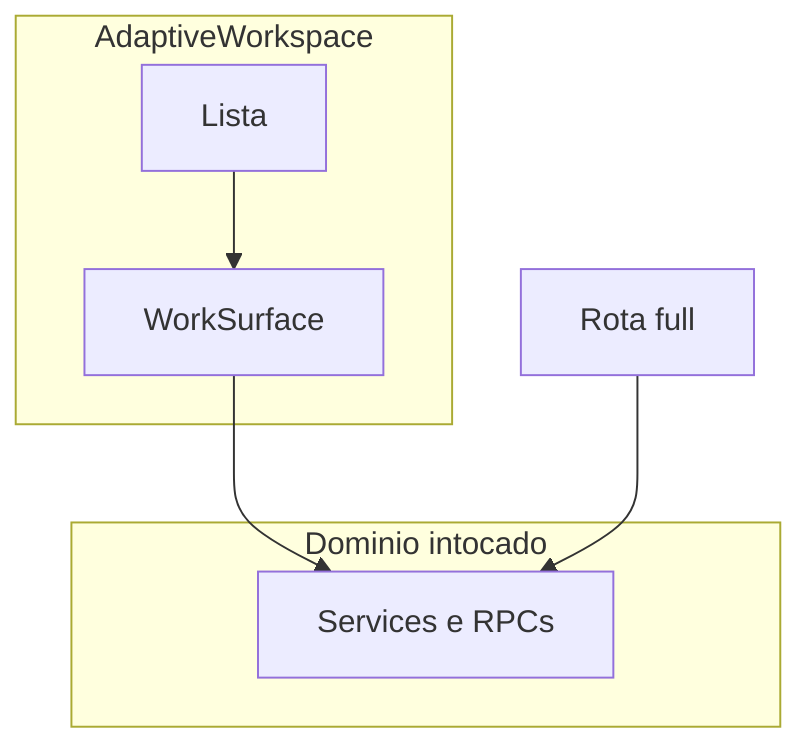

# SPEC — Workspace Catálogo: Produtos + Kits + Listas de Preço

**Data:** 2026-11-21 · **Branch implantação futura:** `dev`  
**Status:** aguardando **gate eFe** — sem código até aprovação  
**Estudos:** Produtos · [Kits](./FAL_ESTUDO_KITS_WORKSPACE_TOBE_2026-11-21.md) · Preços · Integração · [Auditoria](./FAL_AUDITORIA_JORNADA_OPERADOR_CATALOGO_PRECOS_2026-11-21.md) · **[Padrão zin Central+Painel](./FAL_PADRAO_ADAPTIVE_CENTRAL_PAINEL_CATALOGO_2026-11-21.md)**

---

## 1. Premissas

1. Repensar experiência de trabalho; **não** emendar split nas telas atuais.  
2. **Padrão zin já implantado:** Central (`moduleKey=orders`) + Painel (`moduleKey=dashboard`) — mesmo `AdaptiveWorkspace` / `PanelChrome` / prefs / guias. Catálogo **reusa** esse shell; ver mapa 1:1 no doc padrão zin.  
3. Central/Painel = referência de **interação**; **não** duplicar `OrderOpsSurface` / wizard de pedido — só WorkSurfaces de domínio.  
4. Preservar **100%** capacidades AS-IS (inventários nos estudos).  
5. Domínio intocado: `resolve_product_price`, place_order, promo gate, regras BOM/K0 (H2/H5/H6), RPCs preço.  
6. Kits: hub `/admin/kits` (K0 H8) com **workspace próprio**; foco TO-BE = criação rápida + vinculação BOM; sem “Kits Ops” paralelo fora do hub.

## 2. Anti-objetivos

- UI nesta fase de estudo (já cumprido: só docs).  
- main / produção.  
- Fundir Preços ↔ Produtos ↔ Kits ↔ Promoções num único split.  
- Editar kits-manual no workspace de listas públicas.  
- Composição de kit sem `productId` / kit como componente.  
- Remover Liberar, bulk, F8 abas, QuickAdjust, import wizard, H2 composição.

## 3. Design system / hierarquia (capítulo)

### 3.1 Tokens e superfície

Reutilizar admin existente: `--fal-*`, `bg-fal-surface`, `border-fal-line`, `rounded-[14px]`, `text-fal-muted`, `fal-admin-scroll`, dark via shell.

### 3.2 Vocabulário (obrigatório na UI)

| Termo | Significado |
|-------|-------------|
| Abrir guia | Abre contextual no Adaptive |
| Na guia | Registro já no stack |
| + Guia | Empilha outro registro (Produtos) |
| Expandir / Tela cheia / Restaurar | Modos Adaptive |
| Abrir cadastro | `/admin/produtos/:id` ou `/admin/kits/:id` |
| Abrir lista completa | `/admin/precos/:id?tab=produtos` |
| Linkar item | Adicionar componente ao BOM do kit |
| Fechar guia | Collapse contextual |

### 3.3 Densidade

- **Lista:** linhas compactas, badges status/origem/INCOMPLETO/PVC, hint “Aberto na guia”.  
- **Guia:** chrome `PanelChrome`; ações primárias no topo; scroll interno.  
- **Full:** abas (produto/kit) ou F8 (preço); mais espaço para formulários.  
- **Kits:** guia prioriza **picker + BOM** (densidade operacional de montagem).

### 3.4 Estados

Vazio · loading · erro toast · seleção N · incomplete · lista sistema (Base/Promo) · sem permissão (botões disabled) · match único (preços).

### 3.5 Responsivo

≥ lg: split; &lt; lg: contextual fullscreen (comportamento Adaptive atual).

---

## 4. Arquitetura técnica (capítulo)

Âncora: [FAL_PADRAO_ADAPTIVE_CENTRAL_PAINEL_CATALOGO_2026-11-21.md](./FAL_PADRAO_ADAPTIVE_CENTRAL_PAINEL_CATALOGO_2026-11-21.md) — o que Central/Painel já entregam.

### 4.1 Reusar (código já em produção admin)

| Peça | Onde já vive | Uso no catálogo |
|------|--------------|-----------------|
| `AdaptiveWorkspace` | Pedidos + Painel | Shell primary + contextual |
| `PanelChrome` | idem | Título, badge, modos, fechar |
| `adminWorkspacePrefs` | `orders`, `dashboard` | Novas keys `products` \| `kits` \| `prices` |
| Padrão multi-guia | `OrderSplitTabPanels` | Reusar ou extrair genérico para SKUs |
| Lição compact | VAL OrderOps 19/11 | Primary clicável com split aberto |
| `AdminTabs` | Home / F8 | Abas ficha produto/kit |
| Services | — | product, kit BOM, price list, release |

### 4.2 Estender (só na implantação)

```ts
// adminWorkspacePrefs.ts
export type WorkspaceModuleKey = 'orders' | 'dashboard' | 'products' | 'prices' | 'kits'
```

Labels menu (`adminNavConfig`): Pedidos → **Central de pedidos**; Preços → **Listas de preço** (+ breadcrumbs/testes). Kits mantém label **Kits**.

### 4.3 Novas superfícies (nomes de trabalho)

| Nome | Papel | Não é |
|------|-------|-------|
| `ProductWorkSurface` | Preview + ações rápidas **ou** lote | OrderOps |
| `KitWorkSurface` | Criação rápida + **composição/BOM** + resumo preço | OrderOps / painel paralelo |
| `PriceListWorkSurface` | Evolução QuickAdjust no contextual | OrderOps |

Stack multi-SKU: padrão similar a `useOrderSplitTabs` / `OrderSplitTabPanels` — **extrair padrão genérico só se custo justificar**; senão cópia controlada no módulo products.

### 4.4 Estado UI a migrar

| Estado | Hoje | TO-BE |
|--------|------|-------|
| Seleção produtos | Set na page | Mantém; guia reage |
| releasePreflight | Page | Guia lote |
| panelListId + sessionStorage preços | Page + QuickAdjust | Workspace prices + WorkSurface |
| Filtros detalhe F8 | sessionStorage | Intactos na full page |

### 4.5 Fronteira domínio

Nenhuma migration SQL; nenhuma mudança RPC; nenhuma alteração `releaseChecklist` regras hard/soft (só UI que chama).



---

## 5. TO-BE Produtos (resumo normativo)

Ver estudo completo. Normativo para Cursor:

1. Hub `/admin/produtos` + `AdaptiveWorkspace` `products`.  
2. Guia: preview (1) ou bulk (N).  
3. Full: ficha com abas Gerais|Precificação|Mídia|Aplicações|Logística|Relações.  
4. Kit → `/admin/kits/:id` apenas.  
5. Liberar/bulk via **mesmas** APIs.

**Política guia vs full**

| Ação | Guia | Full |
|------|------|------|
| Ver resumo / incompleto | Sim | — |
| Liberar / available / arquivar | Sim | Sim |
| Bulk classificar/medidas | Sim | — |
| Editar Geral/Descrição/Frete/… | — | Sim |
| Imagens / apps / relações | — | Sim |
| Novo SKU | Guia curta ou `/novo` | Após save, full |

---

## 6. TO-BE Kits (resumo normativo)

Ver [FAL_ESTUDO_KITS_WORKSPACE_TOBE_2026-11-21.md](./FAL_ESTUDO_KITS_WORKSPACE_TOBE_2026-11-21.md).

1. Hub `/admin/kits` + Adaptive `kits`.  
2. **Criar kit:** rascunho mínimo (código + nome + categoria) → ID imediato → composição na mesma sessão.  
3. **Guia:** picker rico (Enter no destaque, multi-add, toast merge, qty stepper, reorder BOM, barra H2).  
4. **Full:** abas Identidade | Composição | Precificação | Mídia | **Aplicações (PVC)** | Logística.  
5. Unificar edição de modo preço (evitar 3 UIs divergentes).  
6. Hub `/admin/kits/precos` = massa; import K10 com aviso substituição.  
7. Services BOM/pricing **reutilizados**; sem órfãos sem `productId`.

**Política guia vs full (Kits)**

| Ação | Guia | Full |
|------|------|------|
| Criar rascunho + linkar itens | Sim (núcleo) | Sim |
| Reorder / multi-add BOM | Sim | Sim |
| Apps PVC / imagens / textos longos | Atalho | Sim |
| Preço manual em massa | Link hub preços | Aba + hub |
| Liberar | Sim | Sim |
| Import BOM arquivo | Atalho | Atalho |

---

## 7. TO-BE Listas de Preço (resumo normativo)

1. Hub `/admin/precos` + Adaptive `prices`.  
2. Guia = consulta/ajuste (QuickAdjust promovido).  
3. Full = detalhe F8 4 abas.  
4. Wizard = modal.  
5. kits-manual **nunca** na guia — só hub Kits.  
6. Create/edit lista básica na guia; avançado → Config full.

**Política guia vs full**

| Ação | Guia | Full |
|------|------|------|
| Consultar/filtrar 50 | Sim | Sim (todos filtrados) |
| Edit preço item / add SKU | Sim | Sim |
| Formação / ajuste global | Link | Sim |
| Import | Modal | Modal / aba |
| Scope/priority/default | Link | Aba Config |

---

## 8. Integração

Ver [FAL_JORNADA_PRODUTO_PRECO_INTEGRACAO_2026-11-21.md](./FAL_JORNADA_PRODUTO_PRECO_INTEGRACAO_2026-11-21.md). Deep links Produto↔Kit↔Preço preservados; Promo permanece em Loja; BOM só no hub Kits.

---

## 9. Ordem de implantação futura (após gate)

| Fase | Entrega | Gate técnico |
|------|---------|--------------|
| I0 | Docs aprovados (este pacote) | eFe |
| I1 | Labels menu + `WorkspaceModuleKey` (`products`\|`prices`\|`kits`) + testes nav | tsc + vitest nav |
| I2 | Workspace **Produtos** | smoke Liberar/bulk + redirect kit |
| I3 | Workspace **Kits** (criação rápida + picker/BOM) | smoke linkar 2 itens, H2, Liberar, PVC apps |
| I4 | Workspace **Preços** (guia = QuickAdjust) | smoke Base + F8 + kits-manual redirect |
| I5 | VAL catálogo completo | Central + Promo + loja + kit smoke |

**Ordem:** Produtos → **Kits** → Preços (Kits logo após Produtos: mesma família catálogo; composição depende de itens cadastrados).

## 10. Critérios de aceite (pós-impl)

- [ ] Operador trabalha lista+guia sem perder filtros ao abrir cadastro.  
- [ ] Todas as ações AS-IS Produtos / Kits / Preços alcançáveis.  
- [ ] Criar kit + linkar itens na mesma sessão (após rascunho mínimo).  
- [ ] Picker BOM: Enter no destaque, merge com toast, reorder.  
- [ ] Apps PVC disponíveis na ficha/full do kit.  
- [ ] Central Pedidos split inalterado.  
- [ ] Promo itens/kits OK; preço vitrine inalterado.

## 11. Gate eFe

**Pacote para aprovação:**

1. Este SPEC  
2. **Padrão zin** Central+Painel → catálogo  
3. Estudo Produtos  
4. Estudo **Kits** (criação + vinculação)  
5. Estudo Preços  
6. Integração  
7. Auditoria  

**Ao aprovar:** autorizar marcha I1–I5 **somente em `dev`**, PRs pequenos, sem main.

**Assinatura estudo:** docs entregues 2026-11-21 (Kits adicionado) — aguardando eFe.
