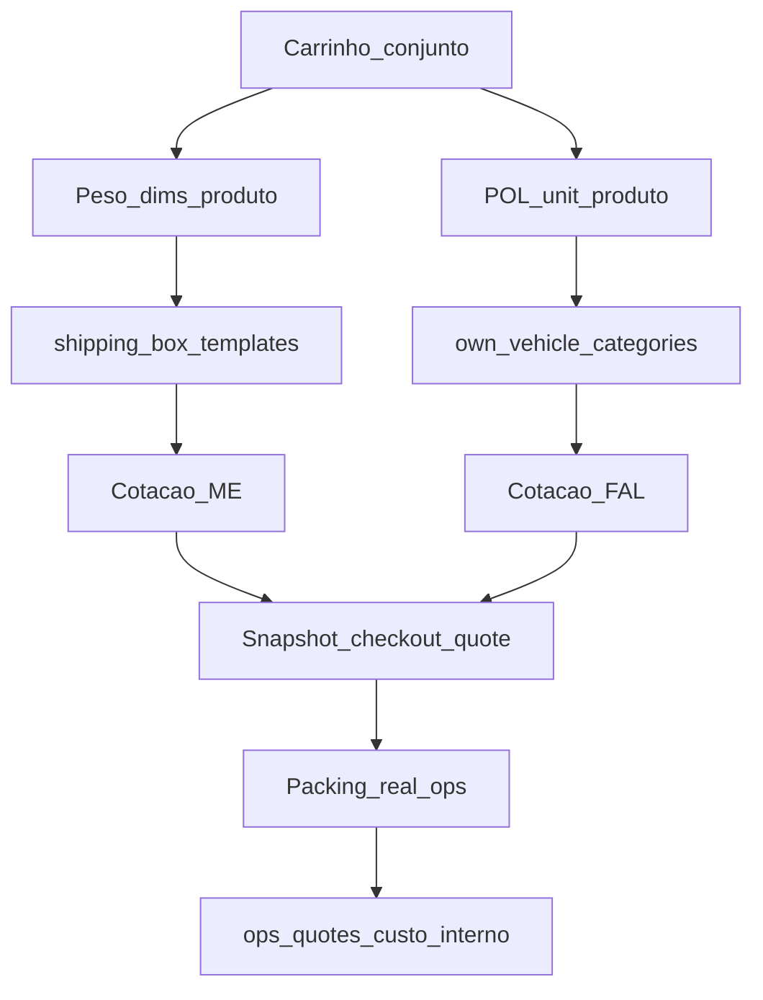

# Spec canônica — Cotação de frete no carrinho (agrupada + caixas + POL)

**Data:** 2026-11-13  
**Tipo:** consolidação Opção 1 (assertividade por calibração; sem mudar packing v1)  
**Auth:** eFe  
**Plano:** Cotação Carrinho Assertiva  

**Relacionados:**  
[FAL_PLANO_FUNCIONAL_LOGISTICA_MEDIDAS_2026-11-04.md](./FAL_PLANO_FUNCIONAL_LOGISTICA_MEDIDAS_2026-11-04.md) ·  
[FAL_PLANEJAMENTO_FRETE_PROPRIO.md](./FAL_PLANEJAMENTO_FRETE_PROPRIO.md) ·  
[FAL_MARCHA_O1C_CAIXAS_WTBP_VAL_2026-11-05.md](./FAL_MARCHA_O1C_CAIXAS_WTBP_VAL_2026-11-05.md) ·  
[FAL_SPEC_JORNADA_FASE_B_EXPEDICAO_2026-11-13.md](./FAL_SPEC_JORNADA_FASE_B_EXPEDICAO_2026-11-13.md) ·  
[FAL_VAL_OPS_FRETE_INTERNO_SNAPSHOT_2026-11-12.md](./FAL_VAL_OPS_FRETE_INTERNO_SNAPSHOT_2026-11-12.md)

---

## 1. Decisão travada

| # | Regra |
|---|--------|
| D1 | Carrinho cotado **em conjunto** (nunca soma fretes unitários na UI) |
| D2 | **ME** usa peso/dims do **produto** + menor **caixa padrão** ativa (volume-sum + peso) |
| D3 | **FAL** usa `POL_TOTAL = Σ(qty × pol_unit)` + veículo + km ida + tarifa — **sem** caixa física |
| D4 | Cotação **não inventa** medidas: `loadCartLogistics` lê só `products.*` |
| D5 | Medidas médias por categoria → **apply explícito** aos produtos (skip manuais) |
| D6 | Volumes na cotação ME loja = **0 (packing_failed) ou 1**; multi-volume só na ops |
| D7 | Packing real → `ops_quotes` (custo interno); frete do cliente / `checkout_quote` **imutáveis** |
| D8 | Fora desta marcha: packing 3D, multi-caixa automática na loja, fallback de categoria em runtime |

---

## 2. Modelo canônico (dois motores, um carrinho)

| Canal | Entrada | Agrupamento | Saída |
|-------|---------|-------------|--------|
| ME | `weight_kg`, L/A/P | Soma volume + peso → menor caixa ativa | 1 volume (dims caixa + peso itens + empty) + preço ME |
| FAL | `pol_unit`, elegibilidade | `POL_TOTAL` | Veículo (moto ≤ 12 POL) + `max(km×R$/km, mínima)+adicional` |
| Ops | Packing real | N volumes | Re-cotação interna; `shipping_amount` congelado |

### Código de referência

| Peça | Caminho |
|------|---------|
| Packing ME | `fal-pecas/src/lib/shippingPacking.ts` · Edge `quote-shipping` |
| Carrinho | `CartShippingQuoteBlock.tsx` · `loadCartLogistics.ts` |
| FAL | `quote-own-delivery` · `ownPol.ts` · `ownVehicleSelect.ts` · `ownPricing.ts` |
| Ops | `OrderPackingPanel.tsx` · `opsShippingQuote.ts` · `MeExpeditionPanel.tsx` |

---

## 3. Política de medidas (produto × categoria)

1. Campos: `weight_kg`, `length_cm`, `width_cm`, `height_cm` + `*_origin` (`manual` \| `global`).
2. Cadastro novo **não** herda sozinho o padrão da categoria.
3. Admin → Classificações → `#medidas-padrao`: peso/dims médios.
4. Apply (`adminApplyCategoryDefaultMeasures`): grava nos produtos; **respeita** origem manual.
5. Bulk global: mesma regra skip/overwrite.
6. Sem medida no produto → ME não cotável; FAL/retirada podem seguir se POL/elegibilidade ok.

**POL** (`pol_unit` + `pol_origin`): capacidade de carga unitária para frete próprio — **não** é cm³. Sem default por categoria nesta marcha; calibração SKU/bulk / aba Frete próprio → Produtos.

---

## 4. Caixas padrão (ME)

Admin → **Logística → Caixas e embalagens** (`shipping_box_templates`).

Algoritmo v1 (`pickSmallestFittingBox` / `resolvePackingStrategy`):

| Modo | Quando |
|------|--------|
| `box_template` | Há caixas ativas e a menor por volume interno comporta Σ(L×W×H×qty) e peso (+ empty) |
| `per_item` | Nenhuma caixa ativa → itens individuais à API ME |
| `packing_failed` | Há caixas e nenhuma cabe → erro explícito (não inventa envelope) |

Agente calibra mix típico: “caixa M ~ X litros / Y kg” a partir das médias dos produtos.

---

## 5. Frete próprio (FAL)

1. `POL_TOTAL = Σ(qty × pol_unit)` no **conjunto**.
2. Menor veículo compatível; moto excluída se `POL_TOTAL > 12`.
3. Restrições/compatibilidade prevalecem sobre POL.
4. Distância = km **ida** (Routes); fórmula `max(km×valor_por_km, tarifa_minima)+adicional`.
5. UI loja: sem jargão “POL”.

---

## 6. Snapshot e re-cotação ops

1. Cotação grava volumes/metadata em `shipping_quotes`.
2. `place_order` copia volumes/charged para shipment; trigger `trg_shipments_ensure_checkout_quote` congela `metadata.checkout_quote` na inserção (ME e own).
3. Ops pré-preenche packing do snapshot; confirma ou corrige.
4. ME: re-cota com packing → divergência → override se necessário para etiqueta.
5. Cliente **não** é re-cobrado pelo ajuste de volume/peso.

---

## 7. Checklist de calibração (agente)

### 7.1 Ordem

1. **Classificações** — preencher `#medidas-padrao` (peso/dims médios) nas folhas usadas.
2. **Apply** — aplicar padrão à subárvore (skip manuais).
3. **Produtos** — filtro gap medidas; completar residual; marcar manual se atípico.
4. **POL** — cada published elegível a FAL com `pol_unit`; filtrar gap POL na listagem.
5. **Caixas** — ao menos P/M/G (ou equivalentes) ativos com L/A/P, empty, max kg.
6. **Veículos FAL** — `capacity_pol` (moto 12) + tarifas ativas.
7. **Smoke** — §8.

### 7.2 Telas

| Passo | Rota |
|-------|------|
| Medidas categoria | `/admin/categorias#medidas-padrao` |
| Apply / produtos | `/admin/produtos` (gap medidas / gap POL) |
| Caixas | `/admin/logistica/caixas` |
| Frete próprio | `/admin/logistica/frete-proprio` |
| Hub | `/admin/logistica` |

### 7.3 Metas de cobertura (published)

| Métrica | Meta |
|---------|------|
| Com peso + L/A/P > 0 | ≥ 98% |
| Com `pol_unit` not null (elegíveis own) | 100% dos `own_delivery_allowed` |
| Caixas ativas | ≥ 1 (recomendado ≥ 3: P/M/G) |
| \|peso packing − peso cotado\| amostra | monitorar; divergência só custo interno |

---

## 8. Critérios de aceite / smoke

| # | Cenário | Esperado |
|---|---------|----------|
| S1 | Carrinho 1 item com medidas + caixa cabe | ME 1 volume `box_template` |
| S2 | N itens mesma caixa (volume-sum) | ME 1 volume; preço sobre dims da caixa |
| S3 | Conjunto não cabe em nenhuma caixa | `packing_failed`; FAL/retirada se aplicável |
| S4 | POL_TOTAL ≤ 12 compatível | FAL moto (se categoria ativa) |
| S5 | POL_TOTAL ≥ 13 | FAL carro (ou manual) |
| S6 | Ops packing diverge do snapshot | `ops_quotes` ok; `shipping_amount` inalterado |
| S7 | Produto sem peso/dims | ME ausente; sem inventar defaults |

### Verificação automatizada (repo)

- `shippingPacking.test.ts` / `shippingPackingParity.test.ts`
- `ownPol.test.ts` / `ownVehicleSelect.test.ts` / `ownPricing.ts`
- Smoke lógica jornada quando disponível

---

## 9. Estado do código (rebase 2026-11-13)

| Item | Estado |
|------|--------|
| Packing v1 + caixas admin | IMPLEMENTADO |
| Cotação agrupada carrinho/checkout | IMPLEMENTADO |
| Own v2 POL/veículo/km | IMPLEMENTADO (código; calibração operacional contínua) |
| Apply medidas categoria | IMPLEMENTADO |
| Snapshot + packing + ops re-cotação | IMPLEMENTADO |
| Filtro gap POL admin | IMPLEMENTADO (listagem produtos → Sem capacidade de entrega) |
| Multi-caixa / 3D na loja | FORA (marcha futura) |

---

## 10. STOP

Esta spec **não** autoriza mudar `pickSmallestFittingBox`, multi-box na Edge, nem fallback de categoria em `loadCartLogistics`.  
Calibração de dados e patches mínimos de admin (hints / filtro POL) seguem VAL irmão desta data.
