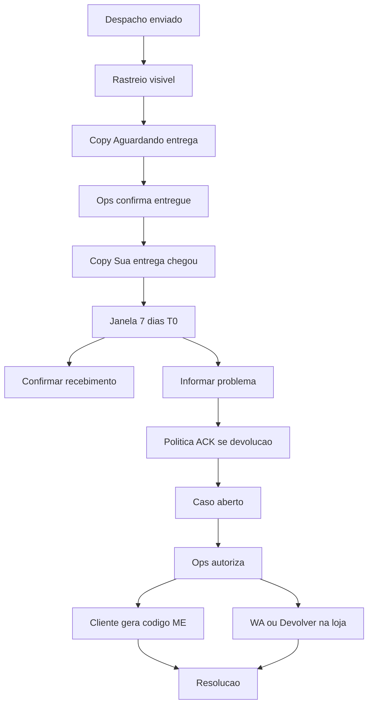

# FAL — SPEC: Camada pós-venda no pedido

**Data:** 2026-11-21  
**Status:** SPEC CANÔNICA — decisões D1–D18 travadas  
**Branch:** `dev`  
**Auditoria base:** [FAL_AUDITORIA_INTEGRAL_POS_VENDA_2026-11-21.md](./FAL_AUDITORIA_INTEGRAL_POS_VENDA_2026-11-21.md)  
**Jornadas / UX:** [FAL_JORNADAS_UX_POS_VENDA_2026-11-21.md](./FAL_JORNADAS_UX_POS_VENDA_2026-11-21.md)  
**Plano de impl.:** [FAL_PLANO_IMPL_POS_VENDA_2026-11-21.md](./FAL_PLANO_IMPL_POS_VENDA_2026-11-21.md)  
**Princípio:** camada operacional integrada ao pedido — **não** módulo isolado  

---

## 1. Decisões travadas (D1–D18)

| ID | Tema | Decisão |
|----|------|---------|
| **D1** | Acesso | Dentro de cada pedido (conta); sem central genérica no MVP |
| **D2** | Escopo | Suporte = pedido; devolução/incompatibilidade = **pedido todo ou itens** |
| **D3** | Devolução | Cliente solicita → operador analisa → **autoriza** retorno |
| **D4** | Janela 7 dias | Âncora = entrega concluída FAL (`entregue` / `shipments.delivered_at` / `order_delivered`). Caso **já aberto** não perde direitos só porque o calendário passou |
| **D5** | ME → entregue | OrderOps **sugere** confirmação; **não** auto-`deliver_order` |
| **D6** | Copy cliente | `enviado` → **“Aguardando entrega”**; `entregue` → **“Sua entrega chegou”** (pickup mantém labels de retirada) |
| **D7** | Recebedor | Cliente vê nome **minimizado** se ME enviar; payload completo só **interno** (LGPD) |
| **D8** | CTAs pós-chegada (Fase 1) | Só **Confirmar recebimento** + **Informar problema** (WA/devolução formal entram nas fases seguintes / bloco separado) |
| **D9** | Motivos | Tipados: suporte + incompatibilidade + devolução |
| **D10** | Caso | **Um** caso/ocorrência por abertura; lista de itens no payload |
| **D11** | Fila ops | Estender `revisao-logistica` + Abrir guia → `OrderOpsSurface` |
| **D12** | Chips v1 | Todas · Suporte · Devolução/incompat. · Aguardando ops |
| **D13** | Ordem | (1) Entrega/rastreio + problema tipado (2) Revisão+chips (3) RMA + ME reversa |
| **D14** | Política UI | Bloco abundante + **ACK** na solicitação de devolução; fonte única com `/trocas-devolucoes` |
| **D15** | Frete devolução | **Conta FAL** (loja paga logística reversa ME) |
| **D16** | Código ME | Após autorização, **cliente** clica “Gerar código de devolução” |
| **D17** | Modalidade | Cotar PAC e SEDEX → contratar o **mais barato**; override no OrderOps |
| **D18** | Fallback | WhatsApp + opção **Devolver na loja** (cliente por conta própria; combinar no WA). Sem API ME “terceiros” no MVP |

---

## 2. Princípios arquiteturais

1. `orders.status` feliz permanece até **`entregue`**. Pós-venda = **caso** (ocorrência tipada + stages), não `devolucao_*` no MVP.  
2. Mutações: cliente via RPCs; ops via `orderOpsActions` → RPCs.  
3. Histórico único: `order_events`.  
4. Admin: Adaptive + vocabulário Abrir guia / + Guia / Na guia — padrão [FAL_PADRAO_ADAPTIVE…](./FAL_PADRAO_ADAPTIVE_CENTRAL_PAINEL_CATALOGO_2026-11-21.md).  
5. Conta: tokens `fal-*`, evolução do detalhe existente — [FAL_PADRAO_TELAS_LAYOUT…](./FAL_PADRAO_TELAS_LAYOUT_DESIGN_v1_2026-11-21.md).  
6. Restock e estorno: **reusar** RPCs/botões já existentes na resolução.  
7. Distinguir **janela comercial FAL (7 dias para ABRIR)** de prazos legais CDC/garantia (política legal continua canônica).

---

## 3. Jornada do cliente (alvo)

### Detalhe por etapa

| Etapa | Comportamento |
|-------|----------------|
| Despacho | `ship_order` + tracking_code/url (puxar ME se necessário); notificação `order_shipped` |
| Em trânsito | Webhook/apply_me_tracking atualiza link; status comercial `enviado` |
| Entrega FAL | `deliver_order` (ou pickup confirm); T0 janela; copy D6; recebedor D7 se houver |
| Confirmar | ACK; não inicia nem encerra janela |
| Problema | Motivo tipado; se grupo devolução/incompat. → escopo todo/itens + política ACK |
| Pós-autorização ME | CTA “Gerar código”; instruções + DC-e; validade código ME ~7 dias |
| Fallback | Deep link WA; “Devolver na loja” com texto para combinar horário no WA |

---

## 4. Jornada do operador (alvo)

| Etapa | Onde | Ação |
|-------|------|------|
| ME reportou delivered | OrderOps (expedição) | Banner “ME: entregue — confirmar?” → `deliver_order` |
| Caso aberto | Inbox + `revisao-logistica` (chips) | Abrir guia |
| Análise | `OrderOccurrencesPanel` / seção pós-venda | Start, notas, autorizar ou recusar |
| Autorização ME elegível | OrderOps | Stage `autorizada`; opcional override PAC/SEDEX |
| Autorização não-ME | OrderOps | `return_mode` wa \| loja; cliente usa WA |
| Peça / conferência | OrderOps | Stages manuais; checklist condição |
| Resolução | OrderOps | Resolve ocorrência + restock + marcar estorno se devido |

Operador **não** precisa sair do pedido / Central.

---

## 5. Modelo de domínio (MVP)

### Caso (preferência: ocorrência tipada)

Campos no payload de eventos (mínimo):

| Campo | Valores / notas |
|-------|-----------------|
| `occurrence_id` | UUID (já existe) |
| `tipo` / `kind` | `pos_venda_suporte` \| `pos_venda_incompat` \| `pos_venda_devolucao` (migrar de `pos_entrega`) |
| `motivo_code` | Ver taxonomia §6 |
| `note` | Texto livre obrigatório |
| `scope` | `order` \| `items` |
| `items` | `[{ order_item_id, qty }]` se scope items ou lista completa se order |
| `policy_ack_at` | ISO se ACK política |
| `stage` | `aberto` → `em_analise` → `autorizada` \| `recusada` → `aguardando_peca` → `em_conferencia` → `resolvido` |
| `return_mode` | `me_codigo` \| `wa` \| `loja` \| null |
| `window_anchor_at` | `delivered_at` do pedido |
| `me_reverse` | protocol/code/url/expires (Fase 3) |

**Default:** sem tabela `returns` nas Fases 1–2. Introduzir tabela só se consulta/fila por `order_events` for inviável (decisão na Fase 2/3 com evidência).

### Relação com `orders.status`

Inalterado no MVP: pedido permanece **`entregue`** durante todo o caso.

---

## 6. Taxonomia de motivos (D9)

### Suporte / entrega

- `atraso`
- `avaria_transporte`
- `item_faltando`
- `outro_suporte`

### Incompatibilidade

- `nao_serve_veiculo`
- `divergencia_catalogo`
- `duvida_aplicacao`

### Devolução (intenção)

- `arrependimento`
- `defeito`
- `quero_devolver`

Motivos de **incompatibilidade** e **devolução** exigem escopo D2 (todo ou itens) + política ACK (D14).

---

## 7. Política de devolução (copy — fonte única)

### Conteúdo obrigatório no formulário (abundante)

1. Peça **sem uso / sem instalação**.  
2. Preferencialmente **nova**, na **embalagem original**.  
3. **Sem graxa, óleo, sujeira** ou dano por mau uso.  
4. Identificação / etiqueta preservada.  
5. A loja **analisa caso a caso**; pode recusar se fora da política.  
6. Quando autorizada devolução com frete ME: **custo do retorno por conta da FAL**.  
7. Link para `/trocas-devolucoes` (versão versionada em `legalVersions`).  

### Implementação copy

- Constantes compartilhadas (ex. `src/lib/returnPolicyCopy.ts`) consumidas pelo formulário **e** pela página legal (evitar drift).  
- Checkbox ACK obrigatório antes de submeter solicitação de devolução/incompat.  
- Persistência: `policy_ack_at` no payload.

---

## 8. Janela de 7 dias (D4)

| Regra | Detalhe |
|-------|---------|
| Início (T0) | Momento em que o pedido entra em `entregue` (staff) |
| Abrir caso | Permitido se `now <= T0 + 7 dias corridos` **ou** já existe caso aberto |
| Confirmar recebimento | Sempre permitido após `entregue` (idempotente); não controla T0 |
| CDC / garantia | Texto legal permanece; janela FAL não substitui direitos legais |

Pickup: T0 = confirmação de retirada (`admin_confirm_store_pickup` → `entregue`).

---

## 9. Melhor Envio — ida vs reversa

### Ida (já existe)

`melhorenvio-label` com `reverse: false`; webhook tracking-only; deliver comercial manual.

### Reversa (Fase 3 — D15–D17)

| Passo | Responsável |
|-------|-------------|
| Autorizar | Ops |
| Gerar código | Cliente (D16) dispara Edge |
| Cotação | Sistema escolhe min(PAC, SEDEX); ops pode override (D17) |
| Pagamento ME | Conta FAL (D15) |
| Entrega ao cliente | Código + instruções + DC-e no pedido |
| Postagem | Cliente em agência Correios |
| Validade código | ~7 dias (regra ME) — por isso geração sob demanda |

**Elegibilidade:** envio original ME, volume único, pedido `entregue`.  
**Inelegível:** D18 (WA + loja).

Edge: ação/função **separada** da ida (não flipar `reverse: false` no mesmo cart cegamente).

---

## 10. Anti-duplicidade

| Tentação | Em vez disso |
|----------|----------------|
| `/admin/pos-venda` | Chips em `revisao-logistica` |
| `orders.status = devolucao` | `stage` no caso |
| Segunda timeline | `order_events` |
| PostSaleOpsSurface | Evoluir `OrderOccurrencesPanel` / slot OrderOps |
| Copy legal triplicada | `returnPolicyCopy` + `LegalDocumentPage` |
| Visão `problemas` para RMA | Manter `problemas` = pagamento/decisão |
| Estorno automático na abertura | Só na resolução, botão existente |
| Auto-deliver ME | Banner sugerir (D5) |

---

## 11. UI — Conta (Fase 1+)

### Bloco após `enviado`

- Título/situação: **Aguardando entrega**  
- Rastreio em destaque (link)  
- (Opcional) Informar problema ainda em trânsito — manter compatível com RPC atual `enviado`\|`entregue`, com motivos de suporte; devolução preferencialmente após `entregue` + janela  

### Bloco após `entregue`

- **Sua entrega chegou** (+ recebedor minimizado se houver)  
- Confirmar recebimento  
- Informar problema (formulário tipado)  
- Fora do bloco mínimo Fase 1: links WA/legal podem permanecer no rodapé do detalhe (já existem) sem competir com D8  

### Formulário problema

1. Seleção motivo (grupos).  
2. Se incompat/devolução: radio Pedido inteiro / Selecionar itens (+ qty).  
3. Se incompat/devolução: política + ACK.  
4. Texto livre.  
5. Submit → um caso.

### Fase 3 (após `autorizada`)

- Se `me_codigo`: botão Gerar código / exibir código+DC-e.  
- Se fallback: CTA WA + Devolver na loja (texto).

---

## 12. UI — Admin

- Lista `revisao-logistica`: pedidos com caso aberto **ou** `own_manual_reviews` pending (corrigir gap).  
- Chips D12.  
- Guia: OrderOps inalterado no shell.  
- Banner ME delivered (D5).  
- Ações de stage + override modalidade + reuso restock/refund.

---

## 13. Fora de escopo (explícito)

- Estorno Mercado Pago automático  
- Multi-volume logística reversa ME  
- Agenda/calendário de horário na loja  
- Templates WhatsApp por stage (spec notificações futura)  
- API ME “envio não intermediado” para frete próprio (C rejeitado)  
- Implementação na `main` / produção sem autorização  

---

## 14. Critérios de aceite da Spec (docs)

- [x] D1–D18 documentadas  
- [x] Jornadas cliente/ops  
- [x] Modelo sem status comercial `devolucao` no MVP  
- [x] ME reversa + fallback D18  
- [x] Anti-duplicidade e padrões Adaptive/OrderOps  

**Aprovação humana desta Spec** é pré-requisito para marcha de código (Plano de impl.).
