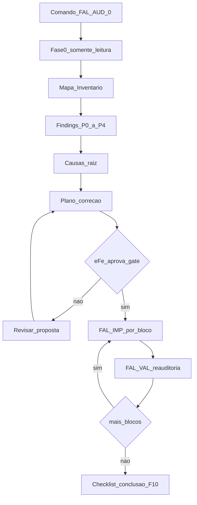

# Protocolo Operacional de Auditoria FAL v1.0

**Status:** Fonte operacional para auditoria → proposta → implementação → validação  
**Data:** 2026-10-08  
**Aplicável a:** Consolidação F10 e ciclos posteriores de polimento  
**PRD:** [../entrada/FAL_PRD_3.0.md](../entrada/FAL_PRD_3.0.md)  
**Roadmap:** [./ROADMAP_FASES_3.0.md](./ROADMAP_FASES_3.0.md)  
**Diagnóstico:** [./DIAGNOSTICO_CONSOLIDACAO_FAL_3.0_2026-10-08.md](./DIAGNOSTICO_CONSOLIDACAO_FAL_3.0_2026-10-08.md)  
**Backlog:** [./BACKLOG_CONSOLIDACAO_FAL_3.0_2026-10-08.md](./BACKLOG_CONSOLIDACAO_FAL_3.0_2026-10-08.md)

---

## 0. Objetivo

Este protocolo transforma o Prompt Mestre de auditoria em **comandos e etapas executáveis no Cursor**.

O agente **não** deve “executar uma lista de 36 itens”.

O ciclo obrigatório é:

```text
auditar → evidências → causa-raiz → propor → dependências → (gate) → implementar → testar → reauditar
```

**Fase 0 (obrigatória):** raio-X completo **sem alterar código**.  
Somente após gate aprovado pelo eFe o agente pode iniciar `FAL-IMP-*`.

---

## 1. Princípios fundamentais

1. **Não presumir** que uma implementação está correta só porque funciona.
2. **Não presumir** que um campo deve existir só porque está no banco.
3. **Não presumir** que uma tela deve permanecer só porque já foi criada.
4. **Não presumir** que uma regra está correta só porque aparece no frontend.
5. **Não criar** funcionalidades sem necessidade real identificada.
6. **Não duplicar** o que já existe; consolidar em fonte única de verdade.
7. **Não corrigir só o sintoma** — sempre causa-raiz.
8. **Nenhuma regra ou campo** deve ser mantido apenas porque já existe no código.

A plataforma deve evoluir para:

- uma única fonte de verdade;
- regras centralizadas;
- componentes reutilizáveis;
- dados consistentes;
- fluxos integrados;
- nomenclatura padronizada;
- comportamento previsível;
- interface simples;
- automação onde possível;
- mínima intervenção manual desnecessária.

---

## 2. Regra de divergência (obrigatória)

> Se durante a auditoria for encontrada uma solução **melhor** do que a especificada no PRD, neste protocolo ou no plano de correção aprovado: **não implementar silenciosamente**.

O agente deve:

1. Registrar a divergência (ID de finding).
2. Explicar o motivo e a alternativa.
3. Avaliar impacto (módulos, dados, UX, risco).
4. Apresentar ao eFe.
5. Só alterar arquitetura/regra após confirmação explícita.

---

## 3. Etapas de trabalho

| Etapa | Nome | Pode editar código? |
|-------|------|---------------------|
| A | Descoberta | Não |
| B | Auditoria | Não |
| C | Proposta de reestruturação | Não |
| D | Implementação | Sim (após gate) |
| E | Validação e regressão | Só testes / docs de resultado |

**Fase 0 = Etapas A + B + C** (somente leitura + documentos de saída).



---

## 4. Núcleo MCP (v1 — o que existe hoje)

Configurado em [`.cursor/mcp.json`](../../.cursor/mcp.json).

| Ferramenta | Namespace / uso | Papel |
|------------|-----------------|-------|
| **Supabase** | `user-supabase` / `supabase` | Schema, RLS, migrations, SQL, dados, órfãos, inconsistências |
| **Context7** | `user-context7` / `context7` | Documentação atual de libs (React, Vite, Supabase, MP, etc.) |
| **Browser / UI** | `cursor-ide-browser` | Auditoria de telas reais (substituto operacional do Playwright MCP) |
| **Git** | `gh` + git local; `cursor-origin` se repo Origin | Histórico, PRs, regressões, decisões recentes |
| **Netlify** | `project-0-…-netlify-mcp` / `netlify-mcp` | Deploy, logs, ambiente (não Vercel) |
| **Mercado Pago** | `user-mercadopago-mcp-server` | Somente blocos checkout / pagamento |

**Fora do protocolo v1 (não bloquear):** Storybook MCP, Figma MCP, Vercel MCP, Playwright MCP dedicado.  
Se forem adicionados depois, reutilizar os mesmos checklists de UI/design/deploy.

**MCP específico da FAL:** não criar antes da primeira auditoria completa; só após descobrir quais regras de domínio precisam ser expostas.

---

## 5. Matriz MCP × etapa

| Etapa / bloco | Supabase | Browser | Git | Context7 | Netlify | MP |
|---------------|----------|---------|-----|----------|---------|-----|
| Fase 0 — mapa | Schema + tabelas-chave | Rotas/shells admin+loja | Estrutura/histórico | — | Sites/deploys | Apps/credenciais (só inventário) |
| Fase 0 — findings | Queries de inconsistência | Fluxos e bugs de UI | Blame/PRs de regressão | APIs duvidosas | Erros prod vs local | Docs webhook/checkout |
| Proposta | Impacto de schema | Escopo de telas | Diff esperado | Padrões oficiais | Impacto deploy | Impacto pagamento |
| IMP — dados/preços | Leitura + (após gate) validação SQL | — | Diff commits | — | — | — |
| IMP — UI/UX | — | Regressão tela a tela | — | Componentes/libs | — | — |
| IMP — checkout/MP | Pedidos/pagamentos | Fluxo checkout | — | — | Logs função | Qualidade/webhook |
| VAL — regressão | Integridade pós-change | E2E crítico | — | — | Smoke deploy se aplicável | Sandbox se aplicável |

**Regra:** não considerar tela auditada só por leitura de código — a interface real também deve ser verificada (Browser).

---

## 6. Regra de evidência

Toda alteração relevante e todo problema importante usam este template:

```markdown
### FIND-XXX

| Campo | Valor |
|-------|-------|
| ID | FIND-XXX |
| Área | (ex.: Preços / Catálogo / Checkout) |
| Tela | |
| Rota | |
| Elemento | |
| Problema | |
| Comportamento atual | |
| Comportamento esperado | |
| Causa provável | |
| Causa confirmada | |
| Impacto | |
| Dependências | |
| MCP utilizado | |
| Evidência | (path, query, screenshot, commit, log) |
| Severidade | P0 \| P1 \| P2 \| P3 \| P4 |
| Proposta | |
| Status | aberto \| proposto \| aprovado \| em_impl \| validado \| aceito_risco \| descartado |
| Teste necessário | |
| Resultado do teste | |
```

**Não corrigir** problemas importantes sem causa confirmada (ou proposta explícita de investigação + STOP).

### Severidade

| Nível | Significado |
|-------|-------------|
| **P0** | Bloqueador — impede operação ou risco grave |
| **P1** | Crítico — funcionalidade principal / experiência essencial |
| **P2** | Importante — qualidade, consistência, operação |
| **P3** | Melhoria — UX, arquitetura, produtividade |
| **P4** | Cosmético — visual / detalhe de baixa prioridade |

---

## 7. Fonte de verdade (por funcionalidade)

Para cada capacidade mapear:

1. Onde é **definida**?
2. Onde é **armazenada**?
3. Onde é **processada**?
4. Onde é **exibida**?
5. Quem pode **alterá-la**?
6. Quem **depende** dela?

Cadeia mínima:

```text
TELA → COMPONENTE → AÇÃO → FRONTEND → API/SERVIÇO → BANCO → REGRA → RESULTADO
```

Quando houver múltiplas implementações da mesma regra: escolher a oficial, eliminar ou redirecionar as demais (na proposta; na implementação só após gate).

---

## 8. Auditoria campo a campo e botões

Para cada campo, botão, texto, indicador ou menu relevante:

1. Para que serve?  
2. Quem utiliza?  
3. É necessário?  
4. É realmente utilizado?  
5. Existe regra de negócio real?  
6. Pode ser automatizado?  
7. O nome é compreensível?  
8. Está no lugar correto?  
9. A informação está correta?  
10. Existe duplicidade?  
11. Está integrado?  
12. Existe dependência?  
13. Impacto em outras telas?  
14. Comportamento previsível?

- Sem função real → propor **remoção**.  
- Função real mal implementada → propor **correção**.  
- Função válida mal apresentada → propor **reorganização**.

Botões: nome, posição, hierarquia, visibilidade, permissão, loading, disabled, confirmação, ação, endpoint, resultado, feedback, erro, refresh da UI, preservação de contexto.

### Auditoria conceitual (campos suspeitos)

**Não remover imediatamente.** Determinar origem, função, regra, consumidor, dependências, impacto.  
Ex.: `priority` / `100` — se houver regra real: documentar, padronizar, integrar; se não: remover na proposta.

---

## 9. Ordem de blocos (execução preferencial)

Alinhada ao Prompt Mestre e à F10. Pode mudar **somente** se a Fase 0 demonstrar dependências diferentes (registrar no plano).

| # | Bloco | Código comando |
|---|-------|----------------|
| 1 | Arquitetura / fundação | `FAL-IMP-01` |
| 2 | Dados / normalização | `FAL-IMP-02` |
| 3 | Códigos / slugs | `FAL-IMP-03` |
| 4 | Categorias (cat→grupo→subgrupo) | `FAL-IMP-04` |
| 5 | Veículos / aplicações | `FAL-IMP-05` |
| 6 | Importações + histórico | `FAL-IMP-06` |
| 7 | Produtos (card/página/relacionados) | `FAL-IMP-07` |
| 8 | Preços | `FAL-IMP-08` |
| 9 | Listas de preços | `FAL-IMP-09` |
| 10 | Loja (publicação / vitrine) | `FAL-IMP-10` |
| 11 | Catálogo cliente | `FAL-IMP-11` |
| 12 | Home / destaques / promoções | `FAL-IMP-12` |
| 13 | Clientes | `FAL-IMP-13` |
| 14 | Pedidos | `FAL-IMP-14` |
| 15 | Frete | `FAL-IMP-15` |
| 16 | Checkout / pagamento | `FAL-IMP-16` |
| 17 | Dashboard | `FAL-IMP-17` |
| 18 | Relatórios | `FAL-IMP-18` |
| 19 | UX global | `FAL-IMP-19` |
| 20 | Busca / filtros / bulk | `FAL-IMP-20` |
| 21 | Responsividade | `FAL-IMP-21` |
| 22 | Preservação de contexto | `FAL-IMP-22` |
| 23 | Nomenclaturas / vocabulário | `FAL-IMP-23` |
| 24 | Integração ponta a ponta | `FAL-IMP-24` |
| 25 | Testes / regressão final | `FAL-IMP-25` |

Cada `FAL-IMP-N` deve ser seguido de `FAL-VAL-N`.

### Escopo temático (checklist de auditoria — ponto de partida, não limite)

Incluir na Fase 0 e nos blocos: arquitetura; normalização; slugs; categorias; aplicações estruturadas (montadora/modelo/versão/anos); produtos indisponíveis (causa real: estoque, status, preço, lista, publicação); card/página; relacionados; importação + pendências; histórico permanente; formação de preços centralizada; listas (inativa ≠ apagada; item inativo ≠ fora da lista); módulo Loja; catálogo elegível; cadeia lista→produto→status→preço→loja→promo→destaque→home; clientes; pedidos; checkout (produto→carrinho→CEP→frete→pagamento→pedido); frete refletido no total; dashboard com dados reais; relatórios vs dados; UX admin/operador/cliente; busca/filtros/bulk só se agregarem valor; responsividade; preservação de contexto; vocabulário oficial (Calculated/Imported/Manual/Override/Markup/Priority/Public/Fallback → manter/traduzir/explicar/substituir/remover).

**Anti-vocabulário externo:** não usar nem reintroduzir termos de plataformas de e-commerce de terceiros; vocabulário é FAL.

---

## 10. Artefatos de saída da Fase 0

Produzir em `docs/planejamento/` (substituir `YYYY-MM-DD` pela data da marcha):

| Arquivo | Conteúdo |
|---------|----------|
| `AUDITORIA_FAL_FASE0_MAPA_YYYY-MM-DD.md` | Mapa da plataforma (rotas, módulos, cadeias) |
| `AUDITORIA_FAL_FASE0_INVENTARIO_YYYY-MM-DD.md` | Duplicidades, código morto, mocks, incompletos, hardcoded |
| `AUDITORIA_FAL_FASE0_FINDINGS_YYYY-MM-DD.md` | Findings com template de evidência |
| `AUDITORIA_FAL_FASE0_CAUSAS_RAIZ_YYYY-MM-DD.md` | Agrupamento por causa (não por tela) |
| `AUDITORIA_FAL_FASE0_PLANO_CORRECAO_YYYY-MM-DD.md` | Ordem, dependências, o que **não** mudar e por quê, divergências |

**Gate:** eFe aprova o plano de correção → autorização para `FAL-IMP-*`.

---

## 11. Entrega de cada ciclo (IMP + VAL)

Ao concluir cada bloco importante:

1. O que foi auditado.  
2. Problemas encontrados.  
3. Causas identificadas.  
4. O que será / foi alterado.  
5. O que **não** será alterado e por quê.  
6. Dependências.  
7. Alterações realizadas.  
8. Testes executados.  
9. Resultados.  
10. Problemas restantes.  
11. Próximo bloco.

Nunca declarar etapa concluída só porque o código mudou — exige validação funcional.

---

## 12. Critério de conclusão (plataforma / F10)

A consolidação só é “concluída” quando:

- [ ] Arquitetura consistente  
- [ ] Dados normalizados (política definida)  
- [ ] Regras centralizadas  
- [ ] Sem funcionalidades duplicadas relevantes  
- [ ] Sem telas divergentes relevantes  
- [ ] Sem componentes obsoletos críticos  
- [ ] Catálogo consistente  
- [ ] Aplicações estruturadas onde escopo F10 exige  
- [ ] Preços consistentes  
- [ ] Listas funcionando (ativa/inativa + item ativo/inativo)  
- [ ] Loja / publicação coerente  
- [ ] Produtos publicados corretamente  
- [ ] Catálogo refletindo a Loja  
- [ ] Carrinho / frete / checkout / pagamento / pedidos coerentes com o estado F9  
- [ ] Dashboard e relatórios com dados reais  
- [ ] Busca e filtros úteis  
- [ ] Responsividade validada nos fluxos críticos  
- [ ] Contexto preservado onde aplicável  
- [ ] Nomenclaturas padronizadas  
- [ ] Campos desnecessários eliminados ou aceitos com STOP  
- [ ] Integrações validadas no escopo  
- [ ] Testes e regressão executados  
- [ ] P0 resolvidos  
- [ ] P1 resolvidos  
- [ ] P2 resolvidos ou conscientemente aceitos (STOP)

---

## 13. Comandos Cursor (copiar/colar)

Usar um comando por mensagem. O agente deve seguir **este arquivo** + PRD + roadmap.

### `FAL-AUD-0` — Raio-X Fase 0 (somente leitura)

```text
Comando: FAL-AUD-0
Protocolo: docs/planejamento/PROTOCOLO_OPERACIONAL_AUDITORIA_FAL_v1.0.md

Execute a FASE 0 completa (etapas A+B+C). PROIBIDO alterar código, migrations,
env ou deploy.

Use MCPs: Supabase, Browser (cursor-ide-browser), Git/gh, Context7;
Netlify e Mercado Pago só para inventário nos blocos correspondentes.

Produza os 5 artefatos AUDITORIA_FAL_FASE0_* com data de hoje.
Agrupe por causa-raiz. Aplique regra de divergência.
Ao final: resumo executivo + lista do que precisa de decisão do eFe.
Não inicie FAL-IMP-*.
```

### `FAL-AUD-MAP` — Mapa Tela→…→Resultado

```text
Comando: FAL-AUD-MAP
Protocolo: docs/planejamento/PROTOCOLO_OPERACIONAL_AUDITORIA_FAL_v1.0.md

Somente leitura. Atualize/refine AUDITORIA_FAL_FASE0_MAPA_*.md
com cadeias TELA→COMPONENTE→AÇÃO→SERVIÇO→BANCO→REGRA→RESULTADO
para módulos: produtos, categorias, aplicações, importações, preços,
listas, loja, catálogo, carrinho, frete, checkout, pedidos, clientes,
dashboard, relatórios. Marque duplicidades e fontes oficiais candidatas.
```

### `FAL-AUD-FINDINGS` — Findings + inventário

```text
Comando: FAL-AUD-FINDINGS
Protocolo: docs/planejamento/PROTOCOLO_OPERACIONAL_AUDITORIA_FAL_v1.0.md

Somente leitura. Preencha FINDINGS e INVENTARIO da Fase 0 com template
de evidência, severidade P0–P4, MCP e evidência. Não implemente.
```

### `FAL-AUD-PLAN` — Plano de correção

```text
Comando: FAL-AUD-PLAN
Protocolo: docs/planejamento/PROTOCOLO_OPERACIONAL_AUDITORIA_FAL_v1.0.md

Somente leitura. Gere/atualize AUDITORIA_FAL_FASE0_PLANO_CORRECAO_* e
CAUSAS_RAIZ_*: ordem por dependência, blocos FAL-IMP-N, o que NÃO mudar
e por quê, divergências vs PRD. Não implemente.
```

### `FAL-AUD-GATE` — Checklist de saída da Fase 0

```text
Comando: FAL-AUD-GATE
Protocolo: docs/planejamento/PROTOCOLO_OPERACIONAL_AUDITORIA_FAL_v1.0.md

Verifique se os 5 artefatos Fase 0 existem e estão completos.
Liste P0/P1 abertos, decisões pendentes e divergências.
NÃO implemente. Peça aprovação explícita do eFe para liberar FAL-IMP-*.
```

### `FAL-IMP-N` — Implementação por bloco (após gate)

```text
Comando: FAL-IMP-NN
Protocolo: docs/planejamento/PROTOCOLO_OPERACIONAL_AUDITORIA_FAL_v1.0.md
Pré-requisito: gate Fase 0 aprovado + plano de correção aprovado.

Implemente APENAS o bloco NN conforme o plano.
Corrija na camada responsável (não espalhe a mesma regra em N telas).
Registre findings tratados. Aplique regra de divergência.
Ao terminar, não declare concluído — aguarde / execute FAL-VAL-NN.
```

Substituir `NN` pelo número do bloco (01–25).

### `FAL-VAL-N` — Reauditoria e regressão do bloco

```text
Comando: FAL-VAL-NN
Protocolo: docs/planejamento/PROTOCOLO_OPERACIONAL_AUDITORIA_FAL_v1.0.md

Reaudite o bloco NN: código + Browser + Supabase quando couber.
Verifique módulos dependentes, desktop/mobile se UI, permissões.
Atualize status dos findings. Liste regressões. Próximo bloco sugerido.
```

---

## 14. Regras de não regressão

Nenhuma alteração é concluída só porque funciona na tela tocada. Após mudança relevante verificar:

- módulos dependentes;
- banco / APIs / permissões;
- outras telas;
- desktop e mobile (fluxos críticos);
- fluxos relacionados (ex.: preço → lista → loja → catálogo → carrinho).

---

## 15. Testes mínimos por domínio

Cobrir (happy path, erro, ausente, inválido, vazio, loading, permissão, duplicidade, alteração, desativação, reativação) conforme o bloco:

produto; classificação; aplicação; importação; preço; lista; loja/publicação; catálogo; carrinho; frete; checkout; pagamento; pedido; cliente; relatório.

Preferir testes já existentes no repo (`vitest` etc.) e expandir só onde a causa-raiz exigir.

---

## 16. Extensões futuras (não bloqueiam v1)

| Extensão | Quando considerar |
|----------|-------------------|
| Playwright MCP dedicado | Se substituir ou complementar `cursor-ide-browser` com suíte estável |
| Storybook MCP | Se o projeto adotar Storybook |
| Figma MCP | Se houver design system Figma oficial |
| MCP domínio FAL | Após Fase 0: expor regras (preço, elegibilidade loja, aplicações) |

---

## 17. Princípio final

A plataforma deve ser:

**simples para operar · clara para administrar · confiável nos dados · consistente entre módulos · automatizada onde possível · escalável · responsiva · fácil de manter · preparada para a operação real da FAL Peças Automotivas.**

Não implementar para cumprir lista.  
Implementar para construir uma plataforma coerente.

Problemas não previstos neste protocolo: registrar → classificar → investigar → dependências → propor → backlog → implementar só se no escopo e após gate quando estrutural.
